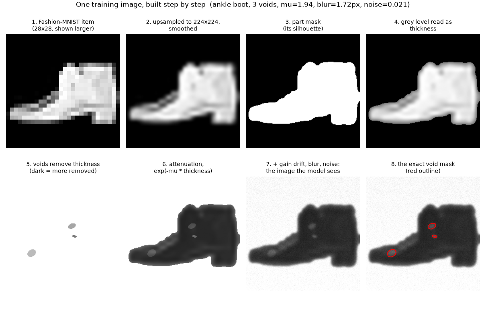
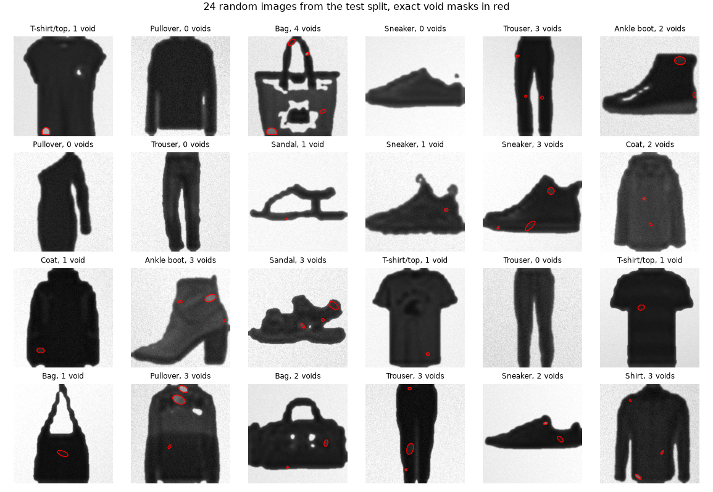
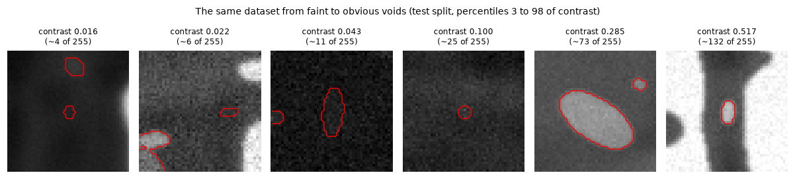
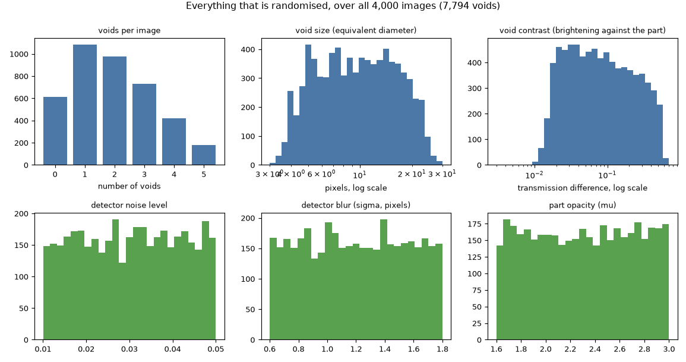
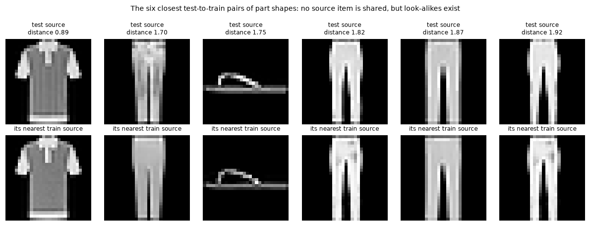
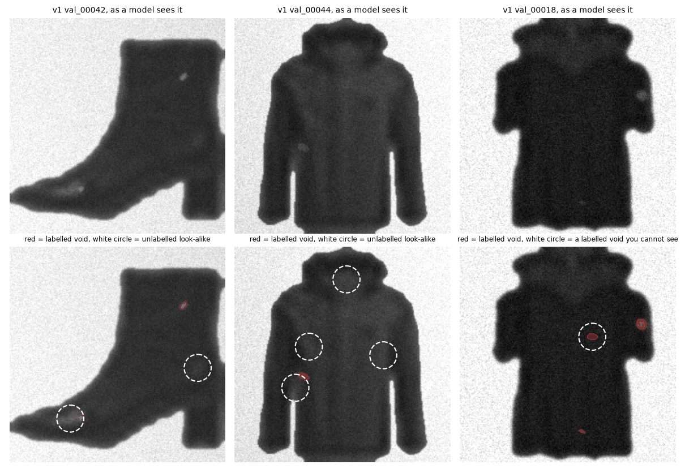
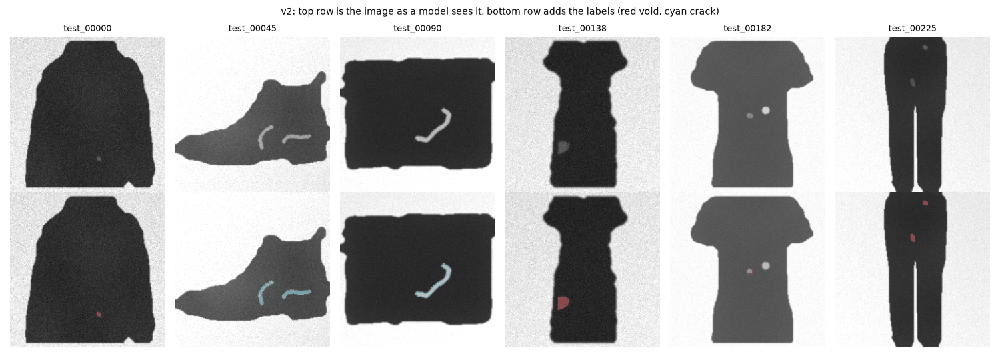

:::{.callout-important}
**Update, 2026-10-19: there is a v2.** Looking at contact sheets of all 4,000 images, I found that v1 has unlabelled
look-alike patches (64% of images) and labelled voids that cannot be seen (19%). [Version 2](#version-2-what-was-wrong-with-v1-and-how-i-fixed-it)
fixes both, adds cracks, and lists all the code. The text below is v1 as I published it.
:::

:::{.callout-tip}
This post is the first of the [Agentic AI Software Factory: Robust Segmentation Models](index.qmd) series, which is still
being planned. I am writing it first because everything else in that series stands on this dataset.
:::

The factory in this series will run hundreds of experiments on segmentation models. To trust what it finds, I need three
things from the data: **exact masks** (no annotator disagreement to argue about), **metadata to slice by** (so that "where does
the model fail?" has an answer), and **as many images as I like**, including a large set that no experiment ever sees.

I also need data I am allowed to show. The earlier posts on this blog used GDXray, whose authors allow research and educational
use but prohibit redistribution ([GDXray page](https://domingomery.ing.uc.cl/material/gdxray)). So I am moving this blog off
GDXray images, and this dataset is the first piece of that. This post builds it, checks it, and says plainly what it is not.

```{=html}
<div style="margin:1em 0;">
  <button id="toggle-outputs" type="button" style="padding:6px 14px;border:1px solid #1971c2;border-radius:4px;background:#1971c2;color:white;cursor:pointer;">Show all outputs</button>
  <span style="color:#666;font-size:0.9em;margin-left:8px;">Outputs are collapsed by default. Each one is the real captured output of the code above it.</span>
</div>
<script>
(function(){
  var b = document.getElementById("toggle-outputs"), open = false;
  b.onclick = function(){
    open = !open;
    document.querySelectorAll("details.out").forEach(function(d){ d.open = open; });
    b.textContent = open ? "Hide all outputs" : "Show all outputs";
  };
})();
</script>
```

## The idea in one paragraph

Take a Fashion-MNIST item (a shoe, a shirt, a bag) and treat it as a **part**: its silhouette is the part's outline, and its
grey level says how thick the material is. Then draw some **voids** inside the part, regions where material is missing, and
simulate how X-rays pass through. Thinner material lets more X-rays through, so a void shows up as a brighter patch. Because I
drew the void, I know exactly which pixels belong to it. The mask is not an opinion, it is the shape I inserted.

*Daily-life version:* a sheet of frosted glass with a bubble inside it. Shine a lamp through. Thick glass casts a dark shadow,
and the bubble is a brighter spot. If you made the bubble yourself, you can draw its outline perfectly.

Why Fashion-MNIST for the shapes? It is [MIT-licensed](https://github.com/zalandoresearch/fashion-mnist), small, and has 70,000
different outlines. It is not realistic for semiconductors, and I will come back to that.

## The recipe, step by step

This is one real training image from the dataset (the figure asserts that it is the stored image, not a lookalike):

{fig-alt="Eight panels: a 28 by 28 Fashion-MNIST ankle boot; its upsampled smooth version; the part mask; the thickness map; the remaining thickness with three voids; the attenuation image; the final noisy image; the final image with the exact void mask outlined in red"}

**Steps 1 to 4: the part.** Upsample the 28×28 item to 224×224, smooth it, threshold it for the part mask, and read the grey
level as thickness:

```{.python filename="notebooks/agentic-factory-segmentation/void_dataset.py"}
    big = np.asarray(Image.fromarray(src28).resize((N, N), Image.BICUBIC), np.float32) / 255
    big = ndi.gaussian_filter(big, 2.0)
    part = big > 0.18
    inner = ndi.binary_erosion(part, iterations=3)               # voids stay clear of the part's edge
    thick = part * (0.35 + 0.65 * big)
```

**Step 5: the voids.** Each void has a random centre inside the part, a size, an elongation and a depth, meaning how much of
the local thickness it removes. Size and depth are drawn log-uniformly, so there are many small and faint voids and few large,
obvious ones. Voids are either ellipses or irregular blobs, and some images get a *cluster* of voids close together, like porosity (431 of the 4,000).

```{.python filename="notebooks/agentic-factory-segmentation/void_dataset.py"}
        r = float(np.exp(rng.uniform(np.log(2.0), np.log(12.0))))   # radius, log-uniform: many small, few large
        e = rng.uniform(1.0, 2.5); th = rng.uniform(0, np.pi)
        u = (xx - cx) * np.cos(th) + (yy - cy) * np.sin(th); v = -(xx - cx) * np.sin(th) + (yy - cy) * np.cos(th)
        d = np.sqrt((u / (r * np.sqrt(e))) ** 2 + (v / (r / np.sqrt(e))) ** 2)
        kind = "blob" if rng.random() < 0.4 else "ellipse"
        shape = d <= (1 + 0.45 * _smooth_field(rng) if kind == "blob" else 1.0)
        removed = float(np.exp(rng.uniform(np.log(0.05), np.log(0.85))))   # fraction of the local thickness the void removes, log-uniform:
        depth = 1.0 - removed                                              # many faint voids (5% removed), few obvious ones (85% removed)
        factor = np.minimum(factor, np.where(shape & inner, depth, 1.0).astype(np.float32))
        kinds.append(kind)
```

Two lines in there matter most. `shape & inner` is the **containment rule**: a void can only exist where the part (shrunk by a
few pixels) exists. And `np.minimum(factor, ...)` records, for every pixel, how much thickness is left.

**Steps 6 and 7: the X-ray.** Transmitted intensity follows the Beer-Lambert law, `exp(-mu * thickness)`. Air transmits
everything. Then come the detector effects: a slow gain drift across the image, blur, and noise whose size grows with the signal:

```{.python filename="notebooks/agentic-factory-segmentation/void_dataset.py"}
    clean = np.where(part, np.exp(-prm["mu"] * thick), 1.0)
    trans = np.where(part, np.exp(-prm["mu"] * thick * factor), 1.0)
    g = np.cos(prm["grad_angle"]) * (xx - N / 2) / (N / 2) + np.sin(prm["grad_angle"]) * (yy - N / 2) / (N / 2)
    trans_g = trans * prm["gain"] * (1 + prm["grad"] * g / 1.5)
    blurred = ndi.gaussian_filter(trans_g, prm["blur"])
    noisy = np.clip(blurred + rng.normal(0, prm["noise"] * (0.6 + 0.8 * blurred)), 0, 1)
    img = np.round(noisy * 255).astype(np.uint8)
```

That is the core of the generator: the function that builds one image is about 70 lines. Every random choice goes into a metadata row, because each one is a slice axis
later: part class, opacity (`mu`), blur, noise, gain drift, number of voids, whether they are clustered, and per void its area,
equivalent diameter and *physical contrast* (how much brighter the void is than the same spot without it).

## What the dataset looks like

{fig-alt="A grid of 24 simulated X-ray images of clothing and shoe silhouettes, each with small red outlines marking voids"}

Some images have no voids at all (15% of them, on purpose), and the voids range from specks to ellipses up to about 30 pixels
across. Here is the range of **contrast** in the same dataset, from the faintest to the most obvious, each outlined with its
exact mask:

{fig-alt="Six small crops of simulated X-ray images, each with a red void outline, ordered from a barely visible void to a very obvious one"}

And everything that is randomised, over all 4,000 images:

{fig-alt="Six histograms: voids per image, void equivalent diameter, void contrast, noise level, blur and part opacity"}

| What is randomised | Range | Why it is there |
|---|---|---|
| number of voids | 0 to 5 (15% have none) | images without defects, and a per-image count to slice by |
| void size | equivalent diameter about 4 to 22 px (5th to 95th percentile) | small voids are where models fail first |
| void depth | removes 5% to 85% of local thickness, log-uniform | gives faint-to-obvious contrast |
| void shape | ellipse or irregular blob | not every defect is round |
| clustering | about one in five of the images that have 2 or more voids (431 images) | porosity-like groups |
| part opacity `mu` | 1.6 to 3.0 | how dark the part is overall |
| blur | 0.6 to 1.8 px | detector sharpness |
| noise | 0.01 to 0.05 | detector noise |
| gain drift | up to 8% across the image | uneven illumination |

## Splits, and the leak I checked for

The dataset has 4,000 images: **2,800 train, 600 validation, 600 test**. Each Fashion-MNIST item is used for at most one image,
and the splits are made by source item, so the same shoe never appears in training and in test. I can rebuild all of it from one
seed:

```{.text}
$ uv run python make_dataset.py
```

```{=html}
<details class="out">
<summary><strong>Show output</strong></summary>
```

```{.text}
train 2800 images, 2368 with at least one void
val 600 images, 520 with at least one void
test 600 images, 500 with at least one void
voids: 7794 | sha256 afce5f71f296f368 | written to notebooks/agentic-factory-segmentation/data/void_dataset_v1
```

```{=html}
</details>
```

Fashion-MNIST itself contains many look-alike items, though, so "no shared source item" does not mean "no similar shapes". I
measured it: for every test shape, the distance to its nearest training shape.

{fig-alt="Six pairs of Fashion-MNIST items, test above and nearest training item below, that look almost identical"}

The closest pair is at distance 0.89, against a median of 4.2. But overall the test-to-train distances look just like the
distances *within* the training set (5th percentile 2.50 against 2.63), and 40 of the 600 test shapes (6.7%) have a training twin
closer than the training set's own 5th percentile. So there is a small group of near-duplicate shapes across the split. That is
exactly what the deduplication posts later in this series are for, and the dataset keeps `src_index` in its metadata so they can
find them.

## The checks

I do not want the dataset's properties to be claims. This script checks them, and every number in this post that is about the
dataset comes from its output:

```{.text}
$ uv run python verify_dataset.py
```

```{=html}
<details class="out">
<summary><strong>Show output</strong></summary>
```

```{.text}
1. containment: voids outside the part
   void pixels outside the part mask: 0  PASS
2. mask matches the metadata: connected components per image == n_voids; no mask iff no voids
   images where the mask component count differs from n_voids: 0  PASS
   images where 'has a mask' disagrees with 'has voids': 0  PASS
3. splits share no source shape
   source items shared between splits: 0  PASS
4. deterministic: regenerate the first 30 train images and compare byte for byte
   identical: 30 of 30  PASS
5. near-duplicate SHAPES (Fashion-MNIST has many look-alike items): nearest-neighbour distance, test source -> train source
   test->train: p5=2.50 p25=3.53 p50=4.20 p75=5.07   | train->train (600 items, excluding self): p5=2.63 p25=3.64 p50=4.22 p75=5.16
   test shapes with a train twin closer than the 5th percentile of train->train (2.63): 40 of 600
6. what is in it
   images 4000: with 0 voids 612 (15%), per-image void counts {0: 612, 1: 1086, 2: 974, 3: 729, 4: 422, 5: 177}
   voids 7794: equivalent diameter px p5=4.2 p50=9.5 p95=21.7; smaller than 20 px area: 13%; physical contrast p5=0.018 p50=0.076 p95=0.443; contrast below 0.05: 37%
   part classes in train: {'Ankle boot': 309, 'Bag': 247, 'Coat': 273, 'Dress': 270, 'Pullover': 299, 'Sandal': 311, 'Shirt': 270, 'Sneaker': 270, 'T-shirt/top': 269, 'Trouser': 282}
   images with clustered voids: 431
```

```{=html}
</details>
```

- **Containment:** zero void pixels outside the part, in all 4,000 images.
- **The mask matches the metadata:** the number of connected regions in each mask equals the recorded void count, and an image has a mask exactly when it has voids.
- **No shared source shapes** between train, validation and test.
- **Deterministic:** rebuilding gives the same bytes. The whole dataset has a SHA-256 of `afce5f71f296f368bae5b66dc1c2ed72c1c48e95f36c22865dd9c74c0c279a02`.

### Two bugs the statistics caught

The structural checks passed on my first build, and the data was still wrong. Printing the summary statistics showed two problems.

1. **The contrast was negative** (median -0.29). A void raises the transmitted intensity, and I had subtracted in the wrong order. The
   images and masks were fine, only the metadata was nonsense, which is the sort of thing that would have quietly broken every
   "slice by contrast" analysis later.
2. **Every void was too easy.** My first version left 15% to 70% of the thickness inside a void (so it removed 30% to 85%), and
   as a result even the 5th-percentile void had a contrast of 0.13 (around 33 on a 0 to 255 scale) and no void was below 0.05. In Part 5 of the earlier series the real casting defects were around 8 to 20 on that
   scale. A model would find these voids trivially. I changed the removal to log-uniform between 5% and 85%, and now the median
   contrast is 0.076 (about 19 of 255), 37% of voids are below 0.05, and the faintest are barely visible.

Neither bug would have shown up in a check that only asked "is the mask consistent with the image".

## What this dataset is not

The masks are exact, and that is the only claim I am making. **"Exact" does not mean "realistic".** Compared with a real X-ray
inspection image, this dataset is missing a lot:

- The parts are clothing and shoes, not packages with pins, bond wires and solder.
- The thickness map is smooth and has no internal structure. Real parts have layers and features.
- Voids are ellipses or smooth blobs of fairly uniform depth, with sharp edges. Real voids are irregular, and their contrast varies inside them.
- The noise is Gaussian with a size that grows with the signal. A real detector has structured noise, and real X-rays have scatter and beam hardening, none of which is simulated here.
- The ranges in the table above are my choices. Only the contrast range was informed by real data, and only roughly.

I have not measured how far any of that matters. The next post tests it: do the statistics match real X-ray images, can a classifier or a
person tell them apart, and, the test that counts, does a model trained on this data do anything useful on real images?

## Licence and attribution

The shapes come from [Fashion-MNIST](https://github.com/zalandoresearch/fashion-mnist), whose repository is under the MIT licence
(Copyright (c) 2017 Zalando SE). The repository's licence page does not separately say whether it covers the image data or the
underlying product photos, and I have not asked Zalando. So I am publishing the generator and a few derived figures, not the data
files: the dataset is rebuilt from the source in 23 seconds, with the notice written into its `README.txt`.

## Jargon, explained simply

**Mask.** A picture the same size as the image, where each pixel says whether it belongs to the thing you want (here, a void).

*Daily-life version:* a stencil. Spray through it and only the stencilled shape gets paint.

**Beer-Lambert law.** The rule that light (or X-rays) passing through material fades exponentially with the thickness, so doubling the thickness squares the fade.

*Daily-life version:* each extra layer of tinted window film darkens a window by the same factor.

**Containment rule.** A domain rule that a defect must lie inside the part. A prediction outside the part is impossible, so a checker can reject it.

**Split by source.** Making train, validation and test from different source items, so that the model is never tested on something it has seen.

*Daily-life version:* not putting the exam's questions in the practice sheet.

**Near-duplicate.** Two items that are not identical but close enough that seeing one is almost seeing the other.

**Slice axis.** A property you can group images by (void size, contrast, noise level) to ask where a model does badly.

## What I did not do

- **No realism measurement.** I only list what is wrong with it. The next post measures it against real X-ray images.
- **No model trained.** I do not yet know whether a segmentation model finds these voids easily or not. The big, high-contrast ones probably yes.
- **The ranges are mine.** Apart from the rough contrast guide from earlier real measurements, I did not fit any parameter to real data.
- **No human review** of the images beyond looking at the figures here.
- **Look-alike shapes remain** across the splits (40 of 600 test shapes), as shown above.
- **One version at the time of writing.** This is v1; v2 is described in its own section below, with its own SHA-256.
- **A single shape family.** All parts come from Fashion-MNIST's ten clothing classes.

## Reproduce this yourself

```{=html}
<details>
<summary><strong>Show reproduce commands</strong></summary>
```

```bash
cd quarto_blog_hasan/notebooks/agentic-factory-segmentation
uv sync
uv run python make_dataset.py      # downloads Fashion-MNIST (checksum-verified), builds data/void_dataset_v1, about 25 s
uv run python verify_dataset.py    # the checks above, about 3 s
uv run python make_figures.py      # the figures in this post
```

```{=html}
</details>
```

## Version 2: what was wrong with v1, and how I fixed it

I made overlay contact sheets of all 4,000 images (the plain image with a very light tint on the labelled voids) and sorted them by
how visible each label really is. v1 has two problems, and one gap I wanted to close. The v1 text above stays as it was
published, because every number in it is true of v1. This section is v2: the problems, the changes, **all the code to build it**, and the checks.

### Problem 1: unlabelled look-alikes

Fashion-MNIST items are product photos. They have prints, stripes, pockets and gaps, and v1 kept all of that as part of the
"thickness". After the X-ray simulation, those features show up as grey patches that look like the voids I inserted. **I labelled the
voids I drew and none of those patches.** A model that finds a look-alike is punished as if it had made a false alarm, and a model
that ignores it is rewarded.

{fig-alt="Three simulated X-ray images of a boot and two jackets. In the lower row, red outlines mark labelled voids and white dashed circles mark similar grey patches that are not labelled, plus one labelled void that is invisible"}

I counted them with a check that does not use my labels: take the defect-free image, subtract its local average (a blur of sigma 10
inside the part), and look for connected patches that are at least 8 grey levels brighter, at least 30 pixels, and at least 8 px away from
the part's edge, then keep those whose visibility score (below) is at least 8. On the 600 v1 validation images:

**64.0% of the images contain at least one unlabelled patch that passes the same bar as a labelled void (2.25 per image on average).**

### Problem 2: labels you cannot see

The second problem is the reverse: a label whose void is not visible. For every v1 void I rebuilt the defect-free image from the
generator (every v1 image rebuilds byte for byte, 4,000 of 4,000) and measured the grey-level change the void causes, in
units of the noise and the part's own background variation:

```
score = mean signal * sqrt(area) / sqrt(noise^2 + clutter^2)
```

`signal` is the exact grey-level difference the void causes, `noise` is the generator's noise at that spot, and `clutter` is the
standard deviation of the defect-free image in a ring around the void. The `sqrt(area)` term is there because a larger patch
is easier to see at the same contrast. The scale is mine, not a standard: a score near 1 means the void is as strong as the noise and background
variation, so you cannot pick it out.

**In v1, 19% of the voids have a score below 1, and 45% are below 4** (the same in train, validation and test, within 3 points). It depends
strongly on the part. In v1 I put every image in one of three groups by its weakest void: *bad* (below 1), *confusing* (1 to 4)
or *good* (4 or more). The share of *bad* images was 62% for trousers, 47% for pullovers and coats, 39 to 43% for dresses, shirts and T-shirts,
17% for bags, but only 1 to 5% for sandals, sneakers and ankle boots. Dark, thick parts hide the voids. The reason is in the recipe: `mu`
was drawn on its own, so a thick part with a high `mu` transmits almost nothing, and removing 5% to 85% of such a part changes few grey levels.

This also matters later: in the earlier series on this dataset, the recall of a plain detector on v1 was about 20%. I do not know how much of
that was the detector and how much was labels nobody could see.

### The gap: no cracks

Voids are only one kind of defect. I added **cracks**: thin, curved lines of missing material. They are a different shape problem
(long and thin, so a box around them is mostly empty), and I wanted a dataset where a model has to find both.

### What changed in v2

| Problem | Change in v2 | Where in the code |
|---|---|---|
| Prints, stripes and gaps look like voids | The thickness inside the part is a blur (sigma 16) of the grey level, so only broad shading is left; gaps made by prints in garments are closed (closing, 6 iterations) and enclosed holes under 900 px are filled; only the largest piece is kept | `prepare_part` |
| Dark thick parts hide voids | `mu` is chosen per image so that the part transmits `exp(-1)` to `exp(-2)` of the beam (`mu = U(1, 2) / mean thickness`) | `make_sample` |
| Labels nobody can see | Each defect is drawn, **scored with the formula above, and redrawn if the score is below 8** (up to 40 tries) | `_score`, `make_sample` |
| Defects blur into each other or into the edge | Defects stay at least 8 px inside the part and are separated by a gap of at least 9 px | `prepare_part`, `make_sample` |
| An irregular blob could split into two pieces under one label | Only the largest connected piece of a shape is kept (my first v2 build had 5 such images, which the mask check below caught) | `make_sample` |
| Only voids | Cracks: a random walk with slowly turning direction, 28 to 90 px long, 3 to 5 px wide, removing 50% to 90% of the local thickness. Mask value 2; voids are 1 | `_crack` |
| Void depth reached 5% | Voids remove 30% to 85% (log-uniform), radius 3 to 12 px, at least 30 px of area | `_blob`, `make_sample` |

Two things I changed are less obvious. Blur is now 0.6 to 1.4 px (it was up to 1.8) and noise 0.01 to 0.04 (it was up to 0.05), because a crack
3 px wide disappears under more blur. And the part is no longer realistic in any way: it is a smooth, flat shape. I took out the structure
on purpose, because structure I do not label is exactly what made v1 ambiguous.

{fig-alt="Six simulated X-ray images of clothing and a boot, with small bright voids and thin bright cracks. The lower row outlines them in red and cyan"}

### All the code

Everything below is the file as it ran. `void_dataset_v2.py` has no import from v1, so these three files are enough to rebuild the
dataset. The two analysis scripts import the v1 generator, so v1 is listed as well. Click to open.

```{=html}
<details>
<summary><strong>void_dataset_v2.py: the generator (173 lines)</strong></summary>
```

```{.python filename="notebooks/agentic-factory-segmentation/void_dataset_v2.py"}
"""Synthetic defect dataset v2: voids AND cracks on Fashion-MNIST silhouettes, every defect clearly visible, no unlabelled look-alikes.

What changed from v1, and why (found by looking at v1's images, see docs in the post):
  * v1 left the Fashion-MNIST prints, stripes and gaps in the part, so grey patches that look like voids existed unlabelled.
    v2 flattens the part's inner texture (smooth thickness) and fills small holes of garments. Only inserted defects are anomalies.
  * v1 chose how much material a void removes without looking at the result; dark thick parts hid them. v2 picks the attenuation so
    every part transmits 15 to 45 percent, and REDRAWS any defect whose visibility score is below T_VIS (score: audit_visibility.py).
  * v2 adds cracks (thin, curved, 3 to 5 px wide). Mask values: 1 = void, 2 = crack.
"""
import gzip
import hashlib
import urllib.request
from pathlib import Path

import numpy as np
from scipy import ndimage as ndi
from PIL import Image

N = 224                      # image side in pixels
SEED = 20261017
CLASS_NAMES = ["T-shirt/top", "Trouser", "Pullover", "Dress", "Coat", "Sandal", "Shirt", "Sneaker", "Bag", "Ankle boot"]
BASE = "https://raw.githubusercontent.com/zalandoresearch/fashion-mnist/master/data/fashion/"
FILES = {  # md5 values as listed in the Fashion-MNIST README
    "train-images-idx3-ubyte.gz": "8d4fb7e6c68d591d4c3dfef9ec88bf0d",
    "train-labels-idx1-ubyte.gz": "25c81989df183df01b3e8a0aad5dffbe",
    "t10k-images-idx3-ubyte.gz": "bef4ecab320f06d8554ea6380940ec79",
    "t10k-labels-idx1-ubyte.gz": "bb300cfdad3c16e7a12a480ee83cd310",
}


def load_fmnist(data_dir: Path):
    """Download (once) and checksum-verify Fashion-MNIST, return all 70,000 images and labels. Read as plain bytes, no pickle."""
    data_dir.mkdir(parents=True, exist_ok=True)
    for name, md5 in FILES.items():
        path = data_dir / name
        if not path.exists():
            urllib.request.urlretrieve(BASE + name, path)
        got = hashlib.md5(path.read_bytes()).hexdigest()
        if got != md5:
            raise RuntimeError(f"{name}: md5 {got} != expected {md5}")
    def idx(name, off, shape):
        return np.frombuffer(gzip.open(data_dir / name).read(), np.uint8, offset=off).reshape(shape)
    X = np.concatenate([idx("train-images-idx3-ubyte.gz", 16, (-1, 28, 28)), idx("t10k-images-idx3-ubyte.gz", 16, (-1, 28, 28))])
    y = np.concatenate([idx("train-labels-idx1-ubyte.gz", 8, (-1,)), idx("t10k-labels-idx1-ubyte.gz", 8, (-1,))])
    return X, y


def _smooth_field(rng, size=7):
    """A smooth random field in [-1, 1], used to make void outlines irregular."""
    f = np.asarray(Image.fromarray(rng.normal(size=(size, size)).astype(np.float32), mode="F").resize((N, N), Image.BICUBIC))
    return f / (np.abs(f).max() + 1e-9)


T_VIS = 8.0          # minimum visibility score of every labelled defect
GARMENT = {0, 2, 3, 4, 6}  # T-shirt, pullover, dress, coat, shirt: close gaps made by prints and stripes
yy, xx = np.mgrid[:N, :N]


def image_rng(split_id, i):
    return np.random.default_rng([SEED + 2, split_id, i])


def prepare_part(src28, cls):
    """Silhouette + flat thickness. Returns (part mask, thickness) or None if the part is unusable."""
    big = ndi.gaussian_filter(np.asarray(Image.fromarray(src28).resize((N, N), Image.BICUBIC), np.float32) / 255, 2.0)
    part = big > 0.18
    if cls in GARMENT:
        part = ndi.binary_closing(part, iterations=6)
    filled = ndi.binary_fill_holes(part)
    lab, n = ndi.label(filled & ~part)
    for c in range(1, n + 1):
        if (lab == c).sum() < 900:
            part |= lab == c
    # keep the largest piece only
    lab, n = ndi.label(part)
    if n > 1:
        part = lab == (1 + int(np.argmax(ndi.sum(part, lab, range(1, n + 1)))))
    # smooth thickness: normalised blur of the grey level inside the part (kills prints and stripes, keeps broad shading)
    w = ndi.gaussian_filter(part.astype(np.float32), 16)
    sm = ndi.gaussian_filter(np.where(part, big, 0).astype(np.float32), 16) / np.maximum(w, 1e-3)
    thick = np.where(part, 0.45 + 0.55 * np.clip(sm, 0, 1), 0).astype(np.float32)
    inner = ndi.binary_erosion(part, iterations=8)
    if part.sum() < 5000 or (inner & (thick > 0.5)).sum() < 1500:
        return None
    return part, thick, inner


def _blob(rng, cy, cx):
    r = float(np.exp(rng.uniform(np.log(3.0), np.log(12.0))))
    e = rng.uniform(1.0, 2.2); th = rng.uniform(0, np.pi)
    u = (xx - cx) * np.cos(th) + (yy - cy) * np.sin(th); v = -(xx - cx) * np.sin(th) + (yy - cy) * np.cos(th)
    d = np.sqrt((u / (r * np.sqrt(e))) ** 2 + (v / (r / np.sqrt(e))) ** 2)
    if rng.random() < 0.4:
        return d <= 1 + 0.4 * _smooth_field(rng)
    return d <= 1.0


def _crack(rng, cy, cx, inner):
    """A thin curved line: a random walk with slowly turning direction, width 3 to 5 px, kept inside `inner`."""
    L = int(rng.uniform(30, 90)); ang = rng.uniform(0, 2 * np.pi); pts = []
    y, x = float(cy), float(cx)
    for _ in range(L // 2):
        iy, ix = int(round(y)), int(round(x))
        if not (0 <= iy < N and 0 <= ix < N and inner[iy, ix]):
            break
        pts.append((iy, ix)); ang += rng.normal(0, 0.28)
        y += 2 * np.sin(ang); x += 2 * np.cos(ang)
    if len(pts) < 14:
        return None
    m = np.zeros((N, N), bool)
    for a, b in zip(pts[:-1], pts[1:]):  # fill the segment between consecutive points
        for t in np.linspace(0, 1, 4):
            m[int(round(a[0] + t * (b[0] - a[0]))), int(round(a[1] + t * (b[1] - a[1])))] = True
    return ndi.binary_dilation(m, iterations=int(rng.integers(2, 4))) & inner


def _score(shape, depth, thick, part, mu, prm, g, clean_b, trans_other):
    """Visibility score of one candidate, same formula as audit_visibility.py (on the image with this defect alone added)."""
    fac = np.where(shape, depth, 1.0).astype(np.float32)
    f = lambda t: ndi.gaussian_filter(t * prm["gain"] * (1 + prm["grad"] * g / 1.5), prm["blur"]) * 255
    trans_b = f(np.where(part, np.exp(-mu * thick * fac), 1.0))
    signal = trans_b - clean_b
    sg = prm["noise"] * (0.6 + 0.8 * trans_b[shape] / 255).mean() * 255
    ring = ndi.binary_dilation(shape, iterations=8) & ~ndi.binary_dilation(shape, iterations=2) & part
    cl = clean_b[ring].std() if ring.sum() > 8 else 0.0
    return float(signal[shape].mean() * np.sqrt(shape.sum()) / np.sqrt(sg ** 2 + cl ** 2))


def make_sample(src28, cls, rng):
    """Returns (image uint8, mask uint8 with 0/1/2, part mask, params, defect records) or None when the source is unusable."""
    prep = prepare_part(src28, cls)
    if prep is None:
        return None
    part, thick, inner = prep
    prm = dict(blur=rng.uniform(0.6, 1.4), noise=rng.uniform(0.01, 0.04), gain=rng.uniform(0.90, 1.0),
               grad=rng.uniform(0.0, 0.08), grad_angle=rng.uniform(0, 2 * np.pi))
    mu = float(rng.uniform(1.0, 2.0) / thick[part].mean())             # part transmits about exp(-1) to exp(-2) of the beam
    g = np.cos(prm["grad_angle"]) * (xx - N / 2) / (N / 2) + np.sin(prm["grad_angle"]) * (yy - N / 2) / (N / 2)
    f = lambda t: ndi.gaussian_filter(t * prm["gain"] * (1 + prm["grad"] * g / 1.5), prm["blur"]) * 255
    clean = np.where(part, np.exp(-mu * thick), 1.0)
    clean_b = f(clean)
    n_target = int(rng.choice([0, 1, 2, 3, 4, 5], p=[0.12, 0.25, 0.22, 0.18, 0.13, 0.10]))
    cy_c, cx_c = np.where(inner & (thick > 0.5))
    factor = np.ones((N, N), np.float32); mask = np.zeros((N, N), np.uint8); keep_out = np.zeros((N, N), bool)
    recs = []
    for _ in range(n_target):
        for _try in range(40):
            k = int(rng.integers(len(cy_c))); cy, cx = cy_c[k], cx_c[k]
            is_crack = rng.random() < 0.3
            shape = _crack(rng, cy, cx, inner) if is_crack else (_blob(rng, cy, cx) & inner)
            if shape is not None:                                       # one defect = one connected piece (a blob clipped by `inner` can split)
                lab, k = ndi.label(shape)
                if k > 1:
                    shape = lab == (1 + int(np.argmax(ndi.sum(shape, lab, range(1, k + 1)))))
            if shape is None or shape.sum() < (40 if is_crack else 30) or (shape & keep_out).any():
                continue
            depth = 1.0 - (rng.uniform(0.5, 0.9) if is_crack else float(np.exp(rng.uniform(np.log(0.3), np.log(0.85)))))
            score = _score(shape, depth, thick, part, mu, prm, g, clean_b, None)
            if score < T_VIS:
                continue
            factor = np.minimum(factor, np.where(shape, depth, 1.0).astype(np.float32))
            mask[shape] = 2 if is_crack else 1
            keep_out |= ndi.binary_dilation(shape, iterations=9)        # a gap of 9 px keeps defects separable after blur
            ys, xs = np.where(shape)
            recs.append(dict(type="crack" if is_crack else "void", area_px=int(shape.sum()), score=round(score, 2), contrast_removed=round(1 - depth, 3),
                             cy=float(ys.mean()), cx=float(xs.mean()), bbox=[int(xs.min()), int(ys.min()), int(xs.max()), int(ys.max())]))
            break
    trans = np.where(part, np.exp(-mu * thick * factor), 1.0)
    blurred = f(trans) / 255
    img = np.round(np.clip(blurred + rng.normal(0, prm["noise"] * (0.6 + 0.8 * blurred)), 0, 1) * 255).astype(np.uint8)
    prm.update(mu=mu, n_defects=len(recs), n_voids=sum(r["type"] == "void" for r in recs), n_cracks=sum(r["type"] == "crack" for r in recs),
               part_area=int(part.sum()), min_score=min((r["score"] for r in recs), default=0.0))
    return img, mask, part.astype(np.uint8), prm, recs
```

```{=html}
</details>
```

```{=html}
<details>
<summary><strong>make_dataset_v2.py: builds the splits, metadata and the SHA-256</strong></summary>
```

```{.python filename="notebooks/agentic-factory-segmentation/make_dataset_v2.py"}
"""Build v2: python make_dataset_v2.py [out_dir]  (a few minutes; deterministic)"""
import csv, hashlib, json, sys
from pathlib import Path
import numpy as np
from void_dataset_v2 import CLASS_NAMES, N, SEED, image_rng, load_fmnist, make_sample

root = Path(__file__).parent
out = Path(sys.argv[1]) if len(sys.argv) > 1 else root / "data" / "void_dataset_v2"
out.mkdir(parents=True, exist_ok=True)
X, y = load_fmnist(root / "data" / "fashion_mnist")
sizes = {"train": 2800, "val": 600, "test": 600}
# sources are visited in a fixed order per split; unusable ones are skipped, so splits stay disjoint by source item
perm = np.random.default_rng(SEED + 2).permutation(len(X)); pos = 0
meta, defects, digest, skipped = [], [], hashlib.sha256(), 0
for sid, (split, n) in enumerate(sizes.items()):
    imgs, mk, pm = (np.zeros((n, N, N), np.uint8) for _ in range(3)); i = 0
    while i < n:
        s = int(perm[pos]); pos += 1
        r = make_sample(X[s], int(y[s]), image_rng(sid, i))
        if r is None:
            skipped += 1; continue
        img, mask, part, prm, recs = r
        imgs[i], mk[i], pm[i] = img, mask, part
        iid = f"{split}_{i:05d}"
        meta.append(dict(id=iid, split=split, src_index=s, part_class=int(y[s]), part_name=CLASS_NAMES[y[s]],
                         **{k: (round(float(v), 5) if isinstance(v, float) else v) for k, v in prm.items()}))
        defects += [dict(id=iid, split=split, **d) for d in recs]
        i += 1
    np.savez_compressed(out / f"{split}.npz", images=imgs, defect_masks=mk, part_masks=pm)
    for a in (imgs, mk, pm):
        digest.update(a.tobytes())
    print(split, n, "images,", int((mk > 0).any((1, 2)).sum()), "with a defect")
with open(out / "metadata.csv", "w", newline="") as f:
    w = csv.DictWriter(f, fieldnames=list(meta[0])); w.writeheader(); w.writerows(meta)
(out / "defects.jsonl").write_text("\n".join(json.dumps(d) for d in defects))
(out / "README.txt").write_text(
    "Synthetic defect dataset v2: voids (mask 1) and cracks (mask 2) on Fashion-MNIST silhouettes, simulated X-ray attenuation.\n"
    "Source shapes: Fashion-MNIST (MIT licence, Copyright (c) 2017 Zalando SE, https://github.com/zalandoresearch/fashion-mnist).\n"
    f"Seed {SEED + 2}. Every defect has a visibility score >= 8 at generation time. Parts are flattened (no inner texture). Skipped sources: {skipped}.\n"
    f"sha256 of all arrays: {digest.hexdigest()}\n")
nv = sum(d["type"] == "void" for d in defects)
print("voids", nv, "cracks", len(defects) - nv, "skipped sources", skipped, "| sha256", digest.hexdigest()[:16])
```

```{=html}
</details>
```

```{=html}
<details>
<summary><strong>verify_dataset_v2.py: the checks</strong></summary>
```

```{.python filename="notebooks/agentic-factory-segmentation/verify_dataset_v2.py"}
"""Checks for void_dataset_v2.  python verify_dataset_v2.py"""
import csv, json
from pathlib import Path
import numpy as np
from scipy import ndimage as ndi
from void_dataset_v2 import SEED, image_rng, load_fmnist, make_sample

root = Path(__file__).parent
d = root / "data" / "void_dataset_v2"
X, y = load_fmnist(root / "data" / "fashion_mnist")
S = {s: dict(np.load(d / f"{s}.npz")) for s in ("train", "val", "test")}   # arrays loaded once (a lazy npz re-reads on every access)
meta = list(csv.DictReader(open(d / "metadata.csv")))
defects = [json.loads(l) for l in (d / "defects.jsonl").read_text().splitlines()]

print("1. containment: defect pixels outside the part, and within 8 px of the part's edge")
out = near = 0
for s, a in S.items():
    m, p = a["defect_masks"] > 0, a["part_masks"] > 0
    out += int((m & ~p).sum())
    near += int((m & ~np.stack([ndi.binary_erosion(q, iterations=8) for q in p])).sum())
print(f"   outside the part: {out}   within 8 px of the edge: {near}  {'PASS' if out == near == 0 else 'FAIL'}")

print("2. the mask matches the metadata: components per image == n_voids + n_cracks, and component type matches")
bad = 0
for r in meta:
    sp, i = r["split"], int(r["id"].split("_")[1]); m = S[sp]["defect_masks"][i]
    nv, nc = ndi.label(m == 1)[1], ndi.label(m == 2)[1]
    bad += (nv, nc) != (int(r["n_voids"]), int(r["n_cracks"]))
print(f"   images where the mask disagrees with the metadata: {bad}  {'PASS' if bad == 0 else 'FAIL'}")

print("3. splits share no source shape")
src = {s: {int(r["src_index"]) for r in meta if r["split"] == s} for s in S}
sh = len(src["train"] & src["val"]) + len(src["train"] & src["test"]) + len(src["val"] & src["test"])
print(f"   source items shared between splits: {sh}  {'PASS' if sh == 0 else 'FAIL'}")

print("4. visibility: every labelled defect scored >= 8 when it was drawn")
sc = np.array([x["score"] for x in defects])
print(f"   defects {len(sc)}: min score {sc.min():.2f}, p5 {np.percentile(sc, 5):.1f}, median {np.median(sc):.1f}  {'PASS' if sc.min() >= 8 else 'FAIL'}")

print("5. deterministic: regenerate the first 30 train images and compare byte for byte")
ok = 0
for r in [m for m in meta if m["split"] == "train"][:30]:
    i = int(r["id"].split("_")[1]); s = int(r["src_index"])
    img, mask, part, prm, recs = make_sample(X[s], int(y[s]), image_rng(0, i))
    ok += bool((img == S["train"]["images"][i]).all() and (mask == S["train"]["defect_masks"][i]).all())
print(f"   identical: {ok} of 30  {'PASS' if ok == 30 else 'FAIL'}")

print("6. what is in it")
n = len(meta); nv = sum(x["type"] == "void" for x in defects)
cnt = {k: sum(int(r["n_defects"]) == k for r in meta) for k in range(6)}
print(f"   images {n}: defects per image {cnt}")
print(f"   voids {nv}, cracks {len(defects) - nv}; images with a crack: {sum(int(r['n_cracks']) > 0 for r in meta)}")
a = np.array([x["area_px"] for x in defects if x["type"] == "void"]); b = np.array([x["area_px"] for x in defects if x["type"] == "crack"])
print(f"   void area px p5={np.percentile(a, 5):.0f} p50={np.percentile(a, 50):.0f} p95={np.percentile(a, 95):.0f}; crack area px p5={np.percentile(b, 5):.0f} p50={np.percentile(b, 50):.0f} p95={np.percentile(b, 95):.0f}")
mu = np.array([float(r["mu"]) for r in meta])
print(f"   part opacity mu p5={np.percentile(mu, 5):.2f} p50={np.percentile(mu, 50):.2f} p95={np.percentile(mu, 95):.2f}")
```

```{=html}
</details>
```

```{=html}
<details>
<summary><strong>lookalike_check.py: counts unlabelled look-alikes, v1 against v2</strong></summary>
```

```{.python filename="notebooks/agentic-factory-segmentation/lookalike_check.py"}
"""How many unlabelled void-like patches does the DEFECT-FREE part contain?  python lookalike_check.py
Residual = defect-free image minus its local mean (normalised blur inside the part, sigma 10). A look-alike is a connected patch of
residual > 8 grey levels, >= 30 px, at least 8 px inside the part, with the same visibility score formula (noise only, no clutter) >= 8.
Run on the first 600 images of val for v1 and v2, using each version's own generator."""
import numpy as np
from pathlib import Path
from scipy import ndimage as ndi
import void_dataset as v1, void_dataset_v2 as v2

root = Path(__file__).parent
X, y = v1.load_fmnist(root / "data" / "fashion_mnist")


def count(clean_b, part, noise, blurred, return_cents=False):
    inner = ndi.binary_erosion(part, iterations=8)
    w = ndi.gaussian_filter(part.astype(float), 10)
    loc = ndi.gaussian_filter(np.where(part, clean_b, 0), 10) / np.maximum(w, 1e-3)
    r = np.where(inner, clean_b - loc, 0)
    lab, n = ndi.label(r > 8); k = 0; cents = []
    for c in range(1, n + 1):
        m = lab == c
        if m.sum() >= 30:
            sg = noise * (0.6 + 0.8 * blurred[m].mean() / 255) * 255
            if r[m].mean() * np.sqrt(m.sum()) / sg >= 8:
                k += 1; cents.append(tuple(np.argwhere(m).mean(0)))
    return (k, cents) if return_cents else k


def run_v1(n=600):
    idx = v1.split_indices(len(X), {"train": 2800, "val": 600, "test": 600})["val"]; out = []
    yy, xx = np.mgrid[:224, :224]
    for i in range(n):
        img, void, part, prm, voids, st = v1.make_sample(X[idx[i]], v1.image_rng(1, i), return_stages=True)
        g = np.cos(prm["grad_angle"]) * (xx - 112) / 112 + np.sin(prm["grad_angle"]) * (yy - 112) / 112
        cb = ndi.gaussian_filter(st["clean"] * prm["gain"] * (1 + prm["grad"] * g / 1.5), prm["blur"]) * 255
        out.append(count(cb, part.astype(bool), prm["noise"], cb))
    return np.array(out)


def run_v2(n=600):
    perm = np.random.default_rng(v2.SEED + 2).permutation(len(X)); pos = 2800 + 0; out = []
    # re-walk the exact source order used by make_dataset_v2 (train consumed 2800 usable + skipped ones)
    import csv
    meta = list(csv.DictReader(open(root / "data/void_dataset_v2/metadata.csv")))
    for r in [m for m in meta if m["split"] == "val"][:n]:
        s = int(r["src_index"]); i = int(r["id"].split("_")[1])
        part, thick, inner = v2.prepare_part(X[s], int(r["part_class"]))
        mu = float(r["mu"])
        rng = v2.image_rng(1, i)
        prm = dict(blur=rng.uniform(0.6, 1.4), noise=rng.uniform(0.01, 0.04), gain=rng.uniform(0.90, 1.0), grad=rng.uniform(0.0, 0.08), grad_angle=rng.uniform(0, 2 * np.pi))
        g = np.cos(prm["grad_angle"]) * (v2.xx - 112) / 112 + np.sin(prm["grad_angle"]) * (v2.yy - 112) / 112
        cb = ndi.gaussian_filter(np.where(part, np.exp(-mu * thick), 1.0) * prm["gain"] * (1 + prm["grad"] * g / 1.5), prm["blur"]) * 255
        out.append(count(cb, part, prm["noise"], cb))
    return np.array(out)


if __name__ == "__main__":
  for name, f in (("v1", run_v1), ("v2", run_v2)):
    a = f()
    print(f"{name}: images with at least one unlabelled look-alike {np.mean(a > 0) * 100:.1f}%  mean per image {a.mean():.2f}  (600 val images)")
```

```{=html}
</details>
```

```{=html}
<details>
<summary><strong>audit_visibility.py: the per-void visibility score of v1</strong></summary>
```

```{.python filename="notebooks/agentic-factory-segmentation/audit_visibility.py"}
"""Void visibility audit: how visible is each labelled void in the image a model actually sees?

The generator is deterministic per image, so every image is rebuilt with its stages. For each void:
  signal  = blur(transmitted) - blur(clean)   the exact grey-level change the void causes (no noise, no neighbours needed)
  sigma   = the detector noise at that spot    (noise * (0.6 + 0.8 * signal level), as in the generator)
  clutter = std of the void-free image in a ring around the void (the part's own texture, edges, gradient)
  score   = mean signal * sqrt(area) / sqrt(sigma^2 + clutter^2)   a matched-filter style detectability, in grey levels
Writes void_visibility.csv and image_quality.csv next to the dataset. python audit_visibility.py
"""
import csv, sys
from pathlib import Path
import numpy as np
from scipy import ndimage as ndi
from void_dataset import N, image_rng, load_fmnist, make_sample, split_indices

root = Path(__file__).parent
D = root / "data" / "void_dataset_v1"
out = Path(sys.argv[1]) if len(sys.argv) > 1 else D.resolve().parent / "void_dataset_v1_quality"
out.mkdir(parents=True, exist_ok=True)
X, y = load_fmnist(root / "data" / "fashion_mnist")
idx = split_indices(len(X), {"train": 2800, "val": 600, "test": 600})
yy, xx = np.mgrid[:N, :N]
vrows, irows = [], []
for sid, (split, src) in enumerate(idx.items()):
    stored = np.load(D / f"{split}.npz")["images"]
    for i, s in enumerate(src):
        img, void, part, prm, voids, st = make_sample(X[s], image_rng(sid, i), return_stages=True)
        assert (img == stored[i]).all(), (split, i)               # rebuilt image is exactly the stored one
        g = np.cos(prm["grad_angle"]) * (xx - N / 2) / (N / 2) + np.sin(prm["grad_angle"]) * (yy - N / 2) / (N / 2)
        f = lambda t: ndi.gaussian_filter(t * prm["gain"] * (1 + prm["grad"] * g / 1.5), prm["blur"]) * 255
        clean_b, trans_b = f(st["clean"]), f(st["transmitted"])
        signal, sigma_map = trans_b - clean_b, prm["noise"] * (0.6 + 0.8 * trans_b / 255) * 255
        lab, n = ndi.label(void)
        edge_dist = ndi.distance_transform_edt(part)
        scores = []
        for k in range(1, n + 1):
            m = lab == k
            ring = ndi.binary_dilation(m, iterations=8) & ~ndi.binary_dilation(m, iterations=2) & ~void & part.astype(bool)
            d, sg = signal[m].mean(), sigma_map[m].mean()
            cl = clean_b[ring].std() if ring.sum() > 8 else 0.0
            score = d * np.sqrt(m.sum()) / np.sqrt(sg ** 2 + cl ** 2)
            scores.append(score)
            vrows.append(dict(id=f"{split}_{i:05d}", split=split, k=k, area=int(m.sum()), signal=round(d, 2), sigma=round(sg, 2),
                              clutter=round(cl, 2), score=round(score, 2), edge_dist=round(float(edge_dist[m].min()), 1)))
        irows.append(dict(id=f"{split}_{i:05d}", split=split, n_voids=n, min_score=round(min(scores), 2) if scores else "",
                          max_score=round(max(scores), 2) if scores else "", noise=round(prm["noise"], 4), blur=round(prm["blur"], 3),
                          mu=round(prm["mu"], 3), cluster=prm["cluster"]))
    print(split, "rebuilt exactly", len(src))
for name, rows in (("void_visibility.csv", vrows), ("image_quality.csv", irows)):
    with open(out / name, "w", newline="") as fh:
        w = csv.DictWriter(fh, fieldnames=list(rows[0])); w.writeheader(); w.writerows(rows)
print(len(vrows), "voids,", len(irows), "images ->", out)
```

```{=html}
</details>
```

```{=html}
<details>
<summary><strong>void_dataset.py: the v1 generator that the two analysis scripts import</strong></summary>
```

```{.python filename="notebooks/agentic-factory-segmentation/void_dataset.py"}
"""A synthetic void dataset with exact masks, built from Fashion-MNIST silhouettes.

Recipe, one image at a time (every random choice is recorded in the metadata, because each one is a slice axis later):
  1. take a Fashion-MNIST item (28x28) and upsample it to 224x224: this is the PART (its silhouette is the part mask)
  2. read the grey level as THICKNESS: more grey, more material
  3. insert 0 to 5 VOIDS inside the part: each removes a fraction of the local thickness; the void mask is the shape inserted
  4. simulate attenuation (Beer-Lambert): transmitted intensity = exp(-mu * thickness); air transmits everything
  5. add detector effects: gain drift, blur, signal-dependent noise
The void mask is exact by construction. A void can never lie outside the part (the containment rule).
"""
import gzip
import hashlib
import urllib.request
from pathlib import Path

import numpy as np
from PIL import Image
from scipy import ndimage as ndi

N = 224                      # image side in pixels
SEED = 20261017
CLASS_NAMES = ["T-shirt/top", "Trouser", "Pullover", "Dress", "Coat", "Sandal", "Shirt", "Sneaker", "Bag", "Ankle boot"]
BASE = "https://raw.githubusercontent.com/zalandoresearch/fashion-mnist/master/data/fashion/"
FILES = {  # md5 values as listed in the Fashion-MNIST README
    "train-images-idx3-ubyte.gz": "8d4fb7e6c68d591d4c3dfef9ec88bf0d",
    "train-labels-idx1-ubyte.gz": "25c81989df183df01b3e8a0aad5dffbe",
    "t10k-images-idx3-ubyte.gz": "bef4ecab320f06d8554ea6380940ec79",
    "t10k-labels-idx1-ubyte.gz": "bb300cfdad3c16e7a12a480ee83cd310",
}


def load_fmnist(data_dir: Path):
    """Download (once) and checksum-verify Fashion-MNIST, return all 70,000 images and labels. Read as plain bytes, no pickle."""
    data_dir.mkdir(parents=True, exist_ok=True)
    for name, md5 in FILES.items():
        path = data_dir / name
        if not path.exists():
            urllib.request.urlretrieve(BASE + name, path)
        got = hashlib.md5(path.read_bytes()).hexdigest()
        if got != md5:
            raise RuntimeError(f"{name}: md5 {got} != expected {md5}")
    def idx(name, off, shape):
        return np.frombuffer(gzip.open(data_dir / name).read(), np.uint8, offset=off).reshape(shape)
    X = np.concatenate([idx("train-images-idx3-ubyte.gz", 16, (-1, 28, 28)), idx("t10k-images-idx3-ubyte.gz", 16, (-1, 28, 28))])
    y = np.concatenate([idx("train-labels-idx1-ubyte.gz", 8, (-1,)), idx("t10k-labels-idx1-ubyte.gz", 8, (-1,))])
    return X, y


def image_rng(split_id: int, i: int) -> np.random.Generator:
    """One independent generator per image, so the dataset does not depend on generation order."""
    return np.random.default_rng([SEED, split_id, i])


def _smooth_field(rng, size=7):
    """A smooth random field in [-1, 1], used to make void outlines irregular."""
    f = np.asarray(Image.fromarray(rng.normal(size=(size, size)).astype(np.float32), mode="F").resize((N, N), Image.BICUBIC))
    return f / (np.abs(f).max() + 1e-9)


def make_sample(src28: np.ndarray, rng: np.random.Generator, return_stages: bool = False):
    """Returns image (uint8), void mask (uint8 0/1), part mask (uint8 0/1), per-image params, per-void records."""
    prm = dict(mu=rng.uniform(1.6, 3.0), blur=rng.uniform(0.6, 1.8), noise=rng.uniform(0.01, 0.05),
               gain=rng.uniform(0.90, 1.0), grad=rng.uniform(0.0, 0.08), grad_angle=rng.uniform(0, 2 * np.pi))
    big = np.asarray(Image.fromarray(src28).resize((N, N), Image.BICUBIC), np.float32) / 255
    big = ndi.gaussian_filter(big, 2.0)
    part = big > 0.18
    inner = ndi.binary_erosion(part, iterations=3)               # voids stay clear of the part's edge
    thick = part * (0.35 + 0.65 * big)

    n_target = int(rng.choice([0, 1, 2, 3, 4, 5], p=[0.15, 0.25, 0.22, 0.18, 0.12, 0.08]))
    prm["cluster"] = bool(rng.random() < 0.2 and n_target >= 2)  # porosity-like groups of voids
    cand_y, cand_x = np.where(inner & (big > 0.35))
    yy, xx = np.mgrid[:N, :N]
    factor = np.ones((N, N), np.float32)                        # remaining thickness fraction at every pixel
    kinds, anchor = [], None
    for _ in range(n_target if len(cand_y) else 0):
        if prm["cluster"] and anchor is not None:
            near = np.where((cand_y - anchor[0]) ** 2 + (cand_x - anchor[1]) ** 2 < 30 ** 2)[0]
            k = int(rng.choice(near)) if len(near) else int(rng.integers(len(cand_y)))
        else:
            k = int(rng.integers(len(cand_y)))
        cy, cx = cand_y[k], cand_x[k]
        anchor = anchor or (cy, cx)
        r = float(np.exp(rng.uniform(np.log(2.0), np.log(12.0))))   # radius, log-uniform: many small, few large
        e = rng.uniform(1.0, 2.5); th = rng.uniform(0, np.pi)
        u = (xx - cx) * np.cos(th) + (yy - cy) * np.sin(th); v = -(xx - cx) * np.sin(th) + (yy - cy) * np.cos(th)
        d = np.sqrt((u / (r * np.sqrt(e))) ** 2 + (v / (r / np.sqrt(e))) ** 2)
        kind = "blob" if rng.random() < 0.4 else "ellipse"
        shape = d <= (1 + 0.45 * _smooth_field(rng) if kind == "blob" else 1.0)
        removed = float(np.exp(rng.uniform(np.log(0.05), np.log(0.85))))   # fraction of the local thickness the void removes, log-uniform:
        depth = 1.0 - removed                                              # many faint voids (5% removed), few obvious ones (85% removed)
        factor = np.minimum(factor, np.where(shape & inner, depth, 1.0).astype(np.float32))
        kinds.append(kind)

    void_all = factor < 1
    labels, n_comp = ndi.label(void_all)
    keep = np.zeros_like(void_all)
    for c in range(1, n_comp + 1):
        if (labels == c).sum() >= 6:                              # drop specks too small to be a defect after clipping
            keep |= labels == c
    factor = np.where(keep, factor, 1.0).astype(np.float32)
    void = keep
    labels, n_comp = ndi.label(void)

    clean = np.where(part, np.exp(-prm["mu"] * thick), 1.0)
    trans = np.where(part, np.exp(-prm["mu"] * thick * factor), 1.0)
    g = np.cos(prm["grad_angle"]) * (xx - N / 2) / (N / 2) + np.sin(prm["grad_angle"]) * (yy - N / 2) / (N / 2)
    trans_g = trans * prm["gain"] * (1 + prm["grad"] * g / 1.5)
    blurred = ndi.gaussian_filter(trans_g, prm["blur"])
    noisy = np.clip(blurred + rng.normal(0, prm["noise"] * (0.6 + 0.8 * blurred)), 0, 1)
    img = np.round(noisy * 255).astype(np.uint8)

    voids = []
    for c in range(1, n_comp + 1):
        m = labels == c
        ys, xs = np.where(m)
        voids.append(dict(area_px=int(m.sum()), eq_diam_px=float(2 * np.sqrt(m.sum() / np.pi)), cy=float(ys.mean()), cx=float(xs.mean()),
                          contrast=float(np.mean(trans[m] - clean[m])), bbox=[int(xs.min()), int(ys.min()), int(xs.max()), int(ys.max())]))
    prm.update(n_voids=len(voids), void_area=int(void.sum()), part_area=int(part.sum()),
               max_eq_diam=max((v["eq_diam_px"] for v in voids), default=0.0), min_contrast=min((v["contrast"] for v in voids), default=0.0))
    out = (img, void.astype(np.uint8), part.astype(np.uint8), prm, voids)
    if return_stages:
        return out + (dict(upsampled=big, part=part, thickness=thick, factor=factor, clean=clean, transmitted=trans, final=img / 255.0),)
    return out


def split_indices(total_sources: int, sizes: dict[str, int]):
    """Assign each source item to at most one split, so no part shape is shared between splits."""
    perm = np.random.default_rng(SEED).permutation(total_sources)
    out, start = {}, 0
    for name, n in sizes.items():
        out[name] = perm[start:start + n]
        start += n
    return out
```

```{=html}
</details>
```


### Build and check v2

```{.text}
$ uv run python make_dataset_v2.py
$ uv run python verify_dataset_v2.py
```

```{=html}
<details class="out">
<summary><strong>Show output</strong></summary>
```

```{.text}
1. containment: defect pixels outside the part, and within 8 px of the part's edge
   outside the part: 0   within 8 px of the edge: 0  PASS
2. the mask matches the metadata: components per image == n_voids + n_cracks, and component type matches
   images where the mask disagrees with the metadata: 0  PASS
3. splits share no source shape
   source items shared between splits: 0  PASS
4. visibility: every labelled defect scored >= 8 when it was drawn
   defects 9257: min score 8.62, p5 24.6, median 91.4  PASS
5. deterministic: regenerate the first 30 train images and compare byte for byte
   identical: 30 of 30  PASS
6. what is in it
   images 4000: defects per image {0: 439, 1: 983, 2: 851, 3: 744, 4: 575, 5: 408}
   voids 7312, cracks 1945; images with a crack: 1546
   void area px p5=35 p50=105 p95=367; crack area px p5=146 p50=263 p95=506
   part opacity mu p5=1.28 p50=1.89 p95=2.69
```

```{=html}
</details>
```

The five checks are the v1 checks with one change each: containment now also asks for 8 px of clearance, the mask check compares voids
and cracks separately, and the new visibility check reads the score stored for every defect. The scores in check 4 come from the
generator's own rule, so check 4 shows that the rule was enforced, not that the rule is the right one. The dataset's SHA-256 is
`af2a6454b1e723367aaacadc5679c6d2cb28d4a0a2795097033d98916f8411b4`.

### Does the fix show up outside my own score?

My score decides what is kept, so it cannot be the only evidence. Two checks that do not use it:

| | v1 | v2 |
|---|---|---|
| Validation images with at least one unlabelled look-alike (`lookalike_check.py`, 600 images) | 64.0% | **0.0%** |
| Plain white top-hat detector, void recall at IoU 0.2 (K = 8, first 300 validation images) | 26% (612 voids) | **71%** (523 voids) |
| Same, precision | 21% | **84%** |
| Same detector, crack recall at IoU 0.2 (K = 8) | no cracks | 32% (150 cracks) |

The detector is the one from the [earlier series](../agentic-zero-to-advanced/02-dataset-baseline.qmd), with its settings unchanged. Crack recall by box
overlap is low for a reason I expect rather than a failure: a curved crack has a long thin box, and a few good detections of its parts
do not reach an IoU of 0.2 with the whole box. A pixel-level score would suit cracks better, and I did not build one.

### What v2 is not, and what I did not do

- **v2 is easier and less realistic than v1.** Flat parts with no internal structure make a clean teaching dataset. A real part has layers,
  and its own look-alikes. v2 removes the ambiguity by removing the texture, not by solving it.
- **The visibility threshold of 8 is my choice.** I looked at the faintest 48 images and they are visible, but I did not test what a person or a model can see at 6 or at 10.
- **The look-alike check is my own measure** (patches of at least 30 px and 8 grey levels, at least 8 px inside the part). A rate of 0.0% means none passed that bar, not that nothing similar remains.
- **The detector check is one detector on 300 validation images.** It is a sanity check on visibility, not a benchmark, and I did not run it on the test split.
- **Cracks are simple:** random-walk lines of one depth, no branching, no tapering. I did not compare them to real cracks.
- **I did not retrain or re-evaluate any earlier result on v2.** The other parts of this blog that use the dataset still describe v1, and with a baseline this much
  stronger their conclusions may change. That is a rewrite for another day.
- **The data files are not published**, for the same reason as v1: build them from the code above.

### Reproduce v2

```{.bash}
cd quarto_blog_hasan/notebooks/agentic-factory-segmentation
uv sync
uv run python make_dataset_v2.py       # downloads Fashion-MNIST (checksum-verified), builds data/void_dataset_v2, under a minute
uv run python verify_dataset_v2.py     # the checks above, a few seconds
uv run python lookalike_check.py       # v1 against v2 look-alikes (needs data/void_dataset_v2 and the v1 generator)
uv run python make_figures_v2.py       # the two figures in this section
```

## What's next

The next post asks how real this synthetic data is: statistics against real X-ray images, a classifier that tries to tell the two
apart, a blind test on a person, and then why none of that is enough, because the test that matters is what a model trained on it
does on real data.
