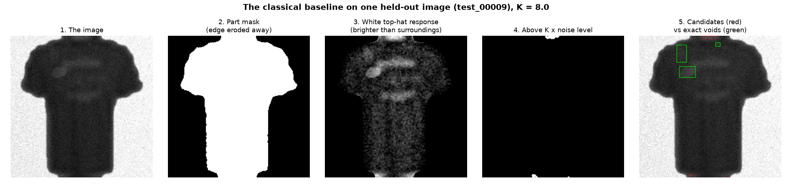
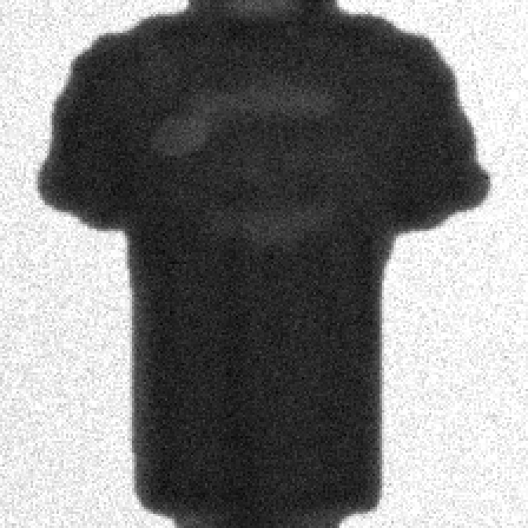
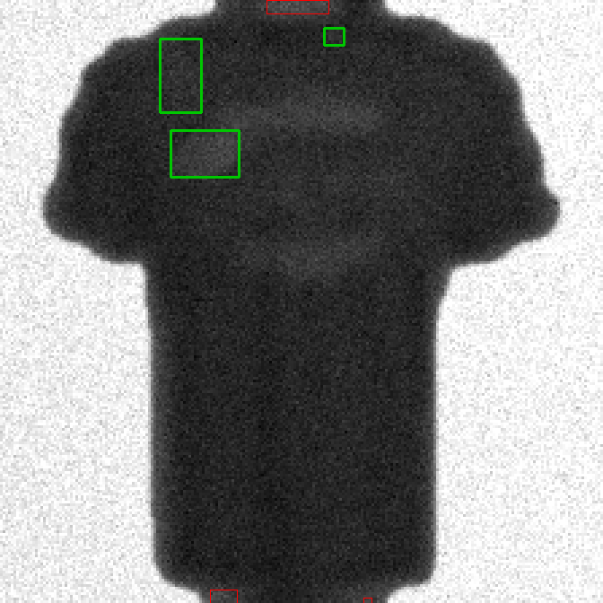
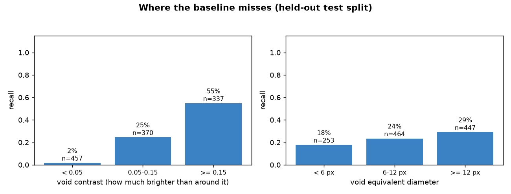

:::{.callout-tip}
This post is part of the [Agentic Developer: Zero to Advanced](index.qmd) series. It follows on
from [Part 1 -- why agentic AI, why X-ray defect detection](01-introduction.qmd).
:::

:::{.callout-note}
**Rewritten on 2026-10-18.** The first version of this series ran on the public GDXray casting
radiographs. GDXray is free for research and education only, and redistribution is not allowed,
so showing its images on a public blog was not something I should have done. This series now
runs on a dataset I generate myself, described in
[A Synthetic Void Dataset With Exact Masks](../agentic-factory-segmentation/01-synthetic-void-dataset.qmd).
Every number below comes from a fresh run on that data, and they differ from the first version.
:::

Part 1 was all talk. This one has no LLM in it at all, on purpose. Before any agent shows up in
Arc 2, there needs to be a real, boring, non-agentic baseline: load the data, run a plain
classical computer-vision detector, score it honestly against exact ground truth. Whatever number
comes out of this post is the number every later, agentic addition in this series has to beat.

## The data

The running dataset is 4,000 synthetic 224x224 "X-ray" images. Each one is a Fashion-MNIST
silhouette (a shirt, a sandal, a boot) treated as a metal part, with the grey level of the
original picture used as the part's thickness. The image is made with Beer-Lambert attenuation
(thicker means darker), plus blur, gain drift and noise. Then **voids** are cut into the part,
meaning thickness is removed from small ellipse-like regions, so more X-rays get through and the
spot comes out brighter. Because I made the voids, the mask of every void is exact, and the
dataset post explains each step and shows the code.

This series uses two of its three splits:

| Split | Images | Voids | Images with no void | Role |
|---|---|---|---|---|
| `val` | 600 | 1,184 | 80 | **dev**: every choice (a threshold, later a prompt) is made here |
| `test` | 600 | 1,164 | 100 | **held-out**: looked at once per question, to report the number |

The parts are different shirts and shoes in each split, so a detector cannot have memorised a
silhouette. The 2,800 `train` images stay untouched until a part trains something.

## What am I actually looking at?

A void is a small bright region inside a dark part. The hard thing about it is the **contrast**,
how much brighter it is than the material around it. In this dataset the voids range from
almost invisible (contrast under 0.05, about 37% of all voids) to clearly visible (above 0.15).
That range is deliberate: real defects are often faint, and a dataset where every void is
obvious would make every baseline look good.

The image below shows one held-out image with its voids (green boxes, exact), and the stages of
the baseline.



## The baseline: no learning at all

The detector is deliberately not deep learning. It is four classical steps:

1. **White top-hat morphology.** Flag small regions that are locally brighter than their
   surroundings, which is exactly what a void is. I use only the white version, because the
   physics here says a void is brighter, not darker.
2. **Part mask.** Otsu-threshold the part (dark) away from the air (bright), and erode the mask
   so the part's own outer edge, a very strong and very boring response, is not a candidate.
3. **A noise-scaled threshold.** Estimate the noise of the response inside the part (median
   absolute deviation) and keep what is above `K` times that. `K` is the one free number.
4. **Connected components.** Turn surviving blobs into candidate boxes.

```{=html}
<details>
<summary><strong>Show <code>detect_candidates()</code></strong></summary>
```

```python
def detect_candidates(gray, k=K_GUESS, return_stages=False):
    mask = part_mask(gray)
    resp = response_map(gray) * (mask > 0)
    inside = resp[mask > 0]
    # robust noise scale of the response inside the part (median absolute deviation)
    sigma = 1.4826 * np.median(np.abs(inside - np.median(inside))) if inside.size else 1.0
    binary = (resp >= k * max(sigma, 1e-3)).astype(np.uint8) * 255
    binary = cv2.morphologyEx(binary, cv2.MORPH_OPEN, CLEAN_KERNEL)

    n, _, stats, _ = cv2.connectedComponentsWithStats(binary)
    boxes = [(int(x), int(y), int(x + w), int(y + h)) for x, y, w, h, a in stats[1:] if a >= MIN_BLOB_AREA]
    return boxes
```

```{=html}
</details>
```

A candidate counts as a **hit** when its box overlaps an exact void box with an IoU of at least
0.2 (matched one to one, best overlap first). No tracking, no learning from labels, no memory
between images: each image is scored completely on its own. That is the point of a baseline,
the dumbest honest thing that could plausibly work.

## Choosing K without cheating

I wrote `K = 4` as a first guess before looking at any score. Then I swept `K` on the **dev**
split and let the F1 score pick, and only then scored the **held-out** split. The sweep, copied
from the run:

```{=html}
<details>
<summary><strong>Show the dev sweep (real output)</strong></summary>
```

```text
dev  K=2.0  P=0.013 R=0.411 F1=0.026 cand=36209
dev  K=2.5  P=0.025 R=0.519 F1=0.048 cand=24445
dev  K=3.0  P=0.043 R=0.535 F1=0.079 cand=14891
dev  K=3.5  P=0.077 R=0.520 F1=0.134 cand=8010
dev  K=4.0  P=0.095 R=0.486 F1=0.158 cand=6089
dev  K=5.0  P=0.135 R=0.418 F1=0.204 cand=3674
dev  K=6.0  P=0.154 R=0.356 F1=0.215 cand=2741
dev  K=8.0  P=0.185 R=0.271 F1=0.220 cand=1736
dev  K=10.0 P=0.217 R=0.214 F1=0.216 cand=1164
dev  K=12.0 P=0.237 R=0.160 F1=0.191 cand=802
dev  K=16.0 P=0.247 R=0.092 F1=0.134 cand=442
dev  K=20.0 P=0.202 R=0.053 F1=0.084 cand=312
chosen K on dev: 8.0
```

```{=html}
</details>
```

The first sweep stopped at `K = 8`, which was the edge of my grid, so I widened it to 20 to make
sure the best value was not just past the edge. It is not: F1 peaks at `K = 8` and falls on both
sides. The sweep also shows the trade-off in one column: a low `K` finds more voids and drowns in
false alarms (36,209 candidates for about 1,184 real voids), a high `K` is quiet and misses most.

## The real numbers

Scored once on the **held-out test split**:

| Metric | `K = 4` (my guess) | `K = 8` (chosen on dev) |
|---|---|---|
| Real voids | 1,164 | 1,164 |
| Candidate boxes raised | 6,165 | 1,718 |
| True positives | 507 | 284 |
| False positives | 5,658 | 1,434 |
| False negatives | 657 | 880 |
| **Precision** | 0.082 | **0.165** |
| **Recall** | 0.436 | **0.244** |
| F1 | 0.138 | 0.197 |
| Pixel Dice against the exact void mask | 0.178 | 0.218 |

That is a weak detector, reported as it is. With the dev-chosen `K` it catches about a quarter
of the real voids, and five of six boxes it raises are not voids. The dev F1 (0.220) and the
held-out F1 (0.197) are close, so the choice of `K` carried over to new shapes rather than
being tuned to the dev split. This is the number the rest of the series has to beat.

Drag the slider to see the held-out image from above, raw and with the answer on top: green is the
exact void, red is what the baseline raised.

::: {.column-body}
```{=html}
<div style="position:relative;max-width:560px;margin:1.5em auto;">
  
  
  <div style="position:absolute;top:0;bottom:0;left:50%;width:2px;background:white;box-shadow:0 0 4px rgba(0,0,0,0.5);" id="bl-handle"></div>
  <input id="bl-range" type="range" min="0" max="100" value="50" style="width:100%;margin-top:10px;">
  <p style="text-align:center;font-size:0.85em;color:#666;">left: the image &nbsp;|&nbsp; right: exact voids (green) vs. the baseline's candidates (red)</p>
</div>
<script>
(function(){
  var r = document.getElementById('bl-range');
  var a = document.getElementById('bl-after');
  var h = document.getElementById('bl-handle');
  if (r && a && h) {
    r.addEventListener('input', function(){
      a.style.clipPath = 'inset(0 ' + (100 - r.value) + '% 0 0)';
      h.style.left = r.value + '%';
    });
  }
})();
</script>
```
:::

On this image, which I picked because it is the first held-out image with exactly three voids
(not because of how the detector did on it), the baseline misses all three. The top-hat response
(third panel) lights up the faint voids, but it lights up the fabric-like texture of the shirt
just as much, so at the threshold that keeps the false alarms down the voids fall below it.

## Where it misses

Because the voids are exact, every miss can be sliced. On the held-out split:



| Slice | Voids | Recall |
|---|---|---|
| contrast < 0.05 | 457 | 2% |
| contrast 0.05 to 0.15 | 370 | 25% |
| contrast >= 0.15 | 337 | 55% |
| diameter < 6 px | 253 | 18% |
| diameter 6 to 12 px | 464 | 24% |
| diameter >= 12 px | 447 | 29% |

Contrast is the big lever: the faintest 457 voids are essentially invisible to this detector, and
even the clearly visible ones are found only about half the time. Size matters much less. These
slices overlap (small voids tend to be fainter), so this is a description of where it fails, not a
proof of why. The factory series later uses exactly this kind of slicing to decide what to fix.

## Why bother with a baseline this bad

Because "the agent found more defects" only means something if you know what "more" is being
measured against. Precision 0.165, recall 0.244, zero learning, zero memory across images: that
is the floor. Later posts in this series swap in better detectors, add tool calling, planning
and review. Every one of those additions gets checked against the same 600 held-out images and
1,164 voids, with the same hit rule. If a later post cannot beat this, it is not helping, no
matter how sophisticated the agent architecture looks.

## What I did not do

- **No tuning beyond one number.** `K` is the only thing chosen on dev. The kernel sizes, the
  erosion, the 0.2 IoU rule and the minimum blob area were fixed by me up front. A better
  hand-tuned classical detector exists; this one is the plain version on purpose.
- **No real X-rays.** The images are simulated. The numbers say how a classical detector behaves
  on this dataset, not on a production line. The dataset post lists how this data differs from
  real X-rays.
- **No second seed.** The dataset is one fixed draw (one seed). I did not measure how much the
  numbers move across freshly generated datasets.
- **No confidence interval.** With 1,164 voids the recall has a standard error of roughly 1.3
  points (my own arithmetic, `sqrt(0.244 * 0.756 / 1164)`), but I did not bootstrap it.
- **Single-class and box-level.** Pixel Dice is reported once, but the series scores boxes.
  Segmentation quality is the subject of the factory series.

## Jargon, explained simply

**Ground truth.** The real, correct answer, established independently of whatever your model
predicts. Think of the answer key a teacher already has before grading anyone's exam. Here it is
exact, because the voids were drawn by the generator.

**Bounding box.** A rectangle marking roughly where something is in an image, not its exact
pixel-perfect shape. For example, "the treasure is somewhere in this square on the map".

**IoU (Intersection over Union).** How much a predicted box overlaps a real one, as a fraction of
their combined area. Suppose you and a friend each draw a circle on the ground guessing where a
dropped coin landed: IoU is how much your two circles overlap, divided by the total ground either
circle covers.

**Precision.** Of everything the model flagged, what fraction was actually real. If you wrote ten
parking tickets today, precision is what fraction of those cars were actually illegally parked.

**Recall.** Of everything that was actually real, what fraction the model caught. If twenty cars
were illegally parked today, recall is what fraction of them you ticketed.

**Contrast.** How different a spot is from what is around it. A pale grey mark on white paper is
low contrast, a black one is high.

**Top-hat filter.** A filter that keeps only small features that stick out of their background,
like picking out pebbles standing on a flat beach.

**Dev set and held-out set.** The dev set is where you are allowed to make choices; the held-out
set is the exam you take once. Choosing on the held-out set makes the score look better than it
is.

## Reproduce this yourself

```{=html}
<details>
<summary><strong>Show reproduce commands</strong></summary>
```

```bash
git clone https://github.com/HasanGoni/quarto_blog_hasan
cd quarto_blog_hasan/notebooks/agentic-factory-segmentation
uv sync && uv run python make_dataset.py        # about 23 s, writes data/void_dataset_v1
cd ../agentic-zero-to-advanced
uv sync && uv run python baseline_detector.py   # about 10 s
```

```{=html}
</details>
```

The dataset is MIT-licensed code generating silhouettes from Fashion-MNIST (MIT licence). Nothing
here needs a download you do not control.

## What's next

[Part 3](03-first-tool-call.qmd) wraps this exact detector as a callable tool and puts one LLM
call in front of it: reading the detector's raw output and writing a plain-English explanation.
Still no planning, no iteration, no real agent yet, just the first tool call.
