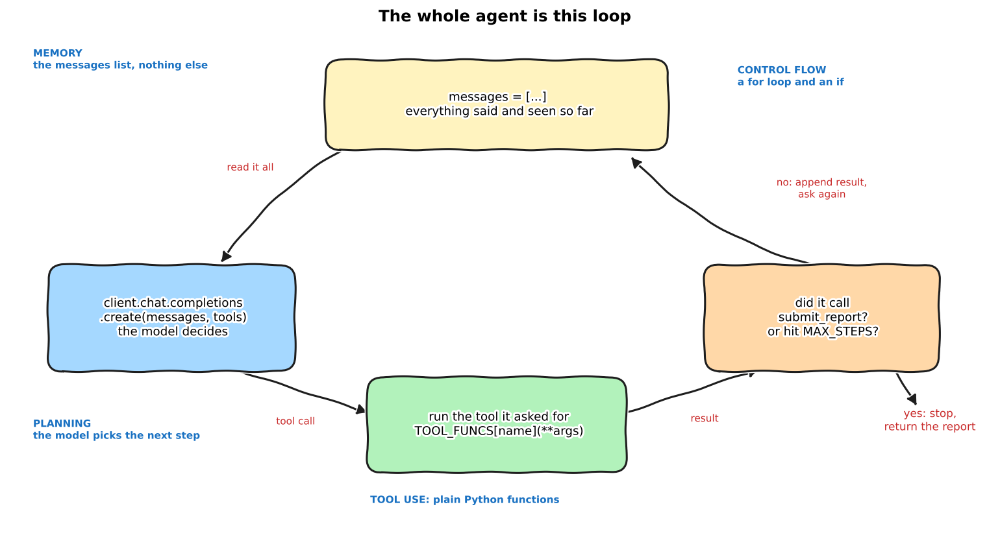

:::{.callout-tip}
This post is part of the [Agentic Developer: Zero to Advanced](index.qmd) series. It follows on
from [Part 4 -- prompting and structured output](04-prompting-structured-output.qmd). It opens
[Arc 2, the agent loop](index.qmd#arc-2-the-agent-loop).
:::

Arc 1 is done. We have a detector, a tool wrapper, and a model that returns clean JSON. Still no
agent. Every call so far was one shot: input in, answer out.

This post builds the agent. No framework. It is a loop of about 40 lines. Then I run it on all 72
real frames and score it. Spoiler: it does worse than the plain detector. That is the useful part, because then we get to look
at why agents fail and what fixes it, with real numbers.

## What "agent" means

People use the word for anything with an LLM in it. I use it for one thing: **the model decides
what happens next, and code does it.**

Four pieces make that work:

- **Planning.** The model picks the next step. You don't hardcode "call tool A, then tool B".
- **Tool use.** The model asks for a function call. Your code runs it and hands back the result.
- **Memory.** The result goes back into the conversation, so the next decision can use it.
- **Control flow.** Something decides when to stop. Usually a loop with a step limit.

*Daily-life version:* a plumber at your door. You don't give him a script. He looks, tries
something, sees what happened, tries the next thing, and tells you when he is done. A plain LLM
call is a plumber who answers through the letterbox without looking at the pipe.

{fig-alt="Hand-drawn loop: messages list, model call, tool runner, stop check"}

## The tools

Same detector as Part 2. Two changes.

First, I split it into small tools. `find_candidates` runs the detector. `measure_candidate` looks
closer at one box: contrast against its surroundings, area, aspect ratio, distance to the image
edge.

Second, **no ground truth in any tool result.** Part 3's `inspect_casting_xray` also returned
true/false positive counts. An agent that sees the answer key is not being tested. The scoring
code sees ground truth, the agent does not.

```{=html}
<details>
<summary><strong>Show inspection_tools.py (the two tools)</strong></summary>
```

```{.python filename="notebooks/agentic-zero-to-advanced/inspection_tools.py"}
def find_candidates(image: str) -> dict:
    """Run the classical detector on one X-ray frame. Returns candidate boxes with an id each.
    The detector is noisy: most boxes are not real defects."""
    gray = load_gray(image)
    boxes = detect_candidates(gray)
    _CANDIDATES[image] = boxes
    return {
        "image": image,
        "image_size": [int(gray.shape[1]), int(gray.shape[0])],
        "candidates": [
            {"id": i, "box": [int(a) for a in b], "w": int(b[2] - b[0]), "h": int(b[3] - b[1])}
            for i, b in enumerate(boxes)
        ],
    }


def measure_candidate(image: str, candidate_id: int) -> dict:
    """Measure one candidate box: contrast against its surrounding ring (positive = brighter than
    surroundings, negative = darker), area, aspect ratio, and distance to the nearest image edge."""
    gray = load_gray(image)
    boxes = _CANDIDATES.get(image) or find_candidates(image) and _CANDIDATES[image]
    if not 0 <= candidate_id < len(boxes):
        return {"error": f"candidate_id {candidate_id} out of range (0..{len(boxes) - 1})"}
    x1, y1, x2, y2 = boxes[candidate_id]
    h, w = gray.shape
    return {
        "candidate_id": candidate_id,
        "contrast": round(contrast_delta(gray, x1, y1, x2, y2), 2),
        "area_px": int((x2 - x1) * (y2 - y1)),
        "aspect_ratio": round((x2 - x1) / max(1, (y2 - y1)), 2),
        "edge_distance_px": int(min(x1, y1, w - x2, h - y2)),
    }
```

```{=html}
</details>
```

The docstring is not decoration. It is what the model reads to decide when to call the tool. A
bad docstring is a bad tool, same as a bad function name in a codebase.

## The loop

This is the whole agent. A `for` loop, a list called `messages`, and one extra tool,
`submit_report`, that means "I'm done".

```{.python filename="notebooks/agentic-zero-to-advanced/agent_loop.py"}
def run_agent(image: str) -> dict:
    messages = [{"role": "system", "content": SYSTEM},
                {"role": "user", "content": f"Inspect frame {image}."}]
    trace, kept_ids, report, t0, tokens = [], [], None, time.time(), 0
    for step in range(1, MAX_STEPS + 1):
        resp = client.chat.completions.create(
            model=MODEL, messages=messages, tools=TOOL_SPECS + [SUBMIT_SPEC], temperature=0.2)
        tokens += resp.usage.total_tokens
        msg = resp.choices[0].message
        messages.append(msg.model_dump(exclude_none=True))
        if not msg.tool_calls:  # model talked instead of acting: nudge it once per step
            trace.append({"step": step, "says": msg.content, "calls": []})
            messages.append({"role": "user", "content": "Use a tool, or call submit_report if you are done."})
            continue
        step_calls = []
        for call in msg.tool_calls:
            args = json.loads(call.function.arguments or "{}")
            if call.function.name == "submit_report":
                report, result = args, {"ok": True}
            elif call.function.name in TOOL_FUNCS:
                try:
                    result = TOOL_FUNCS[call.function.name](**args)
                except Exception as exc:  # tool errors go back to the model, they don't crash the loop
                    result = {"error": str(exc)}
            else:
                result = {"error": f"unknown tool {call.function.name}"}
            step_calls.append({"tool": call.function.name, "args": args, "result": result})
            messages.append({"role": "tool", "tool_call_id": call.id, "content": json.dumps(result)})
        trace.append({"step": step, "says": msg.content, "calls": step_calls})
        if report:
            break
    ...  # scoring against ground truth, see the repo
```

Two details matter more than they look.

- **`messages.append(...)` is the memory.** There is no other state. If it is not in that list,
  the model does not know it.
- **Tool errors go back to the model, they don't crash the loop.** If the model asks for
  `candidate_id=99`, it gets `{"error": ...}` and can try again. Same idea as Part 4's retry,
  now inside the loop.

## One real run, step by step

Frame `C0001_0069.png`. Four candidate boxes. Click through what the agent did. Everything below is
the real trace from the run, not a mock-up.

```{=html}
<div id="trace-viewer" style="max-width:760px;margin:1.5em auto;font-family:ui-monospace,SFMono-Regular,Menlo,monospace;font-size:0.82em;">
  <div style="display:flex;gap:8px;align-items:center;margin-bottom:10px;">
    <button id="tv-prev" style="padding:6px 14px;border:1px solid #888;border-radius:4px;background:#f1f3f5;cursor:pointer;">&larr; back</button>
    <button id="tv-next" style="padding:6px 14px;border:1px solid #1971c2;border-radius:4px;background:#1971c2;color:white;cursor:pointer;">next step &rarr;</button>
    <span id="tv-count" style="color:#666;"></span>
  </div>
  <div style="display:flex;gap:12px;flex-wrap:wrap;">
    <div style="flex:1;min-width:300px;">
      <div style="font-weight:bold;margin-bottom:4px;">What the agent did</div>
      <pre id="tv-step" style="margin:0;padding:12px;border:1px solid #ddd;border-radius:8px;background:#f4f8ff;white-space:pre-wrap;min-height:170px;overflow:auto;"></pre>
    </div>
    <div style="flex:1;min-width:300px;">
      <div style="font-weight:bold;margin-bottom:4px;">What it remembers (len(messages) = <span id="tv-len"></span>)</div>
      <pre id="tv-mem" style="margin:0;padding:12px;border:1px solid #ddd;border-radius:8px;background:#fff9db;white-space:pre-wrap;min-height:170px;max-height:260px;overflow:auto;"></pre>
    </div>
  </div>
</div>
<script>
(function(){
  var trace = [{"step": 1, "says": null, "calls": [{"tool": "find_candidates", "args": {"image": "C0001_0069.png"}, "result": {"image": "C0001_0069.png", "image_size": [768, 572], "candidates": [{"id": 0, "box": [218, 0, 252, 10], "w": 34, "h": 10}, {"id": 1, "box": [333, 112, 341, 124], "w": 8, "h": 12}, {"id": 2, "box": [516, 357, 547, 382], "w": 31, "h": 25}, {"id": 3, "box": [545, 360, 557, 367], "w": 12, "h": 7}]}}]}, {"step": 2, "says": "I will measure the candidates with IDs 0, 1, 2, and 3 to determine if they are real defects or false alarms.\n", "calls": [{"tool": "measure_candidate", "args": {"image": "C0001_0069.png", "candidate_id": 0}, "result": {"candidate_id": 0, "contrast": -1.66, "area_px": 340, "aspect_ratio": 3.4, "edge_distance_px": 0}}]}, {"step": 3, "says": null, "calls": [{"tool": "measure_candidate", "args": {"image": "C0001_0069.png", "candidate_id": 1}, "result": {"candidate_id": 1, "contrast": 59.01, "area_px": 96, "aspect_ratio": 0.67, "edge_distance_px": 112}}]}, {"step": 4, "says": null, "calls": [{"tool": "measure_candidate", "args": {"image": "C0001_0069.png", "candidate_id": 2}, "result": {"candidate_id": 2, "contrast": 13.46, "area_px": 775, "aspect_ratio": 1.24, "edge_distance_px": 190}}]}, {"step": 5, "says": null, "calls": [{"tool": "measure_candidate", "args": {"image": "C0001_0069.png", "candidate_id": 3}, "result": {"candidate_id": 3, "contrast": 6.69, "area_px": 84, "aspect_ratio": 1.71, "edge_distance_px": 205}}]}, {"step": 6, "says": "Based on the measurements, I will keep candidates with IDs 1 and 2 as they show significant contrast and reasonable aspect ratios, indicating potential real defects. Candidates 0 and 3 are likely false alarms due to low contrast or small size.\n\n", "calls": [{"tool": "submit_report", "args": {"kept_ids": [1, 2], "verdict": "review", "reason": "Candidates 1 and 2 show significant contrast and reasonable aspect ratios, suggesting they might be real defects. Candidates 0 and 3 are likely false alarms."}, "result": {"ok": true}}]}];
  var i = 0;
  function render(){
    var s = trace[i], txt = "step " + s.step + "\n";
    if (s.says) txt += "says:  " + s.says.trim() + "\n";
    s.calls.forEach(function(c){
      txt += "calls: " + c.tool + "(" + JSON.stringify(c.args) + ")\n";
      txt += "got:   " + JSON.stringify(c.result) + "\n";
    });
    document.getElementById("tv-step").textContent = txt;
    var m = ["system: You inspect aluminum casting X-ray frames...", "user: Inspect frame C0001_0069.png."];
    for (var k = 0; k <= i; k++) {
      var t = trace[k];
      m.push("assistant: " + (t.says ? t.says.trim().slice(0, 60) + "... + " : "") + t.calls.map(function(c){return c.tool + " call";}).join(", "));
      t.calls.forEach(function(c){ m.push("tool: " + JSON.stringify(c.result).slice(0, 70) + "..."); });
    }
    document.getElementById("tv-mem").textContent = m.join("\n");
    document.getElementById("tv-len").textContent = m.length;
    document.getElementById("tv-count").textContent = "step " + (i + 1) + " of " + trace.length;
    document.getElementById("tv-prev").disabled = i === 0;
    document.getElementById("tv-next").disabled = i === trace.length - 1;
  }
  document.getElementById("tv-prev").onclick = function(){ if (i > 0) { i--; render(); } };
  document.getElementById("tv-next").onclick = function(){ if (i < trace.length - 1) { i++; render(); } };
  render();
})();
</script>
```

Things to notice:

- The first step is `find_candidates`. Nobody told it to in code. The system prompt said so, and it
  followed.
- It measures **one box per step**. It could have asked for all four in one go. Four steps instead of
  one. That costs time. More on this in Part 8.
- The last step is `submit_report`. That is the stop signal. The loop ends because the model said so.
- It dropped candidates 0 and 3 ("low contrast or small size") and kept 1 and 2 ("significant
  contrast"). Hold that thought.

## Scoring it

All 72 frames of GDXray Castings series C0001. Model: Qwen3-Coder-30B on local vLLM, same as Part 3.
Scored the way Part 2 scored the detector: IoU >= 0.05 against the real ground-truth boxes.

| | Boxes kept | Real defects found (TP) | False alarms (FP) | Missed (FN) | Precision | Recall |
|---|---|---|---|---|---|---|
| Plain detector (Part 2) | all 366 | 24 | 342 | 232 | 6.6% | 9.4% |
| Agent loop (this post) | 172 | 8 | 164 | 248 | 4.7% | 3.1% |

The agent is **worse**. Fewer false alarms, yes, but it threw away two thirds of the real defects to
get there. It also costs a lot more:

| Per frame, average | Value |
|---|---|
| Steps | 5.0 |
| Tool calls | 5.3 |
| Tokens | 5,753 |
| Wall time | 39.5 s |

All 72 runs finished with `submit_report`. None hit the step limit.

## Why it got worse

Not a bug in the loop. The loop did what a loop does. The model looked at the measurements, applied
common sense ("real defects are high contrast"), and decided.

So I checked whether the measurements can separate real defects from false alarms at all. Mann-Whitney
AUC per measurement, all 366 candidates, 24 of them real. 0.5 is a coin flip.

| Measurement | AUC | Median, real defect | Median, false alarm |
|---|---|---|---|
| contrast | 0.41 | 9.8 | 15.4 |
| area (px) | 0.47 | 49 | 108 |
| aspect ratio | 0.58 | 1.0 | 1.0 |
| distance to edge (px) | 0.64 | 148 | 108 |

Real defects here have **weaker** contrast than false alarms, not stronger. The model's prior was
backwards for this data, and nothing in the tools told it so. Below 0.5 means a rule that keeps
high-contrast boxes is worse than random. It was.

I want this lesson in the series early:

> **An agent loop does not add information. It only adds decisions.**

If the evidence is weak, a loop makes more confident decisions on the same weak evidence, and
charges you tokens for it. The fix is better evidence, not a better loop. That is why Arc 4 puts a
vision-language model on the actual image (Part 17).

## Why agents fail: three buckets

Cemri et al. read over 1,600 traces from seven multi-agent LLM systems and sorted the failures into
three buckets ([paper](https://arxiv.org/abs/2503.13657)). Their systems are multi-agent and mostly
write software, ours is one agent looking at X-rays, so I use the buckets, not their numbers.

1. **Design issues.** The system was set up badly. Vague role, no stopping rule, missing context.
2. **Misalignment.** The parts don't share what they know. Wrong assumptions made instead of asking.
3. **Verification gaps.** Nothing catches the error. The check is superficial or missing.

*Daily-life version:* a restaurant order goes wrong. Either the order slip was unclear (design),
the waiter and the kitchen assumed different things (misalignment), or nobody looked at the plate
before it left the kitchen (verification).

Our agent from above fails in two of them, maybe three:

- **Design.** The system prompt never said what a real defect looks like here. The model filled the
  gap with its own prior, "high contrast means real". That prior was backwards (AUC 0.41).
- **Verification.** Nothing in the loop checked the answer against anything. `submit_report` took
  whatever the model gave it.
- **Misalignment.** The model assumed instead of asking, but it had nobody to ask. I did not see the
  classic version of this, agents contradicting each other, because there is only one agent. It
  shows up in Part 10 when there are several.

So two fixes to try. Both run on the **even-numbered frames only**. I wrote the guidance below
from the **odd** frames, so the even ones are held out. All numbers in this section are from the
even frames, 36 images, 125 real defects.

### Fix 1: design, a better role spec

The odd frames showed this: boxes with contrast under 16 had 11.7% precision, against 7.4% for all
boxes. Contrast under 8 had 2%. So I wrote that into the prompt, plus a rule to measure
everything before keeping anything.

```{.python filename="notebooks/agentic-zero-to-advanced/agent_fixes.py"}
SYSTEM_DESIGN = SYSTEM + """
What the labeled dev data says about this detector:
- Real defects are weak: contrast roughly 8 to 20. High-contrast boxes (above ~20) are
  usually casting structure or edges, not defects. Contrast under ~8 is almost never real.
- Do not treat "high contrast" as a sign of a real defect. For this detector it is the opposite.
- Measure every candidate before you keep or drop it. Never keep an id you did not measure.
- Finish with verdict "review" if you kept anything, "pass" if you kept nothing."""
```

No code change in the loop. Only the prompt. That is the point of a design fix.

### Fix 2: verification, check the report before accepting it

Part 4 validated the JSON shape. That is the "superficial check" the paper complains about: it
confirms the output is well formed, not that it is right. Here the check compares the report to what
actually happened in the loop. If something is off, the problems go back to the model as the tool
result, and it tries again (twice at most).

```{.python filename="notebooks/agentic-zero-to-advanced/agent_fixes.py"}
def verify_report(report: dict, measured: set[int], n_candidates: int) -> list[str]:
    problems = []
    kept = report.get("kept_ids", [])
    bad = [i for i in kept if not 0 <= i < n_candidates]
    if bad:
        problems.append(f"kept_ids {bad} are not valid candidate ids (valid: 0..{n_candidates - 1})")
    unmeasured = [i for i in kept if i not in measured and 0 <= i < n_candidates]
    if unmeasured:
        problems.append(f"you kept ids {unmeasured} without measuring them. Measure them first.")
    unchecked = [i for i in range(n_candidates) if i not in measured]
    if unchecked:
        problems.append(f"candidates {unchecked} were never measured. Measure them or say why not.")
    if report.get("verdict") == "pass" and kept:
        problems.append("verdict is 'pass' but kept_ids is not empty")
    if report.get("verdict") == "review" and not kept:
        problems.append("verdict is 'review' but kept_ids is empty")
    return problems


# inside the loop, when the model calls submit_report:
problems = verify_report(args, measured, n_cand) if verify else []
if problems and rejections < MAX_REJECTIONS:
    rejections += 1
    result = {"ok": False, "problems": problems, "fix": "Fix these and call submit_report again."}
else:
    report, result, done = args, {"ok": True}, True
```

I ran this check over the 72 reports from the original agent, without changing anything. It would
have bounced **39 of 72**. All 39 for the same reason: candidates the agent never measured. No
invented ids, no pass/review mismatch. So the agent was skipping work, and nothing noticed.

### Results

| Even frames (36), 125 real defects | Boxes kept | Real found (TP) | False alarms (FP) | Precision | Recall | Avg tokens / frame |
|---|---|---|---|---|---|---|
| Plain detector | 191 | 11 | 180 | 5.8% | 8.8% | -- |
| Original agent | 83 | 3 | 80 | 3.6% | 2.4% | 5,583 |
| + design fix | 54 | 8 | 46 | **14.8%** | 6.4% | 10,256 |
| + verify fix | 118 | 5 | 113 | 4.2% | 4.0% | 10,749 |
| + both | 59 | 6 | 53 | 10.2% | 4.8% | 10,751 |

What I read from this:

- **The design fix did the real work.** Precision 3.6% to 14.8%, better than the plain detector.
  It worked because the guidance came from data, not from opinion.
- **The verify fix alone did not help.** It made the agent measure more (about 0.5 rejections per
  frame) and doubled the tokens. But it still believed the wrong prior, so it kept the wrong boxes,
  just with better paperwork. A check that tests process cannot fix a wrong belief.
- **Both together were not better than design alone.** 6 real defects against 8. With counts this
  small that is noise. Do not read it as "verification hurts".
- **Everything costs about 2x the tokens.** More tool calls, longer prompt.

Caveats, because they matter: one run each, temperature 0.2, single digits of true positives. The
direction is believable. The exact numbers are not stable. And the guidance was written for this
detector on this data. Move to a different detector and it is wrong again.

### The check that would have caught it: a gate on labeled data

The `verify_report` check passes agents that are wrong, as shown. The check the paper asks for is
at task level: does the whole thing do the job? Here that means: before trusting the agent, score
it on labeled frames and compare it to the thing it replaces.

```{.python filename="notebooks/agentic-zero-to-advanced/fixes_analysis.py"}
def passes_gate(agent: dict, baseline: dict, min_recall_ratio: float = 0.8) -> bool:
    """Has to beat the plain detector's precision and keep most of its recall."""
    return agent["precision"] >= baseline["precision"] and agent["recall"] >= min_recall_ratio * baseline["recall"]
```

The 0.8 is my choice, not a standard. Result: **all four agents fail the gate.** The design fix
passes on precision (14.8% vs 5.8%) but its recall, 6.4%, is under 80% of the detector's 8.8%.

That is the correct outcome. Every agent here finished without errors and returned valid JSON. A
superficial check would have shipped all of them. The gate says: none of these beat what you have.

*Untested idea for the misalignment bucket:* give the agent a `defect_stats` tool that returns the
dev-set numbers, so it can look up the data instead of guessing. I did not run it.

## What the loop does buy you

Not accuracy, here. Three other things.

- **A trace.** Every decision is a line you can read. The viewer above is just that list.
- **Error recovery.** A bad tool call becomes a message, not a crash.
- **A place to put control.** Step limits, approval gates, cost caps. All of Arc 2 and 5 hang off
  this one `for` loop.

## Jargon, explained simply

**Agent.** A program where a model decides the next action and code carries it out, repeatedly,
until the model says it is done.

*Daily-life version:* the plumber again. A chatbot tells you how plumbers work. An agent comes
over and fixes the pipe.

**Tool call.** The model returns a function name and arguments instead of text. Your code runs the
function.

*Daily-life version:* a chef calling out "knife!" to the kitchen hand. The chef decides. The hand
does it.

**Agent loop.** Ask the model, run its tool, add the result to the history, ask again.

*Daily-life version:* playing 20 questions. Each answer changes what you ask next, and you stop
when you can name the thing.

**Context / messages list.** Everything the model can see right now. The only memory the agent has.

*Daily-life version:* a notepad you reread in full before every step. If you did not write it down,
it is gone.

**Failure buckets (MAST).** Design issues, misalignment, verification gaps. A way to sort why an agent
failed so you know what kind of fix to reach for.

*Daily-life version:* the three ways a restaurant order goes wrong: unclear slip, waiter and kitchen
assuming different things, or nobody looked at the plate.

**Verifier / gate.** Code that checks an agent's output before you accept it. A gate tests the whole
job on labeled data, not just whether the output is well formed.

*Daily-life version:* a taste test before the dish leaves the kitchen, not just checking the plate
is clean.

**Step limit.** A hard cap on loop iterations so a confused agent cannot run forever.

*Daily-life version:* a kitchen timer. Not for the dish, for you.

**AUC.** How well a single number separates two groups. 1.0 is perfect, 0.5 is a coin flip, below
0.5 is backwards.

*Daily-life version:* guessing which of two people is taller by checking shoe size. Works if
shoe size tracks height. Here it didn't.

## Reproduce this yourself

```{=html}
<details>
<summary><strong>Show reproduce commands</strong></summary>
```

```bash
cd quarto_blog_hasan/notebooks/agentic-zero-to-advanced
uv sync
# local vLLM on :8000 serving qwen3-coder, same as Part 3. .env as in Part 4.
uv run python agent_loop.py        # 72 frames, ~10 min, writes out/agent_loop_*.json
uv run python feature_check.py     # the AUC table
for v in design verify both; do uv run python agent_fixes.py $v; done   # fix experiments, even frames
uv run python fixes_analysis.py    # summary table and the gate
uv run python generate_arc2_diagrams.py
```

```{=html}
</details>
```

I ran it once. Numbers will move between runs (temperature 0.2, not 0). I would be surprised if the direction changed, but I did not test that.

## What's next

Further reading: [Cemri et al., Why Do Multi-Agent LLM Systems Fail?](https://arxiv.org/abs/2503.13657).
Section 4 has the three categories with examples, Section 5 has what helps.

Part 6 rebuilds this loop as a LangGraph graph: state, nodes, edges. Same idea, but the control
flow stops being a `for` loop you wrote and becomes something you can draw, inspect, and pause.
