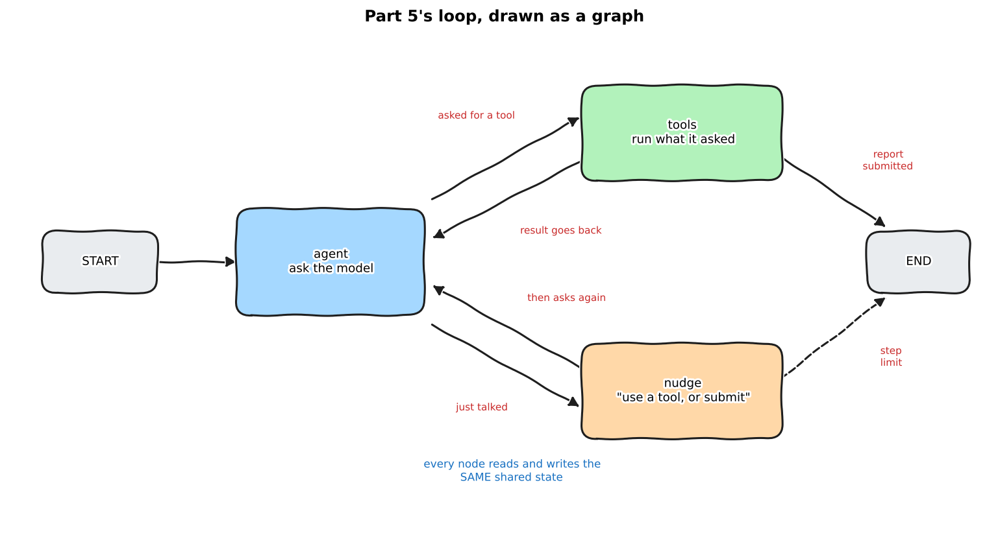
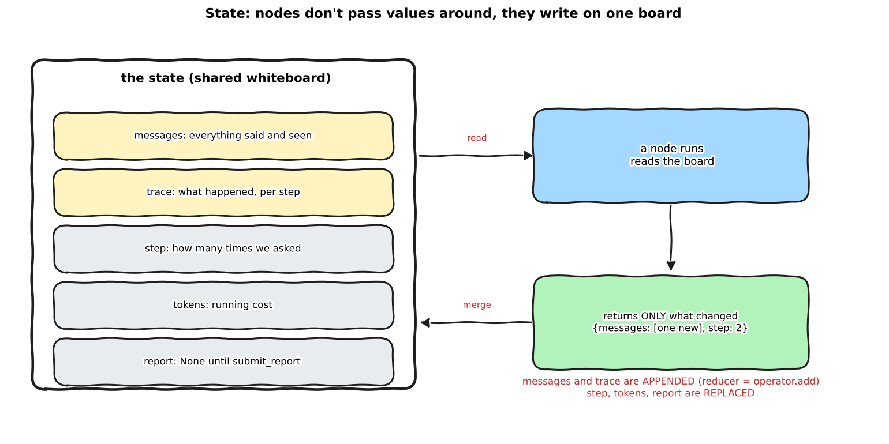

:::{.callout-tip}
This post is part of the [Agentic Developer: Zero to Advanced](index.qmd) series. It follows on
from [Part 5 -- what makes it an agent](05-what-makes-an-agent.qmd), and it is the second post of
[Arc 2, the agent loop](index.qmd#arc-2-the-agent-loop).
:::

::: {.callout-note}
**Rewritten on 2026-10-18** on the synthetic void dataset, with fresh runs. The first version used
GDXray images that I may not redistribute. The conclusion (the graph behaves like the loop) did not
change, the numbers did. The narrated animations below were rebuilt with the new numbers.
:::

Part 5 ended with a hand-written `for` loop that was more precise than the plain detector and
found fewer real voids. This post does not change that. It does something more boring and more
useful first: it rebuilds the same agent as a **LangGraph graph**, runs it on the same 400
images, and checks that nothing changed.

Nothing should change. Same model, same tools, same prompt, same scoring. The only difference is
how the control flow is written down. A `for` loop with three `if`s becomes three nodes and a few
edges. Once the flow is a graph, you can draw it, pause it before any step, and test every path.
That is what Parts 7 to 9 build on.

If you would rather watch than read, each section below has a short narrated animation.

```{=html}
<div style="margin:1em 0;">
  <button id="toggle-outputs" type="button" style="padding:6px 14px;border:1px solid #1971c2;border-radius:4px;background:#1971c2;color:white;cursor:pointer;">Show all outputs</button>
  <span style="color:#666;font-size:0.9em;margin-left:8px;">Outputs are collapsed by default. Each one is the real captured output of the code above it.</span>
</div>
<script>
(function(){
  var b = document.getElementById("toggle-outputs"), open = false;
  b.onclick = function(){
    open = !open;
    document.querySelectorAll("details.out").forEach(function(d){ d.open = open; });
    b.textContent = open ? "Hide all outputs" : "Show all outputs";
  };
})();
</script>
```

## From a loop to a graph

Here is what Part 5's loop was doing, in plain words:

1. Ask the model what to do.
2. If it asked for a tool, run the tool and put the result in the messages list. Ask again.
3. If it just talked, remind it to use a tool. Ask again.
4. If it submitted a report, or we hit 12 steps, stop.

Steps 2, 3 and 4 are **decisions about what happens next**. In the loop they were hidden inside
`if` statements. In a graph they become arrows you can see.

{fig-alt="Hand-drawn graph: START to agent; agent to tools or nudge; tools and nudge back to agent; tools to END on a submitted report; nudge to END at the step limit"}

*Daily-life version:* a kitchen with stations. The **nodes** are the stations (chopping, frying,
plating). The **edges** are the signs that say "if the order has fish, go to the grill, otherwise
go to the pan". The **state** is the order ticket that travels with the dish. The kitchen does not
change when you draw it on a wall. You just stop having to guess where a dish is.

```{=html}
<video controls preload="metadata" playsinline style="width:100%;max-width:760px;display:block;margin:1em auto;border-radius:6px;">
  <source src="videos/part6-state.mp4" type="video/mp4">
</video>
```

## State: one shared whiteboard

State is the first thing to get right. In Part 5 the "memory" was one list, `messages`. Here the
state is a small typed dictionary with every value the graph needs to remember.

```{.python filename="notebooks/agentic-zero-to-advanced/graph_agent.py"}
class AgentState(TypedDict):
    messages: Annotated[list, operator.add]  # reducer: new messages are appended, never replaced
    trace: Annotated[list, operator.add]
    step: int
    tokens: int
    report: dict | None
```

The `Annotated[list, operator.add]` part matters. It is a **reducer**: it tells LangGraph how to
merge a node's answer into the state. For `messages` and `trace` the rule is "add the new items to
the end". For `step`, `tokens` and `report` there is no reducer, so a new value **replaces** the
old one.

{fig-alt="Hand-drawn whiteboard with five state keys; a node reads the board and returns only what changed; messages and trace are appended, step tokens and report are replaced"}

*Daily-life version:* a whiteboard in a shared office. You do not carry the board from desk to
desk. Each person walks up, reads it, and writes only their own line. Nobody rewrites the whole
board, so nobody can accidentally erase someone else's work.

## Nodes: plain Python functions

A node is a function that takes the state and returns **only the keys it wants to change**.
Here is the one that asks the model, the same call as the first line inside Part 5's loop:

```{.python filename="notebooks/agentic-zero-to-advanced/graph_agent.py"}
def agent_node(state: AgentState) -> dict:
    """Ask the model what to do next. Same call as the first line inside Part 5's loop."""
    resp = client.chat.completions.create(
        model=MODEL, messages=state["messages"], tools=TOOL_SPECS + [SUBMIT_SPEC], temperature=0.2)
    msg = resp.choices[0].message
    return {"messages": [msg.model_dump(exclude_none=True)], "step": state["step"] + 1,
            "tokens": state["tokens"] + resp.usage.total_tokens}
```

It returns three keys. `messages` is a list with one item, which the reducer appends. `step` and
`tokens` are new numbers, which replace the old ones. `trace` and `report` are not mentioned, so
they stay as they were.

```{=html}
<details>
<summary><strong>Show the other two nodes (tools and nudge)</strong></summary>
```

```{.python filename="notebooks/agentic-zero-to-advanced/graph_agent.py"}
def tools_node(state: AgentState) -> dict:
    """Run every tool the model asked for and put the results back as messages."""
    last, results, calls, report = state["messages"][-1], [], [], None
    for call in last["tool_calls"]:
        args = json.loads(call["function"]["arguments"] or "{}")
        name = call["function"]["name"]
        if name == "submit_report":
            report, result = args, {"ok": True}
        elif name in TOOL_FUNCS:
            try:
                result = TOOL_FUNCS[name](**args)
            except Exception as exc:  # tool errors go back to the model, they don't crash the graph
                result = {"error": str(exc)}
        else:
            result = {"error": f"unknown tool {name}"}
        calls.append({"tool": name, "args": args, "result": result})
        results.append({"role": "tool", "tool_call_id": call["id"], "content": json.dumps(result)})
    return {"messages": results, "report": report,
            "trace": [{"step": state["step"], "says": last.get("content"), "calls": calls}]}


def nudge_node(state: AgentState) -> dict:
    """The model talked instead of acting. Remind it, once per step, same wording as Part 5."""
    return {"messages": [{"role": "user", "content": "Use a tool, or call submit_report if you are done."}],
            "trace": [{"step": state["step"], "says": state["messages"][-1].get("content"), "calls": []}]}
```

```{=html}
</details>
```

## Edges: who goes next

Edges are where the `if` statements went. A **conditional edge** is a small function that looks at
the state and returns the name of the next node.

```{.python filename="notebooks/agentic-zero-to-advanced/graph_agent.py"}
def after_agent(state: AgentState) -> str:
    """Edge 1: did the model ask for a tool? Yes -> tools. No -> nudge (or stop at the step limit)."""
    if state["messages"][-1].get("tool_calls"):
        return "tools"
    return "nudge" if state["step"] < MAX_STEPS else END


def after_tools(state: AgentState) -> str:
    """Edge 2: submitted the report, or out of steps? Stop. Otherwise go round again."""
    return END if state["report"] or state["step"] >= MAX_STEPS else "agent"


def build_graph(**compile_kwargs):
    g = StateGraph(AgentState)
    g.add_node("agent", agent_node)
    g.add_node("tools", tools_node)
    g.add_node("nudge", nudge_node)
    g.add_edge(START, "agent")
    g.add_conditional_edges("agent", after_agent, ["tools", "nudge", END])
    g.add_conditional_edges("tools", after_tools, ["agent", END])
    g.add_conditional_edges("nudge", lambda s: END if s["step"] >= MAX_STEPS else "agent", ["agent", END])
    return g.compile(**compile_kwargs)
```

That is the whole agent. The `for` loop is gone. The graph keeps going until an edge returns `END`.

```{=html}
<video controls preload="metadata" playsinline style="width:100%;max-width:760px;display:block;margin:1em auto;border-radius:6px;">
  <source src="videos/part6-edges.mp4" type="video/mp4">
</video>
```

### Play with it

Be the model. Pick what it does at each step and watch the state and the path change. Try
submitting a report straight away, or keep asking for tools until the step limit stops you.

```{=html}
<style>
#gw{max-width:760px;margin:1.2em auto;font-family:system-ui,sans-serif;font-size:0.9em;}
#gw svg{width:100%;height:auto;display:block;}
#gw .nd rect{fill:rgba(110,198,255,0.12);stroke:#6aa5d6;stroke-width:2;rx:10;}
#gw .nd.tools rect{fill:rgba(81,180,92,0.14);stroke:#51b45c;}
#gw .nd.nudge rect{fill:rgba(242,169,59,0.16);stroke:#d99a2b;}
#gw .nd.io rect{fill:rgba(128,128,128,0.12);stroke:#888;}
#gw .nd text{font-weight:600;fill:currentColor;text-anchor:middle;font-size:15px;}
#gw .nd.on rect{stroke-width:5;filter:drop-shadow(0 0 4px rgba(25,113,194,0.7));}
#gw .ed{stroke:#888;stroke-width:2.2;fill:none;marker-end:url(#gw-arrow);}
#gw .ed.on{stroke:#1971c2;stroke-width:4.5;}
#gw .btns{display:flex;gap:8px;flex-wrap:wrap;margin:10px 0;}
#gw button{padding:6px 12px;border:1px solid #888;border-radius:5px;background:rgba(128,128,128,0.12);cursor:pointer;color:inherit;}
#gw button.primary{background:#1971c2;color:white;border-color:#1971c2;}
#gw button:disabled{opacity:0.4;cursor:default;}
#gw .panel{display:flex;gap:12px;flex-wrap:wrap;}
#gw .panel>div{flex:1;min-width:260px;}
#gw pre{margin:0;padding:10px;border:1px solid rgba(128,128,128,0.4);border-radius:8px;background:rgba(128,128,128,0.08);white-space:pre-wrap;min-height:120px;max-height:210px;overflow:auto;font-size:0.85em;}
#gw .status{margin-top:8px;font-weight:600;}
</style>
<div id="gw">
  <svg viewBox="0 0 640 250" role="img" aria-label="Interactive graph: start, agent, tools, nudge, end">
    <defs><marker id="gw-arrow" viewBox="0 0 10 10" refX="9" refY="5" markerWidth="7" markerHeight="7" orient="auto-start-reverse"><path d="M0,0 L10,5 L0,10 z" fill="#888"/></marker></defs>
    <path class="ed" id="e-start-agent" d="M78,125 L142,125"/>
    <path class="ed" id="e-agent-tools" d="M255,108 L345,60"/>
    <path class="ed" id="e-tools-agent" d="M345,76 L255,118"/>
    <path class="ed" id="e-agent-nudge" d="M255,134 L345,184"/>
    <path class="ed" id="e-nudge-agent" d="M345,168 L255,142"/>
    <path class="ed" id="e-tools-end" d="M450,60 L540,108"/>
    <path class="ed" id="e-nudge-end" d="M450,190 L540,142" stroke-dasharray="6 5"/>
    <g class="nd io" id="n-start"><rect x="14" y="105" width="64" height="40"/><text x="46" y="130">START</text></g>
    <g class="nd" id="n-agent"><rect x="142" y="95" width="112" height="60"/><text x="198" y="123">agent</text><text x="198" y="143" style="font-size:11px;font-weight:400">ask the model</text></g>
    <g class="nd tools" id="n-tools"><rect x="345" y="35" width="105" height="55"/><text x="397" y="62">tools</text><text x="397" y="80" style="font-size:11px;font-weight:400">run what it asked</text></g>
    <g class="nd nudge" id="n-nudge"><rect x="345" y="160" width="105" height="55"/><text x="397" y="187">nudge</text><text x="397" y="205" style="font-size:11px;font-weight:400">remind it</text></g>
    <g class="nd io" id="n-end"><rect x="540" y="105" width="64" height="40"/><text x="572" y="130">END</text></g>
  </svg>
  <div class="btns">
    <button class="primary" id="gw-tool">Model asks for a tool</button>
    <button id="gw-talk">Model just talks</button>
    <button id="gw-submit">Model submits the report</button>
    <button id="gw-reset">Reset</button>
  </div>
  <div class="panel">
    <div><b>State: messages</b> (<span id="gw-len">2</span> items)<pre id="gw-msgs"></pre></div>
    <div><b>State: the other keys</b><pre id="gw-keys"></pre></div>
  </div>
  <div class="status" id="gw-status"></div>
</div>
<script>
(function(){
  var MAX = 12, st;
  var $ = function(id){ return document.getElementById(id); };
  function reset(){ st = {step:0, msgs:["system: You inspect X-ray images of metal parts for voids...", "user: Inspect image test_00020."], report:null, done:false, tokens:0}; clearOn(); render("At START. The graph sends us to the agent node. Be the model."); }
  function clearOn(){ document.querySelectorAll("#gw .on").forEach(function(e){ e.classList.remove("on"); }); }
  function mark(ids){ clearOn(); ids.forEach(function(i){ var e = $(i); if (e) e.classList.add("on"); }); }
  function render(msg){
    $("gw-msgs").textContent = st.msgs.map(function(m, i){ return (i + 1) + ". " + m; }).join("\n");
    $("gw-msgs").scrollTop = 1e6;
    $("gw-len").textContent = st.msgs.length;
    $("gw-keys").textContent = "step:    " + st.step + " / " + MAX + "   (replaced each time)\ntokens:  " + st.tokens + "   (replaced each time)\nreport:  " + (st.report ? JSON.stringify(st.report) : "None") + "\ntrace:   " + st.step + " entries   (appended)";
    ["gw-tool", "gw-talk", "gw-submit"].forEach(function(b){ $(b).disabled = st.done; });
    $("gw-status").textContent = msg;
  }
  function stepLimit(){ return st.step >= MAX; }
  function act(kind){
    if (st.done) return;
    st.step++; st.tokens += 900;
    if (kind === "tool"){
      st.msgs.push("assistant: tool call (measure_candidate)", "tool: {contrast: 13.46, area_px: 775, ...}");
      mark(["n-agent", "e-agent-tools", "n-tools", "e-tools-agent"]);
      if (stepLimit()){ st.done = true; mark(["n-tools", "e-tools-end", "n-end"]); return render("Step limit (" + MAX + ") reached. The edge after tools returns END. No report was submitted."); }
      render("The model asked for a tool: agent -> tools -> back to agent. Messages grew by 2, step is now " + st.step + ".");
    } else if (kind === "talk"){
      st.msgs.push("assistant: I think it looks fine.", "user: Use a tool, or call submit_report if you are done.");
      mark(["n-agent", "e-agent-nudge", "n-nudge", "e-nudge-agent"]);
      if (stepLimit()){ st.done = true; mark(["n-nudge", "e-nudge-end", "n-end"]); return render("Step limit reached while only talking. The nudge edge returns END."); }
      render("The model only talked: agent -> nudge -> back to agent. The nudge node added a reminder message.");
    } else {
      st.msgs.push("assistant: submit_report", "tool: {ok: true}");
      st.report = {kept_ids: [1, 2], verdict: "review"};
      st.done = true;
      mark(["n-agent", "e-agent-tools", "n-tools", "e-tools-end", "n-end"]);
      render("Report submitted: agent -> tools -> END. The report key was replaced from None to a dict.");
    }
  }
  $("gw-tool").onclick = function(){ act("tool"); };
  $("gw-talk").onclick = function(){ act("talk"); };
  $("gw-submit").onclick = function(){ act("submit"); };
  $("gw-reset").onclick = reset;
  reset();
})();
</script>
```

## Run it

First, the graph as data. LangGraph can list its own nodes and edges, which is a nice sanity check
that the picture you drew matches the code you wrote. Then one real image from the held-out split.

```{.python filename="notebooks/agentic-zero-to-advanced/graph_inspect_demo.py"}
from graph_agent import GRAPH, run_graph_agent

g = GRAPH.get_graph()
print("nodes:", [n for n in g.nodes])
for e in g.edges:
    print(f"  {e.source:>9} -> {e.target:<9} {'(conditional)' if e.conditional else ''}")

r = run_graph_agent("test_00020")
print({k: v for k, v in r.items() if k != "trace"})
for s in r["trace"]:
    calls = ", ".join(f"{c['tool']}({', '.join(f'{k}={v}' for k, v in c['args'].items())})" for c in s["calls"])
    print(f"step {s['step']}: {calls or '(just talked)'}")
```

```{=html}
<details class="out">
<summary><strong>Show output</strong></summary>
```

```{.text}
nodes: ['__start__', 'agent', 'tools', 'nudge', '__end__']
  __start__ -> agent
      agent -> __end__   (conditional)
      agent -> nudge     (conditional)
      agent -> tools     (conditional)
      nudge -> __end__   (conditional)
      nudge -> agent     (conditional)
      tools -> __end__   (conditional)
      tools -> agent     (conditional)

{'image': 'test_00020', 'split': 'test', 'finished': True, 'steps': 6, 'tool_calls': 6, 'tokens': 6806, 'seconds': 15.8, 'n_candidates': 4, 'kept': 2, 'verdict': 'review', 'tp': 1, 'fp': 1, 'fn': 0}
step 1: find_candidates(image=test_00020)
step 2: measure_candidate(image=test_00020, candidate_id=0)
step 3: measure_candidate(image=test_00020, candidate_id=1)
step 4: measure_candidate(image=test_00020, candidate_id=2)
step 5: measure_candidate(image=test_00020, candidate_id=3)
step 6: submit_report(kept_ids=[0, 1], verdict=review, reason=Candidates 0 and 1 show high contrast and reasonable areas, suggesting they are likely real defects. Candidates 2 and 3 have low contrast and are near the image edge, making them less reliable.)
```

```{=html}
</details>
```

Eight edges, as drawn. The agent measured each of the four boxes one at a time, then submitted,
the same pattern as Part 5 (this time it measured all four, where the Part 5 trace skipped one).
On this image it kept two boxes: one real void, one false alarm (`tp=1, fp=1`). One image tells
you nothing about quality, so let's score all of them.

## Pause it, look inside, resume

Here is the first thing a graph gives you that a `for` loop does not. If you compile it with a
**checkpointer**, LangGraph saves the state after every node. Then `interrupt_before=["tools"]`
stops the run right before a tool executes, and you can read what the model is about to do.

```{.python filename="notebooks/agentic-zero-to-advanced/graph_pause_demo.py"}
graph = build_graph(checkpointer=MemorySaver(), interrupt_before=["tools"])
cfg = {"configurable": {"thread_id": "demo"}}

graph.invoke(initial_state("test_00020"), cfg)
snap = graph.get_state(cfg)
print("paused before node:", snap.next)
want = snap.values["messages"][-1]["tool_calls"][0]["function"]
print("model wants to call:", want["name"], want["arguments"])
print("messages so far:", len(snap.values["messages"]), "| step:", snap.values["step"])

graph.invoke(None, cfg)  # resume: None means "continue from the saved state"
snap = graph.get_state(cfg)
print("paused again before:", snap.next, "| step:", snap.values["step"], "| tool results so far:",
      sum(m["role"] == "tool" for m in snap.values["messages"]))
```

```{=html}
<details class="out">
<summary><strong>Show output</strong></summary>
```

```{.text}
paused before node: ('tools',)
model wants to call: find_candidates {"image": "test_00020"}
messages so far: 3 | step: 1
paused again before: ('tools',) | step: 2 | tool results so far: 1
```

```{=html}
</details>
```

It stops, we read the pending call, and `invoke(None, cfg)` continues from the saved state. It ran
the tool, asked the model again, and paused once more before the next tool. This is the hook for
Part 9, where "pause before the risky step and wait for a human" becomes a real feature.

*Daily-life version:* a video game with a save point before every door. You can walk up to the
door, read the sign, and decide whether to go in. A `for` loop is a game with no saves: you find
out what was behind the door by walking through it.

## Test every edge

There is a catch. In the real 400-image run below, the `nudge` node **never ran**. Qwen3-Coder
always called a tool. So the real run proves nothing about that edge, or about the step limit.

For that I use a scripted fake model. Each call returns the next prepared message, so I can force
every path on purpose, with no GPU and no vLLM.

```{.python filename="notebooks/agentic-zero-to-advanced/test_graph_paths.py"}
img = "test_00020"
# 1. happy path: find, submit -> END via the tools node
final, path = run([msg(calls=[("find_candidates", {"image": img})]),
                   msg(calls=[("submit_report", {"kept_ids": [], "verdict": "pass", "reason": "nothing"})])])
# 2. the model talks once, gets nudged, then submits
final, path = run([msg("I think it is fine."),
                   msg(calls=[("submit_report", {"kept_ids": [], "verdict": "pass", "reason": "ok"})])])
# 3. the model never submits: the step limit must stop the graph
final, path = run([msg(calls=[("find_candidates", {"image": img})])] * ga.MAX_STEPS)
# 4. the model only ever talks: the nudge edge must also respect the step limit
final, path = run([msg("hmm")] * ga.MAX_STEPS)
```

```{=html}
<details class="out">
<summary><strong>Show output</strong></summary>
```

```{.text}
happy path:       ['find_candidates', 'submit_report'] | steps 2 | report: True
talk then submit: ['nudge', 'submit_report'] | steps 2 | report: True | nudge text in messages: True
never submits:    12 steps | stopped at step 12 | report: None
only talks:       11 nudges | stopped at step 12 | report: None
```

```{=html}
</details>
```

All four paths behave. A runaway model stops at step 12 whether it keeps calling tools or keeps
chatting. This kind of test is hard to write for a `for` loop and easy for a graph, because each
node is a function and each edge is a function.

```{=html}
<video controls preload="metadata" playsinline style="width:100%;max-width:760px;display:block;margin:1em auto;border-radius:6px;">
  <source src="videos/part6-result.mp4" type="video/mp4">
</video>
```

## Same agent, same score

The same 400 images as Part 5: the first 200 of the dev split (`val`) and the first 200 of the
held-out split (`test`), Qwen3-Coder-30B on local vLLM, scored the way Part 5 scored (a kept box is a
hit at IoU 0.2 or more against the exact void boxes). Only the Part 5 loop's numbers are copied from
last time. The graph's numbers are from a fresh run.

```{.python filename="notebooks/agentic-zero-to-advanced/graph_agent.py"}
def main():
    images = [f"val_{i:05d}" for i in range(N_PER_SPLIT)] + [f"test_{i:05d}" for i in range(N_PER_SPLIT)]
    with ThreadPoolExecutor(8) as pool:
        results = list(pool.map(run_graph_agent, images))
    ...  # writes out/graph_agent_results.json and out/graph_agent_summary.json, compares to Part 5
```

```{=html}
<details class="out">
<summary><strong>Show output (the held-out summary, not the per-image lines)</strong></summary>
```

```{.json}
"test": {
  "graph": {
    "n_images": 200, "finished": 200, "avg_steps": 3.82, "avg_tool_calls": 3.89,
    "avg_tokens": 3887, "avg_seconds": 27.1,
    "tp": 64, "fp": 218, "fn": 323, "precision": 0.227, "recall": 0.165
  },
  "part5_loop": {
    "n_images": 200, "finished": 200, "avg_steps": 3.8, "avg_tool_calls": 3.85,
    "avg_tokens": 3862, "avg_seconds": 27.0,
    "tp": 63, "fp": 215, "fn": 324, "precision": 0.227, "recall": 0.163
  }
}
```

```{=html}
</details>
```

| Held-out (200 images, 387 voids) | Real voids found (TP) | False alarms (FP) | Missed (FN) | Precision | Recall | Steps per image | Tokens per image |
|---|---|---|---|---|---|---|---|
| Part 5 loop | 63 | 215 | 324 | 22.7% | 16.3% | 3.80 | 3,862 |
| Part 6 graph | 64 | 218 | 323 | 22.7% | 16.5% | 3.82 | 3,887 |

| Dev (200 images, 420 voids) | TP | FP | FN | Precision | Recall |
|---|---|---|---|---|---|
| Part 5 loop | 98 | 185 | 322 | 34.6% | 23.3% |
| Part 6 graph | 100 | 185 | 320 | 35.1% | 23.8% |

The two agree to within noise: one real void apart on either split, the same precision to the
decimal on held-out, the same steps and tokens. All 400 runs finished with `submit_report`; none
hit the step limit.

Three things I checked, because "same numbers" is easy to claim and easy to get wrong:

- **Image by image, they are not identical.** The kept-box counts match on 181 of 200 held-out
  images (176 of 200 on dev). The rest differ by a box or two, because the temperature is 0.2, not
  0. The totals agree; the individual runs do not.
- **The wall-clock time is not comparable.** Both took about 27 s per image here, but I did not
  control for what else the machine was doing during either run, and nothing in the graph version
  does less work: steps and tokens per image are the same. I would not read anything into the
  timing either way.
- **The `nudge` node never ran**, on any of the 400 runs. Qwen3-Coder always called a tool. That is
  why the scripted test above exists.

The agent is still more precise and less sensitive than the plain detector, exactly as in Part 5,
and Part 5's fixes still apply. Part 6 is about the container, not the contents.

## Jargon, explained simply

**Graph.** A set of steps (nodes) and arrows between them (edges). Here: three nodes and eight
edges, including START and END.

*Daily-life version:* a subway map. Stations are nodes, lines are edges. You do not care how the
tunnel was dug, only where a train can go next.

**State.** The data every node can read and write. The graph's memory.

*Daily-life version:* the order ticket on a restaurant rail. Every station reads it and adds its
line. Nobody keeps a private copy.

**Node.** One step: a plain function that takes the state and returns what it changed.

*Daily-life version:* one station in the kitchen. It takes the ticket, does its job, and writes
"done" on the ticket.

**Edge.** The rule for which node runs next. A **conditional edge** looks at the state to decide.

*Daily-life version:* a road sign at a fork. "Trucks left, cars right." The sign reads the vehicle,
it does not drive.

**Reducer.** The rule for merging a node's answer into the state: append, replace, add up.

*Daily-life version:* a group chat versus a sticky note. A chat appends every message. A sticky
note is replaced when someone writes a new one.

**Checkpointer.** Saves the state after every node, so you can pause, inspect and resume.

*Daily-life version:* an autosave in a video game. The save point is how you can go back, and also
how you can stop to think.

**Interrupt.** A rule that pauses the graph before or after a chosen node.

*Daily-life version:* a security gate at an airport. The flight is fine, but someone has to look
at your passport before you go through.

**Step limit.** A hard cap on how many times the agent node may run, so a confused model cannot
loop forever.

*Daily-life version:* a kitchen timer. Not for the dish, for you.

## What I did not do

- **One run per setup.** Both the loop and the graph ran once on 400 images. With temperature 0.2
  the totals will move a little between runs, and I did not repeat either to measure how much.
- **No faster, no cheaper, no better claim.** Same steps, same tokens, same detections. If anything
  in this post sounds like "the graph is better at the job", I wrote it badly.
- **One dataset.** All images come from the one synthetic void dataset, as in Part 5, and only the first 200 of each split.
- **The narrated videos were checked by transcript and by looking at frames, not by ear.** The
  transcript matches the script. Whether every word sounds right, I have not listened for.

## Reproduce this yourself

```{=html}
<details>
<summary><strong>Show reproduce commands</strong></summary>
```

```bash
cd quarto_blog_hasan/notebooks/agentic-zero-to-advanced
uv sync                                  # langgraph is already in pyproject.toml
# build the dataset first (Part 2); local vLLM on :8000 serving qwen3-coder, as in Parts 3-5. .env as in Part 4.
uv run python graph_inspect_demo.py      # nodes, edges, one real image
uv run python graph_pause_demo.py        # pause before tools, inspect, resume
uv run python test_graph_paths.py        # every edge, scripted fake model, no GPU
uv run python graph_agent.py             # 400 images, ~20 min, writes out/graph_agent_*.json
uv run python generate_arc2_diagrams.py  # the two hand-drawn diagrams
```

```{=html}
</details>
```

## What's next

Further reading: the [LangGraph overview](https://langchain-ai.github.io/langgraph/) covers
`StateGraph`, reducers and persistence; the persistence page is the one behind
`interrupt_before`.

Part 7 turns this graph into the real inspection pipeline: classify the defect, check business
rules, decide, report. More nodes, same three ideas.
