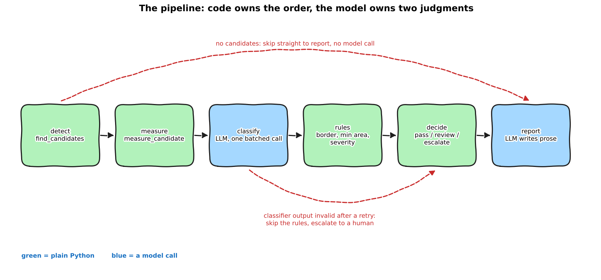

:::{.callout-tip}
This post is part of the [Agentic Developer: Zero to Advanced](index.qmd) series. It follows on
from [Part 6 -- building the graph](06-building-the-graph.qmd), and it is the third post of
[Arc 2, the agent loop](index.qmd#arc-2-the-agent-loop).
:::

::: {.callout-note}
**Rewritten on 2026-10-18** on the synthetic void dataset, with fresh runs and rebuilt animations. The
first version used GDXray images that I may not redistribute. Several conclusions changed, and I say
which ones where they appear. The headline that changed most: two plain rules beat everything with a
model in it.
:::

Part 5 ended on a sentence I want to keep: **an agent loop does not add information, it only adds
decisions.** Part 6 then redrew that loop as a graph. Before adding more nodes, this post asks the
question those two leave open: *which of these decisions does a model actually need to make?*

For the inspection job, the honest answer is two. Everything else, the order of the steps, the
business rules, the final verdict, can be plain Python. So in this post the **code** owns the order,
and the **model** is called in exactly two nodes. I build it, test every branch, and score it on
the same held-out images as Part 5. Then I take the model's guidance away to see what the structure
buys on its own. The answer is smaller than I hoped, and more useful.

Each section has a short narrated animation if you would rather watch.

```{=html}
<div style="margin:1em 0;">
  <button id="toggle-outputs" type="button" style="padding:6px 14px;border:1px solid #1971c2;border-radius:4px;background:#1971c2;color:white;cursor:pointer;">Show all outputs</button>
  <span style="color:#666;font-size:0.9em;margin-left:8px;">Outputs are collapsed by default. Each one is the real captured output of the code above it.</span>
</div>
<script>
(function(){
  var b = document.getElementById("toggle-outputs"), open = false;
  b.onclick = function(){
    open = !open;
    document.querySelectorAll("details.out").forEach(function(d){ d.open = open; });
    b.textContent = open ? "Hide all outputs" : "Show all outputs";
  };
})();
</script>
```

## An agent, or a pipeline?

In Parts 5 and 6 the model chose the next step: measure another box, or submit. That is an agent.
But look at what the inspection actually is. Find boxes. Measure them. Decide which are real.
Apply the customer's rules. Say pass or not. Write a note. The order never changes. Letting a model
choose it adds cost and a way to fail, and buys nothing.

So I split the job in two kinds of steps:

- **Steps with a fixed answer** (find boxes, measure, apply rules, pick a verdict): plain Python.
- **Steps that need judgment** (is this blob a defect? how do I explain this to a person?): a model.

{fig-alt="Hand-drawn pipeline: detect, measure, classify, rules, decide, report. Classify and report are blue model calls, the rest are green plain Python. A red arrow skips from detect to report when there are no candidates; another skips from classify to decide when the classifier output is invalid."}

*Daily-life version:* an airport security line. The stations are fixed: ID, bag scan, body
scan. The only place a person uses judgment is when the scanner beeps. You do not hire a
decision-maker to tell passengers which station comes next.

```{=html}
<video controls preload="metadata" playsinline style="width:100%;max-width:760px;display:block;margin:1em auto;border-radius:6px;">
  <source src="videos/part7-order.mp4" type="video/mp4">
</video>
```

If you want the longer version of this distinction, Anthropic's
[Building effective agents](https://www.anthropic.com/engineering/building-effective-agents) calls
the fixed-order kind a *workflow* and the model-chooses-the-path kind an *agent*. This post builds a
workflow on purpose.

## The state

Same idea as Part 6, a typed whiteboard. Each node fills in its own part.

```{.python filename="notebooks/agentic-zero-to-advanced/pipeline_graph.py"}
class PipelineState(TypedDict):
    image: str
    candidates: list[dict]       # from detect
    measurements: list[dict]     # from measure
    labels: list[dict]           # from classify
    classify_status: str         # "ok" | "failed" | "skipped"
    kept: list[dict]             # survivors after rules, each with a severity
    rejected: list[dict]         # everything dropped, with the reason: the audit trail
    verdict: str                 # "pass" | "review" | "escalate"
    reason: str
    report: dict | None
    trace: Annotated[list, operator.add]   # reducer: one line per node that ran
    llm_calls: int
    tokens: int
```

Only `trace` has a reducer, because every node adds a line to it. The rest are replaced. Note the
`rejected` list: every box that did not make it has a reason attached (`classifier`, `R1 border`,
`R2 min area`). When someone asks "why was this box dropped?", the answer is in the state.

## Nodes one and two: the Part 5 tools, called by code

These are the same two tools as Part 5, `find_candidates` and `measure_candidate`. The difference is
who calls them. In Part 5 the model spent about five steps asking for them one box at a time. Here
the code calls them once per image.

```{.python filename="notebooks/agentic-zero-to-advanced/pipeline_graph.py"}
def detect_node(state: PipelineState) -> dict:
    cands = find_candidates(state["image"])["candidates"]
    out = {"candidates": cands, "trace": [{"node": "detect", "n": len(cands)}]}
    if not cands:
        out |= {"verdict": "pass", "reason": "the detector found no candidates"}
    return out


def measure_node(state: PipelineState) -> dict:
    ms = [measure_candidate(state["image"], c["id"]) for c in state["candidates"]]
    return {"measurements": ms, "trace": [{"node": "measure", "n": len(ms)}]}
```

No ground truth reaches the model, same rule as Part 5. Scoring only happens afterwards.

## Node three: classify, the first model call

One batched call labels every candidate on the image: `defect`, `false_alarm` or `uncertain`, with a
confidence. The prompt carries dev-data guidance like Part 5's design fix (brighter boxes are real far more
often: about 7 in 10 above contrast 30, about 1 in 10 below 15).

Part 4 taught validation and one retry, and Part 5 taught that a *well-formed* answer is not
necessarily a *correct* one. So the check here has two layers. The JSON has to match the schema, and
it has to cover **exactly** the candidate ids we sent. A model that silently skips a box has
produced valid JSON and a wrong answer.

```{.python filename="notebooks/agentic-zero-to-advanced/pipeline_graph.py"}
for _ in range(MAX_CLASSIFY_ATTEMPTS):
    resp = client.chat.completions.create(model=MODEL, messages=messages, temperature=0.2)
    ...
    try:
        parsed = Labels(**json.loads(strip_fences(raw)))
        got = [lab.id for lab in parsed.labels]
        if sorted(got) != sorted(ids):  # well-formed is not enough: it must cover exactly our ids
            raise ValueError(f"expected exactly one label for each id in {sorted(ids)}, got {sorted(got)}")
        return {"labels": [...], "classify_status": "ok", ...}
    except (json.JSONDecodeError, ValidationError, ValueError) as exc:
        error = f"{type(exc).__name__}: {exc}"
        messages += [{"role": "assistant", "content": raw},
                     {"role": "user", "content": f"That failed validation:\n{error}\nReturn ONLY the corrected JSON."}]
return {"labels": [], "classify_status": "failed", ...}   # never an empty list that looks like "all clear"
```

If it fails twice, the node says so (`classify_status: "failed"`) instead of returning an empty list.
An empty list would look exactly like "no defects", which is the worst possible silent failure.

I also made the classifier **swappable**. The graph takes a name, and `band` replaces the model with a
one-line rule (`contrast >= 8`, the best non-trivial F1 on the dev split, `band_dev_sweep.py`). That is not decoration, it is the control experiment further
down.

## Nodes four and five: rules and verdict, plain Python

Business rules are the things a QC owner would sign off on, not things a model should "feel".

```{.python filename="notebooks/agentic-zero-to-advanced/pipeline_graph.py"}
def apply_rules(measurements, labels):
    """Returns (kept, rejected). A candidate has to be labeled defect/uncertain AND pass every rule."""
    ...
        if lab["label"] == "false_alarm":
            rejected.append({"id": lab["id"], "by": "classifier"})
        elif m["edge_distance_px"] == 0:  # R1: touches the image border, the ring is clipped, not measurable
            rejected.append({"id": lab["id"], "by": "R1 border"})
        elif m["area_px"] < MIN_AREA_PX:  # R2: too small to report
            rejected.append({"id": lab["id"], "by": "R2 min area"})
        else:
            uncertain = lab["label"] == "uncertain" or lab["confidence"] < CONF_MIN
            kept.append({"id": lab["id"], "severity": severity(m["area_px"]), "uncertain": uncertain, ...})
```

A rule **overrides** the classifier. If the model calls a border-touching box a defect, R1 still
drops it. The rules are the safety net under the model.

```{=html}
<details>
<summary><strong>Show the verdict node (decide)</strong></summary>
```

```{.python filename="notebooks/agentic-zero-to-advanced/pipeline_graph.py"}
def decide_node(state: PipelineState) -> dict:
    """Escalate whenever the pipeline itself is unsure. Never guess a pass or a fail."""
    kept = state.get("kept") or []
    if state["classify_status"] == "failed":
        verdict, reason = "escalate", "the classifier output was invalid after a retry"
    elif len(kept) > MAX_KEPT:
        verdict, reason = "escalate", f"{len(kept)} candidates survived (limit {MAX_KEPT}); the detector looks confused"
    elif any(k["uncertain"] for k in kept):
        verdict, reason = "escalate", "at least one surviving candidate is uncertain"
    elif kept:
        verdict, reason = "review", f"{len(kept)} confident defect(s) survived the rules"
    else:
        verdict, reason = "pass", "no candidate survived the classifier and the rules"
    return {"verdict": verdict, "reason": reason, "trace": [{"node": "decide", "verdict": verdict}]}
```

```{=html}
</details>
```

Three verdicts, and the third one is the interesting one:

| Verdict | Meaning | What happens next |
|---|---|---|
| `pass` | nothing survived the classifier and the rules | image goes through |
| `review` | one or more *confident* defects survived | normal QC review |
| `escalate` | the pipeline itself is not sure | a human looks first (Part 9 makes this a real pause) |

*Daily-life version:* a bank clerk with an approval limit. Small amounts, they just approve. Big or
strange ones, they say "let me get my manager" instead of guessing. `escalate` is the manager.

### Try the rules yourself

Here is every one of the 1,059 boxes the detector produced on the first 200 dev images and the first
200 held-out images, with its real label. Move the sliders to build your own rules and watch two
things: how it does on the **dev** images (where I looked at the data to pick my numbers) and on the
**held-out** images (never looked at). Try "Just R1 and R2" and then add a contrast rule on top, and
see what the contrast rule costs.

```{=html}
<style>
#rt{max-width:760px;margin:1.2em auto;font-family:system-ui,sans-serif;font-size:0.9em;}
#rt .row{display:flex;align-items:center;gap:10px;margin:6px 0;flex-wrap:wrap;}
#rt .row label{min-width:190px;}
#rt .row input[type=range]{flex:1;min-width:160px;}
#rt .row .v{min-width:44px;text-align:right;font-variant-numeric:tabular-nums;font-weight:600;}
#rt .btns{display:flex;gap:8px;flex-wrap:wrap;margin:10px 0;}
#rt button{padding:6px 12px;border:1px solid #888;border-radius:5px;background:rgba(128,128,128,0.12);cursor:pointer;color:inherit;}
#rt table{width:100%;border-collapse:collapse;margin-top:10px;font-variant-numeric:tabular-nums;}
#rt th,#rt td{padding:6px 8px;border-bottom:1px solid rgba(128,128,128,0.35);text-align:right;}
#rt th:first-child,#rt td:first-child{text-align:left;}
#rt tr.test td{font-weight:600;background:rgba(25,113,194,0.10);}
#rt .gate{margin-top:10px;padding:8px 10px;border-radius:6px;font-weight:600;}
#rt .gate.ok{background:rgba(81,180,92,0.18);border:1px solid #51b45c;}
#rt .gate.no{background:rgba(201,42,42,0.14);border:1px solid #c92a2a;}
#rt .note{margin-top:8px;color:#777;font-size:0.9em;}
</style>
<div id="rt">
  <div class="row"><label for="rt-lo">keep contrast from</label><input type="range" id="rt-lo" min="-30" max="40" step="1" value="8"><span class="v" id="rt-lov"></span></div>
  <div class="row"><label for="rt-hi">keep contrast up to</label><input type="range" id="rt-hi" min="0" max="80" step="1" value="80"><span class="v" id="rt-hiv"></span></div>
  <div class="row"><label for="rt-area">R2: drop boxes smaller than (px)</label><input type="range" id="rt-area" min="0" max="120" step="1" value="20"><span class="v" id="rt-areav"></span></div>
  <div class="row"><label for="rt-border">R1: drop boxes touching the border</label><input type="checkbox" id="rt-border" checked></div>
  <div class="btns">
    <button id="rt-all">Keep everything (plain detector)</button>
    <button id="rt-prior">Only bright boxes (contrast 20 or more)</button>
    <button id="rt-r12">Just R1 and R2, no contrast rule</button>
    <button id="rt-mine">My Part 7 band rules</button>
  </div>
  <table>
    <thead><tr><th>images</th><th>boxes kept</th><th>real found</th><th>of real</th><th>precision</th><th>recall</th></tr></thead>
    <tbody id="rt-body"></tbody>
  </table>
  <div class="gate" id="rt-gate"></div>
  <div class="note">Every one of the 1,059 detector boxes on these 400 images is in this widget, with its real label. The dev row is where I looked at the data to pick the numbers. The held-out row is the test. Watch the two rows move apart when you tune on the dev one.</div>
</div>
<script>
(function(){
  // each row: [split (0 = dev, 1 = held-out), contrast, area_px, edge_distance_px, real (0/1)]
  var ROWS = [[0,-3.69,230,0,0],[0,-23.76,63,2,0],[0,7.32,80,32,0],[0,7.45,208,43,0],[0,9.58,510,45,0],[0,8.57,660,58,0],[0,17.02,25,90,1],[0,-1.46,738,0,0],[0,43.72,117,59,1],[0,-6.51,114,0,0],[0,14.7,171,0,0],[0,2.32,60,0,0],[0,6.51,352,58,0],[0,-40.73,12,30,0],[0,43.2,225,49,1],[0,21.52,25,102,1],[0,-36.95,99,0,0],[0,9.24,99,63,0],[0,6.63,231,57,0],[0,-2.87,112,52,0],[0,5.18,45,59,0],[0,3.62,144,42,0],[0,-33.7,20,1,0],[0,2.74,30,0,0],[0,8.71,30,30,0],[0,13.46,66,0,0],[0,14.86,12,0,0],[0,19.69,144,0,0],[0,18.94,216,0,0],[0,5.62,16,18,0],[0,20.5,195,0,0],[0,14.89,200,89,0],[0,18.57,260,76,1],[0,9.32,48,57,0],[0,9.0,60,52,0],[0,-14.02,192,47,1],[0,30.21,42,49,1],[0,16.83,90,31,1],[0,33.71,960,75,1],[0,21.69,12,66,0],[0,38.53,126,38,1],[0,14.01,35,79,0],[0,11.77,35,0,0],[0,19.27,80,0,0],[0,12.14,156,57,0],[0,13.13,28,85,0],[0,12.93,21,93,0],[0,12.11,45,19,0],[0,12.36,56,8,0],[0,37.83,20,41,0],[0,14.39,35,43,1],[0,27.6,525,21,1],[0,5.24,30,0,0],[0,11.47,98,37,1],[0,10.62,192,0,0],[0,9.77,6,0,0],[0,11.82,12,0,0],[0,7.92,232,0,0],[0,9.79,9,0,0],[0,8.86,24,0,0],[0,-2.6,16,0,0],[0,13.28,6,0,0],[0,10.67,10,0,0],[0,17.54,32,0,0],[0,15.06,16,0,0],[0,14.63,132,0,0],[0,28.72,25,62,1],[0,-2.89,108,50,1],[0,14.55,115,44,0],[0,-1.66,16,0,0],[0,0.96,30,0,0],[0,-18.37,306,11,1],[0,41.28,9,41,0],[0,32.67,40,78,0],[0,39.72,9,39,0],[0,11.65,48,68,0],[0,13.49,357,78,1],[0,17.95,42,96,1],[0,-2.67,15,0,0],[0,25.25,150,0,0],[0,20.68,54,26,0],[0,27.0,91,62,1],[0,8.11,18,0,0],[0,15.07,12,0,0],[0,18.34,6,0,0],[0,-102.49,390,88,1],[0,-73.79,40,62,0],[0,-52.41,12,77,0],[0,-35.71,9,98,0],[0,-51.62,16,105,0],[0,-50.85,24,95,0],[0,-52.79,672,80,0],[0,-78.09,121,62,1],[0,-96.29,250,74,0],[0,-55.53,15,99,0],[0,-74.76,120,0,0],[0,-42.92,63,47,0],[0,-35.25,24,30,0],[0,-29.42,30,19,0],[0,-23.0,24,35,0],[0,-66.96,16,46,0],[0,-67.22,20,51,0],[0,39.37,56,40,1],[0,19.07,186,0,0],[0,30.1,136,42,0],[0,22.41,16,42,0],[0,7.06,30,80,0],[0,1.64,20,1,0],[0,16.09,16,59,0],[0,5.57,12,0,0],[0,20.15,252,0,0],[0,-8.23,9,2,0],[0,7.97,228,0,0],[0,9.96,12,0,0],[0,11.29,18,0,0],[0,-4.26,10,0,0],[0,23.99,168,56,0],[0,21.76,90,65,0],[0,18.41,189,54,0],[0,15.68,615,24,0],[0,15.58,261,27,0],[0,14.2,464,33,1],[0,4.84,9,72,0],[0,20.64,196,77,0],[0,14.46,12,57,0],[0,40.97,20,65,0],[0,-2.39,12,0,0],[0,20.09,315,0,0],[0,18.25,98,0,0],[0,10.77,72,0,0],[0,4.29,49,0,0],[0,3.33,30,0,0],[0,4.19,44,0,0],[0,3.18,72,0,0],[0,20.67,320,0,0],[0,19.84,744,0,0],[0,16.13,144,0,0],[0,-57.88,88,38,0],[0,-91.5,9,62,0],[0,-51.59,16,93,0],[0,-87.51,836,45,0],[0,-48.53,42,39,0],[0,-66.05,42,32,0],[0,-70.83,9,89,0],[0,-67.99,100,89,1],[0,-79.53,9,6,0],[0,-47.14,12,35,0],[0,13.41,140,0,0],[0,29.77,143,44,1],[0,6.99,25,73,0],[0,5.7,80,31,0],[0,53.9,117,52,1],[0,-1.1,186,0,0],[0,18.91,1216,24,0],[0,18.12,570,38,0],[0,12.07,9,66,0],[0,14.54,9,4,0],[0,19.68,300,8,1],[0,9.41,30,61,0],[0,22.28,90,16,0],[0,15.89,48,46,0],[0,45.85,143,67,1],[0,-7.21,320,39,1],[0,21.68,36,91,0],[0,54.34,432,69,1],[0,18.32,221,17,1],[0,29.8,80,44,1],[0,12.87,28,52,0],[0,18.83,9,51,0],[0,21.76,9,35,0],[0,-11.96,36,0,0],[0,-4.4,20,1,0],[0,-9.54,12,0,0],[0,18.58,80,55,0],[0,0.92,28,55,0],[0,-29.14,120,37,1],[0,11.78,96,25,0],[0,24.2,25,41,1],[0,6.92,152,0,0],[0,4.88,140,0,0],[0,15.41,72,62,0],[0,30.85,49,82,1],[0,21.31,77,43,1],[0,-1.62,30,0,0],[0,2.94,154,0,0],[0,31.63,187,40,1],[0,9.5,48,0,0],[0,1.67,66,54,0],[0,-47.2,15,81,0],[0,-39.61,15,91,0],[0,-50.74,12,97,0],[0,-52.99,78,95,0],[0,-51.29,9,90,0],[0,-44.99,9,85,0],[0,-42.15,27,61,0],[0,-49.27,15,42,0],[0,-46.24,36,27,0],[0,-43.45,9,27,0],[0,-41.0,9,20,0],[0,-49.8,15,16,0],[0,-18.26,21,0,0],[0,-26.86,8,0,0],[0,-15.4,12,2,0],[0,17.71,32,34,0],[0,15.13,44,51,0],[0,26.32,255,83,1],[0,28.92,25,98,1],[0,43.6,40,88,1],[0,17.84,84,69,0],[0,10.04,99,81,0],[0,12.16,56,40,0],[0,5.82,35,41,0],[0,7.89,150,60,1],[0,-5.83,90,0,0],[0,-17.64,16,0,0],[0,7.55,48,16,0],[0,16.61,84,64,1],[0,17.73,144,0,0],[0,7.72,72,72,0],[0,20.6,24,48,0],[0,21.27,143,50,0],[0,9.38,182,34,1],[0,13.15,32,33,0],[0,-7.73,16,19,0],[0,25.71,30,96,0],[0,-29.1,40,8,0],[0,16.06,255,24,1],[0,31.66,132,8,1],[0,8.05,12,4,0],[0,15.18,9,4,0],[0,23.75,15,76,0],[0,8.72,63,55,0],[0,33.99,63,72,1],[0,16.56,35,0,0],[0,10.46,104,0,0],[0,28.91,104,66,1],[0,16.16,9,57,0],[0,14.28,30,61,0],[0,15.45,121,59,0],[0,-17.32,48,0,0],[0,-21.15,25,0,0],[0,15.27,90,49,0],[0,11.53,40,50,0],[0,-12.64,12,73,0],[0,9.77,90,63,0],[0,18.42,144,0,0],[0,19.15,368,0,0],[0,39.04,40,46,1],[0,-24.91,30,48,1],[0,-12.35,9,72,0],[0,-13.79,9,68,0],[0,18.92,64,22,0],[0,6.62,6,0,0],[0,-5.41,112,0,0],[0,-3.12,84,0,0],[0,18.15,225,64,0],[0,13.64,130,64,0],[0,26.02,49,75,1],[0,-21.37,9,80,0],[0,29.77,56,91,1],[0,-3.18,70,70,0],[0,5.46,399,0,0],[0,-10.92,90,61,1],[0,-14.03,20,63,0],[0,41.49,48,86,1],[0,13.28,306,49,1],[0,31.48,20,42,0],[0,15.53,25,33,0],[0,3.76,36,39,1],[0,12.57,28,90,0],[0,8.04,16,61,1],[0,33.52,56,35,1],[0,-3.62,12,0,0],[0,-5.44,6,0,0],[0,12.78,900,78,1],[0,-18.92,9,101,0],[0,29.8,63,10,0],[0,42.53,252,46,1],[0,45.54,182,35,1],[0,13.61,88,44,1],[0,15.13,18,0,0],[0,15.99,126,0,0],[0,-0.54,25,0,0],[0,-7.91,9,3,0],[0,29.12,846,53,0],[0,20.33,30,46,0],[0,-0.7,36,0,0],[0,4.23,63,0,0],[0,-7.56,91,0,0],[0,19.51,56,55,0],[0,26.28,25,58,1],[0,2.98,9,68,0],[0,4.51,40,52,0],[0,9.81,234,56,0],[0,-17.45,48,64,0],[0,-0.82,56,53,0],[0,4.22,56,24,0],[0,17.99,168,41,1],[0,-20.04,9,46,0],[0,10.31,6,0,0],[0,13.24,8,0,0],[0,5.02,78,69,0],[0,18.02,240,75,1],[0,0.84,88,39,0],[0,-12.93,32,64,0],[0,-21.62,20,0,0],[0,5.47,6,0,0],[0,20.34,49,92,0],[0,36.68,88,44,1],[0,2.46,90,0,0],[0,9.49,15,0,0],[0,13.36,266,0,0],[0,16.4,25,21,1],[0,19.27,195,24,0],[0,28.5,84,42,1],[0,6.99,45,82,0],[0,14.46,238,96,0],[0,3.9,63,97,0],[0,2.93,72,0,0],[0,-1.26,48,0,0],[0,15.45,618,0,0],[0,16.24,12,0,0],[0,1.4,16,0,0],[0,32.11,108,93,1],[0,40.57,30,74,1],[0,25.41,24,0,0],[0,27.42,126,44,1],[0,0.34,6,0,0],[0,21.08,56,42,1],[0,12.32,42,16,0],[0,9.34,232,13,0],[0,7.66,133,13,0],[0,45.25,49,50,1],[0,27.16,150,0,0],[0,29.16,162,35,1],[0,18.43,35,78,0],[0,50.28,230,66,1],[0,44.51,6,0,0],[0,-17.23,25,0,0],[0,24.85,9,61,0],[0,-6.05,9,3,0],[0,-7.63,108,73,0],[0,-0.85,9,67,0],[0,38.91,56,71,1],[0,21.29,9,5,0],[0,39.65,483,22,1],[0,21.38,48,0,0],[0,18.95,130,36,1],[0,-1.65,55,0,0],[0,1.04,9,48,0],[0,17.27,234,27,1],[0,19.95,360,58,0],[0,2.08,18,9,1],[0,16.06,15,64,0],[0,11.17,306,11,1],[0,18.95,424,0,0],[0,11.21,9,73,0],[0,23.34,42,84,1],[0,33.64,352,17,1],[0,-22.01,9,78,0],[0,-40.8,81,81,0],[0,-75.75,49,84,0],[0,-19.45,9,84,0],[0,-37.95,32,77,0],[0,-34.65,16,84,0],[0,-56.4,120,65,0],[0,-56.08,756,37,0],[0,-60.76,88,0,0],[0,-19.77,9,60,0],[0,-31.33,50,18,0],[0,-58.34,99,50,0],[0,-33.5,165,37,0],[0,-70.5,504,44,1],[0,-60.04,50,64,0],[0,-40.47,28,33,0],[0,-45.11,9,18,0],[0,-71.54,36,1,0],[0,-62.93,36,69,0],[0,-76.04,88,68,0],[0,-45.4,16,71,0],[0,5.47,9,0,0],[0,19.56,120,30,1],[0,25.45,25,50,1],[0,8.27,288,12,1],[0,16.16,28,0,0],[0,7.12,16,0,0],[0,18.05,16,0,0],[0,14.84,9,2,0],[0,9.39,9,5,0],[0,25.09,238,76,1],[0,9.1,75,0,0],[0,13.21,66,0,0],[0,-19.02,152,61,0],[0,5.93,195,61,0],[0,0.54,91,75,1],[0,18.15,117,52,1],[0,12.1,24,60,0],[0,19.22,72,76,1],[0,13.84,187,50,1],[0,19.04,161,0,0],[0,16.48,52,0,0],[0,1.31,9,45,0],[0,25.47,42,16,0],[0,-14.38,12,10,0],[0,16.04,12,13,0],[0,5.72,63,0,0],[0,-0.72,25,48,0],[0,30.39,30,60,0],[0,-9.33,9,46,0],[0,15.7,54,56,0],[0,7.6,72,0,0],[0,3.27,25,0,0],[0,4.95,72,72,0],[0,13.44,90,38,0],[0,-28.05,500,8,1],[0,5.5,15,47,0],[0,19.64,169,16,1],[0,3.64,957,0,0],[0,-10.29,12,15,0],[0,7.15,12,36,0],[0,7.1,18,35,0],[0,18.15,153,90,1],[0,44.54,9,31,1],[0,34.82,40,26,0],[0,7.03,77,54,0],[0,10.24,350,26,0],[0,-4.89,9,11,0],[0,22.48,81,77,0],[0,22.2,16,83,0],[0,15.24,72,54,0],[0,26.96,104,27,1],[0,7.99,135,45,0],[0,-3.76,30,1,0],[0,4.13,210,48,0],[0,9.76,25,19,0],[0,40.91,399,49,1],[0,16.85,224,32,0],[0,-0.75,25,0,0],[0,-35.43,88,89,0],[0,-15.91,48,93,0],[0,-21.5,20,33,0],[0,-22.91,144,47,1],[0,-33.27,91,37,1],[0,8.85,20,65,0],[0,19.48,285,48,1],[0,23.12,42,72,1],[0,4.52,290,0,0],[0,-35.33,9,7,0],[0,-12.96,56,47,0],[0,-35.29,165,53,1],[0,25.25,209,36,1],[0,17.79,182,45,1],[0,2.52,77,0,0],[0,23.0,117,78,1],[0,21.46,232,71,0],[0,13.91,35,59,0],[0,15.97,119,57,0],[0,-9.51,24,26,0],[0,-6.4,9,27,0],[0,8.27,49,18,1],[0,4.45,40,65,1],[0,-11.09,65,0,0],[0,-23.81,30,0,0],[0,-6.49,632,0,0],[0,10.62,336,16,1],[0,14.99,49,27,1],[0,-17.09,169,35,1],[0,7.71,208,82,0],[0,-46.96,9,89,0],[0,-51.73,28,85,0],[0,-19.83,12,19,1],[0,-18.97,84,0,0],[0,39.45,75,38,0],[0,41.95,190,62,1],[0,20.77,9,66,0],[0,11.85,690,20,1],[0,0.23,108,51,1],[0,-0.77,35,66,0],[0,-13.12,20,69,0],[0,11.11,120,74,0],[0,-1.86,63,74,0],[0,4.62,78,0,0],[0,4.22,120,0,0],[0,35.59,56,47,0],[0,24.2,42,73,0],[0,34.83,56,61,0],[0,18.53,35,69,1],[0,26.67,81,76,1],[0,19.37,20,73,0],[0,18.4,24,69,0],[0,20.45,20,59,0],[0,21.35,48,66,0],[0,22.76,9,58,0],[0,5.31,36,26,0],[0,14.73,80,82,0],[0,20.36,420,74,0],[0,17.97,308,81,0],[0,20.57,6,0,0],[0,25.81,9,2,0],[0,23.67,9,0,0],[0,20.99,20,0,0],[0,22.79,6,0,0],[0,2.45,9,1,0],[0,20.99,360,49,1],[0,21.92,42,50,0],[0,22.98,36,64,0],[0,-1.9,9,0,0],[0,27.42,72,60,1],[0,22.83,20,43,0],[0,9.03,288,65,0],[0,-7.51,154,31,1],[0,5.98,208,65,0],[0,26.78,30,34,0],[0,9.35,1512,0,0],[0,42.02,76,72,0],[0,9.79,790,0,0],[0,5.16,162,95,0],[0,18.54,99,45,1],[0,-18.3,136,0,0],[0,-11.35,78,0,0],[0,0.94,12,2,0],[0,11.33,21,0,0],[0,2.57,9,71,0],[0,-6.46,50,73,0],[0,19.75,135,97,0],[0,19.64,99,91,0],[0,18.55,120,91,0],[0,7.52,24,96,0],[0,4.13,12,46,0],[0,23.19,49,43,1],[0,-1.6,20,35,0],[0,-2.5,25,0,0],[0,10.66,45,0,0],[0,10.52,60,0,0],[0,-12.07,357,56,0],[0,-8.0,49,80,0],[0,-40.36,126,86,0],[0,-37.43,36,0,0],[0,12.47,91,0,0],[0,15.06,198,0,0],[0,-6.32,12,83,0],[0,19.58,60,0,0],[0,15.24,9,44,0],[0,22.8,255,44,1],[0,-10.78,48,0,0],[0,-9.39,16,0,0],[1,14.77,9,51,0],[1,0.94,9,109,0],[1,3.5,9,44,0],[1,18.05,16,58,0],[1,25.67,280,51,1],[1,21.04,138,57,0],[1,3.91,42,30,0],[1,-7.3,56,0,0],[1,32.45,135,3,1],[1,35.33,225,46,1],[1,13.08,24,19,0],[1,-4.91,136,67,1],[1,39.28,35,42,1],[1,15.83,133,0,0],[1,18.79,70,0,0],[1,11.7,18,0,0],[1,16.01,24,0,0],[1,4.22,24,0,0],[1,43.76,99,8,1],[1,20.36,110,93,0],[1,27.59,115,0,0],[1,7.55,50,0,0],[1,7.05,6,0,0],[1,-16.79,20,0,0],[1,-21.23,9,2,0],[1,2.95,120,0,0],[1,9.85,15,0,0],[1,11.79,132,0,0],[1,8.59,8,0,0],[1,10.4,16,0,0],[1,20.98,168,0,0],[1,18.83,115,0,0],[1,17.12,40,0,0],[1,-4.9,16,89,0],[1,32.24,384,3,1],[1,-3.62,140,0,0],[1,8.48,150,0,0],[1,-8.12,275,0,0],[1,-31.2,32,9,0],[1,3.51,30,17,0],[1,-14.57,56,61,0],[1,-13.38,9,53,0],[1,12.65,56,81,1],[1,15.86,391,96,1],[1,30.99,575,51,1],[1,5.79,35,61,1],[1,4.56,963,0,0],[1,7.4,147,0,0],[1,5.4,60,0,0],[1,17.83,56,21,1],[1,16.24,98,16,0],[1,10.13,12,22,0],[1,25.77,132,55,0],[1,17.53,77,85,1],[1,4.14,91,0,0],[1,5.55,91,0,0],[1,-62.04,70,20,1],[1,-94.83,380,38,0],[1,-52.86,64,44,0],[1,-68.81,120,34,0],[1,-62.71,25,0,0],[1,-55.2,24,0,0],[1,-31.04,15,0,0],[1,-27.96,20,0,0],[1,-70.48,6,0,0],[1,-25.01,8,0,0],[1,20.76,84,0,0],[1,29.68,200,7,1],[1,13.71,12,50,0],[1,6.4,294,0,0],[1,10.41,35,72,0],[1,-22.87,12,0,0],[1,-25.16,12,0,0],[1,27.1,30,21,1],[1,3.51,130,0,0],[1,13.13,100,0,0],[1,13.91,120,76,0],[1,14.72,12,68,0],[1,-7.21,56,0,0],[1,23.67,468,0,0],[1,-8.74,9,3,0],[1,14.59,170,16,0],[1,-0.9,112,65,0],[1,-1.08,100,64,0],[1,-18.02,9,83,0],[1,21.79,40,19,0],[1,23.07,200,0,0],[1,15.2,6,0,0],[1,14.98,56,24,0],[1,2.97,42,22,0],[1,6.4,40,0,0],[1,4.51,9,0,0],[1,38.65,36,59,0],[1,31.5,42,66,0],[1,29.27,12,67,0],[1,24.84,72,0,0],[1,18.43,1144,58,1],[1,8.75,12,0,0],[1,10.69,15,0,0],[1,9.78,28,0,0],[1,7.69,10,0,0],[1,-3.79,40,70,0],[1,-9.12,240,0,0],[1,-17.93,45,71,0],[1,-11.76,208,28,0],[1,-11.26,42,86,0],[1,-60.47,63,65,1],[1,14.79,300,81,1],[1,14.7,9,60,0],[1,-8.26,16,0,0],[1,5.31,48,100,0],[1,-2.29,153,0,0],[1,-11.14,30,0,0],[1,23.95,16,66,0],[1,14.18,16,62,0],[1,12.3,9,48,0],[1,26.08,16,33,0],[1,1.79,270,12,1],[1,-8.42,126,64,0],[1,-14.83,55,56,0],[1,-14.9,42,65,0],[1,30.29,483,71,1],[1,8.96,60,0,0],[1,17.67,15,0,0],[1,15.91,12,0,0],[1,30.7,35,34,1],[1,13.99,952,56,0],[1,20.32,270,55,0],[1,11.3,24,51,0],[1,15.21,180,45,0],[1,1.36,60,37,0],[1,29.92,80,90,1],[1,23.73,135,40,1],[1,7.87,9,92,0],[1,-11.42,48,0,0],[1,-8.01,56,0,0],[1,-4.44,108,0,0],[1,-13.98,30,0,0],[1,-5.33,175,0,0],[1,0.08,261,0,0],[1,-35.91,42,7,0],[1,-6.85,108,47,0],[1,5.89,56,51,0],[1,5.38,9,57,0],[1,-34.97,18,7,0],[1,-5.16,261,0,0],[1,-24.52,9,6,0],[1,3.22,12,0,0],[1,-17.52,12,0,0],[1,8.54,24,60,0],[1,21.62,40,24,1],[1,14.26,215,0,0],[1,17.59,120,64,0],[1,11.35,56,56,0],[1,10.45,56,99,0],[1,2.51,322,31,0],[1,-7.8,9,3,0],[1,-1.99,72,0,0],[1,42.56,182,68,1],[1,4.08,40,23,0],[1,25.24,54,17,0],[1,4.57,12,0,0],[1,11.75,15,64,1],[1,10.15,9,51,0],[1,10.66,32,63,0],[1,9.36,45,55,0],[1,11.98,144,63,0],[1,15.68,286,56,0],[1,35.25,529,92,1],[1,-27.81,9,35,0],[1,51.29,70,45,1],[1,11.02,48,0,0],[1,23.42,60,0,0],[1,29.98,35,82,1],[1,-18.78,30,0,0],[1,9.87,154,0,0],[1,19.0,84,16,1],[1,9.74,64,0,0],[1,0.55,25,0,0],[1,10.37,112,0,0],[1,20.19,66,0,0],[1,0.56,15,0,0],[1,23.68,200,62,1],[1,18.82,16,58,0],[1,21.93,42,58,0],[1,9.21,60,0,0],[1,6.54,36,0,0],[1,34.89,9,106,0],[1,15.59,90,54,0],[1,15.64,77,51,0],[1,11.57,20,34,0],[1,5.93,16,1,0],[1,12.79,40,0,0],[1,15.17,9,0,0],[1,11.88,55,0,0],[1,16.94,132,0,0],[1,21.43,168,0,0],[1,12.9,96,0,0],[1,32.81,644,70,1],[1,44.71,121,62,1],[1,17.26,9,0,0],[1,14.16,12,0,0],[1,11.88,8,0,0],[1,15.04,72,0,0],[1,19.49,60,50,0],[1,21.51,108,49,0],[1,17.83,15,50,0],[1,15.44,9,49,0],[1,-11.56,55,0,0],[1,-10.67,35,0,0],[1,13.38,52,20,0],[1,26.42,49,14,1],[1,3.04,1495,0,0],[1,48.91,169,68,1],[1,31.42,140,77,1],[1,0.74,495,0,0],[1,-17.8,42,59,0],[1,0.48,873,0,0],[1,8.33,6,0,0],[1,36.55,81,10,1],[1,33.2,54,63,1],[1,32.6,16,90,1],[1,12.97,36,0,0],[1,17.11,330,50,0],[1,16.98,432,35,0],[1,40.81,56,56,1],[1,-82.14,117,91,0],[1,-71.7,165,90,1],[1,-61.42,30,38,0],[1,-80.24,667,54,0],[1,-36.35,20,86,0],[1,-86.47,66,66,0],[1,-26.78,9,80,0],[1,-62.66,9,60,0],[1,-24.65,25,73,0],[1,-79.64,20,48,0],[1,-29.92,672,62,0],[1,-72.16,12,37,0],[1,-31.32,9,74,0],[1,-71.22,528,22,0],[1,-42.57,40,46,0],[1,-66.79,40,2,0],[1,-56.86,49,77,0],[1,-34.69,16,33,0],[1,-52.68,40,75,0],[1,-41.8,9,64,0],[1,33.89,45,74,0],[1,5.98,12,67,0],[1,43.17,90,59,0],[1,19.75,70,75,0],[1,18.54,30,67,0],[1,13.89,55,0,0],[1,11.06,12,0,0],[1,11.37,928,41,0],[1,9.86,9,52,0],[1,9.95,12,51,0],[1,13.42,16,49,0],[1,-4.55,112,35,0],[1,-6.21,9,2,0],[1,8.84,84,0,0],[1,22.77,55,59,0],[1,24.26,48,68,0],[1,8.71,413,0,0],[1,9.77,28,65,0],[1,-7.72,24,9,1],[1,45.24,45,47,1],[1,5.78,48,0,0],[1,-0.96,20,0,0],[1,58.49,435,50,1],[1,0.24,96,24,0],[1,-7.2,16,20,0],[1,-6.29,40,0,0],[1,-14.65,20,4,0],[1,12.8,9,60,0],[1,11.41,25,65,0],[1,12.05,36,56,0],[1,9.34,644,29,0],[1,11.25,9,58,0],[1,8.18,585,30,0],[1,-20.49,12,24,0],[1,21.91,16,91,0],[1,-20.53,56,1,0],[1,-26.62,63,3,0],[1,14.21,153,49,1],[1,-1.8,12,50,0],[1,-22.18,35,22,1],[1,-17.33,128,0,0],[1,-18.14,91,0,0],[1,10.94,9,17,0],[1,-9.86,63,0,0],[1,-2.93,16,2,0],[1,12.16,210,58,0],[1,17.2,100,62,0],[1,17.83,256,15,1],[1,15.35,160,68,0],[1,-14.66,35,0,0],[1,-19.71,24,72,0],[1,13.11,294,52,0],[1,1.12,1188,28,0],[1,6.85,963,0,0],[1,6.03,391,48,0],[1,8.62,160,63,0],[1,6.01,52,34,0],[1,7.62,32,55,0],[1,44.89,1521,0,0],[1,-30.42,70,5,0],[1,-6.45,99,19,0],[1,-5.56,108,20,0],[1,8.21,85,34,0],[1,9.01,32,19,0],[1,7.79,9,13,0],[1,-8.54,42,0,0],[1,9.39,60,0,0],[1,12.66,9,0,0],[1,10.32,9,1,0],[1,14.0,6,0,0],[1,17.39,72,79,0],[1,3.33,20,0,0],[1,-9.93,9,35,1],[1,13.29,234,0,0],[1,-15.26,20,7,0],[1,-8.93,2964,16,0],[1,-3.49,105,0,0],[1,-0.21,102,0,0],[1,17.42,272,14,1],[1,15.01,156,0,0],[1,1.71,40,0,0],[1,8.84,12,0,0],[1,9.83,16,0,0],[1,-4.6,12,0,0],[1,19.51,9,47,0],[1,2.72,9,61,0],[1,11.92,126,48,0],[1,4.46,132,50,0],[1,4.54,143,41,0],[1,4.67,84,43,0],[1,1.74,35,0,0],[1,0.58,25,0,0],[1,15.15,20,65,0],[1,26.28,259,65,0],[1,14.12,126,63,0],[1,12.23,63,63,0],[1,10.33,15,57,0],[1,39.41,336,41,1],[1,2.56,55,58,0],[1,-2.04,16,0,0],[1,6.9,20,16,1],[1,19.09,110,56,0],[1,9.82,112,0,0],[1,12.35,15,0,0],[1,-2.01,45,0,0],[1,6.41,8,0,0],[1,28.27,40,53,1],[1,14.14,568,11,0],[1,18.38,9,0,0],[1,20.38,60,0,0],[1,22.06,70,53,0],[1,23.1,75,37,0],[1,19.19,25,28,0],[1,22.12,50,17,0],[1,26.15,56,61,1],[1,26.35,49,18,0],[1,-5.98,84,57,1],[1,11.93,225,51,0],[1,10.0,210,80,0],[1,9.95,156,96,0],[1,-0.25,189,0,0],[1,11.05,465,31,1],[1,9.81,196,75,0],[1,-6.89,90,0,0],[1,-17.72,45,40,0],[1,11.04,361,40,0],[1,7.69,72,37,0],[1,2.46,63,43,0],[1,19.86,209,25,1],[1,52.3,117,70,1],[1,-20.11,9,2,0],[1,19.33,539,0,0],[1,10.07,24,0,0],[1,29.19,108,74,1],[1,11.77,161,0,0],[1,-1.86,15,0,0],[1,43.22,378,48,1],[1,36.63,49,94,1],[1,27.37,105,75,1],[1,-16.82,30,0,0],[1,21.13,150,33,1],[1,40.99,25,9,1],[1,9.9,16,68,0],[1,20.02,20,64,0],[1,-8.17,9,1,0],[1,7.85,273,53,1],[1,20.26,72,52,0],[1,21.54,42,56,0],[1,-4.75,6,0,0],[1,14.44,15,27,1],[1,45.77,70,46,1],[1,33.76,36,57,0],[1,23.92,49,35,0],[1,9.17,20,0,0],[1,22.64,165,36,1],[1,1.97,9,60,0],[1,20.78,99,31,1],[1,8.67,592,0,0],[1,-24.39,24,94,0],[1,14.79,6,0,0],[1,16.44,9,0,0],[1,15.89,220,16,0],[1,-11.8,80,0,0],[1,-2.43,170,56,0],[1,-9.71,81,76,0],[1,-20.38,9,67,0],[1,9.3,9,63,0],[1,11.38,220,58,0],[1,19.72,528,56,0],[1,8.45,49,57,0],[1,33.39,20,47,0],[1,9.47,30,102,0],[1,2.47,63,0,0],[1,18.27,102,46,0],[1,-7.88,112,0,0],[1,8.07,35,47,1],[1,22.83,9,21,0],[1,-2.96,112,0,0],[1,4.06,63,0,0],[1,-16.62,24,7,0],[1,24.19,280,51,0],[1,8.25,48,0,0],[1,10.63,60,0,0],[1,35.84,20,97,1],[1,8.16,30,0,0],[1,13.11,12,0,0],[1,1.73,8,0,0],[1,-17.49,99,0,0],[1,-27.93,25,3,0],[1,10.56,90,45,1],[1,1.88,247,48,0],[1,-3.91,390,51,0],[1,-5.55,423,0,0],[1,-12.96,24,0,0],[1,51.11,20,99,0],[1,4.9,35,86,0],[1,11.18,20,104,0],[1,0.28,20,87,0],[1,-7.55,170,1,0],[1,-2.58,56,48,0],[1,-34.31,77,38,1],[1,37.89,30,45,0],[1,2.68,28,0,0],[1,11.35,147,0,0],[1,13.15,42,57,1],[1,19.46,20,0,0],[1,9.63,6,0,0],[1,-41.88,6,0,0],[1,-59.37,15,0,0],[1,-62.85,130,4,0],[1,-50.71,176,8,0],[1,-53.79,28,13,0],[1,-51.22,240,26,1],[1,1.66,9,58,0],[1,5.38,156,34,0],[1,-9.12,77,0,0],[1,-22.37,9,2,0],[1,16.66,156,0,0],[1,18.34,9,2,0],[1,18.39,120,0,0],[1,15.07,28,0,0],[1,17.48,12,4,0],[1,20.1,9,66,0],[1,25.12,20,66,0],[1,35.8,54,57,0],[1,24.78,165,98,1],[1,17.08,12,99,0],[1,-11.06,320,28,1],[1,-20.98,144,42,1],[1,14.29,20,47,0],[1,7.95,30,77,0],[1,13.98,18,75,0],[1,10.47,40,0,0],[1,8.64,16,0,0],[1,23.36,264,88,0],[1,0.03,6,0,0],[1,0.08,30,0,0],[1,9.99,9,0,0],[1,10.59,10,0,0],[1,10.06,8,0,0],[1,9.31,6,0,0],[1,12.01,341,29,0],[1,14.66,198,20,0],[1,18.68,528,0,0],[1,-27.56,12,0,0],[1,13.38,9,49,0],[1,5.67,20,0,0],[1,9.81,100,28,1],[1,11.51,12,0,0],[1,46.59,140,69,1],[1,9.79,9,0,0],[1,3.13,24,0,0],[1,-11.26,6,0,0],[1,-9.53,91,52,0],[1,18.01,189,60,0],[1,-4.66,90,62,0],[1,15.45,126,79,0],[1,9.76,30,74,0],[1,19.52,91,74,0],[1,21.7,320,86,0],[1,16.0,15,0,0],[1,11.85,18,0,0],[1,15.03,21,0,0],[1,14.16,15,0,0],[1,15.34,12,0,0],[1,17.85,45,41,1],[1,1.15,45,0,0]];
  var GT = [420, 387];
  var $ = function(id){ return document.getElementById(id); };
  function pct(a, b){ return b ? (100 * a / b).toFixed(1) + "%" : "n/a"; }
  function stats(split, keep){
    var kept = 0, tp = 0, real = 0, plainTp = 0, plainKept = 0;
    ROWS.forEach(function(r){
      if (r[0] !== split) return;
      plainKept++; plainTp += r[4];
      if (keep(r)){ kept++; tp += r[4]; }
    });
    return {kept: kept, tp: tp, plainKept: plainKept, plainTp: plainTp};
  }
  function render(){
    var lo = +$("rt-lo").value, hi = +$("rt-hi").value, amin = +$("rt-area").value, border = $("rt-border").checked;
    $("rt-lov").textContent = lo; $("rt-hiv").textContent = hi; $("rt-areav").textContent = amin;
    var keep = function(r){ return r[1] >= lo && r[1] <= hi && r[2] >= amin && (!border || r[3] > 0); };
    var names = ["dev (200 val images, where I looked)", "held-out (200 test images)"], html = "", res = [];
    [0, 1].forEach(function(s){
      var x = stats(s, keep); res.push(x);
      html += '<tr class="' + (s ? "test" : "") + '"><td>' + names[s] + "</td><td>" + x.kept + "</td><td>" + x.tp + "</td><td>of " + GT[s] +
              "</td><td>" + pct(x.tp, x.kept) + "</td><td>" + pct(x.tp, GT[s]) + "</td></tr>";
    });
    var t = res[1];
    html += '<tr><td>plain detector, held-out</td><td>' + t.plainKept + "</td><td>" + t.plainTp + "</td><td>of " + GT[1] + "</td><td>" +
            pct(t.plainTp, t.plainKept) + "</td><td>" + pct(t.plainTp, GT[1]) + "</td></tr>";
    $("rt-body").innerHTML = html;
    var precOk = t.kept && t.tp / t.kept >= t.plainTp / t.plainKept, recOk = t.tp / GT[1] >= 0.8 * t.plainTp / GT[1];
    var g = $("rt-gate"), ok = precOk && recOk;
    g.className = "gate " + (ok ? "ok" : "no");
    g.textContent = "Part 5's gate on the held-out images: " + (ok ? "PASS" : "FAIL") + " (precision at least the plain detector's: " +
      (precOk ? "yes" : "no") + "; recall at least 80% of the plain detector's: " + (recOk ? "yes" : "no") + ")";
  }
  function set(lo, hi, amin, border){ $("rt-lo").value = lo; $("rt-hi").value = hi; $("rt-area").value = amin; $("rt-border").checked = border; render(); }
  ["rt-lo", "rt-hi", "rt-area", "rt-border"].forEach(function(id){ $(id).addEventListener("input", render); });
  $("rt-all").onclick = function(){ set(-30, 80, 0, false); };
  $("rt-prior").onclick = function(){ set(20, 80, 0, false); };
  $("rt-mine").onclick = function(){ set(8, 80, 20, true); };
  $("rt-r12").onclick = function(){ set(-30, 80, 20, true); };
  render();
})();
</script>

```

Three readings of what you just played with.

First, **R1 does a lot of work for nothing**: on the held-out images 187 of the detector's 513 boxes
touch the image border, and none of them is real. R2 (area under 20 px) drops 73 more, 4 of them real.
Together the two rules cut the boxes from 513 to 253 and keep 77 of the 81 real ones, which is a
precision of 30.4% and a recall of 19.9%.

Second, **the contrast band costs real voids.** The `band` floor of 8 that I picked on dev
(it had the best F1 of any non-trivial floor) drops 93 more boxes (253 down to 160), 15 of them
real voids, leaving 62. Dev F1 was almost flat across floors from 0 to 10 (0.263 to
0.269), so I should have read that as "the floor barely matters on F1", and it matters a lot to
recall.

Third, this is a small amount of signal. There are 81 real boxes among the held-out candidates, so
one box moves precision by a point. Do not tune to the decimal.

The widget uses the same data as this animation, which shows where the dev bands come from:

```{=html}
<video controls preload="metadata" playsinline style="width:100%;max-width:760px;display:block;margin:1em auto;border-radius:6px;">
  <source src="videos/part7-band.mp4" type="video/mp4">
</video>
```

## Node six: report, the second model call

The last node writes the note a QC engineer reads. The rule I used: **code owns the facts, the model
only writes the prose.** The verdict, the kept ids, the severities and the rejection reasons all
come from the state. The model gets them as a JSON record and writes two or three sentences.

Two guards:

- **No call when there is nothing to say.** On a `pass` the note is a template. Do not pay a model
  to write "nothing found".
- **A mechanical check on the prose.** The note may only cite candidate ids that exist on this image.
  If it cites one that does not, the model's text is thrown away and the template is used.

```{.python filename="notebooks/agentic-zero-to-advanced/pipeline_graph.py"}
def report_node(state: PipelineState) -> dict:
    summary, source, calls, tokens = template_summary(state), "template", 0, 0
    if state["verdict"] != "pass":  # nothing to explain on a pass: do not pay a model to say "nothing"
        ...
        text = (resp.choices[0].message.content or "").strip()
        if text and not prose_problems(text, state):
            summary, source = text, "llm"
        else:
            source = "template (llm prose rejected)"
```

That check is narrow on purpose. It catches an invented id. It does **not** catch a note that
overclaims. More on that in the results.

## Edges: only where there is a real choice

Part 6 had eight edges for a three-node loop, because the model chose the path. This graph has six
nodes and only **two** conditional edges, because only two places have a real choice.

```{.python filename="notebooks/agentic-zero-to-advanced/pipeline_graph.py"}
def after_detect(state: PipelineState) -> str:
    return "measure" if state["candidates"] else "report"


def after_classify(state: PipelineState) -> str:
    return "rules" if state["classify_status"] == "ok" else "decide"


def build_pipeline(classifier: str = "llm", **compile_kwargs):
    g = StateGraph(PipelineState)
    g.add_node("detect", detect_node)
    g.add_node("measure", measure_node)
    g.add_node("classify", CLASSIFIERS[classifier])
    g.add_node("rules", rules_node)
    g.add_node("decide", decide_node)
    g.add_node("report", report_node)
    g.add_edge(START, "detect")
    g.add_conditional_edges("detect", after_detect, ["measure", "report"])
    g.add_edge("measure", "classify")
    g.add_conditional_edges("classify", after_classify, ["rules", "decide"])
    g.add_edge("rules", "decide")
    g.add_edge("decide", "report")
    g.add_edge("report", END)
    return g.compile(**compile_kwargs)
```

The rule of thumb I take from this: **draw an edge only when something can actually go two ways.**
Every extra conditional edge is a path you have to test.

```{=html}
<video controls preload="metadata" playsinline style="width:100%;max-width:760px;display:block;margin:1em auto;border-radius:6px;">
  <source src="videos/part7-edges.mp4" type="video/mp4">
</video>
```

## Run it

The graph as data first, then one real image with its trace.

```{.python filename="notebooks/agentic-zero-to-advanced/pipeline_inspect_demo.py"}
from pipeline_graph import build_pipeline, run_pipeline

graph = build_pipeline("llm")
g = graph.get_graph()
print("nodes:", list(g.nodes))
for e in g.edges:
    print(f"  {e.source:>9} -> {e.target:<9} {'(conditional)' if e.conditional else ''}")

r = run_pipeline("test_00020", graph)
for t in r["trace"]:
    print(" ", t)
```

```{=html}
<details class="out">
<summary><strong>Show output</strong></summary>
```

```{.text}
nodes: ['__start__', 'detect', 'measure', 'classify', 'rules', 'decide', 'report', '__end__']
  __start__ -> detect
   classify -> decide    (conditional)
   classify -> rules     (conditional)
     decide -> report
     detect -> measure   (conditional)
     detect -> report    (conditional)
    measure -> classify
      rules -> decide
     report -> __end__

{'image': 'test_00020', 'n_candidates': 4, 'kept': 2, 'verdict': 'escalate', 'llm_calls': 2, 'tokens': 938, 'seconds': 11.3, ...}
  {'node': 'detect', 'n': 4}
  {'node': 'measure', 'n': 4}
  {'node': 'classify', 'attempts': 1}
  {'node': 'rules', 'kept': 2, 'rejected': 2}
  {'node': 'decide', 'verdict': 'escalate'}
  {'node': 'report', 'source': 'llm'}
```

```{=html}
</details>
```

Nine edges, as drawn. Four boxes in, two dropped by the classifier, two kept, and the verdict is
`escalate` because the model gave one of the survivors only 0.3 confidence. Two model calls in total.
Part 5's agent spent six calls on this same image. (Here one of the two kept boxes is a real void and
one a false alarm, and the pipeline handed the call to a human.)

### One real image, start to finish

Traces are good for code. For intuition, here is one real held-out image going through all six
nodes: `test_00204`. I picked it by a rule I wrote down before running it: the first held-out image
from index 200 on (outside the 200 scored in the table below) with five to seven candidates, at least
one hit, at least one miss, and at least two boxes the rules would drop. That rule picks for
variety, not for how well the pipeline does. Everything on screen is read from files a real run wrote
(`video_frame_state.py` saves the boxes, the measurements, the model's labels, the verdict and the
note), nothing is typed in by hand. The answer key stays hidden until the very end, as it does in
scoring.

```{=html}
<video controls preload="metadata" playsinline style="width:100%;max-width:760px;display:block;margin:1em auto;border-radius:6px;">
  <source src="videos/part7-frame1.mp4" type="video/mp4">
</video>
```

The detector proposed five boxes, and `measure` turned each into three numbers. Zero model calls so
far. Then the second half:

```{=html}
<video controls preload="metadata" playsinline style="width:100%;max-width:760px;display:block;margin:1em auto;border-radius:6px;">
  <source src="videos/part7-frame2.mp4" type="video/mp4">
</video>
```

What happened, with the real numbers:

- **classify** (one call): boxes 1, 2 and 3 are false alarms (confidence 0.90, 0.95 and 0.70). Boxes 0
  and 4 are `uncertain`, at 0.3 and 0.4.
- **rules**: nothing to do. The three boxes the rules would have dropped (1, 2 and 3 are all under 20 px)
  were already gone because the model rejected them first.
- **decide**: boxes 0 and 4 survive, both uncertain, so the verdict is `escalate`: a human looks first.
- **report**: the second call writes the note. The facts in it (ids, severities, confidences) come
  from the state, not from the model. Two calls, 1,006 tokens in total.
- **the answer key**: box 4 is a real void, a hit, and it is the one with the lowest measured
  contrast (-23.5, which reads as *darker* than its surroundings; I did not dig into why a box on a
  real void measures dark). The other real void was never boxed by the detector, so nothing
  downstream could ever have found it.

That is the whole results section in one picture: a pipeline that is unsure hands the case to a person,
and it can only ever find what the detector proposed.

## Test every branch

As in Part 6, a real run proves little about the rare paths. In the real runs below the classifier
never returned invalid JSON (0 failed classifications in 870 model classifier calls across the six model runs, and only 2 retries, both in the unguided runs), so a real run proves nothing about that path. I test it with a scripted fake
model: each call returns the next prepared string. The detector and the measuring tool are the
real ones, on a real image (55 of the 200 held-out images have no candidates at all, so that path does run for real).

```{.python filename="notebooks/agentic-zero-to-advanced/test_pipeline_paths.py"}
# 5. well-formed JSON that skips an id is NOT accepted: validating the shape is not enough
final, path, calls = run([json.dumps({"labels": json.loads(labels())["labels"][:-1]}), labels("false_alarm")])

# 6. invalid twice: the classify->decide edge skips the rules and the pipeline escalates, it does not guess
final, path, calls = run(["not json", "still not json", "A note."])

# 11. the model's prose cites an id that does not exist: it is thrown away and the template is used
final, path, calls = run([labels("false_alarm", over={5: "defect"}), "Candidate 99 looks severe."])
```

```{=html}
<details class="out">
<summary><strong>Show output (all 13 checks)</strong></summary>
```

```{.text}
no candidates                      ['detect', 'report'] | model calls 0 | verdict pass
all false alarms                   verdict pass | model calls 1 (classify only) | prose from template
one confident defect               verdict review | kept [5] | model calls 2
bad JSON, retry works              status ok | attempts 2 | verdict pass
missing id is rejected             first answer covered 6/7 ids -> retried -> status ok
classifier fails twice             ['detect', 'measure', 'classify', 'decide', 'report'] | verdict escalate
uncertain survivor                 verdict escalate | at least one surviving candidate is uncertain
low confidence                     verdict escalate | at least one surviving candidate is uncertain
too many survivors                 kept 4 > limit 1 -> escalate
rules beat the classifier          rejected by rule: {0: 'R1 border', 2: 'R2 min area', 6: 'R2 min area'}
invented id in prose               prose source: template (llm prose rejected)
band classifier                    model calls 1 (report only) | verdict review
each rule and severity band        rejected {0: 'R2 min area', 1: 'R1 border'} | kept [(2, 'minor'), (3, 'major'), (4, 'critical')]
```

```{=html}
</details>
```

Every branch behaves, including the two the real data never takes. Writing the first version of these also caught a bug
in my own test helper (integer keys passed as keyword arguments). Cheap to find
here, expensive to find in production.

## The result

Same protocol as Part 5's fixes: the first 200 **held-out** images (387 real voids), guidance and
thresholds chosen on the dev split. Model: Qwen3-Coder-30B on local vLLM, temperature 0.2. Scored at
IoU >= 0.2, as before. I counted every box a human would be shown (confident and uncertain) as "kept".
The two model variants ran **three times each**, because Part 6 did not and I said so.

Three variants, one question each:

- **Rules only.** The `band` classifier, no model in `classify`. Does the structure alone work?
- **LLM classifier, with the guidance.** Does the model add anything over that rule?
- **LLM classifier, without the guidance.** What happens when it has to rely on its own prior?

```{=html}
<details class="out">
<summary><strong>Show output (one line per run)</strong></summary>
```

```{.text}
band run 1: kept 160 tp 62 fp 98 P 0.388 R 0.16 verdicts {'pass': 104, 'review': 93, 'escalate': 3} tokens 139
llm run 1: kept 146 tp 60 fp 86 P 0.411 R 0.155 verdicts {'pass': 109, 'review': 55, 'escalate': 36} tokens 552
llm run 2: kept 147 tp 60 fp 87 P 0.408 R 0.155 verdicts {'pass': 109, 'review': 54, 'escalate': 37} tokens 552
llm run 3: kept 145 tp 60 fp 85 P 0.414 R 0.155 verdicts {'pass': 109, 'review': 57, 'escalate': 34} tokens 551
llm_noguide run 1: kept 138 tp 50 fp 88 P 0.362 R 0.129 verdicts {'pass': 118, 'review': 39, 'escalate': 43} tokens 460
llm_noguide run 2: kept 141 tp 50 fp 91 P 0.355 R 0.129 verdicts {'pass': 117, 'review': 42, 'escalate': 41} tokens 461
llm_noguide run 3: kept 140 tp 50 fp 90 P 0.357 R 0.129 verdicts {'pass': 118, 'review': 41, 'escalate': 41} tokens 453
```

```{=html}
</details>
```

| Held-out (200 images, 387 real voids) | Real found (TP) | Precision | Recall | Tokens / image | Escalated | Gate |
|---|---|---|---|---|---|---|
| Plain detector | 81 | 15.8% | 20.9% | n/a | n/a | baseline |
| Part 5 agent + design fix (one run) | 66 | 31.3% | 17.1% | 4,901 | n/a | pass |
| **Rules R1 + R2 only, no classifier** (computed, no model) | **77** | 30.4% | **19.9%** | **0** | n/a | **pass** |
| Pipeline, `band` classifier | 62 | **38.8%** | 16.0% | **139** | 3 | fail |
| Pipeline + LLM classifier (3 runs) | 60, 60, 60 | 40.8 to 41.4% | 15.5% | about 552 | 34 to 37 | fail x3 |
| Pipeline + LLM, no guidance (3 runs) | 50, 50, 50 | 35.5 to 36.2% | 12.9% | about 458 | 41 to 43 | fail x3 |

The "gate" is Part 5's: precision at least the plain detector's, recall at least 80% of the plain
detector's (here 16.7%). The 0.8 is still my choice, not a standard. The R1 + R2 row is not a pipeline
run: it is the two business rules applied to the detector's boxes (the widget's "Just R1 and R2"
button), so it costs no tokens and has no run-to-run variance.

```{=html}
<video controls preload="metadata" playsinline style="width:100%;max-width:760px;display:block;margin:1em auto;border-radius:6px;">
  <source src="videos/part7-result.mp4" type="video/mp4">
</video>
```

What I read from this, in order of how much I trust it. This is where the conclusions changed from
the first version of the post:

- **Two plain rules beat everything with a model in it.** R1 (drop boxes touching the image border)
  and R2 (drop boxes under 20 px) keep 77 of the detector's 81 real voids, at 30.4% precision, and
  pass the gate comfortably (recall 95% of the detector's). Every model-in-the-loop variant here,
  and every agent in Part 5, finds fewer real voids than that. The first version of this post said
  the pipeline "passes the gate all four Part 5 agents failed". On this data that is not what
  happened: the pipeline variants fail the gate, and the thing that passes is a rule.
- **The contrast rule is what fails the gate.** The `band` floor takes precision from 30.4% to 38.8%
  and recall from 19.9% to 16.0%, 0.7 points under the 16.7% line. That is within the noise of one
  run on 387 voids, so read it as "just misses", not as "clearly worse". It is the price of the
  extra precision, and whether that trade is worth it is a decision for the line owner, not for me.
- **The model adds nothing over the rule I told it, again.** With guidance, the three runs find 60
  real voids against the rule's 62, precision 41% against 39%, at four times the tokens (552
  against 139) and **a lot more human work**: it escalates 34 to 37 of 200 images (about 18%) to a
  person, against 3 for the rule. In the first guided run, 21 of the 36 escalated images held a real void among their kept boxes and
  15 did not.
- **Without the guidance it does not collapse this time.** In the first version it did (precision
  4 to 6%, because the model's prior about contrast was backwards on that data). Here the prior
  is about right, so the unguided model reaches 35.5 to 36.2% precision, with 50 real voids instead
  of 60 and 41 to 43 escalations. The guidance buys 10 real voids and a few points of precision,
  not the difference between working and not working.
- **The strict view agrees.** Counting only confident boxes (not the uncertain ones), the guided
  model is at 43 to 44% precision and the unguided one at 43 to 46%, so the gap I just described is
  mostly about what the model is willing to commit to.
- **Run to run, it is stable.** Three guided runs: 60 real voids each time, precision within 0.6
  points. Model nondeterminism at temperature 0.2 is not what moves these numbers. The small count of
  real boxes is.

### The ceiling nobody mentions

Recall is stuck at 20.9% at best. Look at the plain detector's row: 81 real voids out of 387. A
pipeline that only *filters* the detector's boxes can never find more than the detector proposed.
Everything in Arc 2 improves the **precision** of the boxes, and every variant above gives up some
recall to do it. None of it can fix the 306 real voids the detector never boxed in the first place.
That needs different evidence, and it is why Part 17 puts a vision-language model on the actual
image.

### What the report note gets wrong

The id check did its job: across the six model runs the code never had to reject a note
(`prose_rejected` is 0 everywhere). But it does not check *wording*. I scanned the 273 model-written
notes of the three guided runs for a short list of confident-sounding phrases ("confirmed",
"definite", "high confidence", "clearly", "obvious", "certainly", "severe"). It found "high
confidence" in 8, and none of the other phrases. Reading those 8 against the stored confidences, I
cannot call any of them a clear overclaim: the boxes they describe have confidences of 0.7 to 0.9, and
in a few the note sits next to a 0.3 or 0.4 box it does not distinguish. That scan only looks for a
few phrases, it is not an audit, and I did not read the other 265 notes by hand. The
code-owns-the-facts rule keeps the *numbers* right. The tone is still up to the model.

## Jargon, explained simply

**Workflow.** A fixed sequence of steps where code decides what runs next. Opposite of an agent,
where the model decides.

*Daily-life version:* a recipe versus a chef improvising. Both can cook dinner. Only one needs a
chef.

**Pipeline.** A workflow where each step's output feeds the next, here as a LangGraph graph.

*Daily-life version:* an assembly line. Each station does one thing and passes the part on.

**Business rule.** A condition set by the people who own the process, applied the same way every
time, no judgment involved.

*Daily-life version:* "no returns after 30 days". The cashier does not decide, the policy does.

**Override.** A rule that wins over the model's answer.

*Daily-life version:* the spell-checker says a word is fine, but the style guide says never use it.
The style guide wins.

**Escalate.** Send the case to a human instead of deciding.

*Daily-life version:* the clerk who says "let me get my manager".

**Held-out data.** Images you did not look at while writing the rules. The only fair test.

*Daily-life version:* a practice exam versus the real exam. If you saw the real questions, the score
means nothing.

**Ablation.** Remove one part and measure what changes, to see what that part was worth.

*Daily-life version:* taking one ingredient out of a recipe to taste what it was doing.

## What I did not do

- **No real severity.** The severity bands (minor, major, critical) are pixel-area placeholders at
  60 and 250 px. This dataset has no millimetre scale, so they cannot be tied to a real spec. A real
  line would take them from the customer.
- **No defect *type*.** The dataset has one class (a void), so I classified real versus false alarm
  and scored it, and did not ask the model for a type it could not be checked on. Part 4 showed what
  a type label is worth in that situation.
- **One dataset, 200 held-out images, 81 real boxes among the detector's candidates.** Every
  precision figure here moves by a point if one box changes. The direction is believable. The
  decimals are not. No confidence intervals.
- **The thresholds came from the same dataset.** The 20 px rule, the border rule and the contrast
  floor all came from the dev split of the same synthetic generator. The held-out images are a fair
  test of *those images*, not of a different part, a different detector or a real production line.
- **The rules-only row is not a pipeline run.** It is the two rules applied to the detector's boxes,
  computed from the same candidate list the widget uses.
- **The `band` floor is a judgment call.** Dev F1 was flat from 0 to 10, so a floor of 0 (rules R1
  and R2 only) was equally defensible on dev, and would have passed the gate. I chose 8 because the
  rule needed to do something to be a classifier, and I am telling you that was a choice.
- **The Part 5 comparison is a single earlier run** at the same temperature, on the same images. I
  did not rerun it.
- **No cost in money, only tokens and seconds.** Tokens are real. Seconds are wall time on a shared
  machine (3.4 s per image rules-only, about 17 s with the model classifying) and I did not control
  for load.
- **The narrated videos** (my warm cloned voice, images from the synthetic dataset) were checked by
  transcript and by looking at extracted frames, not by ear. The image walk is one fresh run on one
  image, not one of the three runs in the table.

## Reproduce this yourself

```{=html}
<details>
<summary><strong>Show reproduce commands</strong></summary>
```

```bash
cd quarto_blog_hasan/notebooks/agentic-zero-to-advanced
uv sync
# build the dataset first (Part 2); local vLLM on :8000 serving qwen3-coder, as in Parts 3-6. .env as in Part 4.
uv run python test_pipeline_paths.py      # every branch, scripted fake model, no GPU
uv run python pipeline_inspect_demo.py    # nodes, edges, one real image with its trace
uv run python band_dev_sweep.py           # the contrast floor, chosen on dev (no model)
uv run python video_frame_state.py        # one real run on test_00204, saved for the video (needs vLLM)
uv run python video_frame_crops.py        # zoom crops for the video, from the saved state
uv run python pipeline_graph.py           # 3 variants on 200 held-out images, about 50 min, writes out/pipeline_*.json
uv run python widget_rows.py              # the data behind the 'try the rules' widget
uv run python generate_arc2_diagrams.py   # the hand-drawn pipeline diagram
```

```{=html}
</details>
```

## What's next

Further reading: LangGraph's documentation on [conditional edges](https://langchain-ai.github.io/langgraph/)
covers `add_conditional_edges`, the one call that makes the two branches in this post.

Part 8 looks hard at what we just did: some steps were deterministic tools, some were model calls.
It adds a third kind in between, small "System One" models that return typed answers and calibrated
probabilities instead of generated text, and compares two of them head to head on the narrow
judgments in this pipeline. The probability would feed the same confidence threshold that decides
`review` versus `escalate`.
