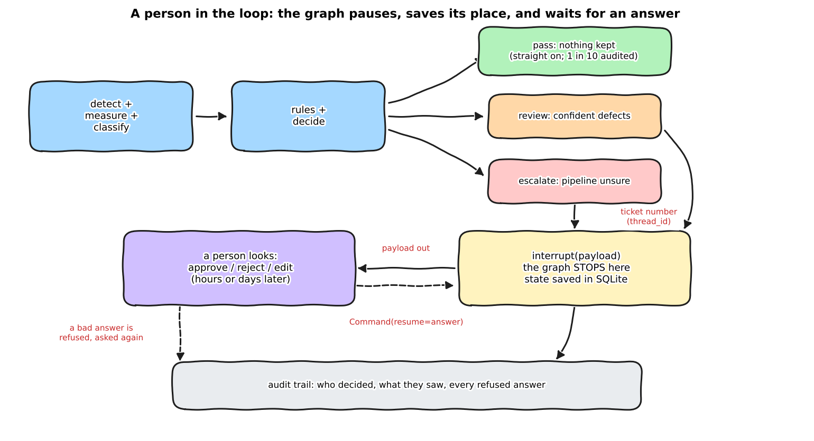

:::{.callout-tip}
This post is part of the [Agentic Developer: Zero to Advanced](index.qmd) series. It follows on from
[Part 8 -- tool design](08-tool-design.qmd) and finishes [Arc 2, the agent loop](index.qmd#arc-2-the-agent-loop). Parts 10 to 13 are
still to be written; Part 14 came first because it did not depend on them.
:::

Part 7 ended every image with a verdict word: `pass`, `review` or `escalate`. In Part 7 they were only labels. In this post
they become **hand-off words**: the pipeline stops, a person looks, and the run carries on from the same place with their answer.

Part 8 left a promise. It said the small typed models' probabilities are what the review threshold would be set on. I test
that promise here, and the result is less friendly than the promise.

Two questions run through the post:

1. **How do you build the pause?** A graph that stops mid-run, saves its place, survives a restart, and refuses a sloppy answer.
2. **Is the person worth it?** I simulate reviewers on the same 200 held-out images as Parts 5 to 8 and measure what each
   policy buys, what it costs in minutes, and how bad a careless reviewer can make things.

:::{.callout-warning}
**What is simulated, and what is not.** The reviewer in every experiment below is a **simulation**. It knows the exact answer
(the synthetic dataset has it) and makes a mistake on each box with a probability I choose. That models a person; it is not
one. The "30 seconds per image" is my **assumption**, not a measurement. The pause, the queue, the validation and the
SQLite persistence are real code and run for real. The pipeline results come from the **saved** Part 7 runs (the language-model
variant used `qwen3-coder`, not the model Part 14 used), so no model was called to produce the numbers; one live check with
the current local model is shown near the end.
:::

```{=html}
<div style="margin:1em 0;">
  <button id="toggle-outputs" type="button" style="padding:6px 14px;border:1px solid #1971c2;border-radius:4px;background:#1971c2;color:white;cursor:pointer;">Show all outputs</button>
  <span style="color:#666;font-size:0.9em;margin-left:8px;">Outputs are collapsed by default. Each one is the real captured output of the code above it.</span>
</div>
<script>
(function(){
  var b = document.getElementById("toggle-outputs"), open = false;
  b.onclick = function(){
    open = !open;
    document.querySelectorAll("details.out").forEach(function(d){ d.open = open; });
    b.textContent = open ? "Hide all outputs" : "Show all outputs";
  };
})();
</script>
```

:::{.callout-tip}
## Read it as a notebook

Every section has a literate notebook: the idea in plain words with a daily-life picture, the real source, and cells you can
**change and rerun**. The notebooks marked "Your turn" let you answer a review yourself and check your answer against the exact one.
Outputs are saved from a real run, and GitHub shows them without installing anything.

| Notebook | Covers | Needs the model server? |
|---|---|---|
| [`09a_where_a_human_belongs`](https://github.com/HasanGoni/quarto_blog_hasan/blob/main/notebooks/agentic-zero-to-advanced/literate/09a_where_a_human_belongs.ipynb) | what is inside each verdict, what the reviewer is shown | no |
| [`09b_pause_and_resume`](https://github.com/HasanGoni/quarto_blog_hasan/blob/main/notebooks/agentic-zero-to-advanced/literate/09b_pause_and_resume.ipynb) | `interrupt()`, bad answers, the replay gotcha, a restart; **you review an image** | no |
| [`09c_who_to_ask`](https://github.com/HasanGoni/quarto_blog_hasan/blob/main/notebooks/agentic-zero-to-advanced/literate/09c_who_to_ask.ipynb) | which cases to send to a person | no, reads the saved Part 8 runs |
| [`09d_does_the_human_help`](https://github.com/HasanGoni/quarto_blog_hasan/blob/main/notebooks/agentic-zero-to-advanced/literate/09d_does_the_human_help.ipynb) | policies, reviewer quality, the rubber stamp; **change the settings** | no, reads the saved Part 7 runs |
| [`09e_queue_and_failures`](https://github.com/HasanGoni/quarto_blog_hasan/blob/main/notebooks/agentic-zero-to-advanced/literate/09e_queue_and_failures.ipynb) | the queue, timeouts, refused answers, the test suite | one cell (about 1 minute) |
:::

## Where a person belongs

*Explain like I'm five.* Airport security. A machine looks at every bag. A person looks only at the bags the machine flags,
plus a few random ones to check that the machine is not missing things. Nobody searches every suitcase by hand (too slow),
and nobody lets the machine decide alone about a bag it is unsure of (too risky).



*Explain like I'm a data scientist.* Human-in-the-loop is a routing decision plus a persistence mechanism. The routing says
which cases reach a person (a policy over the verdict). The persistence says what happens to a run while it waits: the full
graph state is checkpointed under a thread id, so the wait can last days and the answer can be applied by a different process.
Everything else (validation, audit, timeouts) exists because a person is slower, less predictable and less trusted than a function call.

## Jargon, explained simply

| Term | What it means | Daily-life version |
|---|---|---|
| **Interrupt** | A call inside a node that stops the run and hands a question to the caller. | "Hold on, I need to ask someone." |
| **Checkpointer** | Saves the graph's state after every step. | A save slot in a video game. |
| **Thread id** | The name of one saved run. | The ticket number at a deli counter. |
| **Resume** | Continue a paused run, giving it the answer. | Pressing Continue. |
| **Payload** | What the reviewer is shown. | The form clipped to the ticket. |
| **Review queue** | The list of paused runs waiting for a person. | The board behind the counter. |
| **Audit trail** | A record of who decided what, and every answer that was refused. | The receipt. |
| **Policy** | Which verdicts reach a person. | "The machine flags it, or we pick 1 bag in 10." |
| **Deferral** | Handing the cases the model is least sure about to a person. | A triage nurse sending the unsure patients to the doctor first. |
| **Rubber stamp** | Approving without looking. | Signing a page without reading it. |
| **Precision / recall** | Of what was reported, how much is real / of what is real, how much was reported. | Of the fish in the net, how many are the right kind / of the right fish in the lake, how many are in the net. |
| **Ceiling recall** | The best recall any reviewer could reach, because the detector never boxed the rest. | You cannot count fish the net never caught. |

## What is inside each verdict

:::{.callout-note appearance="minimal"}
**Run it:** [notebook `09a_where_a_human_belongs`](https://github.com/HasanGoni/quarto_blog_hasan/blob/main/notebooks/agentic-zero-to-advanced/literate/09a_where_a_human_belongs.ipynb) prints this table and draws the image a reviewer would see.
:::

The synthetic dataset has the exact answer for every image, so I can open each verdict class and count what a person would meet.
`band` is the contrast rule from Part 7, `llm` is the saved language-model run.

| Run | Verdict | Images | Boxes kept | Of those, real | Real boxes thrown away |
|---|---|---|---|---|---|
| band | pass | 104 | 0 | 0 | 9 |
| band | review | 93 | 143 | 59 | 10 |
| band | escalate | 3 | 17 | 3 | 0 |
| llm | pass | 109 | 0 | 0 | 11 |
| llm | review | 55 | 80 | 35 | 8 |
| llm | escalate | 36 | 66 | 25 | 2 |

Two things to see. In `review` and `escalate` images, **less than half the kept boxes are real**: that is what a person fixes. And
the `pass` images contain real defects the pipeline discarded (9 for the rule, 11 for the model). A policy that only looks at
`review` and `escalate` never sees them.

## The pause

Part 6 paused *before* a node with `interrupt_before`. Here the pause is *inside* a node, so the node can hand over a question and
receive the answer. The whole mechanism is one line:

```{.python filename="notebooks/agentic-zero-to-advanced/hitl_graph.py"}
def human_review_node(state: HitlState) -> dict:
    payload = review_payload(state)              # what the reviewer is shown: plain JSON
    valid = set(payload["all_candidate_ids"])
    audit = []
    while True:
        raw = interrupt(payload)                 # first pass: the graph stops here. After Command(resume=x): returns x
        try:
            d = parse_decision(raw, valid)       # never trust the shape of a person's answer
            break
        except DecisionError as exc:             # bad answer: do not crash, do not guess, ask again with the reason
            audit.append({"image": state["image"], "event": "answer rejected", "why": str(exc), "answer": raw})
            payload = {**payload, "previous_answer_rejected": str(exc)}
    ...                                          # approve keeps the pipeline's boxes, reject clears, edit keeps keep_ids
```

The reviewer's three actions are `approve` (the kept boxes are exactly the real ones), `reject` (none is real) and `edit` with
`keep_ids` (these are real, including a box the pipeline threw away). The graph is the Part 7 graph with this node added between
`decide` and `report`, and the policy decides which verdicts take that route:

```{.python filename="notebooks/agentic-zero-to-advanced/hitl_graph.py"}
POLICIES = {
    "none":           Policy("the pipeline decides alone", lambda s: False, auto_fail_confident=True),
    "escalate_only":  Policy("humans see only 'escalate'", lambda s: s["verdict"] == "escalate", auto_fail_confident=True),
    "all_nonpass":    Policy("humans see 'review' and 'escalate'", lambda s: s["verdict"] in ("review", "escalate")),
    "all_plus_audit": Policy("'review' + 'escalate' + 1 in 10 of the passes", ...),
}
```

### A wrong answer is asked again

A reviewer uses a form, and forms get filled in badly. I tried seven kinds of bad answer on one paused image. None crashed the run,
none was guessed, and each came back with a reason the reviewer can act on.

```{=html}
<details class="out">
<summary><strong>Show output (notebook 09b)</strong></summary>
```

```{.text}
approve                                                        -> waiting: expected a JSON object, got str
{'action': 'maybe', 'reviewer': 'x'}                           -> waiting: action: Input should be 'approve', 'reject' or 'edit'
{'action': 'approve'}                                          -> waiting: reviewer: Field required
{'action': 'approve', 'reviewer': '  '}                        -> waiting: reviewer must not be empty: every decision needs a name for the audit trail
{'action': 'edit', 'reviewer': 'x'}                            -> waiting: action 'edit' needs keep_ids (use [] to clear everything, or choose 'reject')
{'action': 'edit', 'reviewer': 'x', 'keep_ids': [999]}         -> waiting: keep_ids [999] are not candidates of this image (valid: [0, 1, 2])
{'action': 'approve', 'reviewer': 'x', 'keep_ids': [0]}        -> waiting: keep_ids is only allowed with action 'edit', not 'approve'

final: pass | dee chose 'reject': dust
```

```{=html}
</details>
```

The audit trail keeps every refused answer next to the final decision, so you can later see that a reviewer needed three tries.

### The gotcha: the node starts again from its first line

When the reviewer answers, LangGraph does **not** continue from the middle of the node. It runs the node again from the top, and this
time `interrupt()` returns the answer instead of pausing. Anything above the `interrupt()` runs twice. I made the node's first line
append to a list, so you can see it:

```{.text}
node body started 1 time(s) after the first run (it paused)
node body started 2 time(s) after one answer
```

Daily-life version: you phone the bank, get put on hold, and when the agent comes back they start the greeting again. If the
greeting charged a fee, you paid twice. The rule for code before `interrupt()`: it must be harmless to run again. Never send an
email or charge a card above it.

### The save slot survives a restart

`MemorySaver` lives inside one Python process. A reviewer may answer tomorrow, after a deploy. With `SqliteSaver` the state is a
file, and I started a review in one process and finished it in a **brand-new** one:

```{=html}
<details class="out">
<summary><strong>Show output (notebook 09b)</strong></summary>
```

```{.text}
this process: queue has {'done': 8, 'waiting': 4} | oldest waiting: insp-test_00002
NEW process sees {'done': 8, 'waiting': 4}
NEW process finished it: fail human
this process again: {'done': 9, 'waiting': 3}
```

```{=html}
</details>
```

## The queue

:::{.callout-note appearance="minimal"}
**Run it:** [notebook `09e_queue_and_failures`](https://github.com/HasanGoni/quarto_blog_hasan/blob/main/notebooks/agentic-zero-to-advanced/literate/09e_queue_and_failures.ipynb) fills a queue, answers some tickets, lets the rest time out, and tries to break it.
:::

`hitl_queue.py` is the board behind the deli counter: one SQLite file with LangGraph's saved states plus one table of tickets
(who is waiting, since when, what they were shown, how it ended). A reviewer's tool talks to three calls: `pending()`,
`answer(thread_id, decision)` and `expire(older_than_s)`.

The design decision that matters is what happens to a ticket nobody answers. `expire()` marks it **held**. It does not pass it. A
silent timeout that turns into a pass is the worst possible default for an inspection: the part would ship because nobody looked.

```{=html}
<details class="out">
<summary><strong>Show output (notebook 09e: 40 images, 10 answered, 2 hours of silence)</strong></summary>
```

```{.text}
counts: {'done': 23, 'waiting': 17}
counts: {'done': 33, 'waiting': 7}
held: 7 | counts: {'done': 33, 'held': 7}
verdicts stored for held items: {'hold'}

answer a closed item again: RuntimeError: insp-test_00002 is 'done', not waiting: answer refused
answer an item that was held: RuntimeError: insp-test_00027 is 'held', not waiting: answer refused
answer a ticket that does not exist: KeyError: 'no such review item: insp-nope'
submit the same image twice: {'status': 'done', 'thread_id': 'insp-test_00000', 'note': 'already submitted: not run again'}
```

```{=html}
</details>
```

A closed ticket cannot be answered again (a second answer would rewrite history), and submitting the same image twice reuses its
ticket instead of running the pipeline again.

All of this is covered by `test_hitl_paths.py`, offline and in seconds: the four decisions, seven kinds of bad answer, a rescued
box, the replay, a second process resuming, a held ticket, and the graph against the simulation for four different reviewers.

```{=html}
<details class="out">
<summary><strong>Show output (uv run python test_hitl_paths.py)</strong></summary>
```

```{.text}
ok  approve keeps the pipeline's boxes, verdict fail, decided_by human
ok  reject clears everything, verdict pass, the note is in the reason
ok  edit keeps exactly the given ids
ok  7 malformed answers are each refused and the question is asked again
ok  the audit trail keeps every refused answer and the final decision
ok  edit can add a rejected box; it is flagged added_by_human
ok  policy none never pauses
ok  escalate_only pauses less than all_nonpass
ok  the audit policy pauses on some images that the pipeline passed
ok  without a human a 'review' verdict becomes fail by itself (decided_by auto-fail)
ok  each resume starts the review node again from its first line
ok  a brand-new process finishes a review started in this one
ok  a second answer to a closed item is refused
ok  an unknown item raises KeyError
ok  submitting the same image twice does not run it twice
ok  expire marks unanswered items 'held', never 'pass'
ok  graph == simulation (reviewer error 0.0, scope all, rubber_stamp False)
ok  graph == simulation (reviewer error 0.1, scope all, rubber_stamp False)
ok  graph == simulation (reviewer error 0.1, scope kept, rubber_stamp False)
ok  graph == simulation (reviewer error 0.0, scope all, rubber_stamp True)
ok  rubber stamping gives the same tp/fp/fn as no human at all

ALL HITL PATHS OK (21 checks)
```

```{=html}
</details>
```

## Which cases to send

:::{.callout-note appearance="minimal"}
**Run it:** [notebook `09c_who_to_ask`](https://github.com/HasanGoni/quarto_blog_hasan/blob/main/notebooks/agentic-zero-to-advanced/literate/09c_who_to_ask.ipynb) draws the five curves and lets you add another judge from Part 8.
:::

*Explain like I'm five.* A triage nurse sends the patients she is least sure about to the doctor first. The question is not whether
the nurse has opinions. It is: when she says "I'm unsure", is she actually the one who is wrong more often?

Part 8 gave every held-out box (513 boxes, 81 real) a probability from several judges. I let each judge decide alone at the
threshold chosen on dev, then let a person re-check the boxes the judge was **least sure** about, and count how many of the judge's
mistakes that fixes. The reference is a person who re-checks the **same number of boxes picked at random**.

| Judge | Judge's mistakes | Fixed after re-checking 25% (least sure first) | Fixed by 25% picked at random |
|---|---|---|---|
| rule (contrast) | 241 | 56 | 61 |
| Laya english (guided) | 212 | 69 | 54 |
| **language model, verbalised (guided)** | 71 | **34** | **18** |
| language model, log-prob (plain) | 242 | 64 | 61 |
| language model, log-prob (guided) | 229 | 64 | 58 |

```{=html}
<details class="out">
<summary><strong>Show output (notebook 09c)</strong></summary>
```

```{.text}
judge                    mistakes | fixed@10%  random | fixed@25%  random | fixed@50%  random
band/guided                   241 |        22    23.5 |        56    61.1 |       104   119.8
laya-english/guided           212 |        25    20.7 |        69    53.7 |       124   105.4
llm-verbalized/guided          71 |        13     6.9 |        34    18.0 |        50    35.3
llm-logprob/plain             242 |        28    23.6 |        64    61.3 |       116   120.3
llm-logprob/guided            229 |        23    22.3 |        64    58.0 |       123   113.8
```

```{=html}
</details>
```

What this says:

- For the verbalised language-model judge, uncertainty is worth about **twice** random choice (34 mistakes fixed against 18).
- For the rule and for the plain log-prob judge, the "least sure" boxes are **no better than random ones**. A person's time sent by
  that signal is no better spent than a coin flip. The other two are only modestly better than chance.
- Part 8 found that these judges separate real defects from false alarms only modestly (AUC about 0.6 to 0.7). You cannot route well
  on a signal that barely separates the two groups, which is why the promise at the end of Part 8 holds for one judge in five.

So I do **not** route on "low confidence". The pipeline routes on two things that do not depend on a judge being well calibrated:
*a defect was kept* (any image with a kept box goes to a person) and *the pipeline itself is confused* (`escalate`). Measure the
curve before you route on a score, and compare it with random.

## Does the person help?

:::{.callout-note appearance="minimal"}
**Run it:** [notebook `09d_does_the_human_help`](https://github.com/HasanGoni/quarto_blog_hasan/blob/main/notebooks/agentic-zero-to-advanced/literate/09d_does_the_human_help.ipynb) reproduces every table here and has a "Your turn" cell where you change the policy and the reviewer.
:::

*Explain like I'm five.* A second proofreader. If they catch typos you would have shipped, the book is better. If they skim and
initial every page, you pay for a signature and gain nothing. If they "fix" correct sentences, the book gets worse. I put a simulated
reviewer behind the pipeline and measured all three. Every number below comes from `hitl_summary.py`, which reads the saved Part 7
runs.

### Four policies, a perfect reviewer

`P` is precision, `R` is recall, and `ceiling R` is the best recall any reviewer could reach. Minutes assume 30 seconds an image, which is my guess.

| Run | Policy | Images a person sees | Minutes | P | R | Ceiling R | False alarms left |
|---|---|---|---|---|---|---|---|
| band | none | 0 | 0 | 0.388 | 0.160 | 0.209 | 98 |
| band | escalate only | 3 | 1.5 | 0.425 | 0.160 | 0.209 | 84 |
| band | review + escalate | 96 | 48 | **1.000** | 0.186 | 0.209 | 0 |
| band | + 1 in 10 passes | 111 | 55.5 | 1.000 | 0.186 | 0.209 | 0 |
| llm | none | 0 | 0 | 0.411 | 0.155 | 0.209 | 86 |
| llm | escalate only | 36 | 17.8 | 0.570 | 0.162 | 0.209 | 47 |
| llm | review + escalate | 91 | 45.5 | **1.000** | 0.181 | 0.209 | 0 |
| llm | + 1 in 10 passes | 105 | 52.5 | 1.000 | 0.181 | 0.209 | 0 |

```{=html}
<details class="out">
<summary><strong>Show output (uv run python hitl_summary.py)</strong></summary>
```

```{.text}
verdict mix {'band': {'pass': 104, 'review': 93, 'escalate': 3}, 'llm': {'pass': 109, 'review': 55, 'escalate': 36}}
run/policy                 sent    min      P      R   ceil   fp  audited  rescued
band/none                   0.0    0.0  0.388  0.160  0.209   98      0.0      0.0
band/escalate_only          3.0    1.5  0.425  0.160  0.209   84      0.0      0.0
band/all_nonpass           96.0   48.0  1.000  0.186  0.209    0      0.0      0.0
band/all_plus_audit       111.0   55.5  1.000  0.186  0.209    0     15.0      0.0
llm/none                    0.0    0.0  0.411  0.155  0.209   86      0.0      0.0
llm/escalate_only          35.7   17.8  0.570  0.162  0.209   47      0.0      0.0
llm/all_nonpass            91.0   45.5  1.000  0.181  0.209    0      0.0      0.0
llm/all_plus_audit        105.0   52.5  1.000  0.181  0.209    0     14.0      0.0

reviewer error sweep (all_nonpass, llm runs)       scope=all: P / R      scope=kept: P / R
  error 0.00                                       1.000 / 0.181        1.000 / 0.155
  error 0.02                                       0.897 / 0.179        0.950 / 0.153
  error 0.05                                       0.764 / 0.172        0.892 / 0.146
  error 0.10                                       0.647 / 0.165        0.832 / 0.141
  error 0.15                                       0.541 / 0.156        0.770 / 0.131
  error 0.20                                       0.453 / 0.144        0.692 / 0.121
  error 0.30                                       0.328 / 0.127        0.581 / 0.109
  error 0.40                                       0.242 / 0.108        0.481 / 0.093
rubber stamp: {'precision': 0.411, 'recall': 0.155, 'sent_to_human': 91, 'human_minutes': 45.5}

deferral (errors fixed after the person re-checks the k% least sure boxes, vs random)
  {'judge': 'band/guided', 'errors': 241, 'fixed@10%': 22, 'random@10%': 23.5, 'fixed@25%': 56, 'random@25%': 61.1, 'fixed@50%': 104, 'random@50%': 119.8}
  {'judge': 'laya-english/guided', 'errors': 212, 'fixed@10%': 25, 'random@10%': 20.7, 'fixed@25%': 69, 'random@25%': 53.7, 'fixed@50%': 124, 'random@50%': 105.4}
  {'judge': 'llm-verbalized/guided', 'errors': 71, 'fixed@10%': 13, 'random@10%': 6.9, 'fixed@25%': 34, 'random@25%': 18.0, 'fixed@50%': 50, 'random@50%': 35.3}
  {'judge': 'llm-logprob/plain', 'errors': 242, 'fixed@10%': 28, 'random@10%': 23.6, 'fixed@25%': 64, 'random@25%': 61.3, 'fixed@50%': 116, 'random@50%': 120.3}
  {'judge': 'llm-logprob/guided', 'errors': 229, 'fixed@10%': 23, 'random@10%': 22.3, 'fixed@25%': 64, 'random@25%': 58.0, 'fixed@50%': 123, 'random@50%': 113.8}
```

```{=html}
</details>
```

- A careful person clears **every** false alarm that reaches them: precision goes from about 0.4 to 1.0.
- Recall barely moves (0.155 to 0.181). It is capped at **0.209**, because the detector never put a box on most of the voids. **A
  reviewer fixes what the pipeline reports. They cannot find what was never boxed.** If recall is the problem, the fix is upstream.
- `escalate only` is nearly free for the rule (3 images) and half-useful for the language model.
- The audit row looked at 15 of the passes (14 for the model run) and the reviewer found **nothing**. That is reassuring and it is
  15 images. It is not a proof that the passes are clean.

### The reviewer's quality is the whole story

Same policy (`review + escalate`, the language-model runs), now the reviewer errs on a fraction of boxes. Two designs: `scope=all`
shows the reviewer every candidate (they can rescue a rejected box, and they can also invent a defect out of the many false alarms),
and `scope=kept` shows only the boxes the pipeline kept. Move the slider. The grey line is the pipeline with **no person**: a bar
below it means the reviewer made the result worse.

```{=html}
<style>
#hl{max-width:760px;margin:1.2em auto;font-family:system-ui,sans-serif;font-size:0.9em;}
#hl .row{display:flex;align-items:center;gap:12px;margin:8px 0;flex-wrap:wrap;}
#hl input[type=range]{flex:1;min-width:220px;}
#hl svg{width:100%;height:auto;display:block;margin-top:8px;}
#hl .verdict{margin-top:8px;padding:8px 10px;border-radius:6px;border:1px solid #888;}
</style>
<div id="hl">
  <div class="row"><label for="hl-err"><strong>Reviewer error per box</strong></label>
    <input id="hl-err" type="range" min="0" max="7" step="1" value="2"><span id="hl-errv"></span></div>
  <div class="row">
    <label><input type="radio" name="hl-s" value="all" checked> reviewer judges every candidate (scope=all)</label>
    <label><input type="radio" name="hl-s" value="kept"> only the kept boxes (scope=kept)</label>
    <label><input type="checkbox" id="hl-stamp"> rubber stamp (approves without looking)</label></div>
  <svg id="hl-svg" viewBox="0 0 760 210" role="img" aria-label="Precision and recall for the chosen reviewer"></svg>
  <div class="verdict" id="hl-note"></div>
</div>
<script>
(function(){
  var S = {"all/0.0": {"precision": 1.0, "recall": 0.181}, "all/0.02": {"precision": 0.897, "recall": 0.179}, "all/0.05": {"precision": 0.764, "recall": 0.172}, "all/0.1": {"precision": 0.647, "recall": 0.165}, "all/0.15": {"precision": 0.541, "recall": 0.156}, "all/0.2": {"precision": 0.453, "recall": 0.144}, "all/0.3": {"precision": 0.328, "recall": 0.127}, "all/0.4": {"precision": 0.242, "recall": 0.108}, "kept/0.0": {"precision": 1.0, "recall": 0.155}, "kept/0.02": {"precision": 0.95, "recall": 0.153}, "kept/0.05": {"precision": 0.892, "recall": 0.146}, "kept/0.1": {"precision": 0.832, "recall": 0.141}, "kept/0.15": {"precision": 0.77, "recall": 0.131}, "kept/0.2": {"precision": 0.692, "recall": 0.121}, "kept/0.3": {"precision": 0.581, "recall": 0.109}, "kept/0.4": {"precision": 0.481, "recall": 0.093}};
  var NONE = {"precision": 0.411, "recall": 0.155}, STAMP = {"precision": 0.411, "recall": 0.155, "sent_to_human": 91, "human_minutes": 45.5}, ERR = [0.0, 0.02, 0.05, 0.1, 0.15, 0.2, 0.3, 0.4];
  var sl = document.getElementById("hl-err"), ev = document.getElementById("hl-errv"), svg = document.getElementById("hl-svg"),
      note = document.getElementById("hl-note"), stamp = document.getElementById("hl-stamp");
  function draw(){
    var e = ERR[+sl.value], scope = document.querySelector('input[name=hl-s]:checked').value, rs = stamp.checked;
    var r = rs ? {precision: STAMP.precision, recall: STAMP.recall} : S[scope + "/" + e];
    ev.textContent = rs ? "(ignored: no looking)" : (Math.round(e*100) + "%");
    var rows = [["precision", r.precision, NONE.precision, "#1971c2"], ["recall", r.recall, NONE.recall, "#e8590c"]], out = "", x0 = 120, W = 540;
    rows.forEach(function(q, i){
      var y = 30 + i*80, w = W*q[1], nx = x0 + W*q[2], worse = q[1] < q[2] - 0.0005;
      out += '<text x="'+(x0-10)+'" y="'+(y+22)+'" text-anchor="end" font-size="14" fill="currentColor">'+q[0]+'</text>';
      out += '<rect x="'+x0+'" y="'+y+'" width="'+Math.max(2,w)+'" height="32" fill="'+(worse?"#e03131":q[3])+'" opacity="0.88"></rect>';
      out += '<text x="'+(x0+Math.max(2,w)+8)+'" y="'+(y+22)+'" font-size="14" fill="currentColor">'+q[1].toFixed(3)+'</text>';
      out += '<line x1="'+nx+'" y1="'+(y-8)+'" x2="'+nx+'" y2="'+(y+40)+'" stroke="#868e96" stroke-width="3"></line>';
      out += '<text x="'+nx+'" y="'+(y-12)+'" text-anchor="middle" font-size="11" fill="#868e96">no person: '+q[2].toFixed(3)+'</text>';
    });
    svg.innerHTML = out;
    var msg;
    if (rs) msg = "A rubber stamp costs " + STAMP.human_minutes.toFixed(0) + " minutes of someone's day and changes nothing.";
    else if (r.precision < NONE.precision) msg = "This reviewer makes the pipeline worse than having nobody: precision fell below " + NONE.precision.toFixed(3) + ".";
    else if (r.precision < NONE.precision + 0.1) msg = "Barely better than nobody. The queue costs time and buys almost nothing.";
    else msg = "The reviewer helps: " + (r.precision/NONE.precision).toFixed(1) + " times the precision of the pipeline alone.";
    if (!rs && r.recall < NONE.recall - 0.0005) msg += " Recall also fell below the pipeline's own (" + r.recall.toFixed(3) + " against " + NONE.recall.toFixed(3) + "): the reviewer threw away real defects.";
    note.textContent = msg;
  }
  sl.oninput = draw; stamp.onchange = draw;
  Array.prototype.forEach.call(document.querySelectorAll('input[name=hl-s]'), function(el){ el.onchange = draw; });
  draw();
})();
</script>
```

The numbers behind the slider:

| Reviewer error per box | `scope=all`: P / R | `scope=kept`: P / R |
|---|---|---|
| 0% | 1.000 / 0.181 | 1.000 / 0.155 |
| 2% | 0.897 / 0.179 | 0.950 / 0.153 |
| 5% | 0.764 / 0.172 | 0.892 / 0.146 |
| 10% | 0.647 / 0.165 | 0.832 / 0.141 |
| 15% | 0.541 / 0.156 | 0.770 / 0.131 |
| 20% | **0.453** / 0.144 | 0.692 / 0.121 |
| 30% | 0.328 / 0.127 | 0.581 / 0.109 |
| 40% | 0.242 / 0.108 | 0.481 / 0.093 |

The pipeline alone is at P 0.411, R 0.155.

- A reviewer who errs on 1 box in 5 with `scope=all` gives precision **0.45, which is no better than having no reviewer** (0.41). The same
  reviewer with `scope=kept` still gives 0.69.
- `scope=kept` gives up the rescues (recall 0.155 instead of 0.181 for a perfect reviewer) and in return it is much harder to hurt the
  result. Showing a person fewer boxes to judge is a safety feature. The reason: with `scope=all` the many false alarms are the main
  place where an error can invent a defect.

### The rubber stamp

A reviewer who approves whatever the pipeline kept without looking:

```{.text}
rubber stamp : precision 0.411, recall 0.155, 91 images, 45.5 minutes
no person    : precision 0.411, recall 0.155,  0 images,  0.0 minutes
-> the rubber stamp costs 46 minutes and changes nothing.
```

A queue with a rubber-stamp reviewer looks like oversight and is not. The defence is to measure the reviewer (next section).

### Is the simulation the same as the real graph?

The tables come from `simulate()`, which applies a policy to a **saved** pipeline run. The real thing is the LangGraph with
`interrupt()`. For the rule classifier (offline) I ran both on the 200 images with a reviewer that errs 10% of the time:

```{.text}
real graph: 96 images paused, P 0.68 R 0.171  (1.4 s)
simulation: 96 images paused, P 0.68 R 0.171
identical final boxes on all 200 images: True
```

`test_hitl_paths.py` repeats that comparison for four reviewers (perfect, 10% error with both scopes, and the rubber stamp). For the
language-model variant I trust the simulation because it uses the same decision code; I did not run the real graph with the model on
200 images (that is about 17 seconds an image).

### One live check with the current model

With the real Part 7 setup (the local `qwen3.8-27b` classifies and writes the note) the graph paused on `test_00002` after 12.3 s,
took the simulated answer, and finished in 4 s. The generated note said the verdict was "fail because the analyzer selected 'approve'".
The ids and numbers in it come from the record, but the model has **no idea why** the person decided: the reviewer's reason is only
in the audit trail. Do not let a generated note stand in for the reviewer's own words.

## What I would log about the reviewers

The simulation says the whole value sits in the reviewer, so a real deployment should measure them. The queue already stores who
decided, when, and the pipeline's verdict. Four numbers I would watch, none of which I measured here because there is no real reviewer:

1. **The overturn rate**: how often `reject` or `edit` replaces what the pipeline kept. Near zero means a rubber stamp or a perfect pipeline, and you cannot tell which without the next item.
2. **Seeded cases**: now and then put an image with a known answer in the queue and score the reviewer on it.
3. **Refused answers per reviewer**: a reviewer who needs three tries often is being asked a confusing question.
4. **Time to answer, and the count of held tickets**: a growing hold list is the queue telling you it is understaffed.

## Best practices, and how they connect to the rest of the series

- **Pause inside a node, not before it, when you need an answer.** `interrupt_before` (Part 6) lets you look; `interrupt()` lets you ask.
- **Make the code above `interrupt()` safe to run twice.** The node starts again on resume.
- **Validate the person.** Ask again with a reason. Never crash, never guess a default.
- **A timeout is a hold, not a pass.** Decide what an unanswered ticket means before you ship.
- **Show the reviewer less.** `scope=kept` was more robust than showing every candidate.
- **Measure the curve before you route on a score** (the Part 8 calibration, tested here against random).
- **A human cannot fix recall that the detector never had.** Put the effort where the loss is.
- **Persist to a file, not memory**, if the answer may come after a restart.

This is the hook for later parts. Part 10 (sub-agents) and Part 12 (orchestration) will have several agents proposing things, and the
same pause-and-ask node is how one of them hands a decision to a person. Part 14's `Execute` sandbox asked a different question
(what may the agent do alone); this part asks who decides when the agent is unsure.

## What I did not do

- **No real reviewer.** Every reviewer here is a simulation with a chosen error rate. The break-even point (about 1 box in 5 for `scope=all`) is a property of this dataset and this pipeline, not a law.
- **The 30 seconds an image is an assumption.** The minutes columns scale with it.
- **The saved language-model run used `qwen3-coder`.** Part 14 and the live check use `qwen3.8-27b`. I did not rerun the 200-image pipeline with the newer model.
- **The audit sample is 15 images.** It found nothing, which says little about how clean the passes really are.
- **No web form.** The "form" is a Python dict. A real reviewer would need a page that shows `show_review()` and sends the answer to `answer()`. The payload is plain JSON, so that is a small step, but I did not build it.
- **No authentication, no deadlines, no escalation chain.** `expire()` holds; nobody is told. Who is told, and how fast, is a business decision.
- **One reviewer per ticket.** There is no second opinion, no disagreement handling.
- **Only the synthetic void data.** No real X-ray was shown to anyone.
- **No video for this part.** The earlier parts have narrated chapters; I wrote this one first and the notebooks to go with it.

## Reproduce this yourself

```{=html}
<details>
<summary><strong>Show reproduce commands</strong></summary>
```

```bash
cd quarto_blog_hasan/notebooks/agentic-zero-to-advanced
uv sync                                          # langgraph-checkpoint-sqlite is in pyproject.toml now
uv run python test_hitl_paths.py                 # 21 offline checks of every path (seconds)
uv run python hitl_summary.py                    # every table in this post; reads the saved Part 7 and Part 8 runs
uv run python hitl_diagrams.py                   # the pause-and-ask figure

# the five literate notebooks (outputs are saved in the files; this re-executes them in place, about 1 minute)
cd literate && ../.venv/bin/python run_all.py 09a_where_a_human_belongs 09b_pause_and_resume 09c_who_to_ask \
    09d_does_the_human_help 09e_queue_and_failures
```

Only one cell of `09e` needs the vLLM server on :8000 (`AGENTIC_ZERO_MODEL` defaults to `qwen3.8-27b` in the notebooks).

```{=html}
</details>
```

## What's next

Parts 10 to 13 (sub-agents, the Deep Agents harness, orchestration, planning across sessions) are still to come. Part 14 already used
sub-agents and the Deep Agents library for a different question (context), so I will write those parts around what Part 14 did not
show: a supervisor that delegates, aggregates, and hands a decision to a person when the sub-agents disagree.
