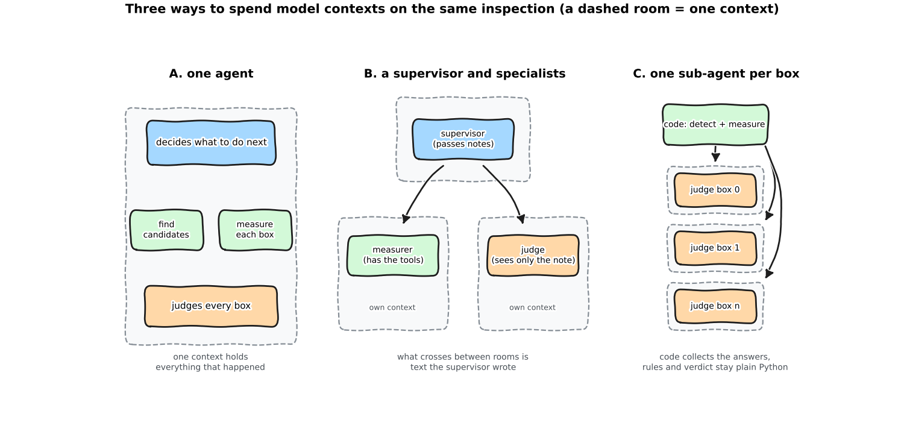

:::{.callout-tip}
This post is part of the [Agentic Developer: Zero to Advanced](index.qmd) series. It follows on from
[Part 9 -- human in the loop](09-human-in-the-loop.qmd) and opens [Arc 3, scaling up](index.qmd#arc-3-scaling-up-multi-agent-and-deep-agents).
Parts 11 to 13 are still to be written.
:::

"When one agent is not enough, use several" is advice that sounds obviously right. This post tests it on the X-ray inspection from Parts 5 to 9,
and the honest summary is: it depends on *why* you split, and one of the three designs I built gave me nothing for twice the cost.

Two questions, because "use sub-agents" answers both and they are not the same question:

1. **An agent runs the whole inspection and picks the order itself (Parts 5 and 6). Does a supervisor with specialists beat one agent?**
2. **Code owns the order (Part 7) and the model only judges the boxes. How many model contexts should the judging use?** One call for all boxes,
   one sub-agent per box, or three sub-agents per box that vote.

:::{.callout-warning}
**What this measures, and what it does not.** One model (`qwen3.8-27b`, temperature 0, thinking off, served locally), one dataset (the synthetic void
images, **one** defect category), the **first 200 held-out test images**, with 387 real voids in them. About 2,000 image-runs in total. The three
judge designs ran 2 to 3 times each; the two agent designs ran **once** (an agent run takes 10 to 40 minutes for 200 images). The 200-image runs overlapped on one shared GPU, so
their **seconds** include queueing; a separate one-image-at-a-time latency check is shown further down. The Part 2 detector can only ever box about **21%** of the real voids, so
no design here can have recall above 0.209 whatever it does.
:::

```{=html}
<div style="margin:1em 0;">
  <button id="toggle-outputs" type="button" style="padding:6px 14px;border:1px solid #1971c2;border-radius:4px;background:#1971c2;color:white;cursor:pointer;">Show all outputs</button>
  <span style="color:#666;font-size:0.9em;margin-left:8px;">Outputs are collapsed by default. Each one is the real captured output of the code above it.</span>
</div>
<script>
(function(){
  var b = document.getElementById("toggle-outputs"), open = false;
  b.onclick = function(){
    open = !open;
    document.querySelectorAll("details.out").forEach(function(d){ d.open = open; });
    b.textContent = open ? "Hide all outputs" : "Show all outputs";
  };
})();
</script>
```

:::{.callout-tip}
## Read it as a notebook

Every section has a literate notebook: the idea in plain words with a daily-life picture, the real source, and cells you can **change and rerun**.
In `10b` you write the brief that the supervisor would write, and in `10a` and `10c` you pick any test image and watch the designs handle it. Outputs are saved from a real run.

| Notebook | Covers | Needs the model server? |
|---|---|---|
| [`10a_three_ways`](https://github.com/HasanGoni/quarto_blog_hasan/blob/main/notebooks/agentic-zero-to-advanced/literate/10a_three_ways.ipynb) | the three designs, what the dataset allows; **pick an image** | two short live cells |
| [`10b_supervisor_and_handoff`](https://github.com/HasanGoni/quarto_blog_hasan/blob/main/notebooks/agentic-zero-to-advanced/literate/10b_supervisor_and_handoff.ipynb) | the supervisor, what survives a hand-off; **write the brief yourself** | live cells, about 1 minute |
| [`10c_fanout_and_panel`](https://github.com/HasanGoni/quarto_blog_hasan/blob/main/notebooks/agentic-zero-to-advanced/literate/10c_fanout_and_panel.ipynb) | one sub-agent per box and the panel; **see each context** | live cells, about 30 seconds |
| [`10d_the_200_image_results`](https://github.com/HasanGoni/quarto_blog_hasan/blob/main/notebooks/agentic-zero-to-advanced/literate/10d_the_200_image_results.ipynb) | every table, the intervals, the buckets; **choose what to plot** | no, reads the saved runs |
| [`10e_failures_and_tests`](https://github.com/HasanGoni/quarto_blog_hasan/blob/main/notebooks/agentic-zero-to-advanced/literate/10e_failures_and_tests.ipynb) | what went wrong, the offline test suite | no |
:::

## Three offices

*Explain like I'm five.* A small clinic can run in three ways.

- **One doctor** does everything: asks the questions, measures, decides, writes it up, and keeps the whole story in their head.
- **A front-desk manager** who cannot examine anyone passes written notes to a nurse (who measures) and a doctor (who decides, and has never met the patient).
- **One technician per sample**: every sample goes to its own technician, who sees only that sample, and a clerk collects the answers.



Nothing about the clinic's *knowledge* changes between the three. What changes is **how many rooms** exist, **what crosses between them**, and **who decides the order**.

## Jargon, explained simply

| Term | In daily life | In this post |
|---|---|---|
| **Context** | the room one person can see and remember things in | a model's prompt plus everything said so far; it has a size limit (65,536 tokens here) |
| **Sub-agent** | a colleague you hand one job to, who only reports the result | another model call with its own context and its own short instructions |
| **Supervisor** | the front-desk manager who coordinates but cannot do the work | an agent whose only tools are the sub-agents |
| **Hand-off** | writing a note for the next person | the text that crosses from one context to the next; the receiver knows only what is on it |
| **Fan-out** | handing each exam paper to a different marker | one sub-agent per box, run at the same time, code collects the answers |
| **Panel** | asking three markers about the same paper | several independent sub-agents on one box, majority wins |
| **Context isolation** | a quiet room where nobody else's papers are on your desk | the reason you would split: a sub-agent's mess never reaches the others |
| **Bootstrap interval** | re-running the taste test with a different random 200 dishes, many times | resample the images 2,000 times and see how much a difference moves |

## What the dataset allows

The plan for this part said "sub-agents per defect category or per inspection stage". The dataset has **one** defect category (voids), so a per-category split cannot be tested honestly, and I did not invent categories.
What can be split is the **stage** (measure, then judge) and the **box** (one judge per candidate).

Every design uses the same model, the same guidance text about contrast (from Part 7), the same two business rules applied by code afterwards (R1 border, R2 minimum area), and the same scoring
against the exact void boxes. A box that the judge calls "uncertain" counts as kept, as in Parts 7 and 9, because a person still looks at it.

## Question 1: a supervisor and two specialists

The supervisor cannot measure or judge. It has two tools, and each tool *is* a sub-agent with its own context:

```python
SYSTEM_SUPERVISOR = """You supervise the inspection of one X-ray image of a metal part. You cannot measure or judge yourself.
You have two specialists, who each work in their own separate context and see ONLY what you pass them:
  inspect_stage(image)  measures every candidate box and returns a note
  judge_stage(brief)    reads a brief and says which boxes are defects. The judge cannot see the image or the measurer's note
                        unless you copy the numbers into the brief.
Call inspect_stage first. If it found no candidates, submit_report with an empty list. Otherwise call judge_stage with a brief that
contains every candidate id and every measurement, then submit_report with the ids the judge called defects."""
```

`inspect_stage` runs a small agent loop (the Part 5 loop) with the two detector tools and writes a plain-text note. `judge_stage` is a single model call with no tools that reads only the brief the supervisor wrote.
The hand-off is **free text**, the way most agent libraries do it: a sub-agent returns its final message.

Here is a real brief and the real answer, for an image with four candidate boxes:

```{=html}
<details class="out">
<summary><strong>Show output (notebook 10b)</strong></summary>
```

```{.text}
tools the supervisor called: ['inspect_stage', 'judge_stage', 'submit_report']

--- brief the supervisor wrote for the judge ---
Image test_00046, 4 candidate boxes measured. All are brighter than surroundings.
Cand 0: box [83,71,104,71,94], contrast +30.29 (brighter), area 483 px, aspect 0.91, edge dist 71 px (well inside image).
Cand 1: box [141,153,219,224], contrast +8.96, area 60 px, aspect 2.4, edge dist 0 (touches bottom edge).
Cand 2: box [85,90,221,224], contrast +17.67, area 15 px, aspect 1.67, edge dist 0 (touches bottom edge).
Cand 3: box [91,95,221,224], contrast +15.91, area 12 px, aspect 1.33, edge dist 0 (touches bottom edge).
Which candidates are real defects?

--- the judge's answer ---
Cand 0: defect 0.7
Cand 1: false_alarm 0.9
Cand 2: false_alarm 0.8
Cand 3: false_alarm 0.8

kept: [0] | calls by role: {'supervisor': 3, 'measurer': 3, 'judge': 1}
```

```{=html}
</details>
```

Look at `Cand 0`: its box is written with **five** numbers (`[83,71,104,71,94]`). A box has four. The measurer or the supervisor garbled it on the way. It did not matter for this decision, because the judge
never uses coordinates, which is exactly why this kind of corruption goes unnoticed. So I counted it.

### What survived the hand-off

For every candidate I checked that its id and its **contrast** value appear in the brief (rounding to one decimal is forgiven, rounding to a whole number is not). I also checked the **box coordinates** with a strict pattern.

```{=html}
<details class="out">
<summary><strong>Show output (notebook 10b)</strong></summary>
```

```{.text}
images where the supervisor wrote a brief: 145  (the other 55 had no candidates)
contrast carried:    512 of 513 boxes; every number intact in 144 of 145 briefs
coordinates carried: 386 of 513 boxes
supervisor kept a box the judge had not called a defect: 0 times
```

```{=html}
</details>
```

The thing I expected to go wrong, the numbers, did not: **512 of 513** contrast values arrived. The thing nobody needed, the coordinates, was corrupted for about 1 box in 4. And the supervisor never overrode its judge.
So the supervisor in this run was a **faithful relay**.

### What it cost, and what it bought

| Design | Precision / recall | Real boxes found / false alarms (per run) | Model calls per image | Tokens per image | Biggest context |
|---|---|---|---|---|---|
| `single` (one agent) | 0.543 / 0.129 | 50.0 / 42.0 | 2.9 | 3,151 | 1,183 |
| `supervisor` + 2 specialists | 0.472 / 0.109 | 42.0 / 47.0 | 6.7 | 5,948 | 1,132 |

The supervisor used **2.3 times the calls and 1.9 times the tokens** and was not better. The bootstrap interval for supervisor minus single is **precision -0.20 to +0.08, recall -0.04 to +0.005**:
it contains zero for both, so I cannot say the supervisor is *worse*, only that there is no sign it is better. Where did the tokens go? About half in the supervisor itself (it reads the note and writes the brief),
half in the measurer, and 5% in the judge, the only part that does the actual deciding.

Why nothing gained? Splitting buys **isolation**: a sub-agent's mess does not reach the others. This inspection has nothing to isolate. The single agent's biggest context was about **1,200 tokens**
(the longest, 2,858) in a **65,536-token** window. There was no crowding to relieve. This matches Part 14, where adding a sub-agent tool to a harness that already worked took T1 from 6 of 6 to 3 of 6.

## Question 2: one judge, one per box, or a panel

Here code owns the order (detect, measure, then judge, then rules), as in Part 7, and only the judging changes:

```python
def judge_one(m, meter, temperature=TEMPERATURE):
    """A sub-agent whose whole world is one box. None = it failed twice (the other boxes are not affected)."""
    messages = [{"role": "system", "content": SYSTEM_ONE}, {"role": "user", "content": "Candidate:\n" + json.dumps(m)}]
    ...

def arm_fanout(image, workers=8):
    ms = measure_all(image)
    with ThreadPoolExecutor(max(1, min(workers, len(ms)))) as pool:
        labs = list(pool.map(lambda m: judge_one(m, meter), ms))
    # a box whose sub-agent failed is kept as uncertain: a failure must never silently drop a defect
    kept = [m["candidate_id"] for m, lab in zip(ms, labs) if lab is None or _keep(lab)]
```

`batched` is Part 7's classifier: one call, all boxes. `fanout` gives each box to its own sub-agent. `panel3` gives each box to three sub-agents at temperature 0.7 (three copies at temperature 0 would
say the same thing three times) and keeps it if at least two do not call it a false alarm.

```{=html}
<details class="out">
<summary><strong>Show output (notebook 10d)</strong></summary>
```

```{.text}
arm         runs    prec  recall  calls   tokens biggest ctx  sec/img*  sub-agent failures
single         1   0.543   0.129   2.88     3151         1183      67.0                   0
supervisor     1   0.472   0.109   6.66     5948         1132     118.6                   0
batched        3   0.476   0.146    0.8      511          306      29.7                   3
fanout         3   0.597   0.135   2.76      873          200      12.3                   9
panel3         2   0.597   0.115   9.03     2934          243      27.1                  77

* seconds from the 200-image runs, 8 images at once, three processes sharing the GPU: queueing is included, compare roughly
```

```{=html}
</details>
```

| Design | Precision (range over runs) | Recall (range over runs) | Real boxes found / false alarms (per run) | Tokens per image | Biggest context |
|---|---|---|---|---|---|
| `batched` | 0.476 (0.470 to 0.487) | 0.146 (0.142 to 0.147) | 56.3 / 62.0 | 511 | 306 |
| `fanout` | **0.597** (0.596 to 0.598) | 0.135 (0.134 to 0.137) | 52.3 / 35.3 | 873 | **200** |
| `panel3` | 0.597 (0.588 to 0.609) | 0.115 (0.109 to 0.121) | 44.5 / 30.0 | 2,934 | 243 |

**Fan-out changed the answer, and the change is real.** At temperature 0 two runs of the same design disagree on only a handful of images (2 of 200 for `batched`, 7 for `fanout`), but `fanout` and `batched` disagree on
**27** images. The bootstrap interval for fan-out minus batched is **precision +0.07 to +0.17, recall -0.02 to -0.002**.

### Better judgement, or just stricter?

Fan-out keeps fewer boxes (88 per run against 118). Precision rises whenever you keep fewer boxes, so I need a yardstick. If the batched judge's kept boxes were thinned **at random** down to the same number, you would
keep 41.7 real ones. Fan-out kept **52.3**. By the same yardstick:

| Design | Kept per run | Real boxes kept | Real boxes kept by random thinning of `batched` to that size |
|---|---|---|---|
| `single` | 92.0 | 50.0 | 43.8 |
| `supervisor` | 89.0 | 42.0 | 42.4 |
| `fanout` | 87.7 | **52.3** | 41.7 |
| `panel3` | 74.5 | 44.5 | 35.5 |

The supervisor sits exactly on the random-thinning line: it is a stricter judge with no better aim. Fan-out and the single agent beat it. Fan-out gave up about **4 real boxes and removed about 27 false alarms** compared with `batched`,
a trade that random thinning would not have made (random thinning gives up about 15 real boxes for the same shrinkage). Whether that trade is *good* is a business question (what does a missed void cost against a false alarm?). I
can say the ranking improved; I cannot say which operating point you should want.

### A bigger image makes the single judge's job harder, the sub-agent's job the same

Images differ in how many candidate boxes the detector gave. The table shows how big the biggest context was, by that count, and the precision at each count.
The 8+ group is only **12 images**, so its precision is a hint, not a result.

| Candidate boxes in the image | Images | `batched`: precision / biggest context | `fanout`: precision / biggest context | `single`: biggest context |
|---|---|---|---|---|
| 1 to 3 | 91 | 0.634 / 342 | 0.721 / 268 | 1,096 |
| 4 to 7 | 42 | 0.352 / 495 | 0.415 / 285 | 1,534 |
| 8 or more | 12 | 0.306 / 770 | 0.714 / 308 | 2,286 |

A fan-out sub-agent's context hardly moves with the image (268, 285, 308); the batched judge's context grows with the box count, and the single agent's grows fastest because it keeps every tool result.
All of them are tiny next to the window. This is the mechanism that would start to matter if images had hundreds of boxes; here it does not.

### The panel is not worth it here

`panel3` has the same precision as `fanout` and lower recall (0.115 against 0.135), at **3.4 times the tokens**. In 221 of 1,026 boxes (22%) the three voters did not agree, so the disagreement is real, but the majority
vote did not recover more real boxes. It also failed more often: **77** sub-agent calls produced an invalid answer twice in a row, against 9 at temperature 0. Sampling warmer to get diversity also gives you more malformed JSON.
(Whether a split vote is a good reason to send a box to a person, as in Part 9, I did not test.)

## Explore it

Pick a group of images by how many candidate boxes the detector gave, and a measure. The bars are the real numbers from the saved runs; the grey number is `batched`, the Part 7 judge.

```{=html}
<style>
#sw{max-width:760px;margin:1.2em auto;font-family:system-ui,sans-serif;font-size:0.9em;}
#sw .row{display:flex;align-items:center;gap:14px;margin:8px 0;flex-wrap:wrap;}
#sw svg{width:100%;height:auto;display:block;margin-top:8px;}
#sw .note{margin-top:8px;padding:8px 10px;border-radius:6px;border:1px solid #888;}
</style>
<div id="sw">
  <div class="row"><label for="sw-b"><strong>Images with</strong></label>
    <select id="sw-b"><option value="all">any number of boxes (all 200)</option><option value="1-3">1 to 3 boxes</option><option value="4-7">4 to 7 boxes</option><option value="8+">8 or more boxes (12 images: a hint only)</option></select>
    <label for="sw-m"><strong>Show</strong></label>
    <select id="sw-m"><option value="precision">precision</option><option value="recall">recall</option><option value="avg_peak_prompt">biggest context (tokens)</option><option value="avg_total_tokens">tokens per image</option><option value="avg_calls">model calls per image</option></select></div>
  <svg id="sw-svg" viewBox="0 0 760 260" role="img" aria-label="One measure for the five designs"></svg>
  <div class="note" id="sw-note"></div>
</div>
<script>
(function(){
  var D = {"all": {"single": {"n": 200, "precision": 0.543, "recall": 0.129, "avg_peak_prompt": 1183, "avg_total_tokens": 3151, "avg_calls": 2.88}, "supervisor": {"n": 200, "precision": 0.472, "recall": 0.109, "avg_peak_prompt": 1132, "avg_total_tokens": 5948, "avg_calls": 6.66}, "batched": {"n": 600, "precision": 0.476, "recall": 0.146, "avg_peak_prompt": 306, "avg_total_tokens": 511, "avg_calls": 0.8}, "fanout": {"n": 600, "precision": 0.597, "recall": 0.135, "avg_peak_prompt": 200, "avg_total_tokens": 873, "avg_calls": 2.76}, "panel3": {"n": 400, "precision": 0.597, "recall": 0.115, "avg_peak_prompt": 243, "avg_total_tokens": 2934, "avg_calls": 9.03}}, "1-3": {"single": {"n": 91, "precision": 0.674, "recall": 0.162, "avg_peak_prompt": 1096, "avg_total_tokens": 3102, "avg_calls": 3.09}, "supervisor": {"n": 91, "precision": 0.724, "recall": 0.11, "avg_peak_prompt": 1129, "avg_total_tokens": 6091, "avg_calls": 7.36}, "batched": {"n": 273, "precision": 0.634, "recall": 0.182, "avg_peak_prompt": 342, "avg_total_tokens": 515, "avg_calls": 1.1}, "fanout": {"n": 273, "precision": 0.721, "recall": 0.171, "avg_peak_prompt": 268, "avg_total_tokens": 637, "avg_calls": 2.01}, "panel3": {"n": 182, "precision": 0.716, "recall": 0.152, "avg_peak_prompt": 321, "avg_total_tokens": 2173, "avg_calls": 6.65}}, "4-7": {"single": {"n": 42, "precision": 0.368, "recall": 0.182, "avg_peak_prompt": 1534, "avg_total_tokens": 4178, "avg_calls": 3.26}, "supervisor": {"n": 42, "precision": 0.448, "recall": 0.169, "avg_peak_prompt": 1392, "avg_total_tokens": 7976, "avg_calls": 7.57}, "batched": {"n": 126, "precision": 0.352, "recall": 0.216, "avg_peak_prompt": 495, "avg_total_tokens": 882, "avg_calls": 1.11}, "fanout": {"n": 126, "precision": 0.415, "recall": 0.19, "avg_peak_prompt": 285, "avg_total_tokens": 1711, "avg_calls": 5.4}, "panel3": {"n": 84, "precision": 0.404, "recall": 0.136, "avg_peak_prompt": 357, "avg_total_tokens": 5750, "avg_calls": 17.7}}, "8+": {"single": {"n": 12, "precision": 0.625, "recall": 0.2, "avg_peak_prompt": 2286, "avg_total_tokens": 6638, "avg_calls": 3.92}, "supervisor": {"n": 12, "precision": 0.258, "recall": 0.32, "avg_peak_prompt": 2188, "avg_total_tokens": 10882, "avg_calls": 8.08}, "batched": {"n": 36, "precision": 0.306, "recall": 0.2, "avg_peak_prompt": 770, "avg_total_tokens": 1528, "avg_calls": 1.08}, "fanout": {"n": 36, "precision": 0.714, "recall": 0.2, "avg_peak_prompt": 308, "avg_total_tokens": 3731, "avg_calls": 11.81}, "panel3": {"n": 24, "precision": 0.625, "recall": 0.2, "avg_peak_prompt": 368, "avg_total_tokens": 12295, "avg_calls": 38.04}}};
  var ARMS = [["single","one agent","#1971c2"],["supervisor","supervisor + 2 specialists","#1971c2"],["batched","batched judge (Part 7)","#868e96"],["fanout","one sub-agent per box","#2f9e44"],["panel3","panel of 3 per box","#2f9e44"]];
  var bs = document.getElementById("sw-b"), ms = document.getElementById("sw-m"), svg = document.getElementById("sw-svg"), note = document.getElementById("sw-note");
  var NOTE = {precision:"Higher is better. Every design keeps a different number of boxes, so read this next to recall.",
    recall:"No design can pass 0.209: the detector never boxed most voids.",
    avg_peak_prompt:"The biggest context any one agent held. The window is 65,536 tokens; nothing here gets near it.",
    avg_total_tokens:"Prompt plus completion tokens, all agents together.", avg_calls:"Every model call of every agent."};
  function draw(){
    var b = bs.value, m = ms.value, rows = ARMS.filter(function(a){ return D[b][a[0]] && D[b][a[0]][m] !== null; });
    var vals = rows.map(function(a){ return D[b][a[0]][m]; }), mx = Math.max.apply(null, vals.concat([0.0001])), out = "", x0 = 210, W = 440;
    rows.forEach(function(a, i){
      var v = vals[i], y = 14 + i*46, w = W * v / mx, base = D[b].batched ? D[b].batched[m] : null;
      out += '<text x="'+(x0-10)+'" y="'+(y+21)+'" text-anchor="end" font-size="13" fill="currentColor">'+a[1]+'</text>';
      out += '<rect x="'+x0+'" y="'+y+'" width="'+Math.max(2,w)+'" height="30" fill="'+a[2]+'" opacity="0.85"></rect>';
      out += '<text x="'+(x0+Math.max(2,w)+8)+'" y="'+(y+21)+'" font-size="13" fill="currentColor">'+(m==="precision"||m==="recall" ? v.toFixed(3) : Math.round(v*10)/10)+'</text>';
      if (base !== null && a[0] !== "batched") { var bx = x0 + W*base/mx; out += '<line x1="'+bx+'" y1="'+(y-4)+'" x2="'+bx+'" y2="'+(y+34)+'" stroke="#868e96" stroke-width="2.5"></line>'; }
    });
    svg.innerHTML = out;
    var n = D[b].batched ? D[b].batched.n : (D[b].single ? D[b].single.n : 0);
    note.textContent = NOTE[m] + " (grey line: the batched judge.) Image-runs in this group: single " + (D[b].single ? D[b].single.n : "-") + ", batched " + (D[b].batched ? D[b].batched.n : "-") + ".";
  }
  bs.onchange = draw; ms.onchange = draw; draw();
})();
</script>
```

## One image at a time

The 200-image runs overlapped, so their seconds include waiting for the GPU. `sub_latency.py` ran 20 held-out images that have at least one box **strictly one after the other**, each design alone (other users of the GPU can still add noise).

| Design | Mean seconds per image | Median | Slowest |
|---|---|---|---|
| `single` | 23.6 | 20.93 | 47.35 |
| `supervisor` | 45.4 | 40.61 | 96.11 |
| `batched` | 11.5 | 10.6 | 32.63 |
| `fanout` | 5.0 | 4.47 | 10.21 |
| `panel3` | not measured | | |

`panel3` has no clean number: the shared model server crashed twice (a CUDA illegal-memory-access error inside the server, while about 9 requests were in flight) while I was timing it alone, so I stopped rather than keep crashing a server other work was using. In the 200-image runs it took 27 seconds per image with the GPU shared.

Alone, a single agent takes about 24 seconds per image, the supervisor about 45 (**1.9 times**), the batched judge about 11.5 and the fan-out about 5: the sub-agents per box run at the same time, so the fan-out is the **fastest** design even though it makes 3.5 times the calls of the batched judge (2.8 against 0.8 per image).

## Failures worth knowing about

These all really happened in the roughly 2,000 runs, and each is a test now.

```{=html}
<details class="out">
<summary><strong>Show output (the offline test suite)</strong></summary>
```

```{.text}
ok  loop: finishes on submit
ok  loop: unknown tool, bad JSON and tool error all go back to the model, none crash it
ok  loop: a talking model is nudged
ok  meter: counts every call, by role
ok  loop: stops at the step limit with nothing submitted
ok  rules: duplicates and out-of-range ids are dropped
ok  rules: ids that are not integers (strings, booleans, floats) are dropped, not guessed
ok  finish: the dropped ids are recorded
ok  batched: one call, kept = defects after rules
ok  batched: a malformed answer is retried with the error
ok  batched: valid JSON that skips ids is refused, and one failure drops the WHOLE image
ok  fanout: one call per box
ok  fanout: every context is just system + one box
ok  fanout: each sub-agent saw exactly its own box, once
ok  fanout: the box is in its own brief
ok  fanout: a failed sub-agent keeps its box (never silently drops it) and does not touch the other boxes
ok  fanout: the failed box was retried once
ok  panel3: three sub-agents per box
ok  panel3: box 0 wins 2 of 3, box 1 loses 1 of 3
ok  panel3: counts boxes where the panel disagreed
ok  panel3: copies run warm (else they would be identical)
ok  single: one agent, tools then submit
ok  single: never submitting counts as unfinished with nothing kept
ok  supervisor: a faithful brief carries every measurement
ok  supervisor: tokens are counted per role
ok  supervisor: the judge sees only the brief, nothing else
ok  supervisor: rounding contrast to a whole number loses the measurement
ok  supervisor: a vague brief carries nothing
ok  fidelity: empty text carries nothing

ALL SUB-AGENT PATHS OK (29 checks)
```

```{=html}
</details>
```

- **The harness crashed on a string id.** One supervisor image was lost because the model submitted a candidate id as a string and my rules function compared it with an integer. The failed line is still in the file. The fix drops an
  id that is not an integer and **counts** it. It does not guess what it meant (the same rule as Part 9: never guess).
- **Tool names the server could not parse.** In 13 supervisor tool calls the name that reached the loop was raw template text such as `<function=inspect_stage`, or `"\nsubmit_report"` with a stray newline. The loop answered "unknown tool" and the model retried, which cost a step each time.
- **One bad answer should not void an image.** With the batched judge, three malformed answers (after a retry) each dropped **every** box of their image. With a sub-agent per box, nine failures each affected one box, and the code keeps that box as uncertain.
- **Corrupted hand-off details nobody uses.** The box coordinates in the supervisor's brief were wrong for about a quarter of the boxes, and no decision changed. If a later stage *did* use them, nothing would have caught it.

## When to split, and when not to

- **Split for isolation, not for company.** If one context holds everything and is nowhere near full, a second agent adds a copy step and a cost. The supervisor here is the proof: 1.9 times the tokens, no better aim than random thinning.
- **Split a fan-out when the units are independent.** One box needs no knowledge of the others, so a sub-agent per box is natural, parallel, and failure-contained. The measured benefits: a different (here, better-ranked) answer, a flat context, and a failure that costs one box.
- **Keep the order in code when you can.** The code-ordered designs (`batched` and `fanout`) were the cheapest per image (511 and 873 tokens, against 3,151 and 5,948 for the two where an agent chose the order), and `fanout` had the best precision of the four.
- **Count tokens per role, per image.** The supervisor's bill was hidden in the supervisor and the measurer (95%), while the judge, the part that decides, was 5%.
- **Check a hand-off with a number, not with trust.** Count how many of the true values arrived. Here the values arrived and the details nobody used did not.
- **Treat a voting panel as an expense.** It needs warm sampling to differ, warm sampling breaks the format more often, and the majority did not beat one careful judge here.
- **Decide what a failed sub-agent means before you run.** Dropped, kept, retried, or sent to a person (Part 9).

## What I did not do

- **One model, one dataset, one defect type.** Per-category sub-agents were not testable. A different model, or a real task with many tools and long documents, could give the opposite answer, and that is precisely when isolation matters.
- **The agent designs ran once.** There is no run-to-run range for `single` and `supervisor`. Their bootstrap intervals measure image sampling, not run-to-run noise.
- **The 200-image seconds are not clean.** Three processes shared one GPU with other work. The one-image-at-a-time table above is the better latency number, and it covers only 20 images.
- **I did not separate "better judge" from "different operating point" completely.** The random-thinning yardstick says fan-out and the single agent beat blind thinning. It does not say where on the precision-recall curve you should sit.
- **Small groups.** The 8-or-more group is 12 images (about 20 real boxes). Treat it as a pointer.
- **No framework.** Parts 11 to 13 use the Deep Agents library, and Part 14 already tried its `task` tool. Here the supervisor is written by hand so that every call is counted.
- **The supervisor's brief was free text.** A structured hand-off (a typed object) would probably carry the coordinates too. I did not measure that.

## Reproduce this yourself

```{=html}
<details>
<summary><strong>Show reproduce commands</strong></summary>
```

```bash
cd quarto_blog_hasan/notebooks/agentic-zero-to-advanced
uv sync
uv run python test_sub_paths.py                  # 29 offline checks of every path (seconds, no model)

# the 200-image runs (a vLLM server on :8000 serving qwen3.8-27b); resumable, about 2 hours with three processes at once
uv run python sub_eval.py single                 # one agent
uv run python sub_eval.py supervisor             # supervisor + two specialists
uv run python sub_eval.py batched fanout panel3  # the three judge designs, 3 + 3 + 2 runs
SUB_RUNS_FILE=sub_runs_sup.jsonl uv run python sub_eval.py supervisor   # a second process writes to its own file

uv run python sub_latency.py                     # one image at a time, 20 images (about 35 minutes)
uv run python sub_summary.py                     # every number in this post, from out/sub_runs*.jsonl
uv run python sub_diagrams.py                    # the three-ways figure

# the five literate notebooks (outputs are saved in the files)
cd literate && ../.venv/bin/python run_all.py 10a_three_ways 10b_supervisor_and_handoff 10c_fanout_and_panel \
    10d_the_200_image_results 10e_failures_and_tests
```

```{=html}
</details>
```

## What's next

Part 11 is the Deep Agents harness: planning, a virtual filesystem and context management for long investigations. This part showed that splitting only pays when there is something to isolate. Part 11 is where there is:
an investigation too long for one context, where offloading to files and a plan the agent keeps rereading are the tools for keeping it small.
