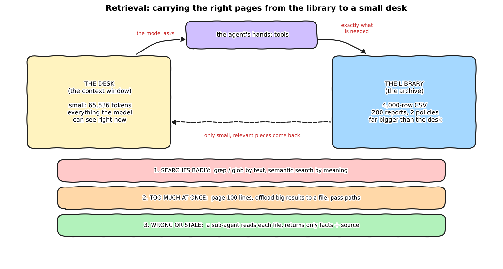

:::{.callout-tip}
This post is part of the [Agentic Developer: Zero to Advanced](index.qmd) series. It stands on its own: it
uses the synthetic void data from [Part 2](02-dataset-baseline.qmd) and the reports the pipeline from
[Part 7](07-the-inspection-pipeline.qmd) wrote, but you do not need to have read either. The earlier
[Retrieval and RAG](../agentic-development/09-retrieval-rag.qmd) post is about *what* to embed. This one is
about what happens to an agent's context window once retrieval is a tool.
:::

LangChain published [Context Engineering Starts with Retrieval](https://www.langchain.com/blog/context-engineering-starts-with-retrieval)
(Jess Weng, 23 October 2026). Its claim: an agent cannot hold everything in its head, so the **harness**
(the code around the model) has to bring "the right context at the right time". It names three ways retrieval
goes wrong, and a five-item checklist:

1. **Inefficient searching.** Use the cheapest tool that works: grep beats embeddings when you know the words.
2. **Too much context at once.** Page through files, and when a tool result is huge, save it to a file and give
   the model a path and a short preview.
3. **Irrelevant or stale context.** Hand retrieved files to a sub-agent that reads one and reports only the facts.

I wanted to know what each item is worth on a real archive, on a local model, with exact answers to check
against. So I built a small harness with each idea as a switch, and ran it. The headline is not "the checklist
wins". It is **"the checklist wins when the archive does not fit, and it loses when it does."** Details below,
including a bug in my own first run that flipped one of the results.

```{=html}
<div style="margin:1em 0;">
  <button id="toggle-outputs" type="button" style="padding:6px 14px;border:1px solid #1971c2;border-radius:4px;background:#1971c2;color:white;cursor:pointer;">Show all outputs</button>
  <span style="color:#666;font-size:0.9em;margin-left:8px;">Outputs are collapsed by default. Each one is the real captured output of the code above it.</span>
</div>
<script>
(function(){
  var b = document.getElementById("toggle-outputs"), open = false;
  b.onclick = function(){
    open = !open;
    document.querySelectorAll("details.out").forEach(function(d){ d.open = open; });
    b.textContent = open ? "Hide all outputs" : "Show all outputs";
  };
})();
</script>
```

:::{.callout-warning}
**A bug in my first pass, and what it changed.** My first run capped the model's answer at 1,200 tokens. When
a model that has all 200 reports in front of it counts by writing out "report 1: no match, report 2: no match..."
it needs far more than that, and it was cut off mid-list. That scored the "stuff everything in the prompt"
arm **0 of 3** on the counting task and **1 of 3** on the find-by-meaning task. With the cap at 8,000 tokens it
scores **3 of 3 and 3 of 3**. I noticed because the saved answers all ended mid-sentence at exactly 1,200
completion tokens. I reran both tasks for every strategy, and kept the old results in
`out/old_ctx_eval_runs_maxtok1200.json`. The other arms moved by noise only (one went from 2 of 3 to 1 of 3
with the identical setup), which is a reminder of how small these samples are. Lesson, again: look at the
individual saved answers, not just the score.
:::

## The desk and the library

*Explain like I'm five.* You are doing an open-book exam, and the library has ten thousand books. Your desk
fits three. You cannot carry the library to your desk. So the skill is not "know everything", it is "fetch
the right three pages". Three things go wrong: you look in the wrong place, you drag back a whole encyclopedia
when you needed one paragraph, or you fetch an old edition that contradicts the new one.



*Explain like I'm a data scientist.* The context window is a fixed token budget (this server's is 65,536).
Retrieval is a set of tools that move data from a store into that budget. Each tool decides *how much* of the
store crosses over, so the design question is the size and the relevance of what a tool returns. Everything
the model sees is re-sent on every step of the loop, so a big tool result is paid for again on each later call.

## Jargon, explained simply

| Term | What it means | Daily-life version |
|---|---|---|
| **Context window** | The most tokens the model can read in one go. | The desk. |
| **Harness** | The code around the model that decides which tools it has and what they return. | The librarian's rules: what you may carry, and in what size. |
| **Payload** | The full content a tool returns. | Carrying the whole book. |
| **Pointer / path** | A file path instead of the content. | A sticky note saying "shelf 4, third book". |
| **Offloading** | When a result is too big, save it to a file and give the model the path plus a preview. | "This box is too heavy; it is in the hallway. Here is the label on the lid." |
| **Paged read** | Read 100 lines at a time with an offset. | Reading a chapter, not the library. |
| **grep / glob** | Search file *contents* / file *names* without opening the files. | The index at the back of a book. |
| **Semantic search** | Find things by meaning, using embeddings (vectors). | Asking the librarian "something about unsure inspectors", not for an exact title. |
| **Sub-agent** | A fresh model call that gets one small job and a small brief, and returns a short answer. | An assistant who reads one report and tells you the two facts that matter. |
| **Context rot** | A model getting worse as its context gets longer or noisier. | Studying with the TV on. |
| **Stuffing** | Pasting everything into the prompt and skipping retrieval. | Carrying the whole shelf to the desk, if the shelf fits. |

## The archive

Everything the agent searches is a real file from this series, in `out/ctx_archive/`:

- `exports/inspection_log.csv`: the **4,000-row** table of the synthetic void dataset. About 454 KB, around 115,000
  tokens (characters divided by four), so it does not fit in a 65,536-token window. This stands in for the article's 40,000-row market export.
- `reports/test_00000.md` to `test_00199.md`: the **200 per-image reports** that the Part 7 pipeline actually wrote
  (verdict, kept and rejected candidates, and the model-written note). About 91 KB, roughly 23,000 tokens by that estimate (the server counted 28,300 with a question attached), so it
  *does* fit.
- `policy/`: two dated policy files. The current one holds the constants from `pipeline_graph.py`. The other
  is **planted by me**: a "superseded" policy with a different minimum area (35 px instead of 20). It exists only to
  test whether an agent reads an old document. It is not a real earlier policy.
- Later, `cases/`: 600 per-image records for the visual-search experiment.

```{.python filename="notebooks/agentic-zero-to-advanced/ctx_corpus.py"}
def report_markdown(r: dict) -> str:
    rep = r["report"]
    lines = [f"# Report {r['image']}", "",
             f"verdict: {rep['verdict']}",
             f"candidates_examined: {r['n_candidates']}",
             f"candidates_kept: {r['kept']}",
             f"reason: {rep['reason']}", ""]
    for k in rep["kept"]:
        lines.append(f"- kept candidate {k['id']}: severity {k['severity']}, confidence {k['confidence']}, "
                     f"uncertain {str(k['uncertain']).lower()}, contrast {k['contrast']}, area_px {k['area_px']}")
    ...
```

```{=html}
<details class="out">
<summary><strong>Show output</strong></summary>
```

```{.text}
archive at .../notebooks/agentic-zero-to-advanced/out/ctx_archive
  4000 rows in inspection_log.csv, 200 reports, 2 policy files
```

```{=html}
</details>
```

## The harness: five ideas, five switches

I wrote about 150 lines of Python in the style of the Part 5 loop (`ctx_harness.py`). It is **not** the
Deep Agents library the article uses; it is the smallest thing that lets me turn each idea on and off. The
model is a local Qwen3.8-27B (FP8) behind vLLM, temperature 0, thinking off.

- **`grep` / `glob`** (switch `grep`): search names and contents without loading files.
- **Paged `read_file`** (`paged`): 100 lines at a time, with `offset`.
- **Offload** (`offload`): any tool result over 2,000 estimated tokens is written to `large_tool_results/`, and the model gets the path plus the first and last five lines.
- **Paths, not payloads** (`search_returns_paths`): the semantic search tool returns file paths, not the reports.
- **Delegate** (`delegate`): an `analyze(path, question)` tool that runs a fresh model call that sees only that one file and the question.

```{.python filename="notebooks/agentic-zero-to-advanced/ctx_harness.py"}
@dataclass(frozen=True)
class Config:
    name: str
    grep: bool = False
    paged: bool = False
    offload: bool = False
    search_returns_paths: bool = False
    delegate: bool = False
    visual: bool = False     # adds similar_cases (DINOv3 + LanceDB), see ctx_visual.py
    grep_tools: bool = True  # False = search-only arm: the model may not use grep/glob
```

The offload rule is eight lines, and it has one trap that I walked into: the offloaded file is itself
read back with `read_file`, so if a *paged read* of an offloaded file were offloaded again, the loop would never end.
Paged reads are already bounded, so they are exempt.

```{.python filename="notebooks/agentic-zero-to-advanced/ctx_harness.py"}
    # a paged read is already bounded (100 lines), so it is never offloaded again (that would loop forever)
    if cfg.offload and est_tokens(out) > OFFLOAD_TOKENS and not (name == "read_file" and cfg.paged):
        off_dir.mkdir(exist_ok=True)
        f = off_dir / f"{call.id}.txt"
        f.write_text(out)
        lines = out.splitlines()
        return (f"[result too large (~{est_tokens(out)} tokens); saved to {_rel(f)}. Use grep or read_file on it.]\n"
                + "\n".join(lines[:5]) + "\n...\n" + "\n".join(lines[-5:]))
```

The article offloads at about 20,000 tokens. Mine is 2,000, because my window is 65,536 and I wanted the rule to
trigger on this data. That is a deliberate scaling, not a copy of their number.

The six strategies:

| Strategy | What the agent gets |
|---|---|
| **stuff** | Everything the question is about, pasted into the prompt, no tools. This is the *best case* for stuffing: it is handed the right folder. |
| **payload** | Tools that return whole things: whole files, whole documents from search. |
| **harness** | grep, glob, paged reads, offloading, search returns paths. |
| **harness + delegate** | The same, plus the `analyze` sub-agent. |
| **search-paths** (T4 only) | Semantic search returning paths and paged reads, with grep and glob taken away. |
| **search-paths + delegate** (T4 only) | The same, plus the sub-agent. |

Every question has an exact answer computed from the same files, so a run is simply right or wrong. Counts:
6 needle lookups, 3 counts, 2 policy questions, 3 find-by-meaning, 3 visual-neighbour questions.

## Results

One table, every run. "Overflow" means the request exceeded the 65,536-token window and the server refused it.
"Cap" means the agent used all 14 steps without answering. "Mean total tokens" is the sum of prompt tokens over all
steps (plus sub-agent tokens), so it is what the loop actually re-reads.

| Task | Strategy | Correct | Overflow | Step cap | Largest single prompt | Mean total tokens |
|---|---|---|---|---|---|---|
| **T1** needle in 4,000-row CSV | stuff | 0 / 6 | 6 | 0 | n/a | n/a |
| | payload | 0 / 6 | 6 | 0 | 543 | 543 |
| | **harness** | **6 / 6** | 0 | 0 | 1,270 | **2,834** |
| | harness + delegate | 3 / 6 | 0 | 3 | 3,343 | 16,535 |
| **T2** count across 200 reports | **stuff** | **3 / 3** | 0 | 0 | 28,300 | 28,300 |
| | payload | 0 / 3 | 2 | 1 | 14,879 | 34,771 |
| | harness | 0 / 3 | 0 | 3 | 29,514 | 111,476 |
| | harness + delegate | 0 / 3 | 0 | 3 | 8,118 | 65,201 |
| **T3** current vs stale policy | stuff | 2 / 2 | 0 | 0 | 453 | 452 |
| | payload | 1 / 2 | 1 | 0 | 1,146 | 2,294 |
| | harness | 1 / 2 | 0 | 1 | 14,841 | 53,299 |
| | harness + delegate | 1 / 2 | 0 | 1 | 14,575 | 51,633 |
| **T4** 4 reports by meaning | **stuff** | **3 / 3** | 0 | 0 | 28,312 | 28,308 |
| | payload | 1 / 3 | 1 | 1 | 18,407 | 46,309 |
| | harness | 1 / 3 | 0 | 2 | 12,492 | 55,062 |
| | harness + delegate | 1 / 3 | 0 | 2 | 13,734 | 59,362 |
| | search-paths | 2 / 3 | 0 | 1 | 7,631 | 43,245 |
| | search-paths + delegate | 2 / 3 | 0 | 1 | 6,030 | 27,303 |
| **T5** 20 visual neighbours | **payload** | **3 / 3** | 0 | 0 | 3,357 | **3,949** |
| | harness | 3 / 3 | 0 | 0 | 4,355 | 9,519 |
| | harness + delegate | 2 / 3 | 0 | 1 | 6,077 | 30,710 |

```{=html}
<details class="out">
<summary><strong>Show output (the script that prints this table)</strong></summary>
```

```{.text}
task strategy                  ok ovfl  cap  peak tok  mean total tok      s
T1   stuff                  0/6      6    0         0               0    0.4
T1   payload                0/6      6    0       543             543    2.3
T1   harness                6/6      0    0      1270            2834    9.4
T1   harness+delegate       3/6      0    3      3343           16535   45.3

T2   stuff                  3/3      0    0     28300           28300  145.7
T2   payload                0/3      2    1     14879           34771   44.4
T2   harness                0/3      0    3     29514          111476  107.5
T2   harness+delegate       0/3      0    3      8118           65201   84.4

T3   stuff                  2/2      0    0       453             452   10.2
T3   payload                1/2      1    0      1146            2294   11.6
T3   harness                1/2      0    1     14841           53299   51.8
T3   harness+delegate       1/2      0    1     14575           51633   56.1

T4   stuff                  3/3      0    0     28312           28308  151.8
T4   payload                1/3      1    1     18407           46309   53.0
T4   harness                1/3      0    2     12492           55062   80.1
T4   harness+delegate       1/3      0    2     13734           59362  104.6
T4   search-paths           2/3      0    1      7631           43245   92.6
T4   search-paths+delegate  2/3      0    1      6030           27303  109.5

T5   v-payload              3/3      0    0      3357            3949   56.1
T5   v-harness              3/3      0    0      4355            9519  163.4
T5   v-harness+delegate     2/3      0    1      6077           30710  222.8

T6: sub-agent brief size (12 target reports, exact verdict + confidence)
narrow         12/12  mean prompt tokens 364
pad20-start    12/12  mean prompt tokens 2946
pad20-middle   12/12  mean prompt tokens 2946
pad20-end      12/12  mean prompt tokens 2946
pad100-start   12/12  mean prompt tokens 13924
pad100-middle  12/12  mean prompt tokens 13924
pad100-end     12/12  mean prompt tokens 13924
```

```{=html}
</details>
```

Pick a task and see the same data as bars. The red line is the 65,536-token window; a bar that would cross it is a
run that overflowed.

```{=html}
<style>
#cx{max-width:760px;margin:1.2em auto;font-family:system-ui,sans-serif;font-size:0.9em;}
#cx .row{display:flex;align-items:center;gap:10px;margin:8px 0;flex-wrap:wrap;}
#cx select{flex:1;min-width:260px;padding:6px;border-radius:5px;border:1px solid #888;background:rgba(128,128,128,0.12);color:inherit;}
#cx svg{width:100%;height:auto;display:block;margin-top:8px;}
#cx .note{margin-top:8px;color:#777;font-size:0.9em;}
</style>
<div id="cx">
  <div class="row"><label for="cx-task"><strong>Task</strong></label>
    <select id="cx-task"></select></div>
  <div class="row"><label><input type="radio" name="cx-m" value="peak" checked> largest single prompt</label>
    <label><input type="radio" name="cx-m" value="total"> total tokens re-read</label></div>
  <svg id="cx-svg" viewBox="0 0 760 300" role="img" aria-label="Tokens per strategy for the chosen task"></svg>
  <div class="note" id="cx-note"></div>
</div>
<script>
(function(){
  var D = [{"task": "T1", "strategy": "stuff", "n": 6, "correct": 0, "overflow": 6, "max_steps": 0, "peak_tokens": 0, "mean_total_tokens": 0, "mean_seconds": 0.4}, {"task": "T1", "strategy": "payload", "n": 6, "correct": 0, "overflow": 6, "max_steps": 0, "peak_tokens": 543, "mean_total_tokens": 543, "mean_seconds": 2.3}, {"task": "T1", "strategy": "harness", "n": 6, "correct": 6, "overflow": 0, "max_steps": 0, "peak_tokens": 1270, "mean_total_tokens": 2834, "mean_seconds": 9.4}, {"task": "T1", "strategy": "harness+delegate", "n": 6, "correct": 3, "overflow": 0, "max_steps": 3, "peak_tokens": 3343, "mean_total_tokens": 16535, "mean_seconds": 45.3}, {"task": "T2", "strategy": "stuff", "n": 3, "correct": 3, "overflow": 0, "max_steps": 0, "peak_tokens": 28300, "mean_total_tokens": 28300, "mean_seconds": 145.7}, {"task": "T2", "strategy": "payload", "n": 3, "correct": 0, "overflow": 2, "max_steps": 1, "peak_tokens": 14879, "mean_total_tokens": 34771, "mean_seconds": 44.4}, {"task": "T2", "strategy": "harness", "n": 3, "correct": 0, "overflow": 0, "max_steps": 3, "peak_tokens": 29514, "mean_total_tokens": 111476, "mean_seconds": 107.5}, {"task": "T2", "strategy": "harness+delegate", "n": 3, "correct": 0, "overflow": 0, "max_steps": 3, "peak_tokens": 8118, "mean_total_tokens": 65201, "mean_seconds": 84.4}, {"task": "T3", "strategy": "stuff", "n": 2, "correct": 2, "overflow": 0, "max_steps": 0, "peak_tokens": 453, "mean_total_tokens": 452, "mean_seconds": 10.2}, {"task": "T3", "strategy": "payload", "n": 2, "correct": 1, "overflow": 1, "max_steps": 0, "peak_tokens": 1146, "mean_total_tokens": 2294, "mean_seconds": 11.6}, {"task": "T3", "strategy": "harness", "n": 2, "correct": 1, "overflow": 0, "max_steps": 1, "peak_tokens": 14841, "mean_total_tokens": 53299, "mean_seconds": 51.8}, {"task": "T3", "strategy": "harness+delegate", "n": 2, "correct": 1, "overflow": 0, "max_steps": 1, "peak_tokens": 14575, "mean_total_tokens": 51633, "mean_seconds": 56.1}, {"task": "T4", "strategy": "stuff", "n": 3, "correct": 3, "overflow": 0, "max_steps": 0, "peak_tokens": 28312, "mean_total_tokens": 28308, "mean_seconds": 151.8}, {"task": "T4", "strategy": "payload", "n": 3, "correct": 1, "overflow": 1, "max_steps": 1, "peak_tokens": 18407, "mean_total_tokens": 46309, "mean_seconds": 53.0}, {"task": "T4", "strategy": "harness", "n": 3, "correct": 1, "overflow": 0, "max_steps": 2, "peak_tokens": 12492, "mean_total_tokens": 55062, "mean_seconds": 80.1}, {"task": "T4", "strategy": "harness+delegate", "n": 3, "correct": 1, "overflow": 0, "max_steps": 2, "peak_tokens": 13734, "mean_total_tokens": 59362, "mean_seconds": 104.6}, {"task": "T4", "strategy": "search-paths", "n": 3, "correct": 2, "overflow": 0, "max_steps": 1, "peak_tokens": 7631, "mean_total_tokens": 43245, "mean_seconds": 92.6}, {"task": "T4", "strategy": "search-paths+delegate", "n": 3, "correct": 2, "overflow": 0, "max_steps": 1, "peak_tokens": 6030, "mean_total_tokens": 27303, "mean_seconds": 109.5}, {"task": "T5", "strategy": "v-payload", "n": 3, "correct": 3, "overflow": 0, "max_steps": 0, "peak_tokens": 3357, "mean_total_tokens": 3949, "mean_seconds": 56.1}, {"task": "T5", "strategy": "v-harness", "n": 3, "correct": 3, "overflow": 0, "max_steps": 0, "peak_tokens": 4355, "mean_total_tokens": 9519, "mean_seconds": 163.4}, {"task": "T5", "strategy": "v-harness+delegate", "n": 3, "correct": 2, "overflow": 0, "max_steps": 1, "peak_tokens": 6077, "mean_total_tokens": 30710, "mean_seconds": 222.8}];
  var NAMES = {T1:"T1: needle in a 4,000-row CSV",T2:"T2: count across 200 reports",T3:"T3: current vs stale policy",
               T4:"T4: find 4 reports by meaning",T5:"T5: 20 visual neighbours (DINOv3 + LanceDB)"};
  var sel = document.getElementById("cx-task"), svg = document.getElementById("cx-svg"), note = document.getElementById("cx-note");
  Object.keys(NAMES).forEach(function(k){ var o=document.createElement("option"); o.value=k; o.textContent=NAMES[k]; sel.appendChild(o); });
  function draw(){
    var t = sel.value, m = document.querySelector('input[name=cx-m]:checked').value;
    var rows = D.filter(function(r){ return r.task===t; });
    var key = m==="peak" ? "peak_tokens" : "mean_total_tokens";
    var maxv = Math.max(65536, Math.max.apply(null, rows.map(function(r){return r[key];})));
    var left=190, W=520, h=300, bh=Math.min(30, (h-30)/rows.length-8), out="";
    var wx = left + W*65536/maxv;
    rows.forEach(function(r,i){
      var y = 12 + i*(bh+10), w = Math.max(2, W*r[key]/maxv);
      var good = r.correct===r.n, color = good ? "#2f9e44" : (r.correct>0 ? "#f08c00" : "#e03131");
      var lab = r.strategy + (r.overflow ? " (overflow)" : "");
      out += '<text x="'+(left-8)+'" y="'+(y+bh*0.7)+'" text-anchor="end" font-size="12" fill="currentColor">'+lab+'</text>';
      out += '<rect x="'+left+'" y="'+y+'" width="'+w+'" height="'+bh+'" fill="'+color+'" opacity="0.85"></rect>';
      out += '<text x="'+(left+w+6)+'" y="'+(y+bh*0.7)+'" font-size="12" fill="currentColor">'+r.correct+'/'+r.n+' correct, '+r[key].toLocaleString()+' tok</text>';
    });
    out += '<line x1="'+wx+'" y1="4" x2="'+wx+'" y2="'+(h-6)+'" stroke="#e03131" stroke-dasharray="4 3"></line>';
    out += '<text x="'+(wx-4)+'" y="'+(h-8)+'" text-anchor="end" font-size="11" fill="#e03131">65,536 window</text>';
    svg.innerHTML = out;
    note.textContent = "Green: all runs correct. Orange: some. Red: none. An overflow run never got an answer, so its bar shows how far it got.";
  }
  sel.onchange = draw;
  Array.prototype.forEach.call(document.querySelectorAll('input[name=cx-m]'), function(e){ e.onchange = draw; });
  draw();
})();
</script>
```

### T1: the needle in the big CSV, where the checklist earns its keep

*"What are `n_voids` and `void_area` for the row with id `test_00xyz`?"* The CSV is around 115,000 tokens.

- **Stuffing and whole-file tools both fail, every time.** Stuffing is refused outright (6 of 6 overflow). The
  `payload` agent calls `read_file` on the CSV and the whole thing is refused (6 of 6).
- **The harness gets 6 of 6, in three steps, with 2,834 tokens in total.** It greps the id, reads the lines around the
  match, and answers. That is about **one fortieth of the CSV**, and it is the exact picture the article paints
  for "find Company B's quarterly revenue in a 40,000-row export".
- **Adding the sub-agent made it worse: 3 of 6, and 16,535 tokens on average.** On the three failures the
  model did not even call `analyze`. It grepped once and then paged through `read_file` thirteen times until it hit the
  14-step cap. Same tools as the 6-of-6 arm plus one more, and the behavior changed. I did not find out why, and I would not
  read a mechanism into it.

### T2: counting across 200 reports, and what the first bug taught me

*"How many reports have verdict escalate AND at least one kept candidate with severity critical?"*

- **Stuffing is right 3 of 3**, at 28,300 tokens and about 146 seconds a question. All 200 reports fit, and a
  27B model reading ~23,000 tokens and counting step by step got exact counts. That surprised me, and it is the
  result my first bug had hidden.
- **Every tool arm is 0 of 3.** The harness arms ran out of the 14-step cap: grep for the verdict, grep for the
  severity, and then they have to intersect two lists by hand. `payload` overflowed on two and capped on one.
- This is a job for **plain code**, as in [Part 8](08-tool-design.qmd): a ten-line script over the files gives the
  count instantly and exactly. I did not give any strategy a code-execution tool, so that is a prediction, not a
  measurement. The retrieval question here is not "how do I fetch it" but "should a language model be counting at all".

### T3: the stale policy

Two policy files, one marked `SUPERSEDED`. **Every run that finished chose the current one.** The
three that failed did so for other reasons: one `payload` run overflowed after reading whole files, and one
harness run (and its delegate twin) ran grep ten times, had four results large enough to be offloaded, and hit the cap.
I did not inspect which patterns it used.

So this test, as I built it, was too easy: both files are small, both are visible in `ls`, and one says
"SUPERSEDED" in its first lines. It says nothing about the harder case, an *unmarked* stale document inside a
large index. I did not test that.

### T4: find four reports by meaning

*"Find 4 reports where a human should double-check a defect the model was unsure about."* The gold is the
set of reports whose record says a kept candidate is uncertain, so the text and the answer do not share
keywords the way a grep wants.

- **Stuffing is 3 of 3** (28,308 tokens).
- Of the tool arms, **search-paths is 2 of 3** (the semantic search returns paths, paged reads, no grep), and **search-paths +
  delegate is also 2 of 3 at 27,303 tokens**, the cheapest tool arm and about the same as stuffing.
- The arms that *had* grep were no better (1 of 3). The model reached for grep first, spent its steps there (grep 10 to 14 times on the failing runs), and ran out of steps. The article's "grep beats embeddings when
  you know the words" is right; here the question was phrased as an idea, so the words were not the right ones.

One honest observation about cost: **the tool arms do not use fewer tokens than stuffing here**, because the agent
loop re-sends its whole history on every step. Prompt caching in the server could change what that costs in
time or money. I counted tokens, not dollars, and I did not measure caching.

### T5: visual retrieval with DINOv3 and LanceDB

You asked whether the same pattern works with an image search tool, so I plugged one in. The embedding model is
`vit_small_patch16_dinov3.lvd1689m` (DINOv3, small, from `timm`) over the 600 test images, in a
[LanceDB](https://lancedb.com) table. The tool is `similar_cases(image_id, k)`, and like the text search it can
return the full case records (payload) or just paths under `cases/` (the article's "retrieve, then offload").

```{.python filename="notebooks/agentic-zero-to-advanced/ctx_visual.py"}
def neighbours(image_id: str, k: int) -> list[str]:
    t = table()
    q = t.search().where(f"id = '{image_id}'").limit(1).select(["vector"]).to_list()[0]["vector"]
    hits = t.search(q).metric("cosine").limit(k + 1).select(["id"]).to_list()
    return [h["id"] for h in hits if h["id"] != image_id][:k]  # the query image is its own nearest neighbour
```

**Does the retrieval itself work on this data?** I measured it separately, because scoring an agent on neighbours that I
defined as correct would be circular. Of the 4 nearest neighbours of each of the 600 test images, how many are the same
kind of part (shoe, bag, coat...)?

```{=html}
<details class="out">
<summary><strong>Show output</strong></summary>
```

```{.text}
share of the 4 nearest DINOv3 neighbours with the same part class: 0.728 (random neighbours: 0.101; 600 queries)
```

```{=html}
</details>
```

**72.8% against 10.1% for random neighbours.** DINOv3 clusters these synthetic X-rays by part shape,
about seven times better than chance, even though it was never trained on them.

**Does the harness help?** The task: *"get the 20 test images most similar to `test_00010`, and count how many have 3 or more
voids"* (and two siblings). Each record is small, so 20 of them is only about 3,000 tokens.

- **The plain payload arm is the best one: 3 of 3 and 3,949 tokens.** The harness is also 3 of 3 but costs 9,519.
  The delegate arm is 2 of 3 and 30,710.
- That is the honest reading: **when the results are small, the machinery is overhead.** The article's checklist is about
  results that are big, and 20 small records are not.

### T6: how much should a sub-agent be given?

You asked about this directly: a sub-agent given a lot of context may degrade ("context rot"), so give it
only what the small job needs. I tested it, with the same analyst and the same question about **one** report (its verdict
and the confidence of its first kept candidate), in three briefs: just that report, that report plus 19 others, and
that report plus 99 others. For the padded briefs the target sits at the start, middle or end. 12 target reports, 84
runs.

| Brief | Correct | Mean prompt tokens |
|---|---|---|
| Narrow: the target report only | 12 / 12 | 364 |
| 20 reports, target at start / middle / end | 12 / 12 each | 2,946 |
| 100 reports, target at start / middle / end | 12 / 12 each | 13,924 |

**No context rot showed up, at this scale and with this model.** All 84 runs were exactly right, including with the
target in the middle of 100 reports. What the narrow brief bought was **38 times fewer tokens** (364 against 13,924),
and with it the time and money, and a smaller surface for injected text.

That is not evidence that rot does not exist. It means 14,000 tokens is not enough to trigger it for a 27B model on
a task where the answer is two exact lines. Published rot results are at much longer lengths and on fuzzier questions.
I would still give a sub-agent the narrow brief, because it is free and it is the version that scales, but this
experiment gives you a reason of cost, not of accuracy.

## What I take from this

1. **Check whether it fits before you build anything.** The 200 reports were 23,000 tokens; pasting them in beat every
   retrieval setup I built on counting and by-meaning questions. The 4,000-row CSV was about 115,000 tokens; only the
   harness worked. The checklist is the plan for when the corpus *stops fitting*.
2. **For a needle in a big file, grep + paged read is not a nicety, it is the whole difference** (6 of 6 against 0 of 6, at about one
   fortieth of the tokens).
3. **A sub-agent is not free.** Where the answer was in one file, the narrow brief was perfect and 38x cheaper than a padded one.
   But adding an `analyze` tool to the needle task made a 6-of-6 agent a 3-of-6 one, and I do not know why.
4. **Counting is for code.** The model got T2 right only by reading everything, and the tool arms failed. A script would
   not have needed any of this.
5. **Small results do not need offloading.** On the visual task, the plain payload beat the harness.
6. **Your first bug will be in the harness.** Mine was a token cap that made one strategy look bad.

## Jargon, once more, in one sentence each

- **Stuff:** put it all in the prompt. Fine until it does not fit.
- **Offload:** if a result is huge, save it to a file and pass the path.
- **Delegate:** let a fresh, small-brief call read one file and report back.

## What I did not do

- **I did not use the Deep Agents library.** This is my own 150-line harness. Deep Agents will differ in its defaults, and the numbers here say nothing about how it performs.
- **One model, one setting:** Qwen3.8-27B (FP8), temperature 0, thinking off, on a GPU shared with other jobs. A different model, or thinking on, could change every ranking.
- **Small samples.** 6, 3, 2, 3 and 3 questions per task. One run is 33 percentage points on T2 and T4. With the same configuration, T4's harness + delegate arm went from 2 of 3 to 1 of 3 between my two passes, so differences of one run are noise.
- **A 14-step cap.** Many tool failures are "ran out of steps", not "gave a wrong answer". A larger cap would change T2 and T4 and I did not try one.
- **Offload threshold scaled to 2,000 tokens** (the article uses about 20,000), because my window is 65,536.
- **Tokens, not dollars.** The loop re-reads its history every step. If the server caches shared prefixes, the cost of the tool arms is lower than the token count says. I did not measure it. Latency was on a shared GPU.
- **The stale-document test was easy** (two small files, one labelled "superseded"). An unmarked stale file inside a large index is untested.
- **Prompt injection through retrieved text** (the article's last point) is untested here.
- **T2 and T4 were run twice**, because of the token-cap bug described at the top. T1, T3 and T5 were run once; their failures were overflow or step-cap, not truncated answers.
- **T6 stops at about 14,000 tokens.** I did not go longer, and I used a task with two exact facts.
- **For T5, the agent is scored on reading neighbour records, not on whether the neighbours are the "right" ones.** Retrieval quality is the separate 72.8% against 10.1% check, and it only compares part class, not defect similarity.

## Reproduce this yourself

```{=html}
<details>
<summary><strong>Show reproduce commands</strong></summary>
```

```bash
cd quarto_blog_hasan/notebooks/agentic-zero-to-advanced
uv sync                                          # lancedb and timm are in pyproject.toml now
# local vLLM on :8000, as in Parts 3-8 (I used Qwen3.8-27B; set AGENTIC_ZERO_MODEL=<name>)
uv run python ctx_corpus.py                      # build the archive: CSV + 200 reports + 2 policies
uv run python ctx_visual.py build                # DINOv3-small embeddings of 600 test images -> LanceDB, cases/*.md
uv run python ctx_visual.py quality              # same-part-class share of the 4 nearest neighbours
uv run python ctx_eval.py                        # T1-T5, all strategies; resumes from out/ctx_eval_runs.json
uv run python ctx_subagent.py                    # T6: narrow / 20 / 100-report briefs
uv run python ctx_summary.py                     # the tables in this post
uv run python ctx_diagrams.py                    # the desk-and-library figure
```

Do not rerun `ctx_corpus.py` after `ctx_visual.py build` without building again: it recreates the archive folder.

```{=html}
</details>
```

## What's next

The article ends by saying retrieval is half the story: the other half is managing the context *after* it is
in the window, as it grows over a long task. That is the natural next post. The roadmap's RAG-over-the-defect-catalog item is
this post's neighbour, and the earlier [Retrieval and RAG](../agentic-development/09-retrieval-rag.qmd) post covers what to
embed and how to chunk it.
