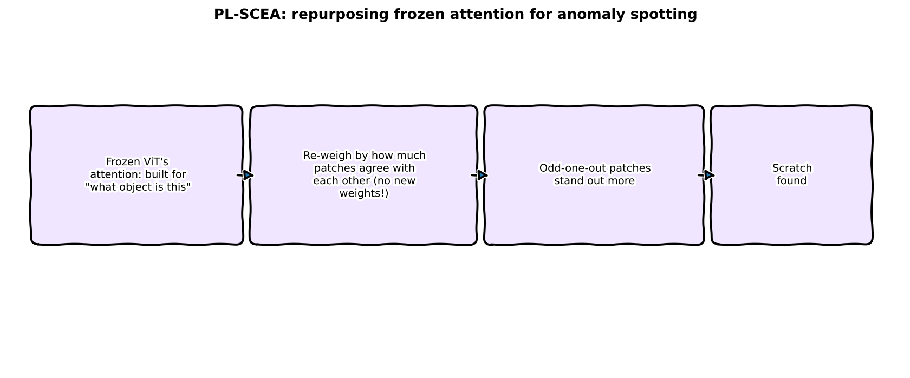
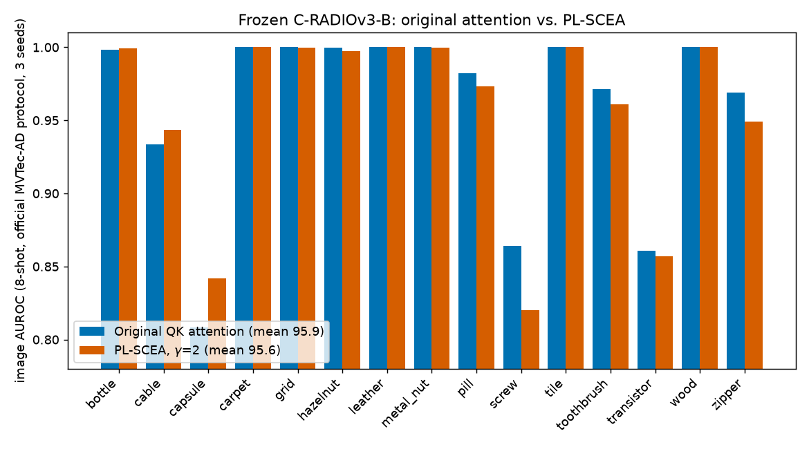
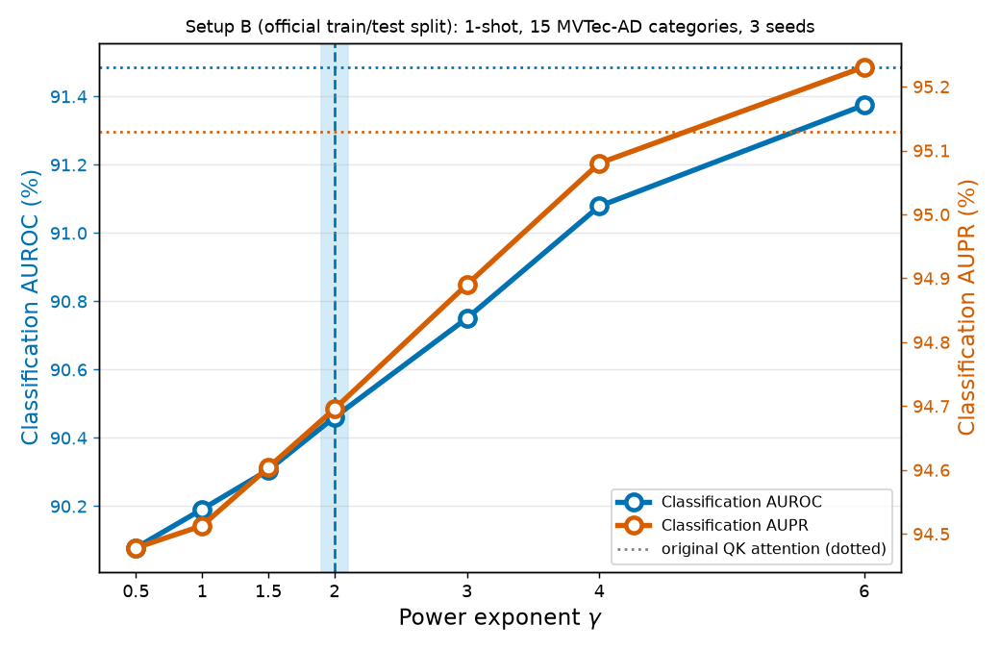
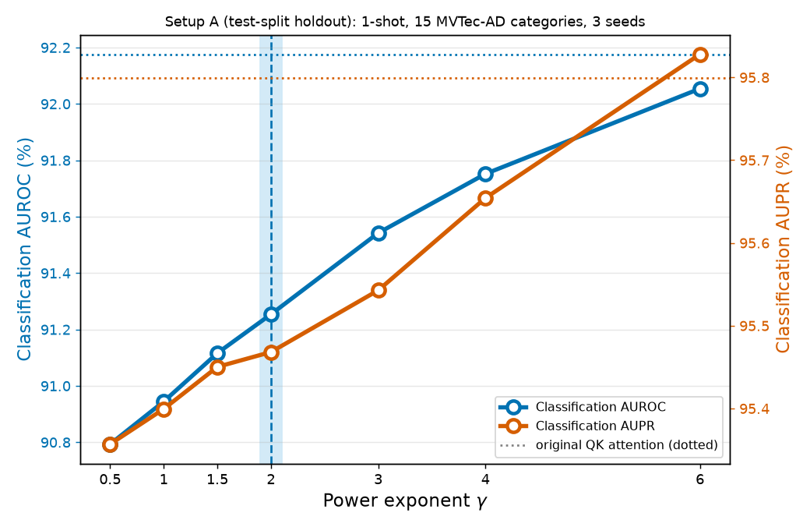
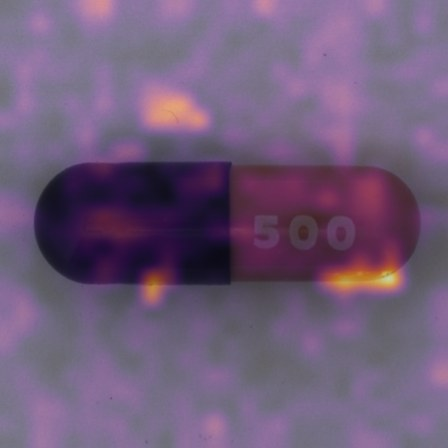
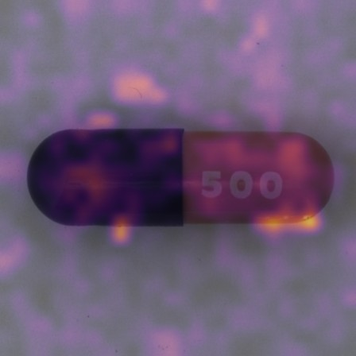
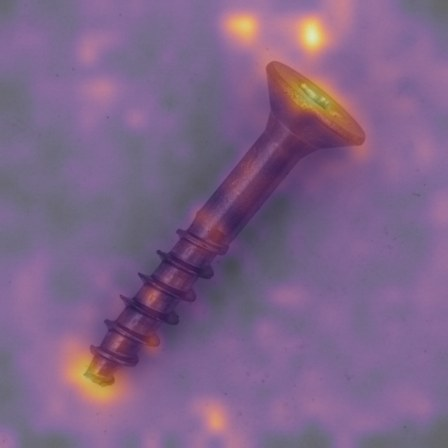
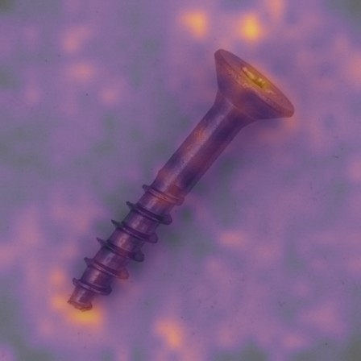

:::{.callout-tip}
This post is part of the [Paper of the Week](index.qmd) series -- real code, real data, real
measured numbers, reported honestly even when they don't flatter the paper.
:::

:::{.callout-warning}
## Correction (2026-10-04)

The first version of this post was **wrong**, and I've rewritten it from scratch. A GitHub issue
opened by `ysinjoro-coder` pointed out two mistakes -- the paper's default is **γ = 2** (not 4), and
its backbone is **RADIOv3** (not DINO). Checking the paper's full text against my code, it was worse
than that: I had also dropped the per-token standardization and applied the reweighting to the
block's *output* instead of inside its attention. **The old headline -- "PL-SCEA dropped mean AUROC
from 0.831 to 0.739" -- described a method that isn't PL-SCEA, and I retract it.** Thank you for
the report.
:::

## What was wrong the first time

| | The paper (arXiv:2609.03655) | My first version (wrong) | This version |
|---|---|---|---|
| Backbone | frozen **RADIOv3-B** | DINOv2-small | frozen **C-RADIOv3-B** (`nvidia/C-RADIOv3-B`) |
| Power exponent γ | **2** by default (ablated in Fig. 5) | 4.0, "per the paper" | **2** (and 4, and a sweep) |
| Correlation | cosine similarity, then **per-token standardization** (Eq. 5-6), keep only above-average | raw cosine, `relu`, self masked | standardized, `max(0, ·)^γ` (Eq. 7) |
| Where it's applied | **replaces attention in the final block**: weights from `Y = softmax(QK^T/√d)·V`, re-aggregate the original `V` (Eq. 1-10) | after the fact, on the block's output tokens | hooked **inside** the final block's attention, exactly Eq. 1-10 |
| Fallback | a token with no positive relation keeps itself (Eq. 8) | none | identity fallback |
| Anomaly head | VAE, cosine loss, 64-d latent, AdamW 8e-4, noise, standardized scores | tiny MSE VAE, 32-d | the paper's recipe (details below) |

## The paper

**[PL-SCEA: Reconfiguring Pretrained Attention for Few-Shot Industrial Anomaly Detection](https://arxiv.org/abs/2609.03655)**
argues that a frozen vision foundation model's *last attention layer* is tuned for semantic
aggregation ("what object is this?"), not for exposing small local defects. PL-SCEA keeps the
pretrained query-key attention only to build *semantically conditioned* values, then derives a new
attention map from how those values correlate with each other, token by token -- with no new
trainable attention parameters. A small VAE ("Latent Normality Modeling") is then fit on the
reconfigured patch features of a handful of normal images, and reconstruction error is the anomaly
score.

## Explain it like I'm five



Picture a classroom where every student asks "who in this room thinks *like I do*?" -- but each
student only listens to the classmates they agree with **more than they agree with the average
person**, and listens extra hard to their very closest friends. A class that's mostly in consensus
ends up looking even more uniform. A genuine mistake (an anomaly) has no real friends to average
toward, so it keeps sticking out.

## Explain it like I'm a data scientist

Let $X$ be the patch tokens entering the final attention layer. Per head, the original attention
gives contextualized values $Y = A_{qk}V$. PL-SCEA uses $Y$ only to *measure* relations:

$$
\tilde y_i = \frac{y_i}{\lVert y_i\rVert},\quad S = \tilde Y\tilde Y^\top,\quad
\hat S_{ij} = \frac{S_{ij}-\mu_i}{\sigma_i+\epsilon},\quad
R_{ij} = \max(0,\hat S_{ij})^{\gamma},\quad
A^{\text{PL-SCEA}}_{ij} = \frac{R_{ij}}{\sum_j R_{ij}}
$$

and then re-aggregates the *original* values, $O = A^{\text{PL-SCEA}}V$. The key idea is the
standardization: $\mu_i,\sigma_i$ are the mean and std of token $i$'s own row of $S$, so "positive"
means "more related to me than the typical token is" -- a *token-adaptive* threshold. The exponent
$\gamma$ then decides how winner-takes-all the surviving relations are.

A concrete example: say a token's similarities to five peers are $[0.9, 0.8, 0.5, 0.4, 0.3]$. The
row mean is $0.58$, std $\approx 0.23$, so the standardized scores are
$[+1.4, +0.9, -0.3, -0.8, -1.2]$. Only the first two survive the $\max(0,\cdot)$. With
$\gamma = 2$ their weights come out at roughly $68\%/32\%$; with $\gamma = 4$ at roughly
$82\%/18\%$. Bigger $\gamma$ = a more "winner takes all" average. (My first version never did this standardization: with raw cosines, almost *every* peer
survives, which is a very different operation.)

## Jargon buster

| Term | Plain-English meaning |
|---|---|
| **Frozen backbone** | A pretrained feature extractor used as-is, no fine-tuning. Here: C-RADIOv3-B, a model distilled from several teachers (CLIP-, DINOv2-, SAM-style) into one |
| **Contextualized value** ($Y = A_{qk}V$) | Each token's value vector after mixing in its neighbors using the ordinary attention weights -- "what this token means *in context*" |
| **Token-adaptive standardization** | Judging each token's correlations against *its own* average, not one global threshold |
| **Power-law reweighting** | Raising the surviving scores to the power $\gamma$ so the strongest relations dominate the weighted average |
| **Latent Normality Modeling (LNM)** | A small VAE fit on a few normal images; anomalies reconstruct badly |
| **Few-shot anomaly detection** | Deciding "defective or fine?" after seeing only a handful (1-8) of normal examples |
| **AUROC / AUPR** | How well anomaly scores rank real defective images above real normal ones (AUPR: with "defective" as the positive class) |
| **QK attention (baseline)** | The model's own, unmodified last-layer attention -- the control in every comparison below |

## Architecture: where PL-SCEA sits

The code below follows the data through the real library calls, no pseudocode:

- `AutoModel.from_pretrained("nvidia/C-RADIOv3-B", trust_remote_code=True)` loads the frozen
  encoder. Its trunk is a 12-block timm ViT (`model.model.blocks`), patch size 16, with a handful of
  prefix tokens (CLS + registers) in front of the patch tokens.
- The *last* block's `attn` is a stock `timm.models.vision_transformer.Attention`
  (`qkv` → softmax(QK) → `proj`). I replace only its `forward` with a version that has two modes:
  `"qk"` (the original computation, verified identical to the stock module to ~3e-7) and
  `"plscea"`.
- In `"plscea"` mode the prefix tokens still get the ordinary attention output; the patch tokens
  get `A_PL-SCEA @ V` built from the standardized, power-law-reweighted self-correlation of
  `Y = softmax(QK^T/√d) V`, computed **per head**.
- The block's residual, LayerNorm, MLP and all earlier blocks are untouched. The 28×28 = 784
  patch tokens that come out (448×448 input) are L2-normalized and fed to the VAE head.
- The VAE (`LNM`): L2-normalized feature + Gaussian noise → re-normalize → encoder → 64-d latent →
  decoder; loss = cosine reconstruction + β·KL. At test time it is deterministic: encode the clean
  feature, decode the posterior mean, anomaly score = 1 − cosine(feature, reconstruction),
  standardized by the training patches' score statistics.

Because the *same frozen weights* are used for both modes, every comparison below changes exactly
one thing: the final block's attention.

## The real mechanism -- real code

```{python}
#| echo: true
#| eval: false
def plscea_weights(y: torch.Tensor, gamma: float) -> torch.Tensor:
    """Paper Eq. 3-9. y: (B, H, N, d) contextualized values of the PATCH tokens only."""
    y_n = F.normalize(y, dim=-1, eps=EPS)                      # Eq. 3: L2-normalize tokens
    s = y_n @ y_n.transpose(-2, -1)                            # Eq. 4: cosine self-correlation
    mu = s.mean(dim=-1, keepdim=True)                          # Eq. 5: per-token mean / std
    sigma = s.std(dim=-1, keepdim=True, unbiased=False)
    s_hat = (s - mu) / (sigma + EPS)                           # Eq. 6: token-adaptive standardization
    r = F.relu(s_hat).pow(gamma)                               # Eq. 7: above-average only, power-law
    d = r.sum(dim=-1, keepdim=True)                            # Eq. 8: row-normalize ...
    eye = torch.eye(r.shape[-1], device=r.device, dtype=r.dtype)
    return torch.where(d > 0, r / d.clamp_min(1e-12), eye)     # ... identity fallback

def _attn_forward(self, x, attn_mask=None, is_causal=False):    # replaces timm Attention.forward
    B, N, C = x.shape
    qkv = self.qkv(x).reshape(B, N, 3, self.num_heads, self.head_dim).permute(2, 0, 3, 1, 4)
    q, k, v = qkv.unbind(0)
    attn = ((q * self.scale) @ k.transpose(-2, -1)).softmax(dim=-1)
    y = attn @ v                                               # Eq. 1-2: Y = A_qk V
    if self.scea_mode == "plscea":
        p = N - GRID * GRID                                    # prefix (cls/register) tokens
        a_pl = plscea_weights(y[:, :, p:], self.scea_gamma)
        y = torch.cat([y[:, :, :p], a_pl @ v[:, :, p:]], dim=2)  # Eq. 10: O = A_PL-SCEA V
    out = y.transpose(1, 2).reshape(B, N, self.attn_dim)
    return self.proj_drop(self.proj(self.norm(out)))
```

```{python}
#| echo: true
#| eval: false
radio = Radio(device)                               # frozen C-RADIOv3-B, final-block attention hooked
support_qk = torch.cat([radio.patch_tokens(img, "qk")     for img in shots])   # k normal images
support_pl = torch.cat([radio.patch_tokens(img, "plscea", gamma=2.0) for img in shots])

lnm_qk, mean_qk, std_qk = fit_lnm(support_qk)       # same head, same shots, run twice
lnm_pl, mean_pl, std_pl = fit_lnm(support_pl)

score = image_score(patch_score_map(lnm_pl, mean_pl, std_pl, radio.patch_tokens(test_img, "plscea")))
```

## Two data protocols (and why there are two)

My first attempt used a Hugging Face mirror (`katiehahm/mvtec_ad`) that only ships MVTec-AD's *test*
split. So I ran everything twice:

- **Setup A -- test-split holdout.** `k` "good" test images per category are held out as the
  few-shot support set; the rest of the test images are evaluated. Score map smoothed with σ = 1 on
  the 28×28 patch grid. This is what I had; it is *not* the paper's protocol.
- **Setup B -- official protocol (closer to the paper).** Support set drawn from the official
  `train/good` images; evaluation on the **full official test set** (good + defective, 1,725
  images over 15 categories); score map upsampled to 448 px and Gaussian-smoothed with σ = 4 as in
  AnomalyDINO, whose preprocessing the paper follows. Data from the `foersben/mvtec-ad` mirror
  (original MVTec layout, CC BY-NC-SA 4.0).

Both: 3 support-set seeds (0, 1, 2), same seeds and same shots for every variant, the paper's VAE
recipe (cosine loss, 64-d latent, AdamW lr 8e-4, wd 1e-5, batch 512, 600 epochs), image score =
mean of the top 1% of patch scores, metrics = image-level AUROC and AUPR macro-averaged over the 15
categories, reported as mean ± std over the seeds.

### What is *still* different from the paper

I'd rather list these than let the numbers imply a faithful reproduction:

- **VAE details the paper doesn't give** -- hidden width (512), input-noise std (0.05) and β (1e-3)
  are my choices, and I train a fixed 600 epochs rather than "up to 600".
- **AnomalyDINO's PCA background masking and rotation augmentation** aren't implemented.
- **Smoothing / top-1% ordering** is my reading of the description (upsample → σ = 4 → mean of the
  top 1% of pixels), not the authors' code.
- **Different support images** than the paper's seeds, naturally.
- **Pixel-level metrics are not measured.** The paper's largest claimed gains are pixel-level
  (e.g. +3.78 pixel-F1-max over QK in its Table 3); this post only measures image-level AUROC/AUPR.
- **My baseline is weaker than theirs.** My QK-attention control gets 91.5 AUROC at 1-shot and 95.9
  at 8-shot (setup B), vs. the paper's 96.5 (QK, 1-shot ablation) and 98.0 (PL-SCEA, 8-shot). So my
  head/pipeline does not reach the paper's absolute level, and everything below is conditional on
  *this* pipeline.

## Results

### 8-shot, setup B (official protocol)



| Category | QK (original) | PL-SCEA γ=2 | PL-SCEA γ=4 | Δ (γ=2 − QK) |
|---|---|---|---|---|
| bottle | 99.8 | 99.9 | 99.9 | +0.1 |
| cable | 93.3 | 94.3 | 93.8 | +1.0 |
| capsule | 80.8 | 84.2 | 82.8 | **+3.4** |
| carpet | 100.0 | 100.0 | 100.0 | +0.0 |
| grid | 100.0 | 100.0 | 100.0 | -0.0 |
| hazelnut | 100.0 | 99.7 | 99.9 | -0.2 |
| leather | 100.0 | 100.0 | 100.0 | +0.0 |
| metal_nut | 100.0 | 100.0 | 100.0 | -0.0 |
| pill | 98.2 | 97.3 | 97.1 | -0.9 |
| screw | 86.4 | 82.0 | 83.9 | **-4.4** |
| tile | 100.0 | 100.0 | 100.0 | +0.0 |
| toothbrush | 97.1 | 96.1 | 96.5 | -1.0 |
| transistor | 86.1 | 85.7 | 84.1 | -0.4 |
| wood | 100.0 | 100.0 | 100.0 | +0.0 |
| zipper | 96.9 | 94.9 | 95.4 | -2.0 |
| **macro AUROC, mean ± std over seeds** | **95.91 ± 0.75** | **95.62 ± 0.81** | **95.57 ± 0.65** | **-0.29** |
| macro AUPR | 97.31 | 97.16 | 97.16 | -0.15 |

Six categories are saturated at ~100 for every variant. Among the rest, PL-SCEA helps `capsule`
(+3.4) and `cable` (+1.0) and hurts `screw` (-4.4) and `zipper` (-2.0). The macro difference
(-0.29) is smaller than the seed-to-seed std (~0.8), so on this pipeline **PL-SCEA is a wash at
8-shot, not a clear win and not the collapse my first version reported.** γ = 2 is slightly better
than γ = 4 on average, which is the direction the paper's ablation predicts.

### 8-shot, setup A (test-split holdout) -- same story

| | QK (original) | PL-SCEA γ=2 | PL-SCEA γ=4 |
|---|---|---|---|
| macro AUROC, mean ± std over seeds | **97.05 ± 0.34** | 96.90 ± 0.27 | 96.76 ± 0.30 |

Per category it is the same pattern: `capsule` +2.3 and `cable` +0.4 up; `screw` -2.4, `pill` -1.1
down (full per-category numbers are in `notebooks/paper-plscea-anomaly/out/setupA_test_holdout/`).
Absolute scores are higher than in setup B (the holdout is an easier protocol -- the support
images come from the same pool as the test images), but the PL-SCEA-vs-QK difference is again
within noise.

### The γ sweep -- what the issue's plot showed, and what I get

The issue included the paper's Fig. 5: image-level AUROC and AUPR as the power exponent $\gamma$
varies, both peaking at $\gamma = 2$. Here is the same experiment on my pipeline (1-shot, 15
categories, 3 seeds; dotted lines = the original QK attention):





**This does not reproduce the paper's peak at γ = 2.** In both setups AUROC and AUPR rise steadily
with γ and are still climbing at γ = 6. In setup B (AUROC): 90.08 (γ=0.5) → 90.46 (γ=2) → 91.08
(γ=4) → 91.37 (γ=6), against 91.49 for the original attention; AUPR crosses the QK line at γ = 6
(95.23 vs 95.13). Everything is within ~1.4 points and the seed std is ~0.2-0.3 here, so it is a
small, consistent trend rather than noise -- but it is a trend *toward the baseline*, with
PL-SCEA never clearly beating it.

### What the maps look like

Seed-0 anomaly maps from the same VAE heads (8-shot, setup B), original attention vs. PL-SCEA
(γ = 2), on real defective images. First `capsule`, the category where PL-SCEA helps most:

<video autoplay loop muted playsinline width="100%" style="max-width:640px;display:block;margin:1em auto;">
  <source src="images/plscea-heatmap-capsule-video.mp4" type="video/mp4">
</video>

::: {.column-body}
```{=html}
<div style="position:relative;max-width:420px;margin:1.5em auto;">
  
  
  <div style="position:absolute;top:0;bottom:0;left:50%;width:2px;background:white;box-shadow:0 0 4px rgba(0,0,0,0.5);" id="cap-handle"></div>
  <input id="cap-range" type="range" min="0" max="100" value="50" style="width:100%;margin-top:10px;">
  <p style="text-align:center;font-size:0.85em;color:#666;">left: PL-SCEA (γ = 2) &nbsp;|&nbsp; right: original QK attention -- drag to compare (same real defective capsule, shared color scale)</p>
</div>
```
:::

And `screw`, where it hurts most:

<video autoplay loop muted playsinline width="100%" style="max-width:640px;display:block;margin:1em auto;">
  <source src="images/plscea-heatmap-screw-video.mp4" type="video/mp4">
</video>

::: {.column-body}
```{=html}
<div style="position:relative;max-width:420px;margin:1.5em auto;">
  
  
  <div style="position:absolute;top:0;bottom:0;left:50%;width:2px;background:white;box-shadow:0 0 4px rgba(0,0,0,0.5);" id="scr-handle"></div>
  <input id="scr-range" type="range" min="0" max="100" value="50" style="width:100%;margin-top:10px;">
  <p style="text-align:center;font-size:0.85em;color:#666;">left: PL-SCEA (γ = 2) &nbsp;|&nbsp; right: original QK attention -- drag to compare (same real defective screw, shared color scale)</p>
</div>
<script>
(function(){
  function wire(p){
    var r=document.getElementById(p+'-range'),a=document.getElementById(p+'-after'),h=document.getElementById(p+'-handle');
    if(r&&a&&h){r.addEventListener('input',function(){a.style.clipPath='inset(0 '+(100-r.value)+'% 0 0)';h.style.left=r.value+'%';});}
  }
  wire('cap'); wire('scr');
})();
</script>
```
:::

## So what can I actually conclude?

- **Not "PL-SCEA is bad" and not "PL-SCEA works as advertised".** On a faithful-in-mechanism
  but not-fully-faithful-in-recipe reimplementation, PL-SCEA is within noise of the original
  last-layer attention for image-level detection at 8-shot, mixed per category, and trends toward
  (never past) the baseline as γ grows at 1-shot.
- **I could not reproduce the γ = 2 optimum.** I don't know whether that's my VAE hyperparameters
  (unspecified in the paper), the missing masking/augmentation, my smoothing/scoring choices, or
  a genuine difference. The paper's improvement may also live mainly at the pixel level, which I
  didn't measure.
- **My pipeline is ~2-5 AUROC points below the paper's absolute numbers**, so a gap I fail to
  see could be hiding in whatever my head does worse. Anyone wanting to adjudicate this should run
  the authors' code on the official split rather than rely on this post.
- **The correction mattered a lot.** The same idea went from "-9 AUROC points" (wrong
  implementation) to "-0.3, within noise" (right mechanism). A reimplementation that silently
  differs from the paper in the details that define the method can generate a confident, wrong
  verdict.

## Reproduce this yourself

```bash
git clone https://github.com/HasanGoni/quarto_blog_hasan
cd quarto_blog_hasan/notebooks/paper-plscea-anomaly
uv sync
# official MVTec-AD layout (train/good + test/*), ~5 GB, to ./data/mvtec_ad:
uv run python -c "from huggingface_hub import snapshot_download as s; s('foersben/mvtec-ad', repo_type='dataset', local_dir='data/mvtec_ad', allow_patterns=['*/train/good/*','*/test/*/*'])"
uv run run_eval.py official 8 2,4                      # setup B, 8-shot, gamma 2 and 4
uv run run_eval.py official 1 0.5,1,1.5,2,3,4,6        # setup B, 1-shot gamma sweep
uv run run_eval.py holdout 8 2,4                       # setup A (needs katiehahm/mvtec_ad)
uv run generate_plots.py && uv run generate_heatmap_viz.py capsule && uv run generate_heatmap_viz.py screw
```

`nvidia/C-RADIOv3-B` and both dataset mirrors download without gating (`trust_remote_code=True`
is required for RADIO's model code). Runs checkpoint per category and resume if killed. Raw
results (per-category, per-seed AUROC and AUPR) are in `out/`.

## Take this into your own workflow

- **Reimplement the formula, not the vibe.** Standardization, the fallback branch, and *where* in
  the network the operation sits are part of the method. Dropping them produced a plausible-looking
  but wrong experiment -- and a confident blog post about it.
- **When a reimplementation disagrees with a paper, say which parts you matched and which you
  didn't.** The list under "What is *still* different" is more useful to a reader than a clean
  headline either way.
- **Check the author's ablation before trusting your own default.** The paper's γ ablation was a
  one-figure check that would have caught my γ = 4.
- **Run your control through the identical pipeline.** The QK-attention baseline here shares
  weights, head, shots and seeds with PL-SCEA, which is what makes the "within noise" statement
  meaningful.
