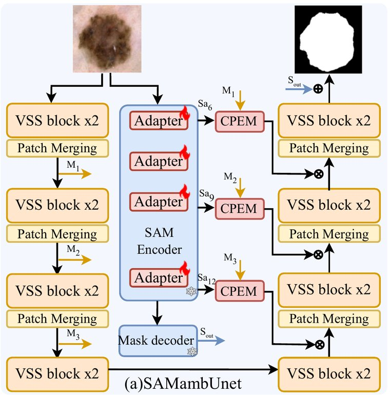
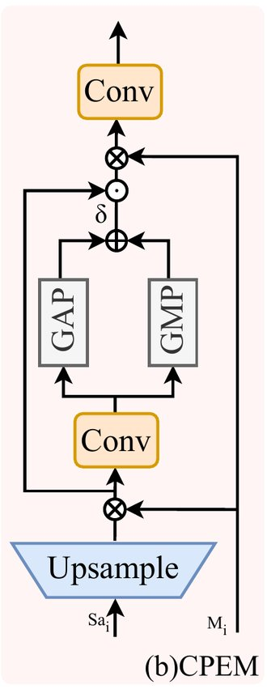
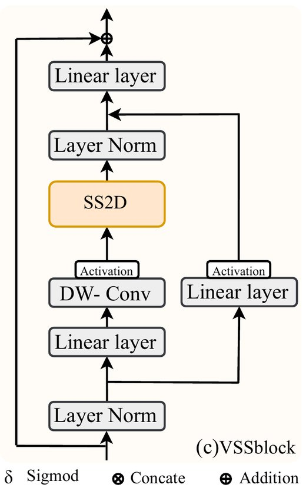
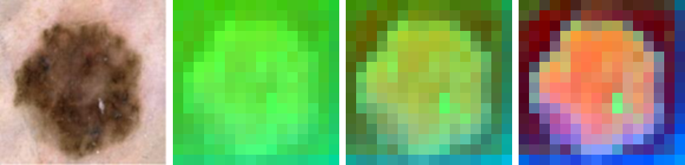
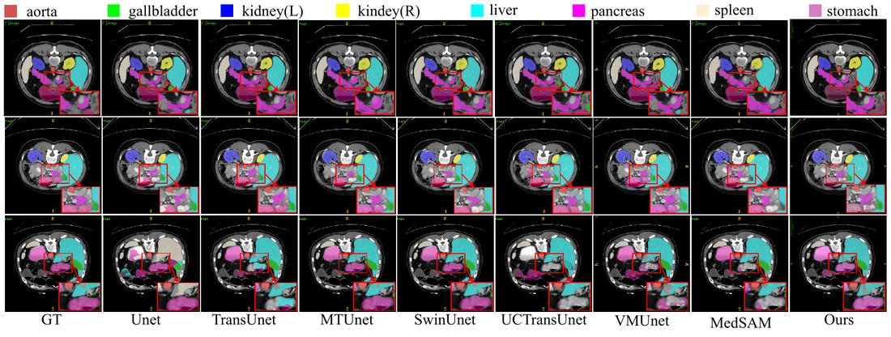

:::{.callout-tip}
This post is part of the [Paper of the Week](index.qmd) series -- real code, real measured numbers,
reported honestly even when they don't flatter the paper.
:::

:::{.callout-warning}
## Read this first: what is real and what is not

The paper says *"code will be released upon acceptance"*, so **there is no official repo**. Every
line of code below was written by me from the paper's equations and Figure 1, and each place where
the paper is silent is marked `# ASSUMPTION`. **Real:** the SAM ViT-B weights (`facebook/sam-vit-base`)
and every number printed from my runs. **Stand-ins:** the Mamba branch is randomly initialised (the
paper starts from VMamba-S weights), and the selective scan is plain PyTorch instead of the CUDA
kernel. **Nothing here reproduces the paper's accuracy numbers** -- that would need the authors' code,
the datasets and weeks of training. What I can show is that the architecture is wired the way the
paper describes and where the paper leaves gaps.
:::

## The paper

**[SAMBA-UNet: Segment Anything Model Based Context Guided Mamba Unet for Medical Image Segmentation](https://arxiv.org/abs/2610.40029)**
(Wang and Zhou, Cardiff University) starts from a simple observation. A skin-lesion or organ boundary
is a low-contrast edge, and the usual model families each miss something:

- a **U-Net** sees edges well, but only locally;
- a **transformer** sees the whole image, but its cost grows with the *square* of the number of pixels;
- **Mamba** (a state-space model) sees the whole image at *linear* cost, but has no idea what an "object" is;
- **SAM** knows objects, but medical images look nothing like its training photos.

SAMBA-UNet runs a SAM encoder and a Mamba U-Net **side by side** on the same image, fine-tunes SAM
cheaply (LoRA + Adapters), and at three depths hands SAM's features to the Mamba decoder through a
small attention gate called HCEM. It needs no prompts. The paper reports Dice 81.94 on Synapse
(VM-UNet: 81.08) and mIoU 81.07 / 81.69 on ISIC17 / ISIC18 (VM-UNet: 80.23 / 81.35).

*Figures 1(a)-(c) and 2 in this post are reproduced from the paper for explanation; they belong to the authors.*

{width=70%}

## Explain it like I'm five

Imagine two people looking at the same photo of a mole. One is a **well-travelled tourist**: they have
seen a billion photos, so they know what "a blob with a border" looks like, but they never read a
skin book. The other is a **careful inspector**: they walk through the picture line by line with a
notebook, so they notice exactly where the edge is, but they don't know what they are looking at.
SAMBA-UNet puts them in one room. A **translator** (HCEM) listens to the tourist's notes at three
levels of detail and hands the useful ones to the inspector, who then draws the outline.

## Explain it like I'm a data scientist

- **Two encoders in parallel**, one image (256 × 256). SAM ViT-B (frozen, plus ~2.5 M trainable
  LoRA/Adapter weights) and a four-stage VSS U-Net (VMamba-style, 96-192-384-768 channels).
- **Three taps.** Features from SAM blocks 6, 9 and 12 (all *global*-attention blocks -- I checked the
  HuggingFace config) are paired with the Mamba skips M1, M2, M3 (64², 32², 16² resolution).
- **HCEM.** Upsample the SAM map to the skip's size, concatenate, 1×1 conv, a CBAM-style channel gate
  `sigmoid(avgpool + maxpool)`, residual add, concatenate with the skip again, 1×1 conv.
- **Prompt-free.** SAM's prompt encoder is dropped. Its mask decoder is drawn in Figure 1 but the paper
  only says it *may* be added to the output "based on performance evaluation" -- I did not implement it.
- **Training recipe (§4.2).** AdamW, lr 1e-3, cosine schedule to 1e-4, batch 32, 300 epochs, one RTX A6000,
  BCE + Dice (binary) or CE + Dice (Synapse) with the λ values "identical to VM-UNet" (not printed).

## Jargon buster

| Term | Plain meaning | Everyday picture |
|---|---|---|
| **Segmentation** | Label every pixel (lesion / not lesion) | Colouring inside the lines |
| **Dice / DSC** | Overlap between the predicted and the true region (1 = perfect) | How much two cut-outs of paper overlap when stacked |
| **HD95** | Distance to the worst-placed 5% of the boundary | How far your pen strays at its worst |
| **SAM** | A foundation model trained to cut out "things" in everyday photos | A tourist who has seen everything but your hospital |
| **Token** | One patch of the image, turned into a vector | One square of a jigsaw |
| **Window vs global attention** | Look inside a small box, or at all tokens | Reading one paragraph vs the whole book |
| **Frozen** | Weights are not updated in training | Keeping the tourist's brain as it is |
| **LoRA** | A small low-rank correction added to some weights | A thin notebook of corrections |
| **Adapter** | A tiny bottleneck layer inserted into a block | A pair of glasses on the tourist |
| **State-space model / Mamba** | Reads a sequence once, keeping a fading memory | The inspector's notebook |
| **Selective scan** | The fade and the input gate depend on the content | Writing more when something new appears |
| **SS2D** | Scan the image grid in four orders (rows, columns, both reversed) | Four inspectors walking four routes |
| **Skip connection** | Pass an early, detailed feature straight to the decoder | A shortcut corridor |
| **Channel attention** | A volume knob per feature channel | Turning up the useful instruments in a band |
| **Ablation** | Remove one part to see what it was worth | Taking one ingredient out of a recipe |

## Architecture, step by step

Everything below is also clickable in the [**interactive explainer page**](explainers/2026-10-31/sambaunet-explained.html)
(pipeline stages, a viewer for the four scan directions, a live LoRA/Adapter parameter calculator,
an HCEM shape stepper).

1. **Input.** 3 × 256 × 256. Both encoders see it.
2. **SAM encoder (frozen).** A ViT-B: 12 blocks, 768 channels, 12 heads. Blocks 3, 6, 9, 12 use *global*
   attention; the others look inside 14 × 14 windows. At 256 px the grid is 16 × 16 tokens. I take the
   output of blocks 6, 9, 12 -- three maps of 768 × 16 × 16.
3. **CoSE (LoRA + Adapters).** LoRA adds `W_up(W_down(x))` to the Q and V projections (Eq. 1); two Adapters
   per block `W_up(GELU(W_down(x)))` (Eq. 2) sit after attention and in the MLP path. Both start as exact
   identities, so on day one the network *is* SAM.
4. **Mamba encoder.** Patch-embed (4 × 4) then `[VSS ×2 → patch merging]` three times, then VSS ×2:
   M1 = 96 × 64 × 64, M2 = 192 × 32 × 32, M3 = 384 × 16 × 16, bottleneck 768 × 8 × 8.
   A VSS block (Figure 1c) is LayerNorm → Linear → depth-wise conv → **SS2D** → LayerNorm, gated by a
   second Linear branch.
5. **HCEM at three levels.** (S6, M1), (S9, M2), (S12, M3): upsample, concatenate, 1 × 1 conv, channel
   gate, residual, concatenate with the skip again, 1 × 1 conv.
6. **Mamba decoder.** Bottleneck, then three times `[patch expand → add the guided skip → VSS ×2]`, then ×4
   upsampling and a 1 × 1 conv to the mask.

{width=30%}
{width=45%}

## The real code

All of it is in [`notebooks/paper-sambaunet/sambaunet.py`](https://github.com/HasanGoni/quarto_blog_hasan/blob/main/notebooks/paper-sambaunet/sambaunet.py).
The pieces that matter (pulled from the file with line numbers, so they cannot drift from what ran):

### CoSE: LoRA on Q and V, Adapters

```python
# sambaunet.py:20-36  (LoRAqkv)
class LoRAqkv(nn.Module):
    """Wraps SAM's fused qkv Linear. Adds  W_up(W_down(x))  to the Q and V slices only (Eq. 1)."""
    def __init__(self, qkv: nn.Linear, rank: int = 4, alpha: float = 4.0):
        super().__init__()
        self.qkv, d = qkv, qkv.in_features
        self.down_q, self.up_q = nn.Linear(d, rank, bias=False), nn.Linear(rank, d, bias=False)
        self.down_v, self.up_v = nn.Linear(d, rank, bias=False), nn.Linear(rank, d, bias=False)
        for up in (self.up_q, self.up_v):
            nn.init.zeros_(up.weight)              # start exactly at the pre-trained SAM (no change at step 0)
        self.scale, self.d = alpha / rank, d

    def forward(self, x):
        out = self.qkv(x)                           # HF layout: [q | k | v], each d wide (checked in modeling_sam.py)
        dq = self.up_q(self.down_q(x)) * self.scale
        dv = self.up_v(self.down_v(x)) * self.scale
        zero = torch.zeros_like(dq)
        return out + torch.cat([dq, zero, dv], dim=-1)
```

```python
# sambaunet.py:39-47  (Adapter)
class Adapter(nn.Module):
    """Eq. 2:  X_out = W_up(GELU(W_down(X_in)))  (bottleneck MLP)."""
    def __init__(self, d: int, hidden: int = 64):
        super().__init__()
        self.down, self.up, self.act = nn.Linear(d, hidden), nn.Linear(hidden, d), nn.GELU()
        nn.init.zeros_(self.up.weight); nn.init.zeros_(self.up.bias)   # identity at init

    def forward(self, x):
        return self.up(self.act(self.down(x)))
```

```python
# sambaunet.py:50-57  (AttnWithAdapter)
class AttnWithAdapter(nn.Module):
    """Adapter #1: after MHSA, before the residual add.  # ASSUMPTION: added as x + Adapter(x)."""
    def __init__(self, attn, d):
        super().__init__(); self.attn, self.adapter = attn, Adapter(d)

    def forward(self, hidden_states, **kw):
        out, w = self.attn(hidden_states, **kw)
        return out + self.adapter(out), w
```

```python
# sambaunet.py:60-66  (MLPWithAdapter)
class MLPWithAdapter(nn.Module):
    """Adapter #2: in the MLP's residual path.  # ASSUMPTION: parallel branch  mlp(x) + Adapter(x)  (Houlsby/MedSAM style)."""
    def __init__(self, mlp, d):
        super().__init__(); self.mlp, self.adapter = mlp, Adapter(d)

    def forward(self, x):
        return self.mlp(x) + self.adapter(x)
```

### Tapping SAM at blocks 6, 9, 12 at 256 px

HuggingFace's `SamPatchEmbeddings` refuses anything but 1024 px, so the patch convolution is called
directly and the 64 × 64 position embedding is resized to 16 × 16 (my assumption -- the paper does not
say how SAM sees 256 px images; the *Upsample* trapezoid in Figure 1b only makes sense for a 16 × 16 map).

```python
# sambaunet.py:83-96  (CoSESamEncoder.forward)
    def forward(self, x256):
        """x256: (B,3,256,256) already SAM-normalised. # ASSUMPTION: SAM sees 256x256 -> 16x16 tokens
        (the paper's images are 256x256 and Figure 1(b) has an *Upsample* block, which only makes sense for 16x16 tokens)."""
        e = self.enc
        h = e.patch_embed.projection(x256).permute(0, 2, 3, 1)  # HF patch_embed insists on 1024px; the conv itself has no fixed size
        #                                                      # (B,16,16,768)
        pe = F.interpolate(e.pos_embed.permute(0, 3, 1, 2), size=h.shape[1:3], mode="bicubic", align_corners=False)
        h = h + pe.permute(0, 2, 3, 1)                                                  # resize abs. pos-embed 64x64 -> 16x16
        feats = {}
        for i, layer in enumerate(e.layers, start=1):
            h = layer(h)
            if i in self.taps:
                feats[i] = h.permute(0, 3, 1, 2).contiguous()                           # (B,768,16,16)
        return feats
```

### The Mamba side: a chunked selective scan

The official VMamba uses a CUDA kernel. A plain Python loop over 4096 positions made one backward pass
take **282 s**. This two-level version (scan inside chunks of 64 in parallel, then carry across chunks)
does the same maths in **11.5 s** and matches the plain loop to 1.4e-6.

```python
# sambaunet.py:115-135  (selective_scan_ref)
def selective_scan_ref(u, delta, A, B, C, D, T=64):
    """Same maths as selective_scan_seq, but two-level (chunked) so it takes ~2*sqrt(L) sequential steps instead of L:
    1) inside every chunk of T steps, scan from a zero state (all chunks in parallel);
    2) scan the chunk-end states across chunks (carry);  3) add carry * running decay back into every step."""
    b, d, L = u.shape; n = A.shape[1]; nc = L // T
    assert L % T == 0
    dA = torch.exp(delta.unsqueeze(-1) * A[None, :, None, :]).view(b, d, nc, T, n)
    dBu = (delta.unsqueeze(-1) * B.permute(0, 2, 1).unsqueeze(1) * u.unsqueeze(-1)).view(b, d, nc, T, n)
    h = torch.zeros_like(dBu[:, :, :, 0]); P = torch.ones_like(h); hs, Ps = [], []
    for t in range(T):                                        # 1) local scan, parallel over chunks
        h = dA[:, :, :, t] * h + dBu[:, :, :, t]; P = dA[:, :, :, t] * P
        hs.append(h); Ps.append(P)
    hs, Ps = torch.stack(hs, 3), torch.stack(Ps, 3)           # (b,d,nc,T,n)
    E, Ptot = hs[:, :, :, -1], Ps[:, :, :, -1]
    c = torch.zeros_like(E[:, :, 0]); carries = []
    for k in range(nc):                                       # 2) carry across chunks
        carries.append(c); c = Ptot[:, :, k] * c + E[:, :, k]
    carry = torch.stack(carries, 2).unsqueeze(3)              # (b,d,nc,1,n)
    full = (hs + Ps * carry).reshape(b, d, L, n)              # 3) true state at every step
    y = (full * C.permute(0, 2, 1).unsqueeze(1)).sum(-1)
    return y + u * D[None, :, None]
```

```python
# sambaunet.py:155-169  (SS2D.forward)
    def forward(self, x):                                   # x: (B,H,W,C)
        B, H, W, _ = x.shape; L = H * W; K = 4
        xz = self.in_proj(x); x, z = xz.chunk(2, dim=-1)
        x = F.silu(self.dw(x.permute(0, 3, 1, 2)))          # (B,Dm,H,W)
        xs = torch.stack([x.flatten(2), x.transpose(2, 3).flatten(2)], 1)         # row-major and column-major order
        xs = torch.cat([xs, xs.flip(-1)], 1)                                      # + both reversed -> (B,4,Dm,L)
        dbl = torch.einsum("bkdl,kcd->bkcl", xs, self.x_proj)
        dts, Bs, Cs = dbl.split([self.dt_rank, self.n, self.n], dim=2)
        dts = torch.einsum("bkrl,kdr->bkdl", dts, self.dt_w)
        dts = F.softplus(dts + self.dt_b[None, :, :, None])
        A = -torch.exp(self.A_log.float())
        y = self._scan4(xs, dts, A, Bs, Cs)                 # (B,K,Dm,L)
        y = y[:, 0] + y[:, 2].flip(-1) + (y[:, 1] + y[:, 3].flip(-1)).view(B, self.d_inner, W, H).transpose(2, 3).flatten(2)
        y = self.norm(y.transpose(1, 2).reshape(B, H, W, -1))
        return self.out_proj(y * F.silu(z))
```

### HCEM

```python
# sambaunet.py:215-226  (HCEM)
class HCEM(nn.Module):
    def __init__(self, c_sam, c_mamba):
        super().__init__()
        self.fuse = nn.Conv2d(c_sam + c_mamba, c_mamba, 1)        # 1x1 conv after the concat (Eq. 3 + text)
        self.out = nn.Conv2d(2 * c_mamba, c_mamba, 1)             # concat with M_i again, 1x1 conv to unify channels

    def forward(self, s, m):                                      # s: SAM feature (B,768,16,16), m: Mamba skip (B,C,H,W)
        s = F.interpolate(s, size=m.shape[-2:], mode="bilinear", align_corners=False)   # MS(.) = Upsample (Fig. 1b)
        f = self.fuse(torch.cat([s, m], 1))                                              # F_cat -> 1x1 conv
        att = torch.sigmoid(F.adaptive_avg_pool2d(f, 1) + F.adaptive_max_pool2d(f, 1))   # Eq. 4: sigma(AvgPool + MaxPool)
        f = f + f * att                                           # "applied to the fused features via residual connections"
        return self.out(torch.cat([f, m], 1))
```

### The whole forward pass

```python
# sambaunet.py:247-265  (SAMBAUNet.forward)
    def forward(self, img, return_debug=False):               # img (B,3,256,256) in [0,1]
        dbg = {}
        S = self.sam((img - self.sam_mean) / self.sam_std)    # {6,9,12}: (B,768,16,16)
        x = self.patch_embed(img).permute(0, 2, 3, 1)         # (B,64,64,96)
        skips = []
        for i, st in enumerate(self.enc):
            x = st(x)
            if i < 3:
                skips.append(x.permute(0, 3, 1, 2)); x = self.merge[i](x)
        x = self.dec[0](x)                                    # bottleneck (B,8,8,768)
        for j, (sk, si) in enumerate(zip(reversed(skips), (12, 9, 6))):
            m_idx = 2 - j
            g = self.hcem[m_idx](S[si], sk)                   # HCEM(Sa_i, M_i) -> (B,C,H,W)
            x = self.expand[j](x)
            x = self.dec_fuse[j](x + g.permute(0, 2, 3, 1))   # # ASSUMPTION: guided skip is ADDED to the up-sampled decoder feature (VM-UNet style), figure shows a concat symbol
            x = self.dec[j + 1](x)
            dbg[f"dec{j}"] = x.detach()
        logits = self.final(x.permute(0, 3, 1, 2))
        return (logits, {**dbg, "S": S, "M": skips}) if return_debug else logits
```

## Does it run? Real output of the smoke test

One real image (the lesion printed in the paper's Figure 1), batch of 2, one GB10 GPU. This is a wiring
test, **not** a benchmark.

<details>
<summary><strong>Show the full captured output of <code>smoke_test.py</code></strong></summary>

```
input (2, 3, 256, 256) mask (2, 1, 256, 256) mask fg fraction 0.534
chunked vs sequential selective scan: max abs diff = 1.43e-06
S6: shape (2, 768, 16, 16)  max|CoSE - original SAM| = 0.00e+00
S9: shape (2, 768, 16, 16)  max|CoSE - original SAM| = 0.00e+00
S12: shape (2, 768, 16, 16)  max|CoSE - original SAM| = 0.00e+00
total params             120.99 M
frozen SAM encoder        89.67 M
LoRA + Adapters (CoSE)     2.53 M  trainable
Mamba UNet + HCEM         28.79 M  trainable (random init here; the paper starts from VMamba-S)
trainable total           31.32 M  (25.9% of all)
forward 5.91s  logits (2, 1, 256, 256)
  SAM tap S6 : (2, 768, 16, 16)
  SAM tap S9 : (2, 768, 16, 16)
  SAM tap S12: (2, 768, 16, 16)
  Mamba skip M1: (2, 96, 64, 64)
  Mamba skip M2: (2, 192, 32, 32)
  Mamba skip M3: (2, 384, 16, 16)
  decoder out dec0: (2, 16, 16, 384)
  decoder out dec1: (2, 32, 32, 192)
  decoder out dec2: (2, 64, 64, 96)
loss 1.2328   backward 11.54s
  grad non-zero: LoRA down (q)  0/12 tensors
  grad non-zero: LoRA up (q)    12/12 tensors
  grad non-zero: Adapter up     48/48 tensors
  grad non-zero: HCEM           12/12 tensors
  grad non-zero: VSS encoder    104/104 tensors
  frozen SAM qkv has grad: False
  frozen SAM weight unchanged after step: True
  step  5  loss 0.1666
  step 10  loss 0.0713
  step 15  loss 0.0566
  step 20  loss 0.0353
  step 25  loss 0.0348
  step 30  loss 0.0292
after 30 steps on ONE image: dice vs mask = 0.993  (memorisation check only, not generalisation)
peak GPU memory 21.0 GB
```

</details>

What it shows:

- **CoSE is exactly SAM at step 0:** `max|CoSE - original SAM| = 0.00e+00` at all three taps.
- **Parameter budget:** 120.99 M in total; 89.67 M frozen SAM; **2.53 M** LoRA + Adapters (rank 4 and
  adapter width 64 are *my* choice -- the paper prints neither); 28.79 M Mamba U-Net + HCEM.
- **Gradients land where they should.** Frozen SAM weights get none and do not move after an optimiser
  step. One surprise that fooled my first check: the LoRA *down* matrices get **zero** gradient at step 0
  (`0/12 tensors`), because the *up* matrices start at zero. That is normal for LoRA and not a bug.
- **Overfit one image:** loss 1.23 → 0.029 in 30 steps, Dice 0.993 against the mask printed in the paper.
  That is **memorisation of one picture**; it proves the gradients flow, nothing more.

## What happens to the image

Real pre-trained SAM features of the paper's lesion at the three tap depths (one shared PCA to colour).
Already at block 6 the lesion separates from the skin; by block 12 it is a distinct blob. These are the
maps HCEM hands to the decoder.

{width=90%}

The Mamba side only exists here as shapes (M1, M2, M3 above), because its weights are random in my run --
showing its "features" would be showing noise.

## The paper's results, as printed

| | SAMBA-UNet | VM-UNet | Gain |
|---|---|---|---|
| Synapse DSC / HD95 | **81.94** / **17.34** | 81.08 / 19.21 | +0.86 / -1.87 |
| ISIC17 mIoU / DSC | **81.07** / **89.54** | 80.23 / 89.03 | +0.84 / +0.51 |
| ISIC18 mIoU / DSC | **81.69** / **89.92** | 81.35 / 89.71 | +0.34 / +0.21 |

Ablation on Synapse (Table 3): baseline 79.05 → +LoRA 80.33 → +Adapter only 80.58 → LoRA + Adapter 81.06 →
**+ HCEM 81.94** (HD95 29.89 → 17.34).

{width=90%}

## Where the paper doesn't add up

This is the part I would want to know before building on it.

- **No code, no weights.** "Upon acceptance."
- **Naming drifts:** SAMBA-UNet / SAMamba-UNet / SAMambUnet; the module is HCEM in the text and CPEM in
  Figure 1; "SKBS" in §3.3 looks like a leftover from another paper.
- **Table 3 has its arrows swapped** (`DSC↓ HD95↑`), and the text says LoRA "reduces HD95 by 6.2%" when
  29.89 → 23.69 is 6.2 *points* (about 21%).
- **The ablation baseline (a) is undefined** and scores 79.05, *below* VM-UNet's 81.08 in Table 2. There is no
  HCEM-only row, so we cannot tell how much of the gain is SAM's features and how much is HCEM itself.
- **Text vs tables.** The prose cites VM-UNet at "82% DSC", ACM-UNet at 85.12% and TransUNet at "89.8% Dice on
  ISIC-17" -- none of which appear in Tables 1-2.
- **"MedSAM [41]"** -- reference 41 is Medical SAM Adapter (the same paper as [31]), not MedSAM.
- **Unspecified:** SAM's input size and position-embedding handling, LoRA rank, adapter width, the λ values,
  what the "multi-scale transformation" is beyond upsampling, where exactly the Adapters add, decoder fusion
  (concat or add), and whether SAM's mask decoder was used in the reported numbers.
- **No statistics.** Single numbers, no seeds, no confidence intervals; the gains over VM-UNet are 0.2-0.9 points.
- **"Computational efficiency" is claimed in the abstract, but no parameter count, FLOPs or speed is printed.**

## So what can I actually conclude?

SAM features guiding a Mamba decoder is a sensible, cheap idea (2.5 M trainable parameters on the SAM side),
and the architecture is clear enough to rebuild -- the code above is the proof of that. Whether it is
*better* is not settled by this paper: one number per dataset, an undefined baseline and no HCEM-only
ablation. A promising recipe, not yet a proof.

## Reproduce this yourself

```bash
cd notebooks/paper-sambaunet
uv sync
HF_HUB_DISABLE_XET=1 uv run python smoke_test.py      # ~1 min on one GPU; writes out/smoke_test.txt
uv run python make_feature_maps.py                    # the SAM feature maps above
python3 build_page.py                                 # rebuilds the interactive page
```

## Take this into your own workflow

1. Load SAM ViT-B from `transformers`, freeze it, take the vision encoder only.
2. Wrap each block: LoRA on the fused `qkv` (Q and V slices), Adapters after attention and in the MLP path,
   **zero-initialised** -- then assert the output equals plain SAM before training anything.
3. Feed 256 px by calling the patch convolution directly and resizing the position embedding.
4. Use the official VMamba `selective_scan` CUDA kernel and VMamba-S weights if you can; use a chunked
   PyTorch scan if you cannot.
5. Check gradients per parameter group (LoRA *down* matrices are zero at step 0), then overfit one batch.
6. Only then train on your own data -- and report mean ± std over several seeds, which the paper does not.
