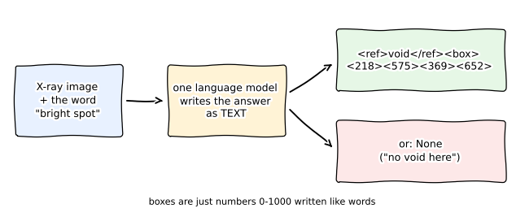
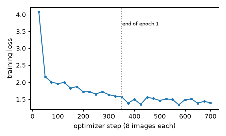
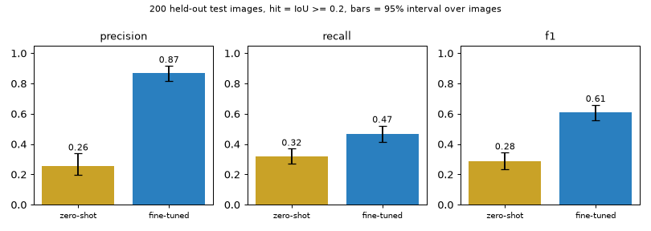
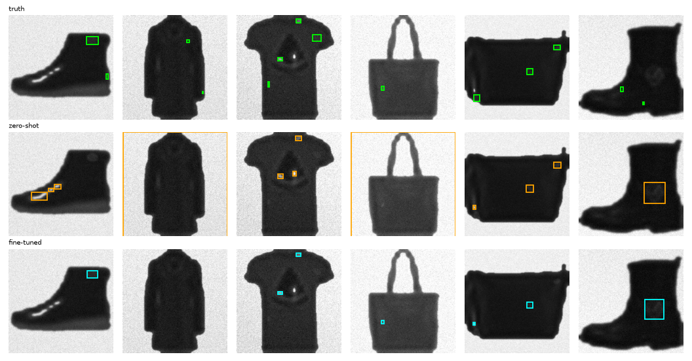

:::{.callout-tip}
This post is part of the [Paper of the Week](index.qmd) series. WeVisOne-VL was item 1 in the
[October 23 digest](2026-10-23.qmd); this is the deep dive I promised myself: does it work on *my* images?
:::

My guess after reading the digest was that a general vision-language model would not find voids without fine-tuning.
So I tested exactly that, in order: **zero-shot first, then fine-tune, then check whether fine-tuning helped.** All numbers below come
from runs on this machine, scored on 200 test images that I touched once per condition.

:::{.callout-warning}
**What this is and is not.**

- The authors' repository lists fine-tuning code as "TODO". **The fine-tuning recipe in this post is mine, not theirs.** Where it differs
  from whatever they did internally, I do not know.
- One model size (4B), one dataset (the synthetic-defect void images from the Agentic series), one training run, one seed. No second seed, so
  I cannot tell you how much of the result is luck of the draw.
- Zero-shot got a fair chance: I searched 4 query words and 3 image scales on **validation** images and picked the best. The test set was
  scored once afterwards.
:::

## The paper in one paragraph

WeVisOne-VL (Tencent, report from October 22) is a Qwen3-VL model fine-tuned so that detection, counting, OCR, pointing and segmentation all
come out of the **same next-token prediction**. A box is not a separate head: the model writes text like
`<ref>void</ref><box><218><575><369><652></box>`, where each number is a coordinate token from 0 to 1000 (thousandths of the image side).
For masks it emits a special `<OBJ>` token that hands a hidden state to a small (9.6M-parameter) pixel decoder. If nothing matches, it
writes `None`. Code and weights are Apache-2.0.

## Explain it like I'm five

Imagine a very well-read friend who answers every question by *writing sentences*. Ask "where is the cat?" and instead of pointing,
they write "the cat is at four-tenths across, six-tenths down". The trick of the paper is that the friend can answer *all* kinds of
picture questions this way: boxes, counting, reading text. One friend, one way of answering.

My question was: when I ask this friend about **voids** (tiny air pockets in an X-ray), do they know what I mean?

{width=85%}

## Explain it like I'm a data scientist

Detection is cast as conditional text generation: `p(box tokens | image, query)`. Coordinates are discretised to 1,001 tokens
(`<0>` to `<1000>`), so box regression becomes classification over a coordinate vocabulary, trained with plain cross-entropy. Fine-tuning
this on one new domain therefore needs no detection-specific loss, no anchors, no NMS: it is supervised fine-tuning on strings.
That is what makes a LoRA recipe so short (below), and it is also why the model's weakness is the usual one for text-decoded detectors:
it can stop early and write `None` or too few boxes.

## Jargon buster

| Term | Daily-life version | In this post |
|---|---|---|
| Zero-shot | Asking a stranger a question about your own job, no training | The released model, untouched |
| Fine-tuning | Giving that stranger a week on the shop floor | Training on 2,800 labelled void images |
| LoRA | Sticky notes added to a textbook instead of rewriting the book | 33M trainable numbers on top of 4.86B frozen ones |
| Coordinate token | Writing a position as "four-tenths across" in words | `<218>` = 21.8 % of the image width |
| IoU | How much two overlapping rectangles share, 0 to 1 | A box counts as a hit at IoU >= 0.2 (the series' rule) |
| Precision | Of the boxes it drew, how many were real | 0.87 after fine-tuning |
| Recall | Of the real voids, how many it found | 0.47 after fine-tuning |
| Bootstrap interval | Re-drawing the 200 images with replacement many times to see how much the score wobbles | Every interval below is over images |

## Setup

- **Model:** `tencent/WeVisOne-VL-4B`, official `wevisone_vl` package, transformers backend, bf16 on the GB10.
- **Data:** the series' void dataset. Images are tiny (224 px), voids are often a few pixels wide. Train 2,800 images (5,446 voids),
  validation = first 100 val images, test = first 200 test images (387 voids).
- **Scoring:** the series' rule: greedy one-to-one matching, a predicted box hits a real void at IoU >= 0.2. I also report IoU 0.5 as a
  harder check. Intervals are bootstrap over images.
- **Why upscale:** voids are tiny, so I enlarge the image (scale 2 = 448 px) before the model sees it, and divide the answer back.

## Step 1: zero-shot

The paper's prompt takes a label to find. The label matters more than I expected, so I tried four words at three scales on 100 validation
images:

```
scale 1 void         boxes/img  0.96  IoU0.2 P 0.208 R 0.099 F1 0.134   IoU0.5 F1 0.114
scale 1 air bubble   boxes/img  1.39  IoU0.2 P 0.396 R 0.272 F1 0.323   IoU0.5 F1 0.246
scale 1 bright spot  boxes/img  1.57  IoU0.2 P 0.439 R 0.342 F1 0.384   IoU0.5 F1 0.284
scale 2 void         boxes/img  1.05  IoU0.2 P 0.248 R 0.129 F1 0.169   IoU0.5 F1 0.13
scale 2 bright spot  boxes/img  2.00  IoU0.2 P 0.425 R 0.421 F1 0.423   IoU0.5 F1 0.299
scale 4 defect       boxes/img  1.44  IoU0.2 P 0.375 R 0.267 F1 0.312   IoU0.5 F1 0.139
chosen on dev: ['bright spot'] scale 2
```

The plain word "void" is the worst query at every scale. "Bright spot" describes what a void *looks like* in the image, and the model knows that.

:::{.callout-note collapse="true"}
## Show the full 12-row grid (real output, `out_zs_dev_stdout.txt`)
```
scale 1 void         boxes/img  0.96  IoU0.2 P 0.208 R 0.099 F1 0.134   IoU0.5 F1 0.114
scale 1 air bubble   boxes/img  1.39  IoU0.2 P 0.396 R 0.272 F1 0.323   IoU0.5 F1 0.246
scale 1 bright spot  boxes/img  1.57  IoU0.2 P 0.439 R 0.342 F1 0.384   IoU0.5 F1 0.284
scale 1 defect       boxes/img  1.34  IoU0.2 P 0.269 R 0.178 F1 0.214   IoU0.5 F1 0.077
scale 2 void         boxes/img  1.05  IoU0.2 P 0.248 R 0.129 F1 0.169   IoU0.5 F1 0.13
scale 2 air bubble   boxes/img  1.67  IoU0.2 P 0.389 R 0.322 F1 0.352   IoU0.5 F1 0.26
scale 2 bright spot  boxes/img  2.00  IoU0.2 P 0.425 R 0.421 F1 0.423   IoU0.5 F1 0.299
scale 2 defect       boxes/img  1.32  IoU0.2 P 0.265 R 0.173 F1 0.21    IoU0.5 F1 0.102
scale 4 void         boxes/img  1.15  IoU0.2 P 0.209 R 0.119 F1 0.151   IoU0.5 F1 0.107
scale 4 air bubble   boxes/img  2.15  IoU0.2 P 0.363 R 0.386 F1 0.374   IoU0.5 F1 0.278
scale 4 bright spot  boxes/img  1.96  IoU0.2 P 0.418 R 0.406 F1 0.412   IoU0.5 F1 0.281
scale 4 defect       boxes/img  1.44  IoU0.2 P 0.375 R 0.267 F1 0.312   IoU0.5 F1 0.139
```
:::

Then the single test run with the chosen setting (200 images, 163 s):

```
zero-shot test: precision 0.257 (0.197 to 0.339)  recall 0.320 (0.273 to 0.370)  F1 0.285 (0.232 to 0.345)
IoU 0.5 F1 0.203   boxes per image 2.41
```

Validation said F1 0.42, test says 0.29. Part of that gap is selection: I picked the best of 12 settings on 100 validation images, so that
number was optimistic by construction. **Use the test number.** On the test set the model also drew a box around the **whole image**
(`<0><0><1000><1000>`) in 13 of 200 images, which scores as a false alarm every time.

## Step 2: my fine-tuning recipe

Everything below is my own choice, not the authors'.

- **What is trained:** LoRA (rank 16, alpha 32, dropout 0.05) on the attention and MLP projections of the **language model only**.
  The vision encoder, embeddings, `<OBJ>` token and pixel decoder are frozen. Trainable: 33,030,144 of 4,863,611,392 parameters (0.68 %).
- **Target text:** the paper's own detection format, `<ref>void</ref><box>...</box>`, or `None` for images with no void. Loss on the answer only.
- **Data:** 2,800 train images at scale 2, batch 1 with gradient accumulation 8 (350 optimizer steps per epoch), lr 1e-4, cosine schedule, 2 epochs.
- **Selection:** after each epoch, score the first 100 validation images; keep the best epoch. Test untouched.

{width=55%}

Training took 29 minutes. Validation F1 at IoU 0.2 was **0.622** after epoch 1 and **0.626** after epoch 2, so epoch 2 is kept; the second
epoch barely helped.

:::{.callout-note collapse="true"}
## Show the training log (real output, `out_ft_stdout.txt`)
```
trainable params: 33,030,144 || all params: 4,863,611,392 || trainable%: 0.6791
epoch 1 step 25/700 loss 4.0873 lr 9.97e-05 64s
...
epoch 2 step 700/700 loss 1.3955 lr 0.00e+00 1733s
VAL epoch 1: IoU0.2 P 0.882 R 0.48 F1 0.622   IoU0.5 F1 0.571   boxes/img 1.1
VAL epoch 2: IoU0.2 P 0.898 R 0.48 F1 0.626   IoU0.5 F1 0.594   boxes/img 1.08
best epoch on val: 2
```
:::

## Step 3: did fine-tuning help?

Same 200 test images, same scoring, intervals over images:

{width=90%}

| | Precision | Recall | F1 (IoU 0.2) | F1 (IoU 0.5) | Boxes / image | Images with a hit |
|---|---|---|---|---|---|---|
| Zero-shot ("bright spot", 2x) | 0.257 (0.197 to 0.339) | 0.320 (0.273 to 0.370) | 0.285 (0.232 to 0.345) | 0.203 (0.159 to 0.256) | 2.41 | 93 / 200 |
| Fine-tuned (my LoRA, epoch 2) | **0.870** (0.818 to 0.918) | **0.468** (0.415 to 0.523) | **0.608** (0.557 to 0.660) | **0.534** (0.481 to 0.591) | 1.04 | 115 / 200 |

Raw counts at IoU 0.2: zero-shot 124 real / 358 false / 263 missed; fine-tuned **181 real / 27 false / 206 missed**.

**Yes, it helped, and clearly:** the F1 intervals do not overlap (0.23 to 0.35 against 0.56 to 0.66). Fine-tuning mostly bought
**precision**: false alarms fell from 358 to 27 while real hits rose from 124 to 181. Recall rose too, but it is still **0.47**, so
the fine-tuned model misses about half of the voids.



What the gallery shows, and what the numbers confirm:

- Zero-shot draws the whole-image box on some empty images (columns 2 and 4) and clusters boxes on bright reflections (column 1).
- The fine-tuned model is quiet. It answered `None` for **73** of 200 images; only 29 images truly have no void, so at least 44 of those
  `None` answers are misses. That is where the missing recall lives.
- Small voids are the hard cases for both. In column 6 both models draw one large box where the truth is two tiny voids.

:::{.callout-note collapse="true"}
## Show real model answers (first two test images, `out/ft_test_raw.jsonl` and `out/zs_test_raw.jsonl`)
```
fine-tuned, image 0:  <ref>void</ref><box><750><205><848><276></box>
fine-tuned, image 1:  None
zero-shot,  image 0:  <ref>bright spot</ref><box><218><575><369><652>,<381><535><429><571>,<434><497><496><541></box>
zero-shot,  image 1:  <ref>bright spot</ref><box><0><0><1000><1000></box>
```
:::

## Where this sits next to the series

The Agentic series measured different designs on a related but not identical task, so treat this as a direction, not a leaderboard.
In Part 10 the model only *judged boxes proposed by a classical detector* whose recall ceiling is 0.209, and the best judge reached
precision 0.597 with recall 0.135. Here the model proposes the boxes itself, with no classical detector, and the fine-tuned version
reaches 0.870 precision and 0.468 recall. Those Part 10 runs used their own image sample and a candidate-filtering protocol, not these
exact 200 images, so I do not claim a head-to-head win. The fair reading: in my runs the fine-tuned text-writing detector found boxes on its own at a precision the Part 10 judges did not reach.

## What I would not conclude

- **One run.** I did not train a second seed, so I cannot say how much of 0.608 is training luck. The test interval covers only
  which images I drew, not training randomness.
- **One dataset, synthetic defects.** The voids in this dataset are generated. Real production voids may behave differently.
- **My recipe.** I did not tune learning rate, rank, or epochs. A better recipe might push recall higher; the 73 `None` answers
  suggest the model is too willing to say "nothing here", so I would first try down-weighting `None` examples or training longer.
- **Masks untested.** I used only the box output. I did not evaluate the segmentation decoder.

## Reproduce

All code is in `notebooks/paper-wevisone-voids/` (own `uv` project; the official repo is cloned into `official/` and installed editable):

```bash
cd notebooks/paper-wevisone-voids
uv sync
.venv/bin/python zeroshot.py dev      # 12-row grid on 100 val images, ~25 min
.venv/bin/python zeroshot.py test     # once, with the chosen setting
.venv/bin/python finetune.py --scale 2 --epochs 2 --tag s2   # ~30 min, 33M trainable params
.venv/bin/python eval_test.py --adapter out/lora_s2_epoch2 --scale 2
.venv/bin/python make_figures.py
```

The scripts are on [GitHub](https://github.com/HasanGoni/quarto_blog_hasan/tree/main/notebooks/paper-wevisone-voids): `common.py` (data and
scoring), `zeroshot.py`, `finetune.py`, `eval_test.py`. The adapter (127 MB) is not committed. Weights and code of WeVisOne-VL are Apache-2.0
per the model card.

## What I take away

For my void images the answer to "does it work without fine-tuning?" is **partly, if you ask the right way**: with the query "bright spot"
it already beats the classical detector's recall ceiling, but three in four of its boxes are wrong. After 30 minutes of LoRA on 2,800
images it becomes a usable proposer: nearly nine in ten boxes real, about half of the voids found. The next experiment is the recall gap.
