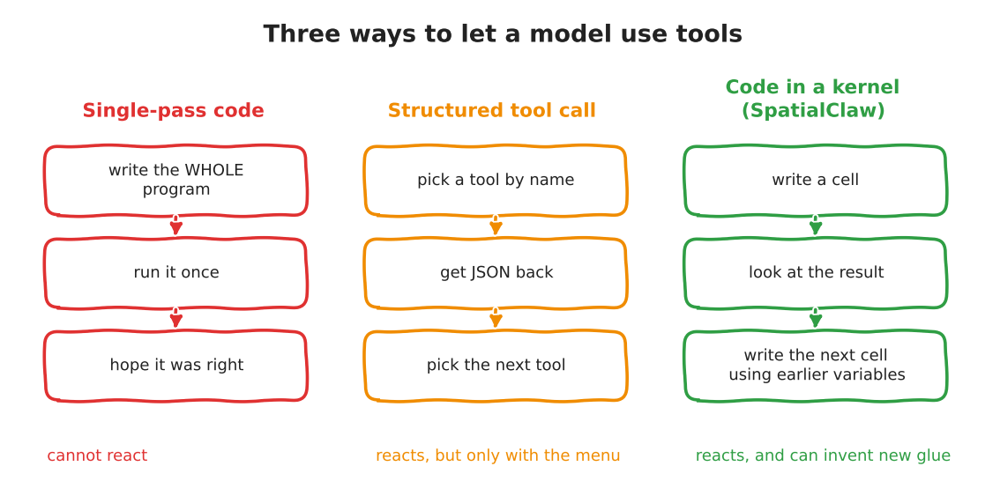
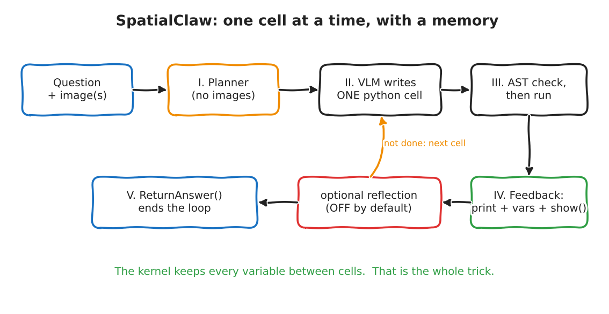

:::{.callout-tip}
This post is part of the [SpatialClaw for Inspection](index.qmd) series. The next post,
[Part 2](02-adapting-for-image-inspection.qmd), turns what we learn here into a plan for
image-only inspection.
:::

:::{.callout-note}
**What I ran and what I did not.** Paper: *SpatialClaw: Rethinking Action Interface for Agentic
Spatial Reasoning* (NVIDIA and KAIST), read from the full PDF text. Code: the official repo
`NVlabs/SpatialClaw` at commit `f37b163`, read directly. I **ran two real pieces of it**: the AST
safety checker and the persistent Jupyter kernel manager. I did **not** run the full agent. It needs
SAM3 and Depth-Anything-3 weights plus a served VLM, and none of that is set up here yet. Every
stand-in is labelled where it appears.
:::

Most "agent with tools" systems give the model a menu. Pick a tool, get JSON back, pick another.
SpatialClaw gives the model a **Python notebook** instead, one that remembers everything. The
model writes one cell, looks at what came out, then writes the next cell using the variables from
the last one.

That sounds like a small change. This post is about how small it really is, how much of the
headline number it explains, and what survives when you throw away the 3D half of the system.

```{=html}
<div style="margin:1em 0;">
  <button id="toggle-outputs" type="button" style="padding:6px 14px;border:1px solid #1971c2;border-radius:4px;background:#1971c2;color:white;cursor:pointer;">Show all outputs</button>
  <span style="color:#666;font-size:0.9em;margin-left:8px;">Outputs are collapsed by default. Each one is the real captured output of the code above it.</span>
</div>
<script>
(function(){
  var b = document.getElementById("toggle-outputs"), open = false;
  b.onclick = function(){
    open = !open;
    document.querySelectorAll("details.out").forEach(function(d){ d.open = open; });
    b.textContent = open ? "Hide all outputs" : "Show all outputs";
  };
})();
</script>
```

## Two reading levels

**Explain like I'm five.** Imagine a detective with a whiteboard. In the old way, the detective
writes the *entire* plan on a sticky note, hands it to an assistant, and leaves. The assistant
does everything blindly. In the SpatialClaw way, the detective asks the assistant to do *one
thing*, looks at the answer on the whiteboard, and only then decides the next thing. The
whiteboard keeps everything written on it. Nothing is forgotten between steps.

**Explain like I'm a data scientist.** A VLM backbone drives a LangGraph loop. Each step it emits
one Python cell, which is AST-checked and run in a long-lived IPython kernel pre-loaded with the
input images and perception primitives (SAM3 for masks, Depth-Anything-3 for depth and camera
pose, plus NumPy, SciPy and Matplotlib). The observation fed back is stdout, a summary of new
variables, tracebacks, and any images the cell registered with `show()`. The loop ends when the
cell calls `ReturnAnswer(...)` or the step cap (`max_steps = 30`) is reached. No training, no
fine-tuning. The paper's claim is that this *interface* is the main lever.

## Jargon buster

| Term | What it means | Daily-life version |
|---|---|---|
| Action interface | The shape of what the model is allowed to *do*: a program, a JSON tool call, a Python cell. | The controls on a machine: a single big red button, a menu, or a full keyboard. |
| Persistent kernel | A Python process that stays alive between steps, so variables survive. | A whiteboard that is not wiped between questions. |
| Single-pass code | The model writes one whole program, runs it once. | Mailing a full recipe to a cook who cannot call you back. |
| Structured tool call | The model picks a named tool and fills in typed arguments, usually JSON. | Ordering from a fixed menu. |
| AST check | Parse the code into a syntax tree and reject it if it contains banned things, *without running it*. | A bouncer who reads your ID but never searches your bag. |
| `show()` | A helper that puts an image into the model's next observation. | Holding the photo up to the detective's face. |
| Planner | A separate model call, with no images, that writes an analysis plan first. | A project manager who has read the brief but never seen the site. |
| `ReturnAnswer` | A function whose call is the agent's way to say "I'm done, here is my answer". | Putting your pen down and handing in the exam. |
| SAM3 | Meta's promptable segmentation model: text, point or box in, masks out. | A very good cookie-cutter for any object you name. |
| Depth-Anything-3 (DA3) | Estimates depth, camera pose and a point map from images. | Turning flat photos into a rough 3D scene. |
| `N_max` | Hard cap on steps per question (30 in the paper). | A timer on the exam. |

## Three ways to let a model use tools

{fig-alt="Hand-drawn comparison of three interfaces: single-pass code writes the whole program and hopes, structured tool call picks from a menu, and code in a kernel writes a cell, looks, and writes the next cell using earlier variables"}

The paper's own framing (Section 2): single-pass code "must commit to a complete strategy before
observing any intermediate mask, depth map", and structured tool calls make it hard to compose
operations "that can only be determined at test time". SpatialClaw's answer is the third column.

## The loop, stage by stage

{fig-alt="Hand-drawn loop: question and images go to a planner, then the VLM writes one python cell, which is AST-checked and run, then feedback, then optional reflection, then either the next cell or ReturnAnswer"}

Here is the actual wiring, traced through the repo (`spatial_agent/workflow.py`, commit `f37b163`).
No pseudocode, this is what the files do:

- **`init_node`** starts or resets a kernel from a `KernelPool`, injects `InputImages`,
  `Metadata`, `tools`, `show`, `vlm` and `ReturnAnswer` into it.
- **`plan_node`** (Stage I) makes a separate LLM call with the question, metadata and tool docs but
  **no images**, and appends the resulting plan to the main system prompt.
- **`llm_step_node`** (Stage II) asks the main VLM for a markdown reply with four fields:
  *purpose, reasoning, next goal, code*. A malformed reply bumps `failure_count` and the cell is
  skipped.
- **`execute_node`** (Stage III) runs `SecuritySandbox.check(code)` first, then executes the cell
  in the kernel. Images registered by `show()` come back as `[SHOW:{...}]` markers parsed out of
  stdout.
- **`feedback_node`** (Stage IV) turns stdout, tracebacks, new-variable summaries and shown
  images into the next message.
- **`reflection_node`** (optional) reviews the step. When on, it can *reject* a `ReturnAnswer`.
- **`router.should_continue`** decides: answer set, then end; step, failure or tool budget spent,
  then `force_terminate`; otherwise loop to `llm_step_node`.

The loop's exit logic is short enough to read whole. Upstream, `spatial_agent/nodes/router.py:37-55`:

```{.python}
def should_continue(state: AgentState) -> str:
    if state.get("final_answer") is not None:
        return END

    if state["step_count"] >= state["max_steps"]:
        return "force_terminate"

    if state["failure_count"] >= state["max_failures"]:
        return "force_terminate"

    if state["max_tool_calls"] > 0 and state["total_tool_calls"] >= state["max_tool_calls"]:
        return "force_terminate"

    return "llm_step_node"
```

And what happens when the budget runs out matters a lot for inspection. `force_terminate`
(`router.py:58`) does **not** return "unknown". It makes one more call to the VLM with key frames
and a chain-of-thought prompt, and returns *whatever that says* as the answer. If that fails it
falls back to a regex over the chat history. So a run that ran out of steps still produces an
answer. Hold that thought for [Part 2](02-adapting-for-image-inspection.qmd).

## Run it: the safety checker

`spatial_agent/kernel/safety.py` holds the AST check. It forbids a list of modules (`os`,
`subprocess`, `sys`, `socket`, `torch`, ...) and builtins (`open`, `exec`, `eval`, `__import__`),
then adds a regex pass for file I/O such as `.save(`. I loaded that file **verbatim** and fed it nine
cells. The cells are only *parsed*, never run. Script: `notebooks/spatialclaw-inspection/smoke_safety.py`.

```{=html}
<details class="out">
<summary><strong>Show output</strong></summary>
```

```{.text}
PASSED   benign: mask area          -> None
PASSED   benign: scipy distance     -> None
BLOCKED  direct: import os          -> Forbidden import: 'os'. Module 'os' is not allowed.
BLOCKED  direct: open()             -> Forbidden builtin call: 'open()'. This operation is not allowed.
BLOCKED  direct: eval               -> Forbidden builtin call: 'eval()'. This operation is not allowed.
PASSED   indirect: getattr open     -> None
PASSED   indirect: dunder import    -> None
PASSED   indirect: via numpy        -> None
PASSED   indirect: str format       -> None
```

```{=html}
</details>
```

Read that carefully. Direct attempts are caught. The four "indirect" cells (building the name
`open` from two strings, reaching `__import__` through `__builtins__`, and so on) **pass the
check**. What I measured is only that the *checker* lets them through. I did **not** execute them,
so I do not claim they would succeed in the kernel. The honest summary: this is a guard against a
model that is *clumsy*, not against one that is *adversarial*. The module's own docstring calls it a
"security sandbox"; for the paper's benchmark use that is fine. For a factory floor it is not
enough, and Part 2 plans a real sandbox.

## Run it: the persistent kernel

`spatial_agent/kernel/manager.py` is the part that makes "the whiteboard is not wiped" true. I used
`JupyterKernelManager` and the `ReturnAnswer` source **verbatim**. Script:
`notebooks/spatialclaw-inspection/smoke_kernel.py`.

**Stand-ins, clearly labelled:** the "agent" is a hard-coded list of five cells, not a VLM. The
image is a synthetic bright solder pad with three dark circular voids, not a real X-ray. The "mask"
is a plain threshold, not SAM3. The `5%` fail limit in the last cell is arbitrary and mine. What is
real: the kernel process, variables surviving between cells, a traceback being captured, the
variable summary, and the answer sentinel.

```{=html}
<details class="out">
<summary><strong>Show output</strong></summary>
```

```{.text}
--- 1. build evidence (stand-in for SAM3)  (0.14s)
pad px: 25433  void px: 1635
--- 2. reuse variables from step 1  (0.23s)
void count: 3  sizes: [437, 1005, 193]
void ratio: 6.43%
--- 3. agent makes a mistake  (0.07s)
TRACEBACK (last line): NameError: name 'largest_void_area' is not defined
--- 4. agent revises after seeing the traceback  (0.00s)
largest void px: 1005
--- 5. commit  (0.01s)
[ReturnAnswer] Answer submitted: FAIL
--- variables the feedback step would summarise:
   img {'type': 'ndarray', 'shape': '(200, 200)', 'dtype': 'float64', 'size_mb': 0.32}
   pad {'type': 'ndarray', 'shape': '(200, 200)', 'dtype': 'bool', 'size_mb': 0.04}
   voids {'type': 'ndarray', 'shape': '(200, 200)', 'dtype': 'bool', 'size_mb': 0.04}
   sizes {'type': 'ndarray', 'shape': '(3,)', 'dtype': 'float64', 'size_mb': 0.0}
   largest_void_area {'type': 'int'}
   ... (13 variables in total; list trimmed here, full list in outputs/smoke_kernel.txt)
--- sentinel: {'text': 'FAIL', 'raw_value': 'FAIL'}
```

```{=html}
</details>
```

Cell 2 used `voids` and `pad` from cell 1 without being told where they came from. Cell 3 failed
and cell 4 recovered, because `sizes` was still alive. That is the entire mechanism. It is also, I
would argue, the whole idea: **a failed step costs one cell, not the whole run**.

One more thing the run printed, which is not in the README: the kernel logged
`Kernel is running over TCP without encryption`. On a single machine that is a note, not a bug, but
if the kernel ever moves to another host it is a finding.

### Step through it

```{=html}
<div id="stepper" style="border:1px solid #ccc;border-radius:6px;padding:12px;margin:1em 0;font-family:inherit;">
  <div style="display:flex;gap:8px;align-items:center;flex-wrap:wrap;">
    <button id="st-prev" type="button">&larr; Previous cell</button>
    <button id="st-next" type="button">Next cell &rarr;</button>
    <span id="st-title" style="font-weight:bold;"></span>
  </div>
  <pre id="st-code" style="margin:10px 0 6px;white-space:pre-wrap;"></pre>
  <pre id="st-out" style="margin:0 0 6px;white-space:pre-wrap;color:#1b5e20;"></pre>
  <div style="font-size:0.9em;color:#555;">Variables alive in the kernel: <span id="st-vars"></span></div>
</div>
<script>
(function(){
  var S = [
    {t:"1. build evidence (threshold, stand-in for SAM3)",
     c:"img = ...; pad = ...; voids = (img < 130) & pad\nprint('pad px:', int(pad.sum()), ' void px:', int(voids.sum()))",
     o:"pad px: 25433  void px: 1635", v:["img","pad","voids"]},
    {t:"2. reuse variables from step 1",
     c:"lab, n = ndimage.label(voids)\nsizes = ndimage.sum(voids, lab, range(1, n+1))\nprint('void ratio: %.2f%%' % (100 * voids.sum() / pad.sum()))",
     o:"void count: 3  sizes: [437, 1005, 193]\nvoid ratio: 6.43%", v:["img","pad","voids","lab","n","sizes"]},
    {t:"3. the agent makes a mistake",
     c:"print(largest_void_area)",
     o:"NameError: name 'largest_void_area' is not defined", v:["img","pad","voids","lab","n","sizes"]},
    {t:"4. the agent revises after seeing the traceback",
     c:"largest_void_area = int(max(sizes))\nprint('largest void px:', largest_void_area)",
     o:"largest void px: 1005", v:["img","pad","voids","lab","n","sizes","largest_void_area"]},
    {t:"5. commit",
     c:"ReturnAnswer('FAIL' if 100 * voids.sum() / pad.sum() > 5 else 'PASS')",
     o:"[ReturnAnswer] Answer submitted: FAIL", v:["img","pad","voids","lab","n","sizes","largest_void_area"]}
  ], i = 0;
  function show(){
    var s = S[i];
    document.getElementById("st-title").textContent = s.t;
    document.getElementById("st-code").textContent = s.c;
    document.getElementById("st-out").textContent = s.o;
    document.getElementById("st-vars").textContent = s.v.join(", ");
  }
  document.getElementById("st-prev").onclick = function(){ i = Math.max(0, i-1); show(); };
  document.getElementById("st-next").onclick = function(){ i = Math.min(S.length-1, i+1); show(); };
  show();
})();
</script>
```

The cells above are shortened for display; the real ones are in `smoke_kernel.py`.

## What the numbers say, and what they do not

The paper reports 59.9% average over 20 benchmarks, +11.2 points over the best prior agent. Those
two numbers hide a decomposition that the paper's own tables let you do. All rows below are from
the paper's Table 2 (same backbone, same tools, same system prompt; only the interface differs).
The averages are over all 20 benchmarks.

| | No tools | Single-pass code | Structured tool call | SpatialClaw |
|---|---|---|---|---|
| Average, 20 benchmarks | 53.4 | 55.2 | 56.7 | **59.9** |

My arithmetic on those numbers, not a claim from the paper:

- Having tools at all (SpatialClaw vs no tools): **+6.5** points.
- The code-in-a-kernel interface (SpatialClaw vs structured tool call, *same tools*): **+3.2** points.
- The best prior agent in their Table 3 (SpaceTools) scores 48.7, below even the **no-tool**
  baseline of 53.4 on the same Gemma4-31B backbone. Table 3 runs each baseline through its *official
  implementation*, so those agents differ in prompts and tooling too. Read together with the
  numbers above: of the +11.2 headline, only about 3 points are cleanly attributable to the
  interface; the rest is the toolset, the prompt and the surrounding setup.

That does not make the interface idea wrong. It makes it a *modest, real* gain on top of a lot of
careful engineering. The paper's own attribution (Finding 4, an LLM judge over 1,095 cases where
SpatialClaw won and the tool-call agent lost): **52.2% composition** (chaining tools in one
program), **19.5% control flow** (`if`/`for` over intermediate results), **28.3% neither**.

And on the **single-image** benchmarks, which are the ones that look like inspection:

| Benchmark | No tools | Single-pass | Tool call | SpatialClaw |
|---|---|---|---|---|
| ERQA | 58.3 | 58.3 | 59.0 | **61.3** |
| Omni3D | 51.7 | 48.2 | **55.7** | 54.3 |
| OmniSpatial | 57.3 | 60.0 | 59.6 | **63.6** |
| SPBench | 55.1 | 58.2 | 60.5 | **68.4** |
| BLINK | **75.7** | 73.9 | 73.9 | 73.4 |

Two of five single-image rows are *not* wins. On Omni3D the plain tool-call agent is ahead, and on
BLINK the **no-tool baseline** is ahead of everything with tools. Tools can hurt when the question
is mostly "recognise what this is". That is a very important sentence for inspection, where half the
job is recognition.

Where does it still fail? Finding 5 sorts 1,000 wrong answers: geometric computation error 21%,
tool selection or coverage error 18%, tool-unsupported visual judgement 14%, VLM hallucination 14%,
recovery failure 8%, perception primitive error 7%. The authors' own limitation section says the
bottleneck is perception quality, not the interface.

## Paper versus repo: the gaps I found

These are things you only see by reading both:

- **Reflection is off by default.** `enable_reflection: bool = False`
  (`spatial_agent/config.py:192`). The paper's five-stage figure does not include it. The repo has a
  whole answer-rejection protocol (`reflection_node.py:147-170`), but a default run never uses it.
  When it is on, it cannot reject forever: after `max_total_answer_attempts = 5` or when
  `min_budget_for_answer_reject = 3` steps remain, the concern is logged and the answer is accepted
  anyway (`config.py:195-196`, `reflection_node.py:156-158`).
- **Timeouts are generous.** `timeout_sec = 600` per cell, `max_steps = 30`, `max_failures = 30`
  (`config.py:154-157`). Fine for a benchmark farm, long for a production line.
- **Thinking is on, with huge budgets.** The Gemma config sets `max_tokens: 131072` with
  `enable_thinking: true` for main, planning and general roles. Cost and latency per sample are
  not reported in the paper text I read, so I make no claim about them.
- **The "sandbox" is a static filter** (shown above).
- **The runtime is a cluster.** Three services (vLLM, a GPU tool server, the agent) and SLURM chain
  jobs. The README says single-machine entry points exist; I have not run them.

## A note on licences

SpatialClaw's own code is under NVIDIA's non-commercial research licence, and SAM3 uses Meta's
custom SAM License, so this series rebuilds the *idea* from the paper with my own code instead of
copying theirs. I am not a lawyer; check the licences yourself before using any of this at work.

## What I take away

1. The core idea is small and real: **keep state between steps, and let the model write the glue**.
2. Its measured gain over a good tool-call agent with the same tools is about three points on
   average, concentrated in tasks that chain geometry. Not a free lunch on recognition.
3. Half the system (3D reconstruction, video, SLURM) is irrelevant to image inspection. The other
   half (kernel, loop, feedback, `show()`) is exactly the part we can rebuild in a few hundred
   lines with our own tools.

[Part 2](02-adapting-for-image-inspection.qmd) lays out that rebuild: what to keep, what to swap, what to drop, how licensing
shapes it, and how I will measure whether it beats the tool-call agent I already built.
