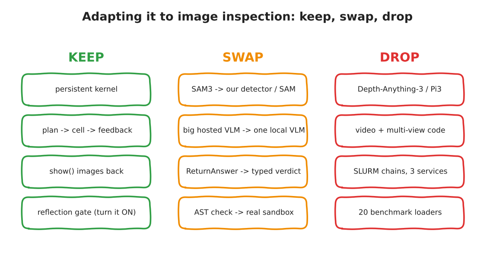

:::{.callout-tip}
This post is part of the [SpatialClaw for Inspection](index.qmd) series. It builds on
[Part 1, the deep dive](01-spatialclaw-deep-dive.qmd). Everything here is a **plan**. Nothing in
this post has been built or measured yet, and I say so wherever a sentence could be mistaken for a
result.
:::

Part 1 ended with a claim: half of SpatialClaw is irrelevant to image inspection, and the other half
is small enough to rebuild. This post makes that claim concrete. It is the document I would want
before writing any code: what changes, why, what could go wrong, and the experiment that decides
whether the whole thing was a good idea.

## The use case, in one paragraph

Inspection systems do not ask "which object is to the left of the table". They ask: *how big is this
defect, how many are there, where are they relative to this feature, and does that break the
spec?* The input is **one image** (sometimes a handful of related crops), the scale is known from
calibration, and the answer must be a **verdict someone is accountable for**. That is a
measurement-and-decide problem. It is exactly the shape where code-as-action should help, because
the measurement is *arithmetic over masks*.

## Keep, swap, drop

{fig-alt="Hand-drawn three-column chart: keep the persistent kernel, plan-cell-feedback loop, show images, and reflection gate; swap SAM3 for our detector, big hosted VLM for one local VLM, ReturnAnswer for a typed verdict, AST check for a real sandbox; drop depth and 3D reconstruction, video code, SLURM chains and benchmark loaders"}

### Keep

- **The persistent kernel.** This is the idea. Variables survive, a failed cell costs one cell.
- **Plan, cell, feedback.** Same loop shape. Part 1 showed it fits in a short graph.
- **`show()`.** Inspection is visual. The model must see the crop it just measured.
- **The reflection gate, turned on.** It is off by default upstream. For inspection I want something
  *like* it, but see below: I want the final decision gated by **deterministic code**, not by the
  same kind of model that made the guess.

### Swap

| Upstream | Inspection version | Why |
|---|---|---|
| SAM3 as the one perception tool | Our own detector and SAM-family segmenter, behind the same `tools.*` style API | We already have a void detector and a labelled synthetic dataset; the model should call what we trust. |
| 26B-397B hosted-scale backbones | One **local** VLM, chosen in Part 3 by measurement | Data stays on the machine, and cost is fixed. Model choice is an experiment, not a decision made here. |
| `ReturnAnswer("B")` (free-form str/int/float) | A **typed verdict**: `PASS`/`FAIL`/`REVIEW` plus measurements plus evidence image ids | A shop floor cannot act on "B". Upstream's `ReturnAnswer` accepts only `str`, `int` or `float` (`return_answer.py`). |
| AST filter as "security" | A real sandbox (separate process, no network, resource limits, timeout) | Part 1 showed the filter passes indirect constructs. Defence in depth, not a filter. |
| `Metadata` (fps, duration) | `Calibration`: microns per pixel, image id, optional part/recipe id | Without scale there are no physical units, and spec limits are physical. |

### Drop

- **Depth-Anything-3, Pi3, MapAnything.** X-ray, optical and SEM inspection images are not scenes
  with perspective. The 3D tools have nothing to reconstruct.
- **Video and multi-view logic**, the temporal metadata, the per-video kernels.
- **SLURM chains and the three-service runtime.** One machine, one process pool.
- **The 20 benchmark loaders.** We will have one evaluation, on our own data.

## Three design changes that matter more than the rest

### 1. The fallback must never guess PASS

Upstream's `force_terminate` (`router.py:58`) runs when steps, failures or tool calls run out, and
returns a best-guess answer from a chain-of-thought VLM call, or a regex over the chat. For a
benchmark, a guess beats a blank. For inspection, **a guess that says PASS is a defect shipped**.
My rule for the build: out of budget means `REVIEW`, always, with the partial evidence attached.
This is a one-line behavioural change, and it is the most important line in the project.

### 2. The spec lives in code, not in the model's head

The model measures. A **deterministic rule function** decides. If the spec says "total void area
must stay under X% of the pad", the agent produces `void_ratio` and a mask, and a plain function
(ordinary tested Python, not model-written) compares it to the threshold. That keeps the part that
must be auditable out of the part that is stochastic. (It echoes the plain-rule control I scored against the agents in
[Part 5 of the zero-to-advanced series](../agentic-zero-to-advanced/05-what-makes-an-agent.qmd),
though there the rule filtered candidates; here it would own the final verdict.)

### 3. Prefer fewer tools that return numbers

Upstream's Table 4 reports that performance degradation is "minimal" when the predefined *utility
functions* are removed and replaced with on-the-fly NumPy. That suggests a thin tool surface works:
the model can already do the geometry. So the inspection API stays small: `segment`, `measure`,
`crop`, `enhance`, `overlay`, `count`. Everything else is NumPy and SciPy that the model writes. The
risk I will watch for is the paper's biggest failure bucket, geometric computation error (21% of
their 1,000 failures); that is why measurements get verified against known synthetic ground truth.

## Licensing: what the plan assumes

SpatialClaw's code is non-commercial research only, and derivatives inherit that limit, so nothing
from it gets copied. I write my own loop, kernel wrapper and prompts from the paper's description.
I have read the upstream source, so I will not call my version "clean-room"; each post says which
ideas come from the paper. Not legal advice: have the licences reviewed before any work use.

## How I will know it was worth it

The idea that justifies everything is one experiment. Same synthetic void dataset (exact ground
truth, which I generate myself, so I can publish everything), same images, three systems:

| System | What it is |
|---|---|
| A. Detector alone | The plain baseline from the zero-to-advanced series |
| B. Tool-call agent | The agent I already built there, structured tools, a graph |
| C. Code-kernel agent | The new one, same perception tools, code as the interface |

Measured per image: verdict accuracy, void-area error against ground truth, false-PASS count (the
number that matters most), steps, tokens and seconds. Failures classified with the paper's own
categories (geometric error, tool selection, hallucination, recovery failure) so we can compare
*kinds* of mistakes, not only counts.

**Pre-registered expectation, written before running anything:** C beats B on questions that need
chained measurement (area ratios, distances between features, counts filtered by size) and
**ties or loses** on pure recognition, because the paper's own single-image table shows tools
hurting on BLINK and the tool-call agent winning on Omni3D. If C does not beat B on measurement
tasks, the series says so and stops being a recommendation.

## The roadmap

| Part | What gets built | Status |
|---|---|---|
| 1 | Deep dive of the paper and code | Published in this series |
| 2 | This plan | You are here |
| 3 | A minimal kernel loop, my own code, local model | Planned |
| 4 | The inspection tool API and `show()` | Planned |
| 5 | A real sandbox, and trying to break it | Planned |
| 6 | The A/B/C experiment above | Planned |
| 7 | Typed verdicts, the rule layer, audit log, human-review path | Planned |
| 8 | Production patterns on real inspection tasks | Planned |

## Risks I already see

- **Latency.** Thinking-enabled models plus up to 30 steps is slow. The paper reports accuracy, not
  per-sample time in the text I read. I will measure it and report it, because a line cannot wait
  a minute per image.
- **Non-determinism.** Same image, two runs, two paths. The rule layer and a fixed seed for
  temperature help, but I will measure run-to-run agreement instead of assuming it.
- **Code the model writes is code that runs.** Part 5 exists because of this.
- **Confident wrong measurements.** A plausible mask with a wrong threshold gives a precise wrong
  number. Overlay-and-look (`show()`) plus ground-truth checks are the defence; the experiment
  will say how well it works.

## Where this goes next

[Part 3](03-minimal-kernel-loop.qmd) is the first code: the smallest loop that can write a cell, run it in a
persistent kernel and read the result back. Before it ships, it must pass the same rule as every
paper post here: run one real step, show the real output, label every stand-in.
