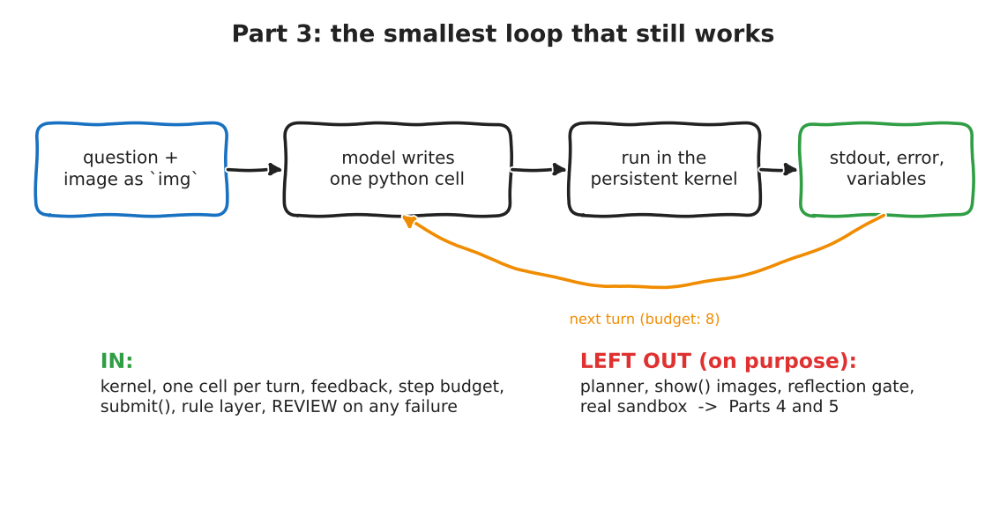

:::{.callout-tip}
This post is part of the [SpatialClaw for Inspection](index.qmd) series. It builds the loop planned in
[Part 2](02-adapting-for-image-inspection.qmd). Everything in the loop is **my own code**, written from the
description in the paper, as the licence section of Part 2 promised.
:::

:::{.callout-note}
**What was run.** The loop and kernel below ran for real: 9 control-flow tests against the real kernel (with a
scripted stand-in for the model), then 12 episodes with the local `Qwen3.8-27B` (FP8, served by vLLM) on the first
12 images of the **DEV** split of my [synthetic defect dataset, v2](../agentic-factory-segmentation/01-synthetic-void-dataset.qmd#version-2-what-was-wrong-with-v1-and-how-i-fixed-it).
The held-out test split was **not touched**; it is saved for the Part 6 experiment. One earlier attempt crashed
when the model server restarted; I kept its output and added retry logic (details below).
:::

Part 1 explained what SpatialClaw does, and Part 2 planned what to keep. This post builds the **smallest** version
that still deserves the name: a model writes one Python cell, a kernel runs it, the printed result goes back, and
the variables stay alive for the next cell. It ends with a number from a real run, and the number is not flattering.
That is the point of running it.

```{=html}
<div style="margin:1em 0;">
  <button id="toggle-outputs" type="button" style="padding:6px 14px;border:1px solid #1971c2;border-radius:4px;background:#1971c2;color:white;cursor:pointer;">Show all outputs</button>
  <span style="color:#666;font-size:0.9em;margin-left:8px;">Outputs are collapsed by default. Each one is the real captured output of the code above it.</span>
</div>
<script>
(function(){
  var b = document.getElementById("toggle-outputs"), open = false;
  b.onclick = function(){
    open = !open;
    document.querySelectorAll("details.out").forEach(function(d){ d.open = open; });
    b.textContent = open ? "Hide all outputs" : "Show all outputs";
  };
})();
</script>
```

## The result first

12 images, one run each, 8 turns allowed per image. Ground truth is the exact void ratio from the mask.

| | Agent | Constant guess (0.86 %) | "Always PASS" |
|---|---|---|---|
| Mean absolute error of the void ratio | **0.67** pp | 0.80 pp | n/a |
| Median absolute error | **0.26** pp | 0.46 pp | n/a |
| Verdicts that match ground truth | **9 of 12** | n/a | 9 of 12 |
| False PASS (a real FAIL called PASS) | **1** | n/a | 3 |
| False FAIL | 2 | n/a | 0 |
| Ended in REVIEW | 0 | n/a | n/a |

Read it honestly. The loop **works**: 12 of 12 episodes produced a measurement, no cell crashed the kernel, and
the agent's numbers are better than a constant guess. But "9 of 12 verdicts right" is exactly what a rule that
says PASS to everything scores on these images, because 9 of the 12 are genuine passes. What the agent buys is
fewer *missed* failures (1 instead of 3) at the price of 2 false alarms. With 12 images that is a direction, not
a finding. The rank correlation between the agent's numbers and the truth is 0.45, which on 12 points I would
not lean on.

## What is in, and what is left out on purpose

{fig-alt="Hand-drawn loop: question and image go to the model, which writes one python cell, run in a persistent kernel, whose stdout, error and variables come back for the next turn, with a budget of 8 turns. Below: what is in (kernel, one cell per turn, feedback, step budget, submit, rule layer, REVIEW on any failure) and what is left out on purpose (planner, show images, reflection gate, real sandbox)"}

Left out, each for a later part: the **planner** (a separate first call that writes a plan without seeing
the image), `show()` (feeding images back to the model; Part 4), the **reflection gate** (off by default
upstream too), and a **real sandbox** (Part 5). Part 3 answers only one question: does the loop run, and what
does it produce?

## Two reading levels

**Explain like I'm five.** A lab assistant sits at a desk with a notebook. You give them an X-ray and say: "tell
me how much of this part is hollow." They may write one thing in the notebook at a time, look at the result, and
write the next. They must hand in **one number**. They do not get to say "pass" or "fail": a supervisor with a
ruler does that. If the assistant runs out of time without a number, the supervisor says "send it to a human".

**Explain like I'm a data scientist.** A persistent IPython kernel holds `img`, `np`, `ndi` and a `submit()`
function. Each turn the model returns one `python` block. We run it, capture stdout, the last lines of any
traceback and a summary of the variables, and append that as the next user message. The loop ends when
`submit()` has been called or a budget runs out (8 turns, 4 failures). A plain function turns the submitted
number into PASS or FAIL against a limit. Anything without a number is REVIEW.

## Jargon buster

| Term | What it means | Daily-life version |
|---|---|---|
| Turn (step) | One model reply plus its execution. | One move in a board game. |
| Budget | The cap on turns and failures. | A parking meter. |
| Persistent kernel | A Python process that keeps variables between cells. | A workbench that is not cleared between jobs. |
| Rule layer | Ordinary code that turns a measurement into a verdict. | The ruler the supervisor holds. |
| REVIEW | "No trustworthy number, a human must look." | Handing the form to a person at the counter. |
| Ground truth | The exact answer from the mask, used only for scoring. | The answer key, kept in another room. |
| DEV split | Images I am allowed to look at while building. | Practice exam questions. |
| False PASS | A bad part called good. | A smoke alarm that stays silent in a fire. |
| Stand-in | A fake used only to test plumbing. | A crash-test dummy. |

## The task, stated exactly

- **Data:** the v2 DEV split (`val.npz`, 600 images), synthetic X-ray-like silhouettes with exact masks. Voids are
  mask value 1, cracks are value 2. The agent must measure voids and **not** count cracks.
- **Measurement:** `void_ratio_pct = 100 * void pixels / part pixels`, with the part as the whole silhouette.
- **Spec:** FAIL when `void_ratio_pct > 1.5`. **This limit is illustrative**: I picked it because it splits the
  DEV images (about a third above it). It is not from any standard.
- **Images used:** `val_00000` to `val_00011`, in order, not picked by outcome.
- **Ground truth** is read only in the scoring script, after the agent has finished. The kernel's working
  directory holds only a copy of the one image.

## The code, from the real files

### The kernel session (`minimal_loop/kernel_session.py`)

It wraps `jupyter_client`: start a kernel in a throw-away directory, run a cell with a timeout, collect stdout
and the traceback, and ask the kernel for a summary of its variables and for the submission, with
`user_expressions`.

````{.python}
# minimal_loop/kernel_session.py
"""A persistent Python kernel for the agent: one cell in, text out, variables survive between cells.

Written for this series from the paper's description of a 'persistent kernel workspace' (no upstream code).
It is NOT a sandbox: the cell runs as my user, in a throw-away working directory, with a wall-clock timeout.
Part 5 replaces this with a real sandbox.
"""
import ast
import json
import queue
import re
import tempfile
import time
from dataclasses import dataclass, field
from pathlib import Path

from jupyter_client import KernelManager

_ANSI = re.compile(r"\x1b\[[0-9;]*m")

# Runs inside the kernel once per episode. `_BASE` lets the variable summary skip our own plumbing.
SETUP = '''
import json as _json
import numpy as np
import scipy.ndimage as ndi
img = np.load({img_path!r})
_SUBMISSION = None
def submit(void_ratio_pct, note=""):
    """Hand in the measurement. The pass/fail decision is NOT yours: a rule outside the notebook makes it."""
    global _SUBMISSION
    v = float(void_ratio_pct)
    if not (v == v) or not (0.0 <= v <= 100.0):
        raise ValueError("void_ratio_pct must be a number between 0 and 100")
    _SUBMISSION = _json.dumps({{"void_ratio_pct": v, "note": str(note)[:300]}})
    print("[submitted]", _SUBMISSION)
def _sc_vars():
    out = {{}}
    for k, v in list(globals().items()):
        if k.startswith("_") or k in _BASE:
            continue
        d = type(v).__name__
        if hasattr(v, "shape") and hasattr(v, "dtype"):
            d += f" shape={{tuple(v.shape)}} dtype={{v.dtype}}"
        elif isinstance(v, (int, float, str, bool)):
            d += f" = {{str(v)[:40]}}"
        out[k] = d
    return _json.dumps(out)
_BASE = set(globals()) | {{"_BASE"}}
'''


@dataclass
class CellResult:
    stdout: str = ""
    error: str = ""            # last lines of the traceback, '' on success
    seconds: float = 0.0
    timed_out: bool = False
    variables: dict = field(default_factory=dict)
    submission: dict | None = None


class KernelSession:
    def __init__(self, image, timeout_sec: int = 60):
        import numpy as np
        self.timeout_sec = timeout_sec
        self.workdir = tempfile.TemporaryDirectory(prefix="sc_kernel_")
        img_path = Path(self.workdir.name) / "img.npy"
        np.save(img_path, image)
        self.km = KernelManager(kernel_name="python3")
        self.km.start_kernel(cwd=self.workdir.name)
        self.kc = self.km.client()
        self.kc.start_channels()
        self.kc.wait_for_ready(timeout=60)
        self._exec(SETUP.format(img_path=str(img_path)), 30)

    def _exec(self, code: str, timeout: float, user_expressions: dict | None = None):
        msg_id = self.kc.execute(code, store_history=True, user_expressions=user_expressions or {})
        out, err, timed_out = [], "", False
        deadline = time.monotonic() + timeout
        while True:
            left = deadline - time.monotonic()
            if left <= 0:
                timed_out = True
                self.km.interrupt_kernel()
                deadline = time.monotonic() + 5            # give the interrupt a moment, then drain
            try:
                msg = self.kc.get_iopub_msg(timeout=max(0.1, min(left, 1.0)) if not timed_out else 1.0)
            except queue.Empty:
                if timed_out:
                    break
                continue
            if msg["parent_header"].get("msg_id") != msg_id:
                continue
            t, c = msg["msg_type"], msg["content"]
            if t == "stream":
                out.append(c["text"])
            elif t == "execute_result":
                out.append(c["data"].get("text/plain", "") + "\n")
            elif t == "error":
                err = _ANSI.sub("", "\n".join(c["traceback"]))
            elif t == "status" and c["execution_state"] == "idle":
                break
        reply = {}
        try:
            reply = self.kc.get_shell_msg(timeout=5)["content"]
        except queue.Empty:
            pass
        return "".join(out), err, timed_out, reply

    def run(self, code: str) -> CellResult:
        t0 = time.monotonic()
        out, err, timed_out, _ = self._exec(code, self.timeout_sec)
        _, _, _, reply = self._exec("", 10, {"v": "_sc_vars()", "s": "_SUBMISSION"})
        ue = reply.get("user_expressions", {})
        get = lambda k: ast.literal_eval(ue[k]["data"]["text/plain"]) if ue.get(k, {}).get("status") == "ok" else None
        v, s = get("v"), get("s")
        tb = "\n".join(err.strip().splitlines()[-4:]) if err else ""
        if timed_out:
            tb = f"TimeoutError: cell ran longer than {self.timeout_sec}s and was interrupted"
        return CellResult(stdout=out, error=tb, seconds=time.monotonic() - t0, timed_out=timed_out,
                          variables=json.loads(v) if v else {}, submission=json.loads(s) if s else None)

    def close(self):
        try:
            self.kc.stop_channels()
            self.km.shutdown_kernel(now=True)
        finally:
            self.workdir.cleanup()
````

### The loop and the rule layer (`minimal_loop/loop.py`)

````{.python}
# minimal_loop/loop.py
"""The smallest SpatialClaw-style loop for image inspection. Written for this series from the paper's description.

What it keeps from the paper: a persistent kernel, one cell per step, feedback = stdout + errors + variable summary,
an explicit step budget, a hard exit on `submit()`.
What it leaves out ON PURPOSE (later parts): the planner, show() images, the reflection gate, a real sandbox.
What it changes for inspection: the agent submits a MEASUREMENT; a plain rule decides PASS/FAIL; running out of budget
returns REVIEW, never a guess.
"""
import re
import time
from dataclasses import dataclass, field
from typing import Callable, Literal

from pydantic import BaseModel

from kernel_session import KernelSession

LIMIT_PCT = 1.5   # ILLUSTRATIVE spec: FAIL when voids cover more than 1.5 % of the part. Not a real standard.

SYSTEM = """You are an inspection agent working in a persistent Python notebook.

Task: measure how much of the part is void in ONE grayscale X-ray image, then submit the number.

The notebook already has: `np` (numpy), `ndi` (scipy.ndimage), and `img` (2-D uint8 array, 224 x 224).
The image shows one part on a background. The part and the background have different brightness.
Voids are small, roundish regions INSIDE the part that look different from the part around them.
The image may also contain cracks: thin, elongated lines inside the part. Cracks are NOT voids, do not count them.

Definition: void_ratio_pct = 100 * (void pixels) / (part pixels), where the part pixels are the whole part
silhouette (voids inside the part count as part area).

Rules:
- Each turn: one short line starting with "Purpose:", then exactly ONE ```python code block. Nothing else.
- Variables you create stay alive between turns. Use print() to look at results; you only see what you print.
- Look at numbers before you trust them (sizes, counts, a few sample values), and sanity-check the result.
- When you are confident, call submit(void_ratio_pct, "one-line note"). You do NOT decide pass or fail.
- You have a limited number of turns. Do not waste them."""


class Verdict(BaseModel):
    status: Literal["PASS", "FAIL", "REVIEW"]
    void_ratio_pct: float | None
    limit_pct: float
    reason: str


def decide(submission: dict | None, limit: float, why_none: str) -> Verdict:
    """The rule layer: ordinary code, no model. No measurement means REVIEW. A guess never becomes PASS."""
    if submission is None:
        return Verdict(status="REVIEW", void_ratio_pct=None, limit_pct=limit, reason=why_none)
    v = submission["void_ratio_pct"]
    return Verdict(status="FAIL" if v > limit else "PASS", void_ratio_pct=v, limit_pct=limit,
                   reason=f"rule: {v:.2f} {'>' if v > limit else '<='} {limit:.2f}")


@dataclass
class Episode:
    verdict: Verdict
    steps: int = 0
    prompt_tokens: int = 0
    completion_tokens: int = 0
    seconds: float = 0.0
    cells: list = field(default_factory=list)      # full trace: purpose, code, stdout, error


ChatFn = Callable[[list], tuple]                   # messages -> (text, {"prompt": int, "completion": int})
_BLOCK = re.compile(r"```python\s*\n(.*?)```", re.S)


def _feedback(res, steps_left: int) -> str:
    parts = []
    out = res.stdout.strip()
    if out:
        parts.append("stdout:\n" + (out if len(out) <= 1500 else out[:1500] + "\n...[truncated]"))
    if res.error:
        parts.append("error:\n" + res.error)
    if res.variables:
        parts.append("variables: " + "; ".join(f"{k}: {v}" for k, v in list(res.variables.items())[:25]))
    if not parts:
        parts.append("(no output)")
    parts.append(f"turns left: {steps_left}")
    return "\n".join(parts)


def run_episode(image, question: str, chat: ChatFn, max_steps: int = 8, max_failures: int = 4,
                limit: float = LIMIT_PCT, cell_timeout: int = 60) -> Episode:
    t0 = time.monotonic()
    ep = Episode(verdict=decide(None, limit, "not started"))
    messages = [{"role": "system", "content": SYSTEM}, {"role": "user", "content": question}]
    failures, session = 0, KernelSession(image, timeout_sec=cell_timeout)
    sub, why_none = None, "out_of_steps"
    try:
        for step in range(1, max_steps + 1):
            ep.steps = step
            text, usage = chat(messages)
            ep.prompt_tokens += usage.get("prompt", 0)
            ep.completion_tokens += usage.get("completion", 0)
            messages.append({"role": "assistant", "content": text})
            m = _BLOCK.search(text)
            if not m:
                failures += 1
                ep.cells.append({"step": step, "purpose": text[:200], "code": "", "stdout": "", "error": "format: no python block"})
                messages.append({"role": "user", "content": "Format error: reply with one 'Purpose:' line and exactly one ```python block."})
            else:
                code = m.group(1)
                res = session.run(code)
                purpose = text.split("```")[0].strip()[:200]
                ep.cells.append({"step": step, "purpose": purpose, "code": code, "stdout": res.stdout[:2000],
                                 "error": res.error, "seconds": round(res.seconds, 2)})
                if res.error:
                    failures += 1
                if res.submission is not None:
                    sub = res.submission
                    break
                messages.append({"role": "user", "content": _feedback(res, max_steps - step)})
            if failures >= max_failures:
                why_none = "too_many_failures"
                break
    finally:
        session.close()
    ep.verdict = decide(sub, limit, why_none)
    ep.seconds = time.monotonic() - t0
    return ep


def openai_chat(base_url="http://127.0.0.1:8000/v1", model="qwen3.8-27b", temperature=0.3, max_tokens=1500) -> ChatFn:
    """The local model, served by vLLM. Thinking is switched off: Part 3 is about the loop, not about the model."""
    from openai import APIConnectionError, APITimeoutError, OpenAI
    client = OpenAI(base_url=base_url, api_key="none", timeout=180)

    def chat(messages):
        # A server restart is an infrastructure event, not an agent failure: wait and retry (up to ~5 minutes).
        for attempt in range(30):
            try:
                r = client.chat.completions.create(model=model, messages=messages, temperature=temperature, max_tokens=max_tokens,
                                                   extra_body={"chat_template_kwargs": {"enable_thinking": False}})
                return r.choices[0].message.content or "", {"prompt": r.usage.prompt_tokens, "completion": r.usage.completion_tokens}
            except (APIConnectionError, APITimeoutError):
                time.sleep(10)
        raise RuntimeError("model server unreachable for 5 minutes")
    return chat
````

Three decisions in that file are the Part 2 plan made real:

1. `submit()` takes a **measurement**, never a verdict. `decide()` is plain code (the "rule layer").
2. Running out of turns, or too many errors, returns **REVIEW**, with the reason. There is no best-guess fallback.
3. A model-server outage is retried and **not** counted as an agent failure. (Upstream treats connection
   errors as transient too. I learned why the hard way, see the last section.)

## Test every path first, with a scripted stand-in

Before spending model time I tested each way an episode can end. The "model" here is a **scripted list of
replies** (a stand-in), so every path is deterministic; the kernel, the timeout, the variable persistence and the
rule layer are real.

````{.python}
# minimal_loop/test_paths.py
"""Control-flow tests for the minimal loop.

STAND-IN: the 'model' is a scripted list of replies, so every path is deterministic and takes seconds.
REAL: the kernel process, the cell timeout, the variable persistence, the rule layer.
Run:  .venv/bin/python -I minimal_loop/test_paths.py
"""
import sys
from pathlib import Path

sys.path.insert(0, str(Path(__file__).parent))
import numpy as np
from loop import run_episode

IMG = np.zeros((16, 16), np.uint8)


def scripted(*cells):
    """Reply with the given code strings in order, each wrapped the way the real model must answer."""
    it = iter(cells)
    def chat(messages):
        c = next(it, "print('nothing left to say')")
        return f"Purpose: scripted step.\n```python\n{c}\n```", {"prompt": 10, "completion": 5}
    return chat


def check(name, ep, status, reason_part, steps=None):
    ok = ep.verdict.status == status and reason_part in ep.verdict.reason and (steps is None or ep.steps == steps)
    print(f"{'ok  ' if ok else 'FAIL'} {name:46s} -> {ep.verdict.status:6s} {ep.verdict.reason}  (steps={ep.steps})")
    assert ok, (name, ep.verdict, ep.steps)


check("submit above limit",              run_episode(IMG, "q", scripted("submit(2.0, 'big')")), "FAIL", "2.00 > 1.50", 1)
check("submit below limit",              run_episode(IMG, "q", scripted("submit(0.5)")), "PASS", "0.50 <= 1.50", 1)
check("variables persist between cells", run_episode(IMG, "q", scripted("x = 3.0", "submit(x)")), "FAIL", "3.00 > 1.50", 2)
check("never submits -> REVIEW",         run_episode(IMG, "q", scripted("print(1)", "print(2)", "print(3)"), max_steps=3), "REVIEW", "out_of_steps", 3)
check("errors only -> REVIEW",           run_episode(IMG, "q", scripted("1/0", "undefined_name", "1/0", "1/0"), max_failures=2), "REVIEW", "too_many_failures", 2)
check("recovers after an error",         run_episode(IMG, "q", scripted("print(nope)", "nope = 0.2\nsubmit(nope)")), "PASS", "0.20 <= 1.50", 2)
check("invalid submit is rejected",      run_episode(IMG, "q", scripted("submit(150)", "submit(1.0)")), "PASS", "1.00 <= 1.50", 2)
check("timeout interrupts, kernel lives", run_episode(IMG, "q", scripted("while True: pass", "submit(0.1)"), cell_timeout=2), "PASS", "0.10 <= 1.50", 2)


def no_block(messages):
    return "I think the answer is 2.", {"prompt": 1, "completion": 1}
check("format error is counted",         run_episode(IMG, "q", no_block, max_failures=2), "REVIEW", "too_many_failures", 2)

ep = run_episode(IMG, "q", scripted("a = np.ones((3, 3))\nprint(a.sum())", "submit(a.sum())"))
print("stdout the model sees after cell 1:", ep.cells[0]["stdout"].strip(), "| cells in trace:", len(ep.cells))
print("ALL PATHS OK")
````

```{=html}
<details class="out">
<summary><strong>Show output</strong></summary>
```

```{.text}
ok   submit above limit                             -> FAIL   rule: 2.00 > 1.50  (steps=1)
ok   submit below limit                             -> PASS   rule: 0.50 <= 1.50  (steps=1)
ok   variables persist between cells                -> FAIL   rule: 3.00 > 1.50  (steps=2)
ok   never submits -> REVIEW                        -> REVIEW out_of_steps  (steps=3)
ok   errors only -> REVIEW                          -> REVIEW too_many_failures  (steps=2)
ok   recovers after an error                        -> PASS   rule: 0.20 <= 1.50  (steps=2)
ok   invalid submit is rejected                     -> PASS   rule: 1.00 <= 1.50  (steps=2)
ok   timeout interrupts, kernel lives               -> PASS   rule: 0.10 <= 1.50  (steps=2)
ok   format error is counted                        -> REVIEW too_many_failures  (steps=2)
variable summary the model sees after cell 1: see trace -> 9.0 | cells: 2
ALL PATHS OK
```

```{=html}
</details>
```

Worth noticing: the `timeout interrupts, kernel lives` case. A cell that loops forever is interrupted after the
timeout, and the *next* cell still runs in the same kernel with its variables intact.

## The real run

````{.python}
# minimal_loop/run_dev.py
"""Real run: local Qwen3.8-27B (vLLM) drives the minimal loop on the first N images of the v2 DEV split (val).

Ground truth (exact void ratio from the mask) is read ONLY here, after the agent has finished. The held-out test split is not touched.
Run:  .venv/bin/python -I minimal_loop/run_dev.py [N]
"""
import json
import sys
from pathlib import Path

sys.path.insert(0, str(Path(__file__).parent))
import numpy as np
from loop import LIMIT_PCT, openai_chat, run_episode

N = int(sys.argv[1]) if len(sys.argv) > 1 else 12
DATA = Path(__file__).resolve().parents[2] / "agentic-factory-segmentation/data/void_dataset_v2/val.npz"
d = np.load(DATA)
images, dmask, pmask = d["images"], d["defect_masks"], d["part_masks"]
chat = openai_chat()
rows, traces = [], []
print(f"{'image':10s} {'gt%':>6s} {'agent%':>7s} {'abs err':>8s} {'gt':>6s} {'agent':>6s} {'steps':>5s} {'tokens':>7s} {'sec':>6s}  reason")
for i in range(N):
    gt = 100.0 * float((dmask[i] == 1).sum()) / float(pmask[i].sum())
    ep = run_episode(images[i], "Measure the void ratio of the part in `img` and submit it.", chat)
    v = ep.verdict
    gt_status = "FAIL" if gt > LIMIT_PCT else "PASS"
    err = None if v.void_ratio_pct is None else abs(v.void_ratio_pct - gt)
    rows.append(dict(image=f"val_{i:05d}", gt_pct=gt, agent_pct=v.void_ratio_pct, abs_err=err, gt_status=gt_status, agent_status=v.status,
                     steps=ep.steps, tokens=ep.prompt_tokens + ep.completion_tokens, seconds=ep.seconds, reason=v.reason,
                     has_cracks=bool((dmask[i] == 2).any())))
    traces.append(dict(image=f"val_{i:05d}", cells=ep.cells))
    r = rows[-1]
    print(f"{r['image']:10s} {gt:6.2f} {('-' if v.void_ratio_pct is None else f'{v.void_ratio_pct:.2f}'):>7s} "
          f"{('-' if err is None else f'{err:.2f}'):>8s} {gt_status:>6s} {v.status:>6s} {ep.steps:5d} {r['tokens']:7d} {ep.seconds:6.1f}  {v.reason}", flush=True)

done = [r for r in rows if r["abs_err"] is not None]
errs = np.array([r["abs_err"] for r in done]) if done else np.array([0.0])
print("\nSUMMARY (n=%d, DEV split, limit %.1f%%)" % (len(rows), LIMIT_PCT))
print("  finished with a measurement:", len(done), "| REVIEW:", sum(r["agent_status"] == "REVIEW" for r in rows))
print("  mean abs error (pct points): %.2f | median: %.2f | max: %.2f" % (errs.mean(), np.median(errs), errs.max()))
print("  verdict agrees with ground truth:", sum(r["agent_status"] == r["gt_status"] for r in rows), "of", len(rows))
print("  FALSE PASS (gt FAIL, agent PASS):", sum(r["gt_status"] == "FAIL" and r["agent_status"] == "PASS" for r in rows),
      "| false FAIL:", sum(r["gt_status"] == "PASS" and r["agent_status"] == "FAIL" for r in rows))
print("  mean steps: %.1f | mean tokens: %d | mean seconds: %.1f" % (np.mean([r["steps"] for r in rows]), np.mean([r["tokens"] for r in rows]), np.mean([r["seconds"] for r in rows])))
Path(__file__).resolve().parents[1].joinpath("out").mkdir(exist_ok=True)
json.dump(dict(limit_pct=LIMIT_PCT, rows=rows, traces=traces), open(Path(__file__).resolve().parents[1] / "out/run_dev.json", "w"), indent=1)
````

```{=html}
<details class="out">
<summary><strong>Show output</strong></summary>
```

```{.text}
image         gt%  agent%  abs err     gt  agent steps  tokens    sec  reason
val_00000    1.62    1.56     0.05   FAIL   FAIL     8   18023  103.0  rule: 1.56 > 1.50
val_00001    0.61    0.36     0.25   PASS   PASS     8   20176   89.9  rule: 0.36 <= 1.50
val_00002    0.96    1.67     0.71   PASS   FAIL     8   11475   61.7  rule: 1.67 > 1.50
val_00003    0.65    0.38     0.27   PASS   PASS     8   18541  103.8  rule: 0.38 <= 1.50
val_00004    0.46    0.45     0.01   PASS   PASS     8   22048  114.6  rule: 0.45 <= 1.50
val_00005    0.17    1.66     1.49   PASS   FAIL     7   10767   73.2  rule: 1.66 > 1.50
val_00006    0.49    0.27     0.22   PASS   PASS     8   12991   52.1  rule: 0.27 <= 1.50
val_00007    1.15    1.16     0.01   PASS   PASS     8   24544  124.7  rule: 1.16 <= 1.50
val_00008    5.02    2.18     2.84   FAIL   FAIL     8   16764   93.9  rule: 2.18 > 1.50
val_00009    1.38    0.04     1.34   PASS   PASS     8   19313  117.9  rule: 0.04 <= 1.50
val_00010    1.81    0.98     0.84   FAIL   PASS     7   14567  110.9  rule: 0.98 <= 1.50
val_00011    0.00    0.00     0.00   PASS   PASS     7   16076  101.3  rule: 0.00 <= 1.50

SUMMARY (n=12, DEV split, limit 1.5%)
  finished with a measurement: 12 | REVIEW: 0
  mean abs error (pct points): 0.67 | median: 0.26 | max: 2.84
  verdict agrees with ground truth: 9 of 12
  FALSE PASS (gt FAIL, agent PASS): 1 | false FAIL: 2
  mean steps: 7.8 | mean tokens: 17107 | mean seconds: 95.6
```

```{=html}
</details>
```

### Step through what the agent actually did

Pick an image, then step through its cells. Everything below is read from the saved run: the agent's purpose
line, its code, and what the kernel printed. The end of each episode shows the agent's number next to the
ground truth.



### Context: trivial rules on the same 12 images

````{.python}
# minimal_loop/trivial_baselines.py
"""Context for the Part 3 numbers: what do trivial rules score on the SAME 12 DEV images?
Ground truth is read here (scoring only). The 'constant' is the median void ratio of ALL 600 DEV images, not of the 12.
Run:  .venv/bin/python -I minimal_loop/trivial_baselines.py
"""
import json
from pathlib import Path

import numpy as np

root = Path(__file__).resolve().parents[1]
d = np.load(root.parent / "agentic-factory-segmentation/data/void_dataset_v2/val.npz")
dm, pm = d["defect_masks"], d["part_masks"]
gt_all = np.array([100.0 * (dm[i] == 1).sum() / pm[i].sum() for i in range(len(dm))])
run = json.load(open(root / "out/run_dev.json")); L = run["limit_pct"]
gt = np.array([r["gt_pct"] for r in run["rows"]]); n = len(gt)
agent = np.array([r["agent_pct"] for r in run["rows"]])
const = float(np.median(gt_all))
gt_fail = gt > L
print(f"n={n}  limit={L}%  ground-truth FAIL count: {int(gt_fail.sum())}  PASS count: {int((~gt_fail).sum())}")
print(f"constant guess (median of all 600 DEV images = {const:.2f}%): mean abs error {np.abs(gt - const).mean():.2f} pp, median {np.median(np.abs(gt - const)):.2f}")
print(f"agent:                                              mean abs error {np.abs(gt - agent).mean():.2f} pp, median {np.median(np.abs(gt - agent)):.2f}")
print(f"'always PASS': agrees on {int((~gt_fail).sum())} of {n}, false PASS {int(gt_fail.sum())}, false FAIL 0")
ag_fail = agent > L
print(f"agent:         agrees on {int((ag_fail == gt_fail).sum())} of {n}, false PASS {int((gt_fail & ~ag_fail).sum())}, false FAIL {int((~gt_fail & ag_fail).sum())}")
print(f"rank correlation agent vs truth (Spearman): {np.corrcoef(np.argsort(np.argsort(agent)), np.argsort(np.argsort(gt)))[0, 1]:.2f}")
````

```{=html}
<details class="out">
<summary><strong>Show output</strong></summary>
```

```{.text}
n=12  limit=1.5%  ground-truth FAIL count: 3  PASS count: 9
constant guess (median of all 600 DEV images = 0.86%): mean abs error 0.80 pp, median 0.46
agent:                                              mean abs error 0.67 pp, median 0.26
'always PASS': agrees on 9 of 12, false PASS 3, false FAIL 0
agent:         agrees on 9 of 12, false PASS 1, false FAIL 2
rank correlation agent vs truth (Spearman): 0.45
```

```{=html}
</details>
```

## What the traces show

- **The agent does real work.** The typical episode: look at the histogram, threshold the part, fill holes, look
  inside the part, label components, check each component's shape, compute the ratio, submit. Cells like
  `ndi.label` on a brightness mask and an aspect-ratio filter to keep roundish voids and drop crack-like lines are
  what the paper means by composition.
- **The budget is the binding constraint.** All 12 episodes submitted on their last or second-to-last turn
  (turns 7 or 8 of 8). Nobody submitted early out of confidence. Had an episode needed one more turn, the rule
  layer would have returned REVIEW; none did here, but 12 of 12 sitting at the edge says 8 is too tight to
  learn anything about the agent. Part 6 uses a larger budget and will report the distribution of turns used.
- **Mistakes are in the measurement, not in the plumbing.** In `val_00008` the ground truth has three voids
  (389, 195 and 119 pixels). The agent's own printout lists components of 200 and 120 pixels, plus long thin
  components that are not in the ground truth, and it ends at 2.18 % against a true 5.02 %. I checked that my
  prompt wording was not the cause: across these 12 images, every ground-truth void pixel belongs to a component
  that a "roundish" filter would keep. I do not know the exact cause of the miss and I did not rerun to find out.
- **No `show()`.** The model never sees the image, only numbers it chooses to print. That is a heavy handicap
  for an inspection task and the reason Part 4 exists.

## Security: model-written code ran on my machine

`KernelSession` is not a sandbox (its docstring says so). The model's cells ran as my user, in a temporary
directory, with a 60 s timeout, against a local model I run myself. An automated review of the code flagged
exactly this, and it is right to. Two things I did about it:

- **Audited every executed cell.** 93 cells over 12 episodes. Imports: `numpy` (15), `scipy` (2),
  `scipy.ndimage` (5), and nothing else. No `open`, `eval`, `exec`, `__import__`, `getattr`, `os`, `subprocess`,
  file reads or writes. This audit is evidence about **this** run with **this** model. It is not a guarantee
  about the next one.
- **Checked what real isolation is available here.** On this machine unprivileged network namespaces are
  blocked (`unshare -rn` and `bwrap --unshare-net` both fail), while Docker is installed. So the plan for
  Part 5 is a container with `--network none`, a read-only filesystem and a scratch directory, and then trying to
  break it.

## Where this differs from the paper

- No planner, no `show()`, no reflection, no benchmark harness.
- A text-only model run with thinking **switched off** (the paper's configs enable thinking). Part 3 is about
  the loop, not about squeezing the model.
- My own kernel wrapper, my own prompt, my own feedback format. The paper's feedback also includes images.
- Turn budget of 8, not 30.
- The answer is a measurement checked by a rule, not a free-form answer.

## What I did not do

- **One run per image, 12 images, temperature 0.3.** The model is not deterministic; a second run would give
  different numbers. I did not measure run-to-run spread.
- **No held-out data.** Nothing here was tuned, but the DEV split is where I will make choices, and this run was
  the first look at it.
- **No claim that code-as-action helps.** There is no tool-call baseline in this post. That comparison is
  Part 6.

## The first attempt crashed

My first run died on episode 2 with `openai.APIConnectionError`: the vLLM container had restarted (another
job, not mine) while my loop was waiting. The first episode before the crash had finished (a false PASS at
1.62 true vs 0.11 submitted), and I kept that output unedited. I then added retry-with-wait to the chat wrapper
(the `chat()` function above), because a server restart is an infrastructure event, not something the agent
should be blamed for, and re-ran all 12 from scratch. The table above is the second run only.

```{=html}
<details class="out">
<summary><strong>Show output</strong></summary>
```

```{.text}
image         gt%  agent%  abs err     gt  agent steps  tokens    sec  reason
val_00000    1.62    0.11     1.51   FAIL   PASS     8   13636   69.2  rule: 0.11 <= 1.50
Traceback (most recent call last):
(attempt 1 stopped here: vLLM container restarted, openai.APIConnectionError; retry logic added afterwards)
```

```{=html}
</details>
```

## Next

[Part 4](index.qmd#roadmap) gives the model eyes and hands: `show()` to feed images back, and a small inspection
tool API (segment, measure, crop, overlay). Then the same 12 images again, to see whether looking helps.
