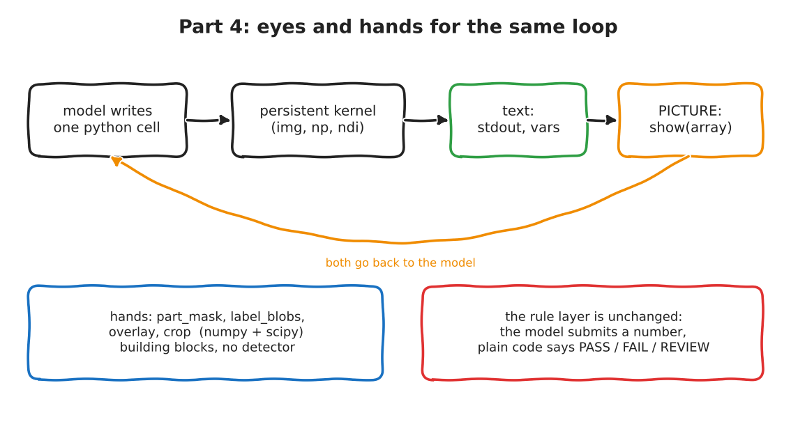

:::{.callout-tip}
This post is part of the [SpatialClaw for Inspection](index.qmd) series. It extends the loop from
[Part 3](03-minimal-kernel-loop.qmd). All code below is my own, written from the paper's description.
:::

:::{.callout-note}
**What was run.** The tests (13 checks against the real kernel, scripted stand-in model) and the three set-ups
below ran for real: the same 12 images of the **DEV** split of my
[synthetic defect dataset, v2](../agentic-factory-segmentation/01-synthetic-void-dataset.qmd#version-2-what-was-wrong-with-v1-and-how-i-fixed-it),
local `Qwen3.8-27B` (FP8, vLLM), thinking off, temperature 0.3, one 14-turn budget. Every set-up was run **twice**, to
see how much the numbers move by themselves. The held-out test split is **not touched**.
:::

Part 3 ended with a loop that works and a model that is nearly blind: it only saw what it chose to `print()`.
SpatialClaw's answer to that is `show()`, a function that puts a picture in front of the model. This post builds
`show()` and a small tool API, and then asks the question that matters for a production decision: **does looking
(and having tools) make the measurement better than simply giving the same text-only agent more turns?**

```{=html}
<div style="margin:1em 0;">
  <button id="toggle-outputs" type="button" style="padding:6px 14px;border:1px solid #1971c2;border-radius:4px;background:#1971c2;color:white;cursor:pointer;">Show all outputs</button>
  <span style="color:#666;font-size:0.9em;margin-left:8px;">Outputs are collapsed by default. Each one is the real captured output of the code above it.</span>
</div>
<script>
(function(){
  var b = document.getElementById("toggle-outputs"), open = false;
  b.onclick = function(){
    open = !open;
    document.querySelectorAll("details.out").forEach(function(d){ d.open = open; });
    b.textContent = open ? "Hide all outputs" : "Show all outputs";
  };
})();
</script>
```

## The result first

Same 12 images as Part 3, 14 turns allowed, **each set-up run twice**. Ground truth is the exact void ratio from the mask.

| 24 episodes per set-up (12 images x 2 runs) | A: text only | B: + `show()` | C: + `show()` + tools | "Always PASS" |
|---|---|---|---|---|
| Median absolute error of the void ratio | 0.21 pp | 0.25 pp | **0.16 pp** | n/a |
| 90th-percentile absolute error | 1.62 pp | 2.80 pp | **0.99 pp** | n/a |
| Mean absolute error | **0.71 pp** | 0.90 pp | 1.44 pp | n/a |
| Verdicts that match ground truth | 19 of 24 | 17 of 24 | 19 of 24 | 18 of 24 |
| False PASS (a real FAIL called PASS) | 2 | 2 | 2 | 6 |
| False FAIL | 2 | 4 | 3 | 0 |
| Ended in REVIEW | 1 | 1 | 0 | n/a |
| Mean turns used (of 14) | 11.2 | 8.0 | **7.2** | n/a |
| Mean tokens per image | 41,491 | 24,750 | **23,444** | n/a |

Three things I am willing to say, and one I am not.

1. **Run-to-run noise is as large as the differences between set-ups.** Run the very same set-up twice on the
   very same 12 images and the verdict changes on 3 to 5 of them. Condition C scored a mean error of 2.63 pp in its
   first run and **0.26 pp** in its second. If I had run each set-up once, I could have written either "tools make it
   much worse" or "tools make it much better", and both would have been wrong.
2. **Budget was part of Part 3's problem.** Part 3's agent used the last or second-to-last of 8 turns on all 12
   images. Given 14 turns, text-only A used about 11 on average and submitted early on some images; it also ran out
   once (REVIEW), which is the safe outcome, not a guessed PASS.
3. **Looking plus tools (C) was the *efficient* condition, and its typical error was the lowest**: about 40 %
   fewer tokens than text-only A, and the lowest median and 90th-percentile error. `show()` alone (B) bought nothing I
   can measure.
4. **What I will not say: that C is more accurate.** Its verdict accuracy (19 of 24) equals A's, and one run of C
   submitted **28.99 %** for an image whose true value is 0.65 % (details below). One catastrophic number in 24
   episodes is exactly the kind of thing a production system is judged on, and 24 episodes cannot tell me how often it
   happens.

On raw verdict agreement, none of the three is clearly better than the trivial rule (19, 17 and 19 of 24 against
18 for "always PASS"). What all three agent set-ups do better is **false PASS**: 2 of 24 against 6, at the price
of 2 to 4 false alarms.

## What is new

{fig-alt="Hand-drawn loop: the model writes one python cell, the persistent kernel runs it, text (stdout and variables) and a picture from show() both go back to the model. Below: hands, the helper functions part_mask, label_blobs, overlay and crop; and the unchanged rule layer where the model submits a number and plain code says PASS, FAIL or REVIEW."}

Three additions, nothing else changed:

1. **`show(array, "title")`** saves a picture inside the kernel; the host attaches it to the next message.
2. **Four helper functions** (`part_mask`, `label_blobs`, `overlay`, `crop`): building blocks, **not a detector**.
   The model still has to decide which regions are voids and which are cracks or noise.
3. **Switches**, so each addition can be measured alone: A has neither, B has `show()`, C has both. The rule
   layer, the budget logic and the REVIEW path are the Part 3 code, imported unchanged.

## Two reading levels

**Explain like I'm five.** Last time the lab assistant worked with a blindfold: they could ask the computer
questions and read the answers aloud, but never look at the X-ray. Now they may take the blindfold off whenever
they ask for a picture, and they get a small toolbox: a stencil that outlines the part, a magnifier, a
highlighter pen. They still hand in one number, and the supervisor with the ruler still decides.

**Explain like I'm a data scientist.** The kernel gets a `show()` that writes a PNG (2x nearest-neighbour upscale,
at most two per turn). After each cell the host collects new PNGs and puts them into the next user message as
`image_url` parts next to the usual stdout, error and variable summary. The tool functions are plain
numpy/scipy, injected into the kernel as source text. A switch decides which names exist in the kernel at all, so
in condition A, `show` is a `NameError` the model has to read, not a hidden no-op.

## Jargon buster

| Term | What it means | Daily-life version |
|---|---|---|
| `show()` | Put a picture in front of the model. | Taking the blindfold off. |
| Tool API | A few named helper functions the model can call. | A toolbox on the workbench. |
| Ablation | Switch one feature on or off to see what it was worth. | Taking one ingredient out of a recipe and tasting again. |
| Condition (A, B, C) | One fixed set-up of the same experiment. | A, B and C are three versions of the same exam. |
| Run-to-run noise | The model gives different answers to the same question. | Asking the same person twice and getting two slightly different estimates. |
| Plausibility check | A rule that rejects numbers that cannot be right. | The cashier who stops when a coffee scans at 4,000 euros. |
| IoU | Overlap of two masks, 1 = identical. | How well two cookie cutters line up. |

## The code, from the real files

### The tool API that runs inside the kernel (`minimal_loop/kernel_tools.py`)

````{.python}
# minimal_loop/kernel_tools.py
"""Code that runs INSIDE the kernel (it is sent as text, then exec'd). Written for this series; numpy + scipy only.

show()  : lets the model look at an array. The host reads the saved PNG and attaches it to the next message.
The rest: a small inspection tool API (part_mask, label_blobs, overlay, crop). Primitives, not a detector:
the model still has to decide what counts as a void.
"""
import os as _os
import numpy as _np
import scipy.ndimage as _ndi
from PIL import Image as _Image

_SHOWN_DIR = "shown"
_n_shown = 0


def _to_uint8(x):
    x = _np.asarray(x)
    if x.dtype == bool:
        return (x * 255).astype(_np.uint8)
    if x.dtype != _np.uint8:
        x = x.astype(float)
        lo, hi = float(x.min()), float(x.max())
        x = (x - lo) / (hi - lo + 1e-9) * 255
        return x.astype(_np.uint8)
    return x


def show(x, title=""):
    """Look at an array: 2-D (grayscale) or H x W x 3 (RGB). Shown at 2x size. At most 2 images per turn."""
    global _n_shown
    a = _to_uint8(x)
    if a.ndim not in (2, 3) or (a.ndim == 3 and a.shape[2] != 3):
        raise ValueError(f"show() needs a 2-D or HxWx3 array, got shape {a.shape}")
    _os.makedirs(_SHOWN_DIR, exist_ok=True)
    _n_shown += 1
    h, w = a.shape[:2]
    _Image.fromarray(a).resize((w * 2, h * 2), _Image.NEAREST).save(f"{_SHOWN_DIR}/{_n_shown:03d}.png")
    with open(f"{_SHOWN_DIR}/{_n_shown:03d}.txt", "w") as f:
        f.write(str(title)[:80])
    print(f"[show #{_n_shown}] {str(title)[:80]}  (shape {tuple(a.shape)})")


def part_mask(image):
    """Boolean silhouette of the part (holes filled). Assumes the part is DARKER than the background (Otsu threshold)."""
    g = _np.asarray(image, dtype=float)
    hist, edges = _np.histogram(g, bins=64, range=(0, 255))
    p = hist / hist.sum()
    c = (edges[:-1] + edges[1:]) / 2
    w0, w1 = _np.cumsum(p), 1 - _np.cumsum(p)
    m0 = _np.cumsum(p * c) / _np.maximum(w0, 1e-9)
    m1 = (_np.sum(p * c) - _np.cumsum(p * c)) / _np.maximum(w1, 1e-9)
    t = c[_np.argmax(w0 * w1 * (m0 - m1) ** 2)]
    m = g < t
    lab, n = _ndi.label(m)
    if n == 0:
        return m
    sizes = _ndi.sum(m, lab, range(1, n + 1))
    return _ndi.binary_fill_holes(lab == (1 + int(_np.argmax(sizes))))


def label_blobs(mask, min_area=3):
    """Connected components of a boolean mask. Returns (label_image, list of dicts), biggest first.
    Each dict: id, area (pixels), cy, cx, bbox (y0, x0, y1, x1), elongation (1 = round, large = line-like)."""
    lab, n = _ndi.label(mask)
    out = []
    for i, sl in enumerate(_ndi.find_objects(lab), start=1):
        ys, xs = _np.nonzero(lab[sl] == i)
        if len(ys) < min_area:
            continue
        ys, xs = ys + sl[0].start, xs + sl[1].start
        ev = _np.linalg.eigvalsh(_np.cov(_np.vstack([ys, xs]))) if len(ys) > 2 else _np.array([1.0, 1.0])
        out.append(dict(id=i, area=int(len(ys)), cy=round(float(ys.mean()), 1), cx=round(float(xs.mean()), 1),
                        bbox=(int(ys.min()), int(xs.min()), int(ys.max()) + 1, int(xs.max()) + 1),
                        elongation=round(float(_np.sqrt(max(ev[1], 1e-9) / max(ev[0], 1e-9))), 2)))
    out.sort(key=lambda d: -d["area"])
    return lab, out


_COLORS = [(255, 60, 60), (60, 200, 60), (70, 120, 255), (255, 170, 0)]


def overlay(image, masks):
    """RGB picture: the grayscale image with the outline of each boolean mask in a colour. masks: list of masks."""
    rgb = _np.stack([_to_uint8(image)] * 3, axis=-1).copy()
    for k, m in enumerate(masks):
        edge = _np.asarray(m, dtype=bool) & ~_ndi.binary_erosion(_np.asarray(m, dtype=bool))
        rgb[edge] = _COLORS[k % len(_COLORS)]
    return rgb


def crop(image, cy, cx, r=24, zoom=4):
    """A (2r x 2r) window centred on (cy, cx), enlarged by `zoom`. Pass the result to show()."""
    y0, x0 = max(0, int(cy) - r), max(0, int(cx) - r)
    w = _np.asarray(image)[y0:int(cy) + r, x0:int(cx) + r]
    return _np.kron(w, _np.ones((zoom, zoom) + (1,) * (w.ndim - 2), dtype=w.dtype))
````

### The session and the loop (`session4.py`, `loop4.py`)

`Session4` subclasses Part 3's `KernelSession` (that file is untouched), loads the tool source, and removes the
names a condition does not offer. `run_episode4` is the Part 3 loop with one change: feedback may carry pictures.

````{.python}
# minimal_loop/session4.py
"""Part 4: the Part 3 kernel plus show() and the inspection tool API. Subclass, so Part 3's file is untouched."""
import base64
from pathlib import Path

from kernel_session import CellResult, KernelSession

_TOOLS_SRC = (Path(__file__).parent / "kernel_tools.py").read_text()


class Session4(KernelSession):
    def __init__(self, image, timeout_sec: int = 60, with_show: bool = False, with_tools: bool = False):
        super().__init__(image, timeout_sec=timeout_sec)
        self.with_show = with_show
        self._seen = set()
        if with_show or with_tools:
            # one exec: the module source, then drop the names the condition does not offer
            drop = []
            if not with_show:
                drop.append("show")
            if not with_tools:
                drop += ["part_mask", "label_blobs", "overlay", "crop"]
            out, err, _, _ = self._exec(_TOOLS_SRC + "\n" + "".join(f"del {n}\n" for n in drop)
                                        + "_BASE |= set(globals())\n", 30)
            assert not err, err

    def run(self, code: str) -> CellResult:
        res = super().run(code)
        res.images = self._collect_images()
        return res

    def _collect_images(self, max_images: int = 2):
        """New PNGs written by show() since the last cell, as (title, data-URL). The extra ones are dropped, and said so."""
        shown = Path(self.workdir.name) / "shown"
        out = []
        for p in sorted(shown.glob("*.png")) if shown.exists() else []:
            if p.name in self._seen:
                continue
            self._seen.add(p.name)
            if len(out) < max_images:
                title = p.with_suffix(".txt").read_text() if p.with_suffix(".txt").exists() else ""
                out.append((title, "data:image/png;base64," + base64.b64encode(p.read_bytes()).decode()))
        return out
````

````{.python}
# minimal_loop/loop4.py
"""Part 4: the Part 3 loop with eyes (show) and hands (inspection tools), switchable so each can be measured alone.

Reuses Part 3's rule layer (`decide`, `Verdict`), block parser and model client unchanged. Only the episode loop is new,
because feedback can now carry images.
"""
import time

from loop import LIMIT_PCT, SYSTEM, _BLOCK, Episode, decide, openai_chat  # noqa: F401  (openai_chat re-exported)
from session4 import Session4

SHOW_DOC = """
- `show(array, "title")` lets you LOOK at a 2-D (grayscale) or HxWx3 (RGB) array. The picture arrives with the next
  message, at 2x size. At most 2 pictures per turn. Use it to check what your masks really cover."""

TOOLS_DOC = """
Helper functions already defined in the notebook (numpy + scipy only):
- `part_mask(image)` -> bool silhouette of the part (assumes the part is darker than the background).
- `label_blobs(mask, min_area=3)` -> (label_image, blobs). Each blob is a dict with id, area (pixels), cy, cx,
  bbox (y0, x0, y1, x1) and elongation (about 1 = round, large = line-like). Biggest first.
- `overlay(image, [mask1, mask2])` -> RGB picture with the outlines of the masks (red, green, ...), for show().
- `crop(image, cy, cx, r=24, zoom=4)` -> an enlarged window around a point, for show().
These are building blocks. Deciding which regions are voids, and which are cracks or noise, is your job."""


def system_prompt(with_show: bool, with_tools: bool) -> str:
    return SYSTEM + (SHOW_DOC if with_show else "") + (TOOLS_DOC if with_tools else "")


def _content(res, steps_left: int, with_show: bool):
    """Feedback message: text, plus the pictures show() produced this turn (as image parts)."""
    parts = []
    out = res.stdout.strip()
    if out:
        parts.append("stdout:\n" + (out if len(out) <= 1500 else out[:1500] + "\n...[truncated]"))
    if res.error:
        parts.append("error:\n" + res.error)
    if res.variables:
        parts.append("variables: " + "; ".join(f"{k}: {v}" for k, v in list(res.variables.items())[:25]))
    if not parts:
        parts.append("(no output)")
    imgs = getattr(res, "images", [])
    if imgs:
        parts.append("pictures attached: " + "; ".join(t or "(untitled)" for t, _ in imgs))
    parts.append(f"turns left: {steps_left}")
    text = "\n".join(parts)
    if not (with_show and imgs):
        return text
    return [{"type": "text", "text": text}] + [{"type": "image_url", "image_url": {"url": u}} for _, u in imgs]


def run_episode4(image, question, chat, with_show=False, with_tools=False, max_steps=14, max_failures=4,
                 limit=LIMIT_PCT, cell_timeout=60) -> Episode:
    t0 = time.monotonic()
    ep = Episode(verdict=decide(None, limit, "not started"))
    messages = [{"role": "system", "content": system_prompt(with_show, with_tools)}, {"role": "user", "content": question}]
    failures, session = 0, Session4(image, timeout_sec=cell_timeout, with_show=with_show, with_tools=with_tools)
    sub, why_none = None, "out_of_steps"
    try:
        for step in range(1, max_steps + 1):
            ep.steps = step
            text, usage = chat(messages)
            ep.prompt_tokens += usage.get("prompt", 0)
            ep.completion_tokens += usage.get("completion", 0)
            messages.append({"role": "assistant", "content": text})
            m = _BLOCK.search(text)
            if not m:
                failures += 1
                ep.cells.append({"step": step, "purpose": text[:200], "code": "", "stdout": "", "error": "format: no python block", "images": []})
                messages.append({"role": "user", "content": "Format error: reply with one 'Purpose:' line and exactly one ```python block."})
            else:
                res = session.run(m.group(1))
                imgs = getattr(res, "images", [])
                ep.cells.append({"step": step, "purpose": text.split("```")[0].strip()[:200], "code": m.group(1), "stdout": res.stdout[:2000],
                                 "error": res.error, "seconds": round(res.seconds, 2),
                                 "images": [{"title": t, "png": u} for t, u in imgs]})
                if res.error:
                    failures += 1
                if res.submission is not None:
                    sub = res.submission
                    break
                messages.append({"role": "user", "content": _content(res, max_steps - step, with_show)})
            if failures >= max_failures:
                why_none = "too_many_failures"
                break
    finally:
        session.close()
    ep.verdict = decide(sub, limit, why_none)
    ep.seconds = time.monotonic() - t0
    return ep
````

## Test first, with a scripted stand-in

The same pattern as Part 3: the "model" is a **scripted list of replies** (stand-in), the kernel, the tools, the
picture capture and the rule layer are real.

````{.python}
# minimal_loop/test_paths4.py
"""Tests for Part 4: show() and the tool API, against the REAL kernel.
STAND-IN: the 'model' is a scripted list of replies. REAL: kernel, tools, image capture, message building, rule layer.
Run:  .venv/bin/python -I minimal_loop/test_paths4.py
"""
import sys
from pathlib import Path

sys.path.insert(0, str(Path(__file__).parent))
import numpy as np
from loop4 import run_episode4

rng = np.random.default_rng(0)
IMG = np.full((40, 40), 230, np.uint8)
IMG[8:32, 8:32] = 70                      # dark square "part"
IMG[18:22, 18:22] = 130                   # a 4x4 lighter "void" (16 px)
IMG = IMG + rng.integers(0, 3, IMG.shape).astype(np.uint8)
SEEN = []


def scripted(*cells):
    it = iter(cells)
    def chat(messages):
        SEEN.append(messages[-1])
        c = next(it, "print('nothing left to say')")
        return f"Purpose: scripted step.\n```python\n{c}\n```", {"prompt": 10, "completion": 5}
    return chat


def check(name, ok, detail=""):
    print(f"{'ok  ' if ok else 'FAIL'} {name:52s} {detail}")
    assert ok, name


# 1. show() produces a picture that is attached to the NEXT message as an image part
SEEN.clear()
ep = run_episode4(IMG, "q", scripted("show(img, 'raw')", "submit(1.0)"), with_show=True)
last = SEEN[-1]["content"]
check("show: image part attached to next message", isinstance(last, list) and last[1]["type"] == "image_url", f"parts={[p['type'] for p in last]}")
check("show: data URL is a PNG", last[1]["image_url"]["url"].startswith("data:image/png;base64,"))
check("show: title travels in the text", "raw" in last[0]["text"])
check("show: trace keeps the picture", len(ep.cells[0]["images"]) == 1 and ep.cells[0]["images"][0]["title"] == "raw")

# 2. at most 2 pictures per turn
SEEN.clear()
ep = run_episode4(IMG, "q", scripted("show(img,'a'); show(img,'b'); show(img,'c')", "submit(1.0)"), with_show=True)
check("show: at most 2 pictures per turn", len(SEEN[-1]["content"]) == 3, f"parts={len(SEEN[-1]['content'])}")

# 3. conditions: without with_show the function does not exist; the model gets a plain NameError, never a crash
ep = run_episode4(IMG, "q", scripted("show(img)", "submit(1.0)"), with_show=False)
check("no-show condition: show() is a NameError", "NameError" in ep.cells[0]["error"], ep.cells[0]["error"].splitlines()[-1])
ep = run_episode4(IMG, "q", scripted("part_mask(img)", "submit(1.0)"), with_show=True, with_tools=False)
check("no-tools condition: part_mask is a NameError", "NameError" in ep.cells[0]["error"])

# 4. tools do what the doc says
code = ("pm = part_mask(img)\nprint('part px', int(pm.sum()))\n"
        "lab, bl = label_blobs((img > 100) & pm)\nprint(bl)\nsubmit(100*bl[0]['area']/pm.sum())")
ep = run_episode4(IMG, "q", scripted(code), with_show=True, with_tools=True)
check("tools: part_mask finds the 24x24 square", "part px 576" in ep.cells[0]["stdout"], ep.cells[0]["stdout"].splitlines()[0])
check("tools: label_blobs finds the 16 px void", "'area': 16" in ep.cells[0]["stdout"])
check("tools: submit uses them", ep.verdict.status == "FAIL" and abs(ep.verdict.void_ratio_pct - 100 * 16 / 576) < 1e-6, ep.verdict.reason)

# 5. overlay + crop feed show()
ep = run_episode4(IMG, "q", scripted("pm = part_mask(img)\nshow(overlay(img, [pm]), 'outline')\nshow(crop(img, 20, 20, r=8, zoom=3), 'zoom')", "submit(1.0)"),
                  with_show=True, with_tools=True)
check("overlay + crop produce 2 pictures", len(ep.cells[0]["images"]) == 2 and not ep.cells[0]["error"], ep.cells[0]["error"][-80:])

# 6. bad input is an error the model can read, not a crash
ep = run_episode4(IMG, "q", scripted("show(np.zeros((2,2,2,2)))", "submit(1.0)"), with_show=True)
check("show: bad shape is a readable error", "ValueError" in ep.cells[0]["error"])

# 7. the rule layer is unchanged: budget exhausted with pictures in play -> REVIEW
ep = run_episode4(IMG, "q", scripted("show(img)", "show(img)", "show(img)"), with_show=True, max_steps=3)
check("out of budget still -> REVIEW", ep.verdict.status == "REVIEW" and "out_of_steps" in ep.verdict.reason)
print("ALL PART-4 PATHS OK")
````

```{=html}
<details class="out">
<summary><strong>Show output</strong></summary>
```

```{.text}
ok   show: image part attached to next message            parts=['text', 'image_url']
ok   show: data URL is a PNG                              
ok   show: title travels in the text                      
ok   show: trace keeps the picture                        
ok   show: at most 2 pictures per turn                    parts=3
ok   no-show condition: show() is a NameError             NameError: name 'show' is not defined
ok   no-tools condition: part_mask is a NameError         
ok   tools: part_mask finds the 24x24 square              part px 576
ok   tools: label_blobs finds the 16 px void              
ok   tools: submit uses them                              rule: 2.78 > 1.50
ok   overlay + crop produce 2 pictures                    
ok   show: bad shape is a readable error                  
ok   out of budget still -> REVIEW                        
ALL PART-4 PATHS OK
```

```{=html}
</details>
```

## Check the tool before blaming the model

`part_mask` is the tool the agent will lean on most, so I scored it against the exact part masks of all 600 DEV
images **before** any agent run.

````{.python}
# minimal_loop/part_mask_check.py
"""How good is the part_mask() tool against the exact part masks of the DEV split? (Run before the agent runs.)"""
import sys
from pathlib import Path
import numpy as np
exec((Path(__file__).parent / "kernel_tools.py").read_text())
d = np.load(Path(__file__).resolve().parents[2] / "agentic-factory-segmentation/data/void_dataset_v2/val.npz")
iou = []
for i in range(600):
    gt = d["part_masks"][i] > 0
    pm = part_mask(d["images"][i])
    iou.append((pm & gt).sum() / (pm | gt).sum())
iou = np.array(iou)
print(f"part_mask vs exact part mask, 600 DEV images: mean IoU {iou.mean():.4f}, median {np.median(iou):.4f}, min {iou.min():.2f}")
print(f"images with IoU < 0.95: {(iou < 0.95).sum()} of 600 ({100*(iou<0.95).mean():.1f} %)")
print("first 12 images (the ones the agent sees): IoU", np.round(iou[:12], 3).tolist())
print("worst 3: val_%05d %.2f, val_%05d %.2f, val_%05d %.2f" % tuple(x for i in np.argsort(iou)[:3] for x in (i, iou[i])))
# the cause: the exact part mask has big through-holes (cut-outs); fill_holes closes them
import scipy.ndimage as ndi
def has_cutout(g):
    return ndi.binary_fill_holes(g).sum() - g.sum() > 200
gt_has_hole = np.array([has_cutout(d["part_masks"][i] > 0) for i in range(600)])
print(f"exact part masks with an enclosed hole of > 200 px (cut-out the silhouette does not include): {gt_has_hole.sum()} of 600")
print(f"  of the {(iou<0.95).sum()} low-IoU images, {(gt_has_hole & (iou<0.95)).sum()} have such a hole")
````

```{=html}
<details class="out">
<summary><strong>Show output</strong></summary>
```

```{.text}
part_mask vs exact part mask, 600 DEV images: mean IoU 0.9877, median 0.9994, min 0.57
images with IoU < 0.95: 52 of 600 (8.7 %)
first 12 images (the ones the agent sees): IoU [1.0, 0.966, 1.0, 0.902, 0.999, 0.998, 1.0, 1.0, 1.0, 0.998, 1.0, 1.0]
worst 3: val_00135 0.57, val_00092 0.73, val_00261 0.80
exact part masks with an enclosed hole of > 200 px (cut-out the silhouette does not include): 68 of 600
  of the 52 low-IoU images, 52 have such a hole
```

```{=html}
</details>
```

Mean overlap is very high, and the 52 low-overlap images all have one cause: the exact part mask contains a large
enclosed cut-out (a hole through the silhouette), and `part_mask` fills holes, so it counts the cut-out as part.
That is a **definition** mismatch, not noise, and it affects 8.7 % of DEV images. I left the tool as it is and
report this, instead of tuning it on the way to a better number.

## The real runs

````{.python}
# minimal_loop/run_dev4.py
"""Part 4 real run: the SAME 12 DEV images as Part 3, local Qwen3.8-27B (vLLM), one condition per invocation.

  A  no show(), no tools, 14 turns   (Part 3's setup with a bigger budget: isolates the budget)
  B  show(),    no tools, 14 turns   (adds eyes)
  C  show() + tools, 14 turns        (adds eyes and hands)

Ground truth is read only here, after the agent has finished. The held-out test split is not touched.
Run:  .venv/bin/python -I minimal_loop/run_dev4.py A|B|C [N] [tag]     (tag = 'r2' for the repeat run, same settings)
"""
import base64
import json
import sys
from pathlib import Path

sys.path.insert(0, str(Path(__file__).parent))
import numpy as np
from loop4 import LIMIT_PCT, openai_chat, run_episode4

COND = {"A": (False, False), "B": (True, False), "C": (True, True)}
cond = sys.argv[1]
N = int(sys.argv[2]) if len(sys.argv) > 2 else 12
TAG = sys.argv[3] if len(sys.argv) > 3 else ""
show, tools = COND[cond]
ROOT = Path(__file__).resolve().parents[1]
d = np.load(ROOT.parent / "agentic-factory-segmentation/data/void_dataset_v2/val.npz")
images, dmask, pmask = d["images"], d["defect_masks"], d["part_masks"]
imgdir = ROOT / f"out/part4_{cond}{TAG}_images"
imgdir.mkdir(parents=True, exist_ok=True)
chat = openai_chat(max_tokens=1500)
rows, traces = [], []
print(f"condition {cond}: show={show} tools={tools} max_steps=14")
print(f"{'image':10s} {'gt%':>6s} {'agent%':>7s} {'abs err':>8s} {'gt':>6s} {'agent':>6s} {'steps':>5s} {'tokens':>7s} {'sec':>6s}  reason")
for i in range(N):
    gt = 100.0 * float((dmask[i] == 1).sum()) / float(pmask[i].sum())
    ep = run_episode4(images[i], "Measure the void ratio of the part in `img` and submit it.", chat, with_show=show, with_tools=tools, max_steps=14)
    v = ep.verdict
    gt_status = "FAIL" if gt > LIMIT_PCT else "PASS"
    err = None if v.void_ratio_pct is None else abs(v.void_ratio_pct - gt)
    for c in ep.cells:                       # pictures to files, so the JSON stays small
        for k, im in enumerate(c.get("images", [])):
            fn = f"val_{i:05d}_s{c['step']:02d}_{k}.png"
            (imgdir / fn).write_bytes(base64.b64decode(im.pop("png").split(",", 1)[1]))
            im["file"] = fn
    rows.append(dict(image=f"val_{i:05d}", gt_pct=gt, agent_pct=v.void_ratio_pct, abs_err=err, gt_status=gt_status, agent_status=v.status,
                     steps=ep.steps, tokens=ep.prompt_tokens + ep.completion_tokens, seconds=ep.seconds, reason=v.reason,
                     pictures=sum(len(c.get("images", [])) for c in ep.cells)))
    traces.append(dict(image=f"val_{i:05d}", cells=ep.cells))
    r = rows[-1]
    print(f"{r['image']:10s} {gt:6.2f} {('-' if v.void_ratio_pct is None else f'{v.void_ratio_pct:.2f}'):>7s} "
          f"{('-' if err is None else f'{err:.2f}'):>8s} {gt_status:>6s} {v.status:>6s} {ep.steps:5d} {r['tokens']:7d} {ep.seconds:6.1f}  {v.reason}", flush=True)

done = [r for r in rows if r["abs_err"] is not None]
errs = np.array([r["abs_err"] for r in done]) if done else np.array([0.0])
print("\nSUMMARY condition %s (n=%d, DEV split, limit %.1f%%)" % (cond, len(rows), LIMIT_PCT))
print("  finished with a measurement:", len(done), "| REVIEW:", sum(r["agent_status"] == "REVIEW" for r in rows))
print("  mean abs error (pct points): %.2f | median: %.2f | max: %.2f" % (errs.mean(), np.median(errs), errs.max()))
print("  verdict agrees with ground truth:", sum(r["agent_status"] == r["gt_status"] for r in rows), "of", len(rows))
print("  FALSE PASS (gt FAIL, agent PASS):", sum(r["gt_status"] == "FAIL" and r["agent_status"] == "PASS" for r in rows),
      "| false FAIL:", sum(r["gt_status"] == "PASS" and r["agent_status"] == "FAIL" for r in rows))
print("  mean steps: %.1f | mean tokens: %d | mean seconds: %.1f | pictures shown: %d" % (
    np.mean([r["steps"] for r in rows]), np.mean([r["tokens"] for r in rows]), np.mean([r["seconds"] for r in rows]), sum(r["pictures"] for r in rows)))
json.dump(dict(cond=cond, limit_pct=LIMIT_PCT, max_steps=14, rows=rows, traces=traces), open(ROOT / f"out/run_dev4_{cond}{TAG}.json", "w"), indent=1)
````

```{=html}
<details class="out">
<summary><strong>Show output</strong></summary>
```

```{.text}
condition A: show=False tools=False max_steps=14
image         gt%  agent%  abs err     gt  agent steps  tokens    sec  reason
val_00000    1.62    1.57     0.05   FAIL   FAIL     6    9946   95.8  rule: 1.57 > 1.50
val_00001    0.61    0.14     0.46   PASS   PASS    13   61257  282.3  rule: 0.14 <= 1.50
val_00002    0.96    1.18     0.21   PASS   PASS     9   24732  169.3  rule: 1.18 <= 1.50
val_00003    0.65    0.45     0.20   PASS   PASS    12   29109  155.4  rule: 0.45 <= 1.50
val_00004    0.46       -        -   PASS REVIEW    14   58849  211.2  out_of_steps
val_00005    0.17    0.31     0.14   PASS   PASS    12   42070  213.3  rule: 0.31 <= 1.50
val_00006    0.49    0.47     0.02   PASS   PASS    14   46204  232.8  rule: 0.47 <= 1.50
val_00007    1.15    1.38     0.23   PASS   PASS    12   45642  135.9  rule: 1.38 <= 1.50
val_00008    5.02    2.12     2.90   FAIL   FAIL    10   29094  141.9  rule: 2.12 > 1.50
val_00009    1.38    0.19     1.20   PASS   PASS    14   62904  121.2  rule: 0.19 <= 1.50
val_00010    1.81    0.16     1.65   FAIL   PASS    11   47720  198.3  rule: 0.16 <= 1.50
val_00011    0.00    0.19     0.19   PASS   PASS    13   55406  206.8  rule: 0.19 <= 1.50

SUMMARY condition A (n=12, DEV split, limit 1.5%)
  finished with a measurement: 11 | REVIEW: 1
  mean abs error (pct points): 0.66 | median: 0.21 | max: 2.90
  verdict agrees with ground truth: 10 of 12
  FALSE PASS (gt FAIL, agent PASS): 1 | false FAIL: 0
  mean steps: 11.7 | mean tokens: 42744 | mean seconds: 180.4 | pictures shown: 0
```

```{=html}
</details>
```

```{=html}
<details class="out">
<summary><strong>Show output</strong></summary>
```

```{.text}
condition B: show=True tools=False max_steps=14
image         gt%  agent%  abs err     gt  agent steps  tokens    sec  reason
val_00000    1.62    1.37     0.25   FAIL   PASS     7   14572  101.1  rule: 1.37 <= 1.50
val_00001    0.61    4.33     3.72   PASS   FAIL    14   80115  283.8  rule: 4.33 > 1.50
val_00002    0.96    0.83     0.14   PASS   PASS     5    6849   57.6  rule: 0.83 <= 1.50
val_00003    0.65    0.45     0.20   PASS   PASS     9   19702  106.3  rule: 0.45 <= 1.50
val_00004    0.46    0.22     0.24   PASS   PASS     5    7047   71.1  rule: 0.22 <= 1.50
val_00005    0.17    0.00     0.17   PASS   PASS     6   10345   89.9  rule: 0.00 <= 1.50
val_00006    0.49    0.44     0.05   PASS   PASS    10   27115  156.3  rule: 0.44 <= 1.50
val_00007    1.15    0.92     0.23   PASS   PASS    11   35728  174.2  rule: 0.92 <= 1.50
val_00008    5.02    2.22     2.80   FAIL   FAIL     8   17886  105.3  rule: 2.22 > 1.50
val_00009    1.38    0.27     1.12   PASS   PASS     6    8294   68.6  rule: 0.27 <= 1.50
val_00010    1.81       -        -   FAIL REVIEW    14   95772  327.6  out_of_steps
val_00011    0.00    0.95     0.95   PASS   PASS     6    7966   44.2  rule: 0.95 <= 1.50

SUMMARY condition B (n=12, DEV split, limit 1.5%)
  finished with a measurement: 11 | REVIEW: 1
  mean abs error (pct points): 0.90 | median: 0.24 | max: 3.72
  verdict agrees with ground truth: 9 of 12
  FALSE PASS (gt FAIL, agent PASS): 1 | false FAIL: 1
  mean steps: 8.4 | mean tokens: 27615 | mean seconds: 132.2 | pictures shown: 64
```

```{=html}
</details>
```

```{=html}
<details class="out">
<summary><strong>Show output</strong></summary>
```

```{.text}
condition C: show=True tools=True max_steps=14
image         gt%  agent%  abs err     gt  agent steps  tokens    sec  reason
val_00000    1.62    1.44     0.18   FAIL   PASS    10   37868  178.4  rule: 1.44 <= 1.50
val_00001    0.61    0.49     0.12   PASS   PASS     6   18637   97.0  rule: 0.49 <= 1.50
val_00002    0.96    0.96     0.00   PASS   PASS     6   13786  105.2  rule: 0.96 <= 1.50
val_00003    0.65   28.99    28.34   PASS   FAIL    14   65576  182.3  rule: 28.99 > 1.50
val_00004    0.46    0.42     0.04   PASS   PASS     5   10999   42.0  rule: 0.42 <= 1.50
val_00005    0.17    0.00     0.17   PASS   PASS     8   25243  108.9  rule: 0.00 <= 1.50
val_00006    0.49    0.48     0.01   PASS   PASS     9   34860  144.2  rule: 0.48 <= 1.50
val_00007    1.15    1.50     0.35   PASS   FAIL     8   26032   79.3  rule: 1.50 > 1.50
val_00008    5.02    6.69     1.67   FAIL   FAIL     6   14652   68.4  rule: 6.69 > 1.50
val_00009    1.38    1.79     0.41   PASS   FAIL     9   31253  126.7  rule: 1.79 > 1.50
val_00010    1.81    1.59     0.22   FAIL   FAIL     9   39968  121.3  rule: 1.59 > 1.50
val_00011    0.00    0.00     0.00   PASS   PASS     4    8647   70.9  rule: 0.00 <= 1.50

SUMMARY condition C (n=12, DEV split, limit 1.5%)
  finished with a measurement: 12 | REVIEW: 0
  mean abs error (pct points): 2.63 | median: 0.18 | max: 28.34
  verdict agrees with ground truth: 8 of 12
  FALSE PASS (gt FAIL, agent PASS): 1 | false FAIL: 3
  mean steps: 7.8 | mean tokens: 27293 | mean seconds: 110.4 | pictures shown: 77
```

```{=html}
</details>
```

### The summary table, computed from the saved runs

````{.python}
# minimal_loop/summarize_part4.py
"""Part 4 summary: the same 12 DEV images under four set-ups. Reads only saved run files. Part 3's row is its saved run (8 turns)."""
import json
from pathlib import Path

import numpy as np

ROOT = Path(__file__).resolve().parents[1]
runs = {"P3 (text, 8 turns)": json.load(open(ROOT / "out/run_dev.json"))}
for c, name in (("A", "A (text, 14 turns)"), ("B", "B (+ show)"), ("C", "C (+ show + tools)")):
    runs[name] = json.load(open(ROOT / f"out/run_dev4_{c}.json"))
    runs[name.replace(")", ", run 2)")] = json.load(open(ROOT / f"out/run_dev4_{c}r2.json"))
LIM = 1.5


def stats(data):
    rows = data["rows"]
    mx = data.get("max_steps", 8)
    done = [r for r in rows if r["abs_err"] is not None]
    e = np.array([r["abs_err"] for r in done])
    return dict(n=len(rows), review=sum(r["agent_status"] == "REVIEW" for r in rows), mae=e.mean(), med=np.median(e), mx=e.max(),
                agree=sum(r["agent_status"] == r["gt_status"] for r in rows),
                fpass=sum(r["gt_status"] == "FAIL" and r["agent_status"] == "PASS" for r in rows),
                ffail=sum(r["gt_status"] == "PASS" and r["agent_status"] == "FAIL" for r in rows),
                steps=np.mean([r["steps"] for r in rows]), last=sum(r["steps"] >= mx - 1 for r in rows), tokens=np.mean([r["tokens"] for r in rows]),
                sec=np.mean([r["seconds"] for r in rows]), pics=sum(r.get("pictures", 0) for r in rows), big=sum(r["abs_err"] is not None and r["abs_err"] > 3 for r in rows))


gt = [r["gt_pct"] for r in runs["P3 (text, 8 turns)"]["rows"]]
print("12 DEV images val_00000..11, local Qwen3.8-27B, thinking off, temperature 0.3, ONE run per image per set-up\n")
print(f"{'set-up':28s} {'MAE pp':>7s} {'median':>7s} {'max':>6s} {'verdicts ok':>11s} {'false PASS':>10s} {'false FAIL':>10s} {'REVIEW':>6s} {'steps':>5s} {'last 2 turns':>12s} {'tokens':>7s} {'sec':>5s} {'pics':>5s} {'err>3pp':>7s}")
for name, data in runs.items():
    s = stats(data)
    print(f"{name:28s} {s['mae']:7.2f} {s['med']:7.2f} {s['mx']:6.2f} {s['agree']:>8d}/12 {s['fpass']:10d} {s['ffail']:10d} {s['review']:6d} {s['steps']:5.1f} {s['last']:>9d}/12 {s['tokens']:7.0f} {s['sec']:5.0f} {s['pics']:5d} {s['big']:7d}")
print(f"{'always PASS':28s} {'':7s} {'':7s} {'':6s} {sum(g <= LIM for g in gt):>8d}/12 {sum(g > LIM for g in gt):10d} {0:10d}")
print(f"{'constant 0.86 %':28s} {np.mean([abs(g - 0.86) for g in gt]):7.2f} {np.median([abs(g - 0.86) for g in gt]):7.2f}")
print("\nper image: gt %, then agent % (verdict) for each set-up")
names = list(runs)
print(f"{'image':10s} {'gt':>6s} " + " ".join(f"{n[:18]:>20s}" for n in names))
for i in range(12):
    cells = []
    for n in names:
        r = runs[n]["rows"][i]
        cells.append(f"{'-' if r['agent_pct'] is None else format(r['agent_pct'], '.2f'):>8s} ({r['agent_status']:6s}){r['steps']:3d}")
    print(f"val_{i:05d} {gt[i]:6.2f} " + " ".join(f"{c:>20s}" for c in cells))

print("\nrun-to-run noise: the SAME set-up run twice on the SAME 12 images")
for c, name in (("A", "A"), ("B", "B"), ("C", "C")):
    r1 = json.load(open(ROOT / f"out/run_dev4_{c}.json"))["rows"]
    r2 = json.load(open(ROOT / f"out/run_dev4_{c}r2.json"))["rows"]
    both = [(a["agent_pct"], b["agent_pct"]) for a, b in zip(r1, r2) if a["agent_pct"] is not None and b["agent_pct"] is not None]
    d = np.array([abs(x - y) for x, y in both])
    flips = sum(a["agent_status"] != b["agent_status"] for a, b in zip(r1, r2))
    print(f"  {name}: verdict changed between the two runs on {flips} of 12 images | median |difference| of the number {np.median(d):.2f} pp, mean {d.mean():.2f}, max {d.max():.2f} (n={len(d)})")

print("\npooled over both runs (24 episodes per set-up; 'always PASS' = 12 images x 2 for comparison)")
print(f"{'set-up':10s} {'MAE':>5s} {'median':>7s} {'p90':>6s} {'verdicts ok':>11s} {'false PASS':>10s} {'false FAIL':>10s} {'REVIEW':>6s} {'err>3pp':>7s} {'mean steps':>10s} {'mean tokens':>11s}")
for c in "ABC":
    rows = json.load(open(ROOT / f"out/run_dev4_{c}.json"))["rows"] + json.load(open(ROOT / f"out/run_dev4_{c}r2.json"))["rows"]
    e = np.array([r["abs_err"] for r in rows if r["abs_err"] is not None])
    print(f"{c:10s} {e.mean():5.2f} {np.median(e):7.2f} {np.percentile(e, 90):6.2f} {sum(r['agent_status'] == r['gt_status'] for r in rows):>8d}/24 "
          f"{sum(r['gt_status'] == 'FAIL' and r['agent_status'] == 'PASS' for r in rows):10d} {sum(r['gt_status'] == 'PASS' and r['agent_status'] == 'FAIL' for r in rows):10d} "
          f"{sum(r['agent_status'] == 'REVIEW' for r in rows):6d} {(e > 3).sum():7d} {np.mean([r['steps'] for r in rows]):10.1f} {np.mean([r['tokens'] for r in rows]):11.0f}")
print(f"{'always PASS':10s} {'':5s} {'':7s} {'':6s} {2 * sum(g <= LIM for g in gt):>8d}/24 {2 * sum(g > LIM for g in gt):10d} {0:10d}")
````

```{=html}
<details class="out">
<summary><strong>Show output</strong></summary>
```

```{.text}
12 DEV images val_00000..11, local Qwen3.8-27B, thinking off, temperature 0.3, ONE run per image per set-up

set-up                        MAE pp  median    max verdicts ok false PASS false FAIL REVIEW steps last 2 turns  tokens   sec  pics err>3pp
P3 (text, 8 turns)              0.67    0.26   2.84        9/12          1          2      0   7.8        12/12   17107    96     0       0
A (text, 14 turns)              0.66    0.21   2.90       10/12          1          0      1  11.7         5/12   42744   180     0       0
A (text, 14 turns, run 2)       0.77    0.30   4.33        9/12          1          2      0  10.8         2/12   40238   190     0       1
B (+ show)                      0.90    0.24   3.72        9/12          1          1      1   8.4         2/12   27616   132    64       1
B (+ show, run 2)               0.91    0.75   2.80        8/12          1          3      0   7.7         0/12   21885   111    56       0
C (+ show + tools)              2.63    0.18  28.34        8/12          1          3      0   7.8         1/12   27293   110    77       1
C (+ show + tools, run 2)       0.26    0.13   1.09       11/12          1          0      0   6.6         0/12   19595    91    68       0
always PASS                                                9/12          3          0
constant 0.86 %                 0.80    0.46

per image: gt %, then agent % (verdict) for each set-up
image          gt   P3 (text, 8 turns)   A (text, 14 turns)   A (text, 14 turns,           B (+ show)    B (+ show, run 2)   C (+ show + tools)   C (+ show + tools,
val_00000   1.62     1.56 (FAIL  )  8     1.57 (FAIL  )  6     1.69 (FAIL  )  9     1.37 (PASS  )  7     1.37 (PASS  )  6     1.44 (PASS  ) 10     1.55 (FAIL  )  5
val_00001   0.61     0.36 (PASS  )  8     0.14 (PASS  ) 13     0.60 (PASS  ) 12     4.33 (FAIL  ) 14     3.38 (FAIL  )  7     0.49 (PASS  )  6     0.56 (PASS  )  9
val_00002   0.96     1.67 (FAIL  )  8     1.18 (PASS  )  9     0.81 (PASS  ) 11     0.83 (PASS  )  5     0.83 (PASS  )  5     0.96 (PASS  )  6     0.71 (PASS  )  5
val_00003   0.65     0.38 (PASS  )  8     0.45 (PASS  ) 12     0.70 (PASS  ) 14     0.45 (PASS  )  9     1.59 (FAIL  ) 12    28.99 (FAIL  ) 14     0.48 (PASS  ) 10
val_00004   0.46     0.45 (PASS  )  8        - (REVIEW) 14     0.34 (PASS  )  9     0.22 (PASS  )  5     0.22 (PASS  )  5     0.42 (PASS  )  5     0.44 (PASS  )  9
val_00005   0.17     1.66 (FAIL  )  7     0.31 (PASS  ) 12     1.66 (FAIL  ) 10     0.00 (PASS  )  6     0.09 (PASS  )  9     0.00 (PASS  )  8     0.07 (PASS  )  7
val_00006   0.49     0.27 (PASS  )  8     0.47 (PASS  ) 14     0.48 (PASS  ) 12     0.44 (PASS  ) 10     0.44 (PASS  )  8     0.48 (PASS  )  9     0.47 (PASS  )  4
val_00007   1.15     1.16 (PASS  )  8     1.38 (PASS  ) 12     0.13 (PASS  ) 14     0.92 (PASS  ) 11     0.43 (PASS  ) 11     1.50 (FAIL  )  8     0.99 (PASS  )  5
val_00008   5.02     2.18 (FAIL  )  8     2.12 (FAIL  ) 10     0.69 (PASS  )  6     2.22 (FAIL  )  8     2.22 (FAIL  )  6     6.69 (FAIL  )  6     4.25 (FAIL  )  5
val_00009   1.38     0.04 (PASS  )  8     0.19 (PASS  ) 14     1.83 (FAIL  ) 11     0.27 (PASS  )  6     2.54 (FAIL  )  9     1.79 (FAIL  )  9     0.30 (PASS  ) 10
val_00010   1.81     0.98 (PASS  )  7     0.16 (PASS  ) 11     2.65 (FAIL  ) 12        - (REVIEW) 14     2.60 (FAIL  ) 10     1.59 (FAIL  )  9     1.38 (PASS  )  5
val_00011   0.00     0.00 (PASS  )  7     0.19 (PASS  ) 13     0.66 (PASS  )  9     0.95 (PASS  )  6     0.95 (PASS  )  4     0.00 (PASS  )  4     0.00 (PASS  )  5

run-to-run noise: the SAME set-up run twice on the SAME 12 images
  A: verdict changed between the two runs on 5 of 12 images | median |difference| of the number 0.47 pp, mean 0.89, max 2.49 (n=11)
  B: verdict changed between the two runs on 3 of 12 images | median |difference| of the number 0.01 pp, mean 0.45, max 2.27 (n=11)
  C: verdict changed between the two runs on 5 of 12 images | median |difference| of the number 0.16 pp, mean 2.81, max 28.51 (n=12)

pooled over both runs (24 episodes per set-up; 'always PASS' = 12 images x 2 for comparison)
set-up       MAE  median    p90 verdicts ok false PASS false FAIL REVIEW err>3pp mean steps mean tokens
A           0.71    0.21   1.62       19/24          2          2      1       1       11.2       41491
B           0.90    0.25   2.80       17/24          2          4      1       1        8.0       24750
C           1.44    0.16   0.99       19/24          2          3      0       1        7.2       23444
always PASS                            18/24          6          0
```

```{=html}
</details>
```

### Step through what the agent did, and what it saw

Pick an image and a condition, then step through the cells. For B and C you also see the pictures the model was
shown on that turn. Everything is read from the saved first run.



## What the traces show

- **The pictures were used, not ignored.** In condition B the model called `show()` in 60 of its 101 cells, in C in
  58 of 94 (first runs). It checked masks with `overlay`, zoomed with `crop`, and once caught its own mistake: in
  `val_00001` (B) it printed a patch, saw values around 30 to 50, and wrote in a code comment *"Wait - the part is DARK (values
  ~30-50) and background is BRIGHT (~220-255)! I had it backwards!"* That is the case for `show()`: a picture catches an assumption a number does not.
- **But seeing did not stop the blunders.** Right after that rescue, the same episode computed 4.33 % (true 0.61 %)
  because a 1,227 px region that the model itself called "the background hole, NOT a void" stayed in the sum
  (the exact mask of that image has an enclosed cut-out of about 1,080 px, the same thing as in the section above). The agent noticed, wrote the right sentence in a code comment, and the
  code did not do what the comment said.
- **The 28.99 % in C, first run, `val_00003`.** An 8,583 px region (29 % of the part) was labelled "VOID" by a
  threshold on local contrast. The image also has a 2,805 px enclosed cut-out that `part_mask` counts as part, and
  in turn 13 the model itself wondered whether the region was "a gradient artifact". In turn 12 the model overlaid it and wrote
  *"confirm they are the small round voids, not the whole part"*; in turn 13 it printed that 31.7 % of the part
  was above its threshold, which is a clear warning; in turn 14, its last turn, it submitted the number anyway.
  The rule layer did exactly what it should: 28.99 > 1.5, FAIL. Here a wrong number happened to land on the safe side
  of the limit. A wrong number can also land on the unsafe side. **A plausibility check in the rule layer** (a
  measurement far outside anything seen on good parts goes to REVIEW, not FAIL or PASS) is the obvious guard, and it
  belongs in Part 7. I did not add it here, and I did not retro-fit it to these runs.
- **Hard images stay hard.** `val_00008` (three real voids, true 5.02 %) was under-measured in all five runs without tools
  (0.69 to 2.22 %, including Part 3's), and measured 6.69 % and 4.25 % in the two C runs. It is the one image where
  tools clearly helped, and it is one image.
- **Fewer turns, same verdicts.** C used 7.2 turns on average over both runs, A used 11.2. My reading, not tested
  separately: with a ready `part_mask` and `label_blobs`, the first turns of Part 3 (find the part, label the blobs)
  collapse into one call.

## Where this differs from the paper

- Still no planner, no reflection gate, no benchmark harness. A text-and-picture model with thinking **switched off**.
- The paper's `show()` and tools are for 3D spatial tasks (segmentation, depth). My tool API is four 2-D
  building blocks for this one measurement, and I wrote them without reading any upstream tool code.
- 12 images, 2 runs per set-up, temperature 0.3. That supports a direction, not a ranking.

## What I did not do

- **No claim that eyes or tools do not help in general.** This is one model, one prompt, 12 images of a synthetic
  dataset, with a tool API I wrote in one sitting. A better prompt or a better tool could change the picture.
- **No tuning on the held-out split** (it is untouched) and **no prompt tuning** between the runs.
- **No sandbox yet.** `show()` writes files and the tools are more code the model can call; the kernel still runs
  as my user. Part 5 is the container.

## Next

[Part 5](index.qmd#roadmap) puts the kernel in a real sandbox (`docker run --network none`, read-only filesystem,
scratch directory) and then tries to break it. After that, Part 6 is the experiment this series has been building
towards, on the held-out split, with a plain tool-call agent as the opponent.
